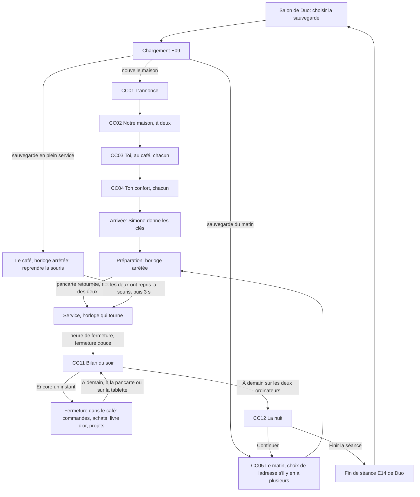

# Cosy Café: parcours, écrans, HUD et contrôles

| Champ | Valeur |
|---|---|
| Statut | proposition de ux-ui-designer, maquettes basse fidélité à valider par le manager; deviendra les sections 5 (contrôles) et 9 (interface et HUD) du cahier des charges |
| Version | 0.1 |
| Date | 2026-11-07 |
| Rédigé par | ux-ui-designer |
| Sources | `docs/jeux/cosy-cafe/cadrage.md`; `docs/plateforme/cahier-des-charges.md` (F05, F06, F10); `docs/plateforme/ux/parcours.md`; `docs/plateforme/identite-visuelle.md` et `design/identite/b/`; `docs/jeux/cosy-cafe/technique.md` (sections 2.2 à 2.5, 5.5 à 5.8, 6.2, 11); `docs/jeux/cosy-cafe/son.md` (8.5.20, 8.6); `docs/jeux/cosy-cafe/simulations/cosy_cafe.py` (réglages, adresses, recettes); section 5 de `docs/jeux/jeu-1/cahier-des-charges.md` |
| Maquettes | `design/maquettes/cosy-cafe/`: `hud.html` (20 états), `tablette.html` (12), `ardoise.html` (5), `bilan.html` (7); 89 captures dans `captures/`, planche `planche.png`, contrôle des daltonismes `captures/controle-daltonisme-hud.png` |
| Vérifications | `node design/maquettes/cosy-cafe/outils/verifier.cjs` (mise en page, contrastes, parcours au clavier), `node design/maquettes/cosy-cafe/outils/capturer.cjs` (captures et planche); résultats en section 12 |

## En bref

1. **Le monde d'abord.** Ce qui se passe se lit dans le café (tasse qui se remplit, thermomètre du pichet, cadran du four, pancarte, rail); le HUD ne garde que ce que la vue subjective cache: l'heure, tes tickets, ce que tu tiens, où est l'autre, les alertes douces.
2. **Le bas de l'écran reste aux mains et au plan de travail** (technique, 2.3): tickets et horloge en haut à gauche, alertes au centre en haut, l'autre en haut à droite, « En main » seul dans le coin bas droit.
3. **La caméra ne bouge jamais sans le joueur** (C22). Ardoise, tablette, livre d'or, bilan et propositions s'ouvrent **par-dessus** la vue, qui reste immobile; un changement de lieu se fait par un fondu.
4. **Deux familles d'interfaces dans le monde**: les postes rapides (caisse, rail, machine, four, plonge) s'utilisent sans lâcher la souris; les interfaces posées (ardoise, tablette, livre d'or, bilan, détail d'une proposition) rendent le curseur et se ferment par leur touche, par Retour arrière ou d'un clic à côté, jamais par Échap (C19, C20). Le café continue derrière.
5. **Échap, c'est toujours la pause de Duo.** Pointeur verrouillé, Chromium avale cet Échap: le SDK le change en demande de pause (technique, 2.2). Au retour, une capsule « Clique pour reprendre la souris » paraît; ce clic, ou Entrée, n'agit pas dans le café.
6. **L'accord des deux** pour ouvrir le café (« On ouvre ? »), fermer plus tôt, un gros achat (300 € au moins, EC-05), une embauche, renommer la maison ou déménager: un seul composant, la proposition, qui ne vole jamais le focus (Entrée l'ouvre). La journée finit quand les deux ont dit « À demain » au bilan du soir (TE-05).
7. **Gestes lisibles sans interface envahissante**: un anneau ou un arc autour du point de visée, seulement pendant le geste, avec la zone visée marquée par sa forme et un mot; « gestes simplifiés » propres à chaque joueur, invisibles et inaudibles pour l'autre.
8. **Le bilan du soir commence par le livre d'or**, puis ce qu'on retient (habitués, ce qui a plu, ce qui a manqué), puis les chiffres, puis demain, et finit sur « À demain » ou « Encore un instant ». Rien ne compare les deux joueurs.
9. **Confort**: champ de vision réglable (50 à 75° à la verticale, montré à l'horizontale), balancement de tête coupé par défaut, sensibilité et inversion de la souris, aide à viser qui ne tourne jamais la caméra, repères visuels des sons importants, écritures à la main remplaçables, « Réduire les animations » de Duo respecté.
10. **Contrôles**: Z Q S D et flèches pour marcher, souris pour regarder, E (ou Espace) et clic gauche pour agir, R et clic droit pour reposer, ranger ou lâcher (sens du cahier, 5.1), Tab pour la tablette, B pour aménager (A ou molette pour tourner), G pour faire signe; rangée des chiffres jamais utilisée.

## 0. Conventions

### 0.1 Exemples

Comme dans les documents de la plateforme: **Camille** (toi, le Mac, profil Duo « astre aqua ») et **Sacha** (le PC, « croissant mauve »). La maison s'appelle **La Tasse Bleue** (nom choisi par les joueurs). Les noms du monde suivent la simulation du game designer quand elle en donne: **Ormeval**, la place du Tilleul, **Simone** (l'ancienne patronne), **Bastien** (habitué); Lucette et Nora (habituées), Joëlle (laitière), le Fournil Morel et la Torréfaction Lamy sont des exemples de ce document, à remplacer par ceux du game designer. Les prix sont les prix conseillés de la simulation.

### 0.2 Ton et rédaction neutre

- Tutoiement pour chaque joueur, « vous » pour les deux. Les textes vivent dans un seul fichier de textes du jeu.
- Le genre des joueurs n'est pas connu (règle de la plateforme, `parcours.md`, 0.2): participes avec « avoir » (« Sacha a fermé à clé »), jamais avec « être » pour un joueur; « Sacha est à la plonge » (un lieu) est neutre, « Sacha est prête » ne l'est pas. On écrit « Trop lourd pour une seule personne », « C'est parti », « Fait une pause depuis 1 min ».
- **Règle pour les répliques des personnages** (game-designer): un personnage s'adresse aux joueurs par leur prénom ou par « vous », sans adjectif ni participe qui s'accorde (« Alors c'est vous ! », « Merci, Camille ! », pas « Vous êtes les nouveaux patrons »). Les personnages eux-mêmes ont leur genre.
- **L'annonce du début** (cadrage, 4.13) « Café de la place cherche repreneurs » désigne les futurs joueurs au masculin: proposition neutre et naturelle, « **Café de la place à reprendre** ».
- Une erreur ou un refus dit ce qui se passe et quoi faire (« Plus de tasse propre ici. Il y en a dans le lave-vaisselle, à la plonge. »). Aucun texte ne gronde: le jeu n'a pas d'échec.
- Les objets s'accordent normalement; un statut de produit reste invariable comme dans les boutiques (« Épuisé »).

### 0.3 Typographie de l'interface

Celle de la plateforme (`parcours.md`, 0.3): espace insécable avant « : » et dans les guillemets « », espace fine insécable avant « ; ! ? % » et entre les milliers (« 1 482 € »), espace insécable dans « 4,20 € », « 58 °C », « 11 h 20 », « 2 min ». Apostrophe typographique, points de suspension en un caractère, jamais de tiret cadratin ni demi-cadratin. Les textes de ce document sont écrits avec des espaces ordinaires; les maquettes portent les vraies (`outils/typographier.py`, qui ajoute aux règles de la plateforme les euros, les degrés, les milliers et le « + » devant un nombre).

### 0.4 Les deux joueurs à l'écran

- Chaque joueur garde sa couleur **et** son symbole de profil Duo (`design/identite/b/joueurs.json`), transmis par le SDK: jeton (symbole dans sa couleur sur un disque de nuit cerclé d'encre) sur les tickets pris, les cartes du HUD, les verrous à deux, les repères; tablier à la couleur du joueur par défaut. La couleur n'est jamais seule: le symbole et le prénom l'accompagnent toujours.
- Sur les écrans de choix à deux (création, matin, nuit), toi à gauche, l'autre à droite (règle de Duo).
- **Rien ne compare les deux joueurs** (cadrage, 5): aucun compteur par joueur, aucun « meilleur barista », aucune qualité de geste montrée à l'autre.

### 0.5 Principes de l'interface en vue subjective

| # | Principe | Conséquence |
|---|---|---|
| P1 | Le monde d'abord | une information du monde ne passe dans le HUD que si la vue subjective la cache (derrière soi, trop petite, déjà passée) |
| P2 | La caméra ne bouge jamais sans le joueur (C22) | aucun cadrage imposé, aucune cinématique, aucune aide à viser qui tourne la vue; fondu enchaîné pour changer de lieu |
| P3 | Le bas de l'écran reste aux mains et au plan de travail | rien au centre bas pendant le service; seul « En main » dans le coin bas droit |
| P4 | Tout texte qui compte se lit aussi à la taille de l'interface | un ticket, l'ardoise, le livre d'or ont une lecture dans le HUD ou une interface posée (section 3.4) |
| P5 | Rien ne vole le focus | une proposition ou une alerte n'interrompt jamais ce que tu fais: Entrée va la chercher |
| P6 | Échap appartient à Duo (C19) | une interface du jeu se ferme par sa touche, par Retour arrière ou d'un clic à côté |
| P7 | Le café ne s'arrête pas pour un menu | ouvrir la tablette ou l'ardoise pendant le service n'arrête pas l'horloge (seule la pause de Duo l'arrête) |
| P8 | Aucune punition | aucun geste raté, aucune perte; un refus est doux, dit pourquoi et quoi faire |

## 1. Parcours

### 1.1 Vue d'ensemble



À tout moment: Échap ouvre la pause de Duo (E11) sur les deux ordinateurs; « Retour au salon » y finit la séance, avec l'état exact du moment. Une coupure ouvre E12 (section 2.4).

### 1.2 Depuis le salon de Duo

| Étape | Écran | Ce que fournit le jeu |
|---|---|---|
| 1 | E08 Salon (Duo) | trois emplacements de sauvegarde, une maison par emplacement (technique, 6.3). Libellé (40 caractères au plus): « La Tasse Bleue · jour 9 · Ormeval »; au-delà de 40, on retire d'abord « · lieu », puis on raccourcit le nom de la maison avec « … ». « Nouvelle partie » ouvre une nouvelle maison |
| 2 | E08, aide de sauvegarde | « Le jeu enregistre toutes les 2 minutes, à chaque pause et à la fin de chaque journée. » |
| 3 | E09 Chargement (Duo) | rappel des commandes, trois lignes: « Z Q S D : marcher · souris : regarder » · « E ou clic : agir · Tab : tablette » · « Échap : pause » (libellés selon le clavier réel) |
| 4 | jeu | sauvegarde de fin de journée: CC05 Le matin. Nouvelle maison: CC01. Sauvegarde faite en plein service: le café, horloge arrêtée (1.3) |

### 1.3 Reprendre une journée en cours

La sauvegarde automatique (toutes les 2 minutes) permet de reprendre en plein service (C23). On ne doit pas tomber au milieu du coup de feu sans avoir la main:

1. Le jeu s'ouvre dans le café, l'horloge arrêtée, clients figés; capsule « Clique pour reprendre la souris » au centre (le pointeur n'est pas encore verrouillé).
2. Carte de l'horloge: « 11 h 20 » avec l'icône de pause et « L'horloge repart quand vous avez repris la souris ». La carte de l'autre montre « Pas encore la main » tant qu'il n'a pas cliqué.
3. Quand les deux ont repris la souris: « Le service reprend dans 3 », un chiffre par seconde (réglage `decompteReprise` de la simulation, 3 s), puis l'horloge repart. Avec « Réduire les animations », seul le chiffre change.

### 1.4 Première fois: une nouvelle maison

| # | Écran | Ce que voient et font les joueurs | Focus par défaut | Attente de l'autre |
|---|---|---|---|---|
| 1 | CC01 L'annonce | une affichette sur la vitrine, en surimpression sur la place du village à l'aube; trois lignes de récit | Continuer | chacun passe à son rythme; on attend l'autre à l'écran suivant |
| 2 | CC02 Notre maison (à deux) | nom de la maison, emblème, couleurs, avec l'enseigne qui se met à jour en direct; les deux peuvent modifier, chaque champ en cours d'écriture est verrouillé à la couleur de celui qui écrit | champ « Nom de la maison » | puces « C'est notre maison » ou « Pas encore »; tout changement remet les deux puces à « Pas encore » (même règle que le salon) |
| 3 | CC03 Toi, au café (chacun) | prénom (prérempli avec le pseudo Duo), silhouette, visage, teint, coiffure et couleur, tenue, tablier (couleur du profil par défaut), lunettes; aperçu de l'autre en petit, en direct | champ « Prénom », curseur à la fin | carte de l'autre: « Choisit sa coiffure… » puis « C'est parti » |
| 4 | CC04 Ton confort (chacun) | champ de vision, sensibilité de la souris (bouton « Essayer »), balancement de la tête, aide à viser, gestes simplifiés; aperçu du café derrière | C'est parti ! | « En attente de Sacha… » |
| 5 | Arrivée | fondu, puis le café vide, jour 1 (un lundi: le café ouvre le lendemain, TE-06). Simone accueille les joueurs sur le seuil; aucun mouvement de caméra imposé (C22): elle vient vers eux, on la regarde si on veut | le jeu | |

- Ordre voulu: la maison d'abord (une décision à deux, qui fait parler), puis chacun pour soi, puis le confort juste avant d'entrer dans la vue subjective.
- Ces écrans sont en 2D par-dessus la scène, curseur visible. Tab et Maj+Tab, flèches dans un groupe de choix, Entrée; Retour arrière revient à l'étape précédente hors d'un champ de texte; Échap reste la pause de Duo.
- Le clic sur « C'est parti ! » de CC04 sert aussi de geste pour verrouiller le pointeur à l'entrée dans le café (section 2.3).
- Silhouettes et visages sans nom genré (« Silhouette 1 » à « Silhouette 4 », vignettes). Aucun pronom demandé.

Règles de saisie de CC02: nom de 1 à 24 caractères; lettres accentuées, chiffres, espace, apostrophe, trait d'union, « & » et point; pas d'émoji (les polices doivent tout afficher). Douze emblèmes (tasse, théière, grain de café, feuille de thé, brioche, moulin à café, tilleul, abeille, mésange, chat, cerise, clé: aucun ne reprend un symbole de profil Duo) et huit paires de couleurs nommées, à dessiner par la direction artistique.

Textes:

| Écran | Élément | Texte |
|---|---|---|
| CC01 | affichette | Café de la place à reprendre |
| CC01 | affichette | Belle salle, clientèle fidèle, terrasse au soleil. S'adresser à Simone, à l'épicerie. |
| CC01 | récit | Vous avez lu l'annonce. Vous avez appelé. Ce matin, Simone vous attend avec les clés. |
| CC01 | bouton | Continuer |
| CC02 | titre | Notre maison |
| CC02 | texte | Le nom de votre café, sur l'enseigne, les tasses et le livre d'or. Vous le choisissez ensemble. |
| CC02 | champ | Nom de la maison · indicatif : Par exemple : La Tasse Bleue |
| CC02 | erreurs | Il faut un nom, même court. · Ce caractère ne peut pas s'écrire sur l'enseigne : lettres, chiffres, espaces, apostrophe, trait d'union, & et point seulement. |
| CC02 | verrou | Sacha écrit le nom… |
| CC02 | groupes | Emblème · Couleurs |
| CC02 | bouton | C'est notre maison ! (après appui : Pas encore) |
| CC02 | puces | C'est notre maison · Pas encore |
| CC02 | aide | Vous continuez quand vous avez choisi « C'est notre maison ! » sur les deux ordinateurs. Un changement remet tout le monde à « Pas encore ». |
| CC02 | aide | Vous pourrez la renommer plus tard, sur la tablette, d'un commun accord. |
| CC03 | titre | Toi, au café |
| CC03 | texte | Chacun crée son personnage sur son ordinateur, en même temps. Sacha voit le tien. |
| CC03 | champ | Prénom · aide : Les habitués t'appelleront ainsi. 16 caractères au plus. |
| CC03 | groupes | Silhouette · Visage · Teint · Coiffure · Couleur des cheveux · Tenue · Tablier · Lunettes |
| CC03 | tablier | Couleur de ton profil Duo : astre aqua |
| CC03 | autre | Sacha · Choisit sa coiffure… |
| CC03 | bouton | C'est parti ! (après appui : Modifier mon personnage) |
| CC04 | titre | Ton confort |
| CC04 | texte | Pour que la vue à la première personne reste agréable. Tu pourras tout changer à tout moment sur la tablette, section Réglages. |
| CC04 | réglages | ceux de la section 8.10, groupe « Vue », « Souris » et « Gestes simplifiés » |
| CC04 | essai | Essayer : clique dans l'aperçu, bouge la souris, clique à nouveau pour finir. |
| CC04 | bouton | C'est parti ! |
| CC04 | attente | En attente de Sacha… |
| Arrivée | Simone | réplique du cahier (section 3) : « Vous voilà chez vous. Faites de ce café l'endroit où l'on aime s'arrêter : écrivez votre carte, servez vos clients, et la maison grandira. Demain, on retourne la pancarte à 8 heures. » |

### 1.5 Le matin et le choix de l'adresse

CC05 Le matin s'ouvre au début de chaque journée, en surimpression sur le café à l'aube, curseur visible. Chacun le lit à son rythme et entre dans le café quand il veut: la préparation n'a pas d'horloge.

| Bloc | Contenu |
|---|---|
| en-tête | « Mardi 9 · printemps » · « Soleil, 18 °C » |
| Ce matin | livraisons arrivées (fournisseur et contenu), cartons à ranger, courrier (par exemple la lettre d'une nouvelle adresse, PR-01) |
| Aujourd'hui | événement du jour (sortie de l'école, jour de marché au bourg le jeudi, brunch du week-end), habitué attendu |
| Nos projets | les projets épinglés, avec leur avancement |
| Où ouvrez-vous ? | seulement s'il y a plusieurs cafés (ci-dessous) |
| action | « Commencer la journée » (focus par défaut); ce clic ou cet Entrée verrouille aussi le pointeur |

**Plusieurs cafés** (C23, C24: on choisit l'adresse au début d'une journée, et les deux joueurs sont toujours dans le même café):

- Une carte par café: nom et lieu, qui le tient en ton absence, réputation, événement du jour, dernière visite. Le dernier café ouvert est présélectionné (TE-13).
- Chacun choisit; le jeton de chaque joueur se pose sur la carte choisie. Le bouton « On y va » ne part que si les deux ont choisi le même café et l'ont validé (puces « On y va » et « Pas encore »).
- Choix différents: pas d'arbitrage automatique, le jeu invite à en parler.
- Le chargement de l'adresse (5 s au plus, C23) se fait en fondu, avec le nom du lieu.

| Élément | Texte |
|---|---|
| titre | Mardi 9 · printemps |
| météo | Soleil, 18 °C |
| bloc | Ce matin |
| lignes | Joëlle a livré : 12 L de lait, 1 L de crème. · Le Fournil Morel a livré : 30 croissants, 20 pains au chocolat. · Les cartons attendent à la porte de service. |
| bloc | Aujourd'hui |
| lignes | Sortie de l'école à 16 h 30 : des familles au goûter. · Lucette passe d'habitude vers 10 h. |
| bloc | Nos projets |
| ligne | Une vraie terrasse : 2 sur 3. |
| bloc (plusieurs cafés) | Où ouvrez-vous aujourd'hui ? |
| carte | La Tasse Bleue · place du Tilleul, Ormeval · tenue par Simone · 4 tasses sur 5 · dernière visite : il y a 3 jours |
| marques | Ton choix · Choix de Sacha |
| bouton | Commencer la journée (plusieurs cafés : On y va) |
| puces | On y va · Pas encore |
| désaccord | Vous n'avez pas choisi le même café : Sacha préfère La Tasse Bleue, place de la Halle. Parlez-en, puis choisissez. |
| attente | En attente du choix de Sacha… |
| autre | Sacha lit le matin… · Sacha est déjà dans le café. |
| chargement | Ormeval, place du Tilleul |

### 1.6 Préparation

- Horloge arrêtée à l'heure d'ouverture (TE-02): « 7 h 30 » et « Mardi · préparation ».
- L'ardoise du jour arrive proposée par la tablette (AT-02): on la garde ou on la retouche (section 4.3).
- Ce qu'on fait: ranger la livraison (porter les cartons, les poser sur leurs étagères), mise en place, carte du jour sur l'ardoise (CC08), achats sur la tablette (CC10), aménagement (B, section 6), fournées dès qu'il y a un four.
- **Ouvrir** (TE-03): maintenir E sur la pancarte de la porte (1 s, anneau de maintien); l'autre voit la carte « On ouvre ? » et répond « Oui, on ouvre » (Entrée, de là où il est, ou le même geste à la pancarte). La pancarte se retourne quand les deux l'ont fait. Sens du détail: la face intérieure de la pancarte porte « Côté rue : fermé » ou « Côté rue : ouvert », pour que le personnel lise ce que voit la rue.
- Le premier jour, Simone guide par ses répliques et une **astuce** à la fois en haut au centre (« Astuce : passe derrière le comptoir, puis prends une tasse sur la machine. »), qui disparaît quand c'est fait. Les astuces se coupent dans les réglages; chacun a les siennes.

### 1.7 Service

- L'horloge tourne (une heure de jeu par minute réelle au rythme normal, TE-01: 10 minutes de service au village, de 8 h à 18 h). Rappel dans le HUD: « 11 h 20 » et « Mardi · fermeture à 19 h » (au bourg, où l'on sert à table: c'est le décor des maquettes du HUD; au village, on sert au comptoir, SE-01).
- **Fermer plus tôt** (TE-04): maintenir E sur la pancarte pendant le service propose « On ferme plus tôt ? »; avec l'accord de l'autre, la fermeture douce commence.
- Le service se joue dans le monde et par les postes rapides (section 4): caisse, rail, machine, vitrine, plonge, salle.
- **Fermeture douce**: à l'heure de fermeture, la pancarte se retourne seule (« Côté rue : fermé »), plus personne n'entre, les clients installés finissent tranquillement (15 minutes de jeu, simulation `fermetureDouce`). Le HUD dit « 18 h · Fermé : les derniers clients finissent tranquillement ».
- La pendule sonne midi et la dernière heure (son, 8.6.1); le HUD ajoute « Dernière heure du service » une fois, à 17 h.

### 1.8 Fermeture et bilan du soir

1. Quand le dernier client est sorti, le **bilan du soir** (CC11) s'ouvre chez les deux, par-dessus le café vide, curseur visible. Chacun le lit à son rythme; l'autre voit seulement à quelle page il en est (section 7).
2. La dernière page du bilan propose « À demain » (focus par défaut) et « Encore un instant » (TE-05). « Encore un instant » ramène dans le café, en fermeture, horloge arrêtée: « Fermé · plus de clients ce soir ». On commande pour demain (tablette, Commandes: la commande habituelle est déjà prête, ST-02), on achète, on aménage, on lit le livre d'or, on épingle des projets. Rien n'est obligatoire: les rangements peuvent attendre demain, rien ne se perd. Une alerte douce rappelle seulement une commande pas encore passée.
3. **Finir la journée**: dire « À demain », sur la dernière page du bilan, en maintenant E sur la pancarte, ou sur la tablette (Bilans). Ce n'est pas une proposition mais un choix de chacun, comme « C'est parti » dans Duo: puces « À demain » et « Encore un instant »; la journée finit quand les deux ont dit « À demain ». Fondu, puis la nuit (CC12).

### 1.9 La nuit, la fin de séance et le retour au salon

CC12 La nuit, sur le café fermé dans le noir (fondu):

| Élément | Texte |
|---|---|
| titre | Fin de la journée |
| sous-titre | Mardi 9 · La Tasse Bleue, place du Tilleul |
| demain | Demain : mercredi 10, pluie. Livraison à 7 h. |
| choix | Continuer (focus par défaut) · Finir la séance |
| puces | Pas encore · Veut continuer · Veut finir la séance |
| aide | Vous continuez quand vous avez choisi « Continuer » sur les deux ordinateurs. Tu peux changer d'avis tant que Sacha n'a pas choisi. |
| attente | En attente du choix de Sacha… |
| désaccord | Sacha veut finir la séance. Parlez-en, puis choisissez. |
| fin | La séance est finie. Votre café vous attend tel quel : mercredi 10 au matin. |
| fin | Progression enregistrée. Retour au salon de Duo… |

- Le lundi (jour de fermeture, TE-08), pas de service ni de bilan: la journée se finit par « Passer à mardi » sur les deux ordinateurs.
- Les deux sur « Continuer »: le matin suivant (CC05). Les deux sur « Finir la séance »: le jeu écrit la sauvegarde (`level-end`) et envoie `sessionEnd`; l'écran de fin de Duo (E14) prend le relais.
- Ce que le jeu fournit à E14 (séance de coopération): sous-titre « Cosy Café · 2 journées · 38 min »; trois statistiques (technique, 6.3) « Journées tenues : 2 », « Clients servis : 92 », « Mots au livre d'or : 7 »; ligne de progression « Ormeval · 3 tasses sur 5 · jour 10 »; libellé du bouton « Continuer » au lieu de « Rejouer ». Point pour dev-plateforme: E14 n'a pas de titre de séance (ses titres de coopération sont « Vous avez réussi ! » et « Pas cette fois »); proposition: « Séance enregistrée ».
- « Retour au salon » depuis la pause de Duo: fenêtre de Duo avec le texte fourni par le jeu, « Tout est enregistré : vous reprendrez mardi 9 à 11 h 20, en plein service. » (rien n'est perdu après un arrêt normal, technique 6.2).

### 1.10 Déménager

1. Une lettre arrive au courrier du matin (PR-01: « Une boutique se libère place de la Halle »): elle s'affiche sur l'écran du matin et ouvre le projet « Partir pour Mérelles » dans Nos projets; visite possible un lundi.
2. « Proposer de déménager » ouvre l'écran CC13 chez celui qui propose, et la carte de proposition chez l'autre. CC13 explique ce qui change, puis chacun choisit « On y va ! » ou « Pas maintenant » (puces).
3. Accepté: le déménagement se fait un lundi (cahier, section 3); le mardi matin s'ouvre à la nouvelle adresse, par un fondu (C22). L'ancien café reste ouvert, tenu par quelqu'un du lieu (cadrage, 4.11).

| Élément | Texte |
|---|---|
| titre | On s'installe à Mérelles ? |
| lieu | La boutique de la place de la Halle : 81 m², une terrasse, un four. |
| ce qui change | La Tasse Bleue d'Ormeval reste ouverte : Simone la tiendra pour vous. Vous la réglerez depuis la tablette, section Nos cafés. |
| ce qui change | Lundi, c'est le déménagement ; mardi, vous ouvrez à Mérelles. |
| ce qui change | Vos recettes, vos meubles de la réserve et votre caisse vous suivent. |
| boutons | On y va ! · Pas maintenant |
| puces | On y va · Pas encore |
| aide | Il faut choisir « On y va ! » sur les deux ordinateurs. |

## 2. États à deux

### 2.1 Tableau des états

| État | Ce que voit Camille | Ce que voit Sacha | Règle |
|---|---|---|---|
| Attente de l'autre (écran de choix) | sa puce « C'est parti », « En attente de Sacha… », ce que fait Sacha | sa puce « Pas encore » | toujours une issue: changer d'avis (« Pas encore ») |
| Proposition envoyée | carte « Ta proposition · En attente de Sacha… » (pointillés), somme réservée | carte « Proposition de Sacha », sonnerie douce | section 2.2 |
| Pause de Duo | superposition E11 de Duo | superposition E11 | section 2.3 |
| Échap avalé par Chromium | une seule pause, comme d'habitude | « Pause demandée par Camille. » | section 2.3 |
| Coupure | E12 « Connexion perdue avec Sacha » | E12 « Connexion perdue avec Camille » | section 2.4 |
| Absence pendant le service | carte de l'horloge « L'horloge attend Sacha », carte de l'autre « Fait une pause depuis 1 min » | rien de spécial; la moindre entrée relance tout après 3 s | 60 s sans entrée en service (PA-04), section 2.5 |
| Même objet pris à deux | l'objet saute dans ta main | l'objet revient en 0,2 s, « Déjà pris par Camille » | SI-01, technique 5.5 |
| Même ticket pris à deux | la pince prend ta couleur et ton symbole | « Ticket pris par Camille »; on peut aider à le préparer | SI-02 |
| Même groupe de la machine | le groupe est réservé pour toi | « Ce groupe est pris » | SI-04 |
| Donner à l'autre | invite « Donner à Sacha », la main se vide | l'objet arrive en main; mains pleines: « Camille a déjà les mains prises » | technique, 5.5 |
| Ligne ou meuble tenu par l'autre | verrou « Sacha modifie cette ligne », « Sacha déplace cette table » | idem dans l'autre sens | verrou à la couleur et au symbole de celui qui tient |
| Porter à deux, en attente | « Tu tiens un côté. En attente de Sacha… » | repère sonore et visuel « Camille attend pour porter » | section 6.5 |
| L'autre dans une interface | carte de l'autre « Sur la tablette : catalogue » (s'il est hors de vue) | | son avatar tient la tablette |
| Lecture du bilan | puce « Sacha lit la page 2 » | | chacun à son rythme, sans attente |

### 2.2 L'accord des deux: la proposition

Un seul composant pour toutes les décisions communes:

| Décision | Lancée par | Poids |
|---|---|---|
| Ouvrir le café (TE-03) | maintenir E sur la pancarte; l'autre répond « Oui, on ouvre » | léger |
| Fermer plus tôt (TE-04) | maintenir E sur la pancarte pendant le service | léger |
| Gros achat (EC-05: plus que la recette moyenne d'une journée, 300 € au moins) | tablette, « Proposer à Sacha » | lourd: la somme est réservée |
| Embauche (EC-05) | tablette, Équipe | lourd |
| Renommer la maison, changer l'emblème | tablette, Nos cafés | lourd |
| Déménager | tablette, Nos cafés, puis CC13 | lourd, écran plein |

Comportement:

1. **Chez celui qui propose**: une carte en pointillés en haut à droite, « Ta proposition · En attente de Sacha… »; sur la tablette, « Retirer ma proposition ». La somme d'un achat est réservée et la tablette l'affiche (« Caisse : 1 482 € · dont 980 € réservés »).
2. **Chez l'autre**: une carte pleine en haut à droite, sonnerie douce, aucun focus volé (Espace et E continuent d'agir dans le monde). « Entrée : voir et répondre » ouvre le détail (interface posée, curseur visible): ce que c'est, le prix et ce qu'il restera, ce que ça apporte, quand ça arrive. Focus par défaut sur l'acceptation.
3. **Réponses**: « D'accord » (achat fait, message chez les deux); « Pas maintenant » (chez celui qui propose: « Camille préfère attendre : rien n'a été dépensé. »); Retour arrière ou clic à côté: répondre plus tard, la carte reste.
4. **Expiration**: une proposition sans réponse s'annule à la fin de la journée (quand les deux ont dit « À demain »), sans rien dépenser.
5. **Une proposition par joueur à la fois**; une nouvelle remplace la sienne. Si les deux proposent la même chose, c'est accepté d'emblée: « Vous avez eu la même idée : machine à espresso deux groupes achetée. »

| Élément | Texte |
|---|---|
| carte reçue | Proposition de Sacha · Machine à espresso deux groupes · 980 € · Entrée voir et répondre |
| carte reçue (ouvrir) | On ouvre ? · Sacha a retourné la pancarte. · Entrée répondre |
| carte reçue (fermer plus tôt) | On ferme plus tôt ? · Sacha propose de fermer maintenant. · Entrée répondre |
| carte envoyée | Ta proposition · Banquette en velours · 340 € · En attente de Sacha… |
| détail, titre | Sacha propose d'acheter une machine à espresso deux groupes |
| détail | 980 € · il resterait 502 € dans la caisse |
| détail | Deux cafés à la fois : le service va plus vite aux heures de pointe. |
| détail | Livrée demain à 7 h, installée à la place de la machine actuelle. |
| boutons | D'accord · Pas maintenant · Voir dans le catalogue |
| aide | Retour arrière : répondre plus tard. La somme reste réservée jusqu'à ta réponse, ou jusqu'à la fin de la journée. |
| détail (ouvrir) | On ouvre ? · Sacha a retourné la pancarte. L'horloge démarre et les premiers clients arrivent dès que vous l'avez retournée tous les deux. · Oui, on ouvre · Pas encore |
| détail (fermer plus tôt) | On ferme plus tôt ? · Les clients installés finissent tranquillement ; plus personne n'entre. · Oui, on ferme · Pas encore |
| accepté | D'accord ! Machine à espresso deux groupes achetée : livrée demain à 7 h. |
| refusé (chez qui propose) | Camille préfère attendre : rien n'a été dépensé. · Camille dit : pas encore. |
| retiré (chez l'autre) | Sacha a retiré sa proposition. |
| expiré | Proposition annulée à la fin de la journée : rien n'a été dépensé. |
| même idée | Vous avez eu la même idée : machine à espresso deux groupes achetée. |

### 2.3 Pause de Duo, Échap et reprise de la souris

Demande du manager, d'après la découverte de l'architecte (technique, 2.2): tant que le jeu tient le pointeur, Chromium avale le premier Échap pour rendre la souris, et Duo ne le reçoit pas. Parade dans le SDK: un déverrouillage involontaire, fenêtre active et partie en cours (`running`), envoie `pauseRequest`. Pour les joueurs, **une pression sur Échap fait toujours une pause**, comme dans tous les jeux de Duo.

**Cas 1: Camille appuie sur Échap en jouant (pointeur verrouillé).**

| Temps | Chez Camille | Chez Sacha |
|---|---|---|
| 1 | Échap: Chromium rend la souris; le SDK voit un déverrouillage involontaire, fenêtre active, et demande la pause (une image d'attente, imperceptible) | |
| 2 | superposition de pause de Duo (E11), « Tu as mis la partie en pause. », curseur visible, focus sur « Reprendre » | superposition E11, « Pause demandée par Camille. »; la vue de Duo prend le focus, ce qui libère son pointeur; le SDK n'envoie rien hors de `running` |
| 3 | le café est figé chez les deux; un geste en cours s'interrompt sans rien perdre (les touches sont relâchées: le lait garde sa température); les interfaces ouvertes restent ouvertes dessous | idem |
| 4 | « Reprendre » (Entrée, clic ou Échap) met sa puce à « Veut reprendre » | idem; quand c'est fait sur les deux ordinateurs: « Reprise dans 3 » (Duo) |
| 5 | retour au café: le pointeur est libre. Le jeu essaie de le reprendre; Chromium refuse sans geste après un Échap. Capsule au centre: « Clique pour reprendre la souris », « ou appuie sur Entrée. Ce clic n'agit pas dans le café. » Le point de visée est masqué, le curseur du système visible | si le jeu avait rendu le pointeur lui-même à l'arrivée de `pause` (`exitPointerLock`), il le reprend sans geste et la capsule n'apparaît pas; sinon, même capsule |
| 6 | premier clic (ou Entrée): le pointeur se verrouille, la capsule disparaît, **ce clic n'agit pas** (il ne sert pas une tasse). Z Q S D marchent déjà pendant la capsule | idem |
| 7 | l'horloge du café, arrêtée par la pause, repart quand les deux ont repris la souris, au plus tard 3 s après la reprise de Duo; carte de l'horloge: « L'horloge repart quand vous avez repris la souris » | idem |

**Les autres cas:**

| Cas | Ce qui se passe | Ce que voit le joueur | Comment il reprend la souris |
|---|---|---|---|
| Échap avec une interface du jeu ouverte (tablette, ardoise, bilan, détail d'une proposition) | le pointeur est déjà libre: Échap atteint Duo directement | pause de Duo; l'interface reste ouverte dessous | rien à faire: l'interface a le curseur; en la fermant, le jeu reprend le pointeur sans clic (C20) |
| L'autre appuie sur Échap | `pause` arrive par Duo | « Pause demandée par Sacha. » | comme le cas 1, étape 5 |
| Alt+Tab, Cmd+Tab, touche Windows, notification du système | déverrouillage involontaire avec perte du focus: **pas de pause** (F05) | en revenant: capsule « Clique pour reprendre la souris »; le café a continué | un clic ou Entrée |
| Connexion perdue (E12) | pause imposée par Duo | E12 | comme le cas 1, étape 5, quand l'autre est de retour |
| Ouverture d'une interface posée | le jeu rend le pointeur (`exitPointerLock`) | curseur visible, la vue ne bouge pas | à la fermeture, le jeu reprend le pointeur sans geste (Chromium l'accepte quand c'est la page qui l'a rendu) |
| Début de journée (CC05) | le pointeur n'est pas encore verrouillé | écran du matin, curseur visible | le clic ou l'Entrée de « Commencer la journée » sert de geste |
| Reprise d'une sauvegarde en plein service | pointeur libre au départ | section 1.3 | un clic chacun, puis « Le service reprend dans 3 » |

Règles pour dev-plateforme et le dev du jeu (à vérifier par la mesure M4 de la technique): jamais de `pauseRequest` hors de `running`; le premier clic ou la première touche de reprise sont consommés; Entrée reprend aussi la souris (geste clavier accepté par Chromium, « clic ou touche » selon la technique); l'ordre de `blur` et `pointerlockchange` se décide après une image (`document.hasFocus()`); aucun texte du système (« Appuie sur Échap… ») n'apparaît dans Electron, d'où l'indice « Échap : pause » de Duo au début de chaque partie.

| Élément | Texte |
|---|---|
| capsule | Clique pour reprendre la souris |
| sous la capsule | ou appuie sur Entrée. Ce clic n'agit pas dans le café. |
| horloge, après une pause | L'horloge repart quand vous avez repris la souris |
| carte de l'autre | Pas encore la main |
| reprise d'une sauvegarde | Le service reprend dans 3 |

### 2.4 Déconnexion et reprise (F06)

- Duo met en pause des deux côtés (E12) et attend sans limite. Le jeu se fige comme pour une pause: gestes interrompus sans perte, objets tenus gardés, interfaces ouvertes gardées.
- À la reconnexion: chacun retrouve son avatar là où il était, avec ce qu'il tenait; les verrous (ligne de l'ardoise, meuble tenu) sont relâchés; un port à deux reprend posé au sol, à l'endroit où il était (« Le comptoir a été posé pendant la coupure. »).
- Fin de séance au milieu d'un port à deux, d'un geste ou de l'aménagement (PA-11): la charge se pose, le geste reprendra à son début, le mode aménagement se ferme, sans rien perdre.
- Si l'application de l'hôte s'est fermée: reprise depuis la dernière sauvegarde, 2 minutes au plus en arrière (C23); le jeu le dit à la reprise: « La partie reprend à 11 h 18, un peu avant la coupure. »
- Textes de Duo inchangés; le jeu fournit le rappel de sauvegarde de E12: « Progression enregistrée il y a moins de 2 minutes. »

### 2.5 Absence pendant le service

Règle du cahier (PA-04): après 60 s sans aucune entrée d'un joueur pendant le service, son avatar s'assoit au bout du comptoir, la pancarte passe à « Petite pause, on revient vite » (plus personne n'entre), l'horloge et la patience des clients s'arrêtent. Le joueur présent finit ce qui est en cours et peut décorer. La moindre entrée de l'absent relance tout après un décompte de 3 s (« Le service reprend dans 3 »). Hors service, après 180 s, seul un indicateur « absent » change. Textes: « L'horloge attend Sacha » (carte de l'horloge), « Fait une pause depuis 1 min » (carte de l'autre), « Petite pause, on revient vite » (pancarte). Aucun son, pour ne pas réveiller la pièce.

## 3. HUD en vue subjective

### 3.1 Disposition

```text
+------------------------------------------------------------------------+
| horloge (heure, moment)      alertes douces           l'autre (hors vue)|
| minuteries                   astuce, ou barre d'un     propositions      |
| tes tickets                  mode (aménager, porter)                     |
|                                                                          |
|                      repère          +           repère                  |
|                                  point de visée                          |
|                            arc d'un geste, lecture                       |
|                                 invite contextuelle                      |
|                                    repère (derrière)                     |
|                                                                          |
|     (bas de l'écran libre: mains, objet tenu, plan de travail)  En main  |
+------------------------------------------------------------------------+
```

| Région | Ancrage | Largeur à 100 % | Contenu | Raison |
|---|---|---|---|---|
| haut gauche | coin, 1 em | 15 em | horloge, minuteries, tes tickets | « le temps et ton travail »; lecture en Z, d'abord à gauche |
| haut centre | centré, 1 em | 19 em | alertes douces (3 au plus), astuce, barre d'aménagement ou de port | une nouvelle se voit sans quitter le centre des yeux; zone vide en vue subjective (plafond, mur du fond) |
| haut droite | coin, 1 em | 14,5 em | l'autre quand il est hors de vue, propositions | même place que dans La Petite Ligne; « l'autre et ce qui vous concerne tous les deux » |
| centre | point de visée | | point de visée, anneau de maintien, arc d'un geste, lecture d'un ticket, invite, repères des sons, capsule de la souris | là où sont les yeux; rien n'y reste hors de l'action |
| bas droite | coin, 3,5 em du bas | 14 em | En main | la main droite tient l'objet: son nom vit près d'elle; les 3,5 em du bas restent à l'indicateur « Progression enregistrée » de Duo |
| bas, ailleurs | | | rien | les mains, l'objet tenu et le plan de travail (technique, 2.3) |

- Chaque région est ancrée à son coin: une région qui grandit ne pousse jamais les autres (leçon de La Petite Ligne). La taille d'interface de Duo (100, 125, 150 %) s'applique au HUD, **plafonnée à un trentième de la hauteur de la fenêtre** (`font-size: min(1rem, 100vh / 30)`): à 150 %, le HUD garde sa taille entière jusqu'à 720 pixels CSS de haut et rétrécit juste ce qu'il faut en dessous. Vérifié sans chevauchement de 911x512 (1366x768 à 150 % dans Windows) à 1920x1080 à 150 % (section 12).
- Zones de Duo par-dessus le jeu: l'indice « Échap : pause » (en haut au centre, 4 s au début de chaque partie, il recouvre les alertes ce temps-là), les notifications (en haut à droite, rares en partie), l'indicateur « Progression enregistrée » (bas droit, 2 s).
- Le HUD ne se redessine que sur un événement (minute affichée, ticket, alerte), jamais à chaque image. Capsules opaques à fond clair, sans flou: lisibles sur toute scène.
- Option « Heure à l'écran : Toujours · En service · Jamais » (section 8.10). Il n'y a pas de mode « sans HUD »: tout ce qui reste est utile.

### 3.2 Les éléments

| Élément | Quand | Forme | Textes |
|---|---|---|---|
| Point de visée | toujours (sauf capsule de la souris) | point clair cerclé d'encre (0,6 em); sur un objet utilisable, anneau (1,5 em), et l'objet visé reçoit un contour doux dans le monde (cahier, 5.2); taille réglable (petit, moyen, grand) | aucun |
| Invite contextuelle | quand le point de visée tient une cible | capsule sous le point de visée: touche réelle, bouton de souris, verbe et objet; une deuxième ligne donne le détail; deux actions au plus (Agir, et Reposer quand il existe) | « E · clic Servir la table 3 » + « Cappuccino, tarte aux fruits · ticket 12 » |
| Refus doux | action impossible | même capsule en pointillés, icône d'information, sans touche; la raison et quoi faire | « Plus de tasse propre ici » + « Il y en a dans le lave-vaisselle, à la plonge. » |
| En main | dès qu'on tient quelque chose | carte du coin bas droit: l'objet (ou le plateau et son contenu), le ticket servi | « En main · Plateau : cappuccino, tarte aux fruits · Ticket 12 · 2 sur 4 places » |
| Horloge | toujours (réglable) | carte: heure en gros et icône de la météo du jour (nommée pour les lecteurs d'écran), puis le jour et le moment (cahier 2.2: heure, jour et météo en petit dans le HUD); icône de pause et bord en pointillés quand l'horloge est arrêtée | « 11 h 20 » + « Mardi · fermeture à 19 h », « 7 h 30 » + « Mardi · préparation », « L'horloge attend Sacha », « L'horloge repart quand vous avez repris la souris », « 18 h 10 » + « Fermé · plus de clients ce soir » |
| Minuteries | une machine travaille et tu ne la regardes pas | capsule avec anneau de progression; « prêt » avec une coche | « Lave-vaisselle · encore 2 min », « Lave-vaisselle : propre », « Four · croissants · 3 min », « Four : c'est prêt » |
| Tes tickets | tu as pris des tickets | titre, puis le ticket en cours déplié (numéro, destination, attente, lignes avec case, état), les autres repliés sur une ligne; 3 au plus visibles, « + 1 autre » | « 12 · Table 3 · 6 min · Cappuccino · Tarte aux fruits · Prêt à servir », « 14 · Comptoir · à faire » |
| L'autre, hors de vue | l'autre n'est pas dans ton champ | carte: jeton, prénom, flèche de direction, lieu, ce qu'il tient ou fait; masquée quand il est en vue (une étiquette avec jeton et prénom flotte alors au-dessus de sa tête); derrière un mur dans ton champ, son avatar garde un liseré à sa couleur (cahier, 2.2) | « Sacha · À la plonge · Tient 3 assiettes sales », « Sacha · Sur la tablette : catalogue » |
| Prénom d'un habitué | en le regardant à moins de 3 m, si on l'a déjà servi (cahier, 2.2) | étiquette au-dessus de lui | « Lucette · café crème » |
| Alertes douces | un événement à savoir | carte au centre haut, icône, une ou deux lignes; 6 s; 3 au plus (2 sous 600 pixels de haut), la plus récente en bas; jamais de focus; annoncées aux lecteurs d'écran (`aria-live="polite"`) | tableau 3.3 |
| Repères des sons | un son important hors de vue (réglage, actif par défaut) | icône et petite flèche sur un anneau invisible autour du point de visée (9 em sur les côtés, 10 em derrière), dans la direction du son; 3 au plus; 2 s (3 s pour la priorité 1) | sans texte; nom pour les lecteurs d'écran (« Clochette de la porte, derrière toi ») |
| Lecture d'un ticket | le point de visée tient un ticket du rail | carte sous le point de visée, au-dessus de l'invite: le ticket à la taille de l'interface | « Ticket 15 · Table 5 · 2 min · 2 chocolats chauds · 1 pain au chocolat · Libre : personne ne le prépare » |
| Astuce | premiers jours, ou première fois qu'un poste sert | capsule au centre haut, une à la fois, jusqu'à ce que ce soit fait | « Astuce : passe derrière le comptoir, puis prends une tasse sur la machine. » |
| Capsule de la souris | pointeur libre en jeu | capsule au centre, curseur du système visible | section 2.3 |
| Barre d'un mode | aménagement, port à deux | carte au centre haut avec les touches du mode | section 6 |

**Direction de l'autre**: flèche vue de dessus, le haut est devant toi (devant: vers le haut; derrière: vers le bas; à droite: vers la droite). Elle se met à jour quand tu tournes, sans animation avec « Réduire les animations ». Le lieu (« À la plonge ») est la vraie information: c'est ce qu'on se dit à voix haute.

### 3.3 Alertes douces

Une alerte n'apparaît que chez qui est concerné: le reste se dit à voix haute (cadrage, 5).

| Alerte | Qui la voit | Texte |
|---|---|---|
| Livraison arrivée | les deux | Livraison : le Fournil Morel a déposé 2 cartons à la porte de service. |
| Habitué qui arrive | les deux | Lucette arrive : un café crème, comme d'habitude. |
| Plus de tasses propres | celui qui en cherche (à la machine) | Plus de tasses propres sur la machine. |
| Une recette s'épuise | celui qui la sert | Il reste 2 croissants. · Plus de tarte aux fruits : l'ardoise la marque « Épuisé ». |
| Machine ou four prêt, hors de vue | celui qui l'a lancé | Four : les croissants sont dorés. |
| L'autre fait signe | l'autre | Sacha te montre : le lave-vaisselle. |
| Commande pas encore passée (fermeture) | les deux | Commande de demain pas encore passée. Tab tablette, Commandes. |
| Proposition refusée, retirée, expirée | celui qui a proposé | section 2.2 |
| Achat fait | les deux | Chaise bistrot cannée achetée : livrée demain matin. |
| Un projet réalisé | les deux | Projet réalisé : une vraie terrasse ! |
| Déjà pris | celui qui arrive second | Déjà pris par Camille. |

### 3.4 Textes écrits dans le monde (C21): seuil de lisibilité

À 60° de champ vertical, une lettre de 1 cm vue à 1 m fait 6,7 pixels sur l'écran de 1366x768 (technique, 2.4). Seuil fixé ici:

| Catégorie | Exemples | Règle à 1366x768, champ de vision par défaut |
|---|---|---|
| À lire en jouant, sans s'arrêter | numéro et destination d'un ticket, numéro de table, nom et prix des lignes de l'ardoise vue du comptoir, étiquettes des étagères de la réserve, chiffres de la pendule | **18 pixels au moins** pour la hauteur des lettres, soit 2,7 cm à 1 m, 4,1 cm à 1,5 m, 6,8 cm à 2,5 m |
| Écrit à la main, à lire posé | lignes d'un ticket, mot du jour, livre d'or, fiches de recettes | se lit **dans une interface ou une carte du HUD**, à la taille de l'interface; dans le monde, rien n'est exigé |
| Décor | enseignes du quartier, affiches, étiquettes de produits | libre; jamais porteur d'une information nécessaire |
| Plancher | tout texte du monde censé se lire | jamais sous 14 pixels (2,1 cm à 1 m) |

- 18 pixels au champ de vision par défaut deviennent 13,5 pixels au champ le plus large (75°): c'est le plancher. Sur 1920x1080 et sur l'écran du Mac, les lettres sont plus grandes.
- Conséquences pour le directeur artistique et le level designer: un ticket du rail porte son numéro et sa destination en gros (3 cm environ), ses lignes en petit (lues par la carte du HUD); l'ardoise du comptoir garde 8 lignes de 7 cm de haut environ au village (environ 0,8 à 1 m de haut), lisibles depuis le comptoir, pas depuis le fond de la salle; une ardoise plus grande pour les grandes adresses, ou plusieurs.
- La pendule: chiffres ou repères lisibles depuis le comptoir; le rappel du HUD reste la référence.

### 3.5 Le HUD selon le moment

| Moment | Horloge | Haut centre | Haut droite | Centre | Tickets | En main |
|---|---|---|---|---|---|---|
| Préparation | arrêtée, « Préparation » | astuce (premiers jours), alertes de livraison | l'autre hors de vue, propositions | point de visée, invite | non | si on tient |
| Service | qui tourne | alertes | l'autre, propositions | point de visée, invite, gestes, repères | oui | si on tient |
| Absence de l'autre | « L'horloge attend Sacha » | | « Fait une pause depuis 1 min » | | oui | |
| Fermeture | arrêtée, « Fermé » | rappel de commande | l'autre, propositions | | non | |
| Aménagement | arrêtée, « Préparation · aménagement » | barre « Aménager » | l'autre | fantôme, statut de pose | non | le meuble |
| Port à deux | arrêtée | barre « Porter à deux » | (l'autre est en vue: étiquette) | invite « Poser » | non | « Vous portez » |
| Geste | inchangée | | | arc du geste, invite | oui | l'outil |
| Pointeur libre | arrêtée si c'est après une pause | | | capsule de la souris | oui | oui |

## 4. Interfaces dans le monde

### 4.1 Deux familles

| | Postes rapides | Interfaces posées |
|---|---|---|
| Lesquels | caisse, rail à tickets, machine, moulin, buse vapeur, four, vitrine, plonge, réserve, tables | ardoise, tablette, livre d'or, bilan du soir, détail d'une proposition, écrans de choix (matin, nuit, création, déménagement) |
| Pointeur | reste verrouillé, la souris regarde | le jeu le rend (curseur visible) et le reprend à la fermeture, sans clic (C20) |
| Caméra | ne bouge pas | **ne bouge pas** (C22): l'interface s'ouvre en surimpression 2D, par un fondu de 150 ms (aucun avec « Réduire les animations »), sur la vue assombrie |
| Déplacement | libre | l'avatar s'arrête, les touches servent à l'interface |
| Le café | continue | continue (sauf le bilan, ouvert café fermé) |
| Ouvrir | E ou clic sur le poste | E ou clic sur l'objet; Tab pour la tablette; automatique pour le bilan |
| Fermer | | sa touche (Tab pour la tablette), Retour arrière, clic à côté, ou le bouton « Fermer »; jamais Échap |
| L'autre voit | ton avatar au poste, l'effet de ton geste | ton avatar qui tient la tablette ou regarde l'ardoise; ta carte « Sur la tablette : catalogue » |

### 4.2 Navigation au clavier et à la souris des interfaces posées

Même modèle que La Petite Ligne (`games/la-petite-ligne/ui-maquettes/README.md`, section 4):

| Touche | Effet |
|---|---|
| flèches, ou Z Q S D (positions `KeyW`, `KeyA`, `KeyS`, `KeyD`) | élément voisin, par navigation spatiale (le plus proche dans la direction) |
| A et E (positions `KeyQ`, `KeyE`) | section ou page précédente, suivante (tablette, bilan, livre d'or) |
| Entrée, Espace | activer |
| Tab, Maj+Tab | dans la tablette: Tab la ferme (c'est sa touche). Ailleurs: élément suivant, précédent, en boucle dans l'interface |
| Retour arrière | fermer la fenêtre du dessus, sinon l'interface; dans un champ de texte, effacer |
| Échap | pause de Duo; l'interface reste ouverte dessous, le focus revient où il était |
| souris | clic; clic à côté de l'interface: la fermer; molette: faire défiler |

Règles:

- **Focus par défaut** sur l'action la plus probable, toujours visible (le conteneur défile pour la montrer, jamais la page); liste en section 10.
- **Anti-double-appui**: Entrée, Espace et E sont ignorés 300 ms après l'ouverture (l'appui qui a ouvert l'ardoise ne change pas de section), et une touche maintenue n'active jamais deux fois.
- **Champ de texte** (nom de la maison, mot du jour): les lettres s'écrivent, Retour arrière efface, flèches gauche et droite déplacent le curseur, flèches haut et bas sortent du champ, Entrée valide.
- **Le focus ne se perd jamais**: à la fermeture d'une fenêtre, il revient sur ce qui l'a ouverte.
- **Curseurs** (réglages): flèches gauche et droite changent la valeur, haut et bas passent au réglage voisin.
- Les touches des interfaces (A, E, flèches, Z Q S D) sont fixes; les actions du monde se réaffectent dans Duo (section 9.5).

### 4.3 L'ardoise (CC08)

Interface posée, ouverte par E ou clic sur l'ardoise derrière le comptoir, ou depuis la tablette (Carte et prix). Maquette `ardoise.html`.

- **Chaque matin**, l'ardoise arrive proposée par la tablette d'après le stock et la météo (AT-02); un bandeau le dit, on la garde ou on la retouche. Une recette dont un produit manque est grisée avec sa raison (« Plus de lait d'avoine »).
- **À gauche, « Vos recettes »** par famille (boissons chaudes, froides, sucré, salé): nom, prix conseillé, profils attirés; « Écrire » si elle n'est pas sur l'ardoise, « Sur l'ardoise » sinon; recette pas encore apprise (« à apprendre : Bastien a une idée pour l'été ») ou qui demande un poste (« Il faut un four »): bouton inactif qui dit pourquoi.
- **À droite, la planche**, à la craie: compteur (« 6 lignes sur 8 · vedettes : 3 sur 3 »), **mot du jour** (facultatif, 40 caractères, aussi sur l'ardoise de trottoir; un tic de craie par caractère, son 8.11.1), puis les lignes: nom, prix réglable par pas de 10 centimes (« − » et « + »), étoile « vedette » (trois au plus, montrées à la rue), « Effacer », et l'avis de prix (« Prix juste pour le village », « Un peu cher pour le village : les familles hésiteront »).
- **Résumé** sous la planche: ce que dit l'ardoise et qui elle attire.
- **À deux**: les deux peuvent écrire en même temps; une ligne touchée par l'autre se verrouille à sa couleur et à son symbole (« Sacha modifie cette ligne »); en-tête « Sacha écrit aussi sur l'ardoise ». Les changements apparaissent à la craie chez les deux.
- **Pendant le service**: l'ardoise se lit sans se modifier; une recette en rupture se grise toute seule (« Épuisé depuis 11 h 05 : la vitrine est vide », AT-02 et ST-05), avec « Dépanner sur la tablette » (l'épicerie livre dans l'heure, au prix +30 %). La planche prend toute la largeur.
- Nombre de lignes par adresse: celui de la simulation (8 au village, 12 au bourg, 16 en ville et à Paris, 20 à la grande maison).

| État | Ce qui change | Focus par défaut |
|---|---|---|
| vide (premier jour) | « L'ardoise est vide. Écris ce que vous proposez aujourd'hui : c'est l'ardoise qui fait entrer les clients. » | « Écrire » de la première recette |
| composée (proposée ce matin) | bandeau de la proposition, lignes, résumé | « Écrire » de la première recette absente |
| pleine | « L'ardoise est pleine : efface une ligne pour en écrire une autre. »; « Écrire » devient « Ardoise pleine » | « Effacer » de la première ligne |
| à deux | verrou d'une ligne, en-tête de l'autre | comme composée |
| service | « Le café est ouvert : l'ardoise se retouche après la fermeture. Une recette en rupture se grise toute seule. » | « Dépanner sur la tablette » d'une ligne en rupture, sinon rien (lecture seule) |

Textes: titre « L'ardoise » · « La carte du jour : ce que vous proposez, et à quel prix. Les vedettes et le mot du jour s'affichent aussi sur l'ardoise de trottoir. » · « Vos recettes » · « Écrire » · « Sur l'ardoise » · « Pas encore apprise » · « Il faut un four » · « Sur l'ardoise » · « Mot du jour » · « Facultatif, 40 caractères au plus. Il s'écrit aussi sur l'ardoise de trottoir. » · indicatif « Un petit mot pour la rue, si tu veux » · noms accessibles « Baisser le prix du café crème », « Monter le prix du café crème », « Vedette : café crème » · « Effacer » · « Proposée par la tablette ce matin, d'après votre stock et la météo. Retouche-la si tu veux. » · « Le café est ouvert : l'ardoise se retouche après la fermeture. Une recette en rupture se grise toute seule. » · « Épuisé depuis 11 h 05 : la vitrine est vide » · « Dépanner sur la tablette » · « Ce que dit votre ardoise : boissons chaudes et douceurs du matin. Elle attire surtout les flâneurs et les pressés. » · pied « flèches ou Z Q S D choisir · Entrée écrire, effacer, changer le prix · Retour arrière fermer (dans le mot du jour : effacer) · Chaque changement s'écrit tout de suite à la craie. »

### 4.4 Le rail à tickets

Poste rapide, au-dessus du comptoir, côté service.

- **Arrivée**: quand la caisse encaisse (ou qu'une table commande au bourg), le ticket s'imprime et se pince au rail, blanc (libre). Son: la pince et un tintement (son, 8.6.1).
- **Lire**: le point de visée sur un ticket ouvre la carte de lecture (3.2): numéro, destination, attente, lignes, « Libre » ou « Pris par Sacha ».
- **Prendre**: E ou clic, « Prendre le ticket 15 ». Le ticket reste au rail, mais sa pince prend ta couleur et ton symbole (visible des deux côtés du rail); il entre dans « Tes tickets ». Trois tickets au plus par joueur (hypothèse). **Rendre**: même geste, « Rendre le ticket 15 ».
- **Ticket de l'autre**: invite « Ticket pris par Sacha » sans action (SI-02); on peut quand même aider à le préparer (CO-03).
- **Options** (CO-08: lait d'avoine, déca): écrites sur le ticket et dans la carte de lecture (« 2 chocolats chauds, dont 1 au lait d'avoine »); l'aide « Rappel des options » éclaire la bouteille ou le moulin.
- **Article en trop** (CO-09): il reste au passe avec l'étiquette « Prêt » et part au prochain client qui commande la même chose.
- **Avancement**: une ligne se coche quand l'objet correspondant est prêt et posé au passe ou sur ton plateau (« Cappuccino, au passe »); « Prêt à servir » quand tout est coché.
- **Servi**: le ticket part sur la pique. Une table servie d'une partie seulement garde son ticket.
- **Plein**: au-delà de 8 tickets, le rail s'allonge sur une seconde rangée; le HUD ne dit rien (on le voit, on se le dit).
- Attente d'un ticket: le papier jaunit doucement dans le monde (CO-03); la carte de lecture et « Tes tickets » écrivent les minutes avec un sablier; jamais de couleur seule ni de clignotement.

### 4.5 La caisse

Poste rapide, sans mini-jeu de monnaie (cadrage, 6).

- Le client arrivé à la caisse dit sa commande dans une bulle (texte à la taille de l'interface, ancré au-dessus de lui): « « Un cappuccino et un croissant, s'il vous plaît. » ». L'écran de la caisse montre les lignes et le total.
- **Une action** (CO-01): « E · clic Prendre la commande » + « Cappuccino, croissant · 4,20 € · le ticket part au rail »; l'anneau tourne 2,5 s (0,4 s de plus par article au-delà du premier), puis le ticket s'imprime et monte au rail, et l'encaissement est fait. S'éloigner annule sans rien perdre. Un pourboire tombe dans la tirelire du comptoir (SE-03).
- En salle (dès le bourg), la commande se prend à la table, même geste, et l'encaissement se fait en servant (SE-02).
- Habitué: « « Comme d'habitude ! » » et son prénom dans l'invite (« Prendre la commande · Lucette, café crème »). Lui servir sa commande fétiche avant qu'il la demande lui fait plaisir (SE-05).
- Une recette épuisée demandée: le client choisit autre chose ou repart, sans reproche; l'invite le dit (« La tarte est épuisée : le client prend un croissant. »).
- File: six places au plus (C4); au-delà les clients attendent dehors. Personne à la caisse: le son prévient (tapotement puis sonnette), et le repère visuel s'il est réglé.

### 4.6 Le livre d'or (CC09)

Interface posée, ouverte sur le comptoir (E ou clic), « livre » d'une double page par jour. Le bilan du soir en reprend la page du jour (section 7).

- Mots écrits à la main (police à choisir par la direction artistique), signature, étiquette « habitué » ou « habituée » (selon le personnage), et une ligne d'aide qui dit le sujet: « A aimé : le café crème, la nappe », « A manqué : une place assise », « A trouvé cher : le chocolat chaud ».
- Les habitués d'abord, puis les autres mots. A et E ou flèches gauche et droite: jour précédent, suivant; « Aujourd'hui » revient au dernier jour.
- Réglage « Écritures à la main : Manuscrites · Plus lisibles » (section 8.4).
- Vide: « Personne n'a encore écrit dans le livre d'or. Les clients écrivent quand quelque chose les a marqués : une recette, un geste, un manque. »

### 4.7 La tablette de la maison (CC10)

Interface posée, **Tab** l'ouvre partout (comme le carnet de La Petite Ligne) et la ferme; elle est aussi posée sur son support derrière le comptoir. Le café continue pendant qu'on la regarde. Maquette `tablette.html`.

- **En-tête**: maison et lieu, jour et heure, caisse (« dont 980 € réservés » pendant une proposition), et « Sacha regarde aussi : Catalogue » quand l'autre est dans la même section.
- **Sections** (colonne de gauche, A et E pour passer de l'une à l'autre, pastille du nombre de choses à faire sur Accueil):

| Section | Contenu | État vide ou particulier | Focus par défaut |
|---|---|---|---|
| Accueil | À faire (propositions à répondre, commande pas encore passée), service en cours, météo et demain, réputation, projet épinglé | « Rien à faire pour l'instant. » | premier bouton de « À faire » |
| Commandes | par fournisseur (portrait, nom, lieu): produit, en réserve, habituelle (la commande habituelle du cahier, ST-02, calculée sur les trois dernières journées et l'ardoise prévue, déjà remplie), quantité, prix; « Revenir à la commande habituelle »; dépannage dans l'heure à +30 % (ST-05); total et bouton toujours visibles en bas | ligne tenue par l'autre: « Sacha modifie cette ligne »; envoyée: « Commande envoyée : livrée demain à 7 h. Tu peux la modifier jusqu'à la fermeture à clé. » | « Commander pour demain » |
| Catalogue | filtres par famille et par style, cartes d'articles (vignette, nom, famille et style, ce qu'il apporte, ce qu'il demande, prix) | trop cher (« Il manque 918 € »), gros achat (« Proposer à Sacha »), en attente (« Ta proposition · en attente de Sacha », « Proposée par Sacha · 980 € réservés »), acheté (« Livré demain matin ») | premier article achetable |
| Carte et prix | la carte de l'ardoise en tableau; « Modifier la carte » ouvre l'ardoise | | « Modifier la carte » |
| Équipe | employés (dès la ville): nom, caractère, points forts, humeur en mots, salaire, postes et horaires, « Montrer une recette »; une embauche demande l'accord des deux (EC-05) | « Pas encore d'équipe : à deux, vous suffisez au café du village. » | onglet de la section |
| Nos cafés | cafés de la maison (résultat du jour, qui le tient, réputation), « Régler à distance », « Y aller demain »; « Notre maison » (nom, emblème, couleurs, à modifier d'un commun accord); nouvelle adresse et déménagement | « Un seul café pour l'instant. Quand vous partirez pour une plus grande adresse, celui-ci restera ouvert : vous le retrouverez ici, avec son résultat de chaque jour. » | premier bouton |
| Bilans | un bilan par jour, les plus récents en haut; un jour ouvre ses pages (section 7) | « Votre premier bilan s'écrira ce soir, à la fermeture. » | dernier bilan |
| Nos projets | projets en cours (avancement, ce qui manque, « Épingler »), plus tard (fermés), réalisés | « Aucun projet réalisé pour l'instant : le premier ne tardera pas. » | premier projet |
| Réglages | réglages pour toi, puis pour vous deux (section 8.10) | | premier réglage |

- Règle des achats (cahier, EC-05 et 5.2): tout achat arrive le lendemain matin avec les livraisons; sous le seuil (recette moyenne d'une journée, 300 € au moins), « Acheter » agit tout de suite; au-dessus, « Proposer à Sacha » ouvre « Proposer l'achat à Sacha ? » (la somme est réservée en attendant la réponse; il resterait tant dans la caisse) avec « Proposer à Sacha » et « Annuler ».

| Élément | Texte |
|---|---|
| en-tête | La Tasse Bleue · place du Tilleul · Mardi 9 · printemps · 11 h 20 · Caisse : 1 482 € · dont 980 € réservés · Sacha regarde aussi : Catalogue |
| sections | Accueil · Commandes · Catalogue · Carte et prix · Équipe · Nos cafés · Bilans · Nos projets · Réglages |
| pied | A E sections · flèches ou Z Q S D choisir · Entrée valider · Tab ou Retour arrière fermer · Le café continue pendant que tu regardes. |
| Accueil | Aujourd'hui · À faire · Sacha propose : machine à espresso deux groupes, 980 € · Répondre · Commande de demain : pas encore passée · Préparer la commande · Service en cours · Fermeture à 18 h · 31 clients servis · 2 cartons attendent à la porte de service. · Soleil, 18 °C · Le banc et les deux tables dehors vont plaire. · Demain : pluie, 12 °C. Sortie de l'école à 16 h 30. · Réputation : 3 tasses sur 5 · Encore quelques belles journées pour la quatrième. · Projet épinglé · Une vraie terrasse : 2 sur 3 · Il manque : un store. · Voir nos projets |
| Commandes | Commandes pour demain · Livrées demain à 7 h, à la porte de service. « Habituelle » : d'après vos trois dernières journées et l'ardoise prévue. · Revenir à la commande habituelle · Produit · En réserve · Habituelle · Quantité · Prix · Total : 68,20 € · Commander pour demain · Modifier la commande · Sacha modifie cette ligne · noms accessibles « Moins de lait entier », « Plus de lait entier » |
| Catalogue | Catalogue · Familles : Tout · Fonctionnel · Assises · Tables · Luminaires · Décoration · Revêtements · Extérieur · Style : Tous · Campagne · Bistrot · Nordique · Jardin · Atelier · Rétro · À partir de 300 €, un achat attend l'accord de Sacha. Tout achat arrive demain matin, avec les livraisons. · Acheter · Proposer à Sacha · Répondre à Sacha · Retirer ma proposition · Il manque 918 € · Il faut : un point d'eau, une prise |
| fenêtre d'achat | Proposer l'achat à Sacha ? · Banquette en velours · 340 € · La somme est réservée en attendant la réponse de Sacha. Il resterait 162 € dans la caisse. · Proposer à Sacha · Annuler |
| Carte et prix | Carte et prix · La même carte que l'ardoise : ce que tu changes ici s'écrit à la craie. · Sur l'ardoise (6 lignes sur 8) · Prix · Vedette · Modifier la carte |
| Nos cafés | Nos cafés · Vous y êtes aujourd'hui. · Notre maison · La Tasse Bleue · emblème : théière · bleu et crème · Modifier, avec l'accord de Sacha · Régler à distance · Y aller demain |
| Nos projets | Nos projets · Le carnet de vos envies pour la maison. Ceux que vous épinglez vous attendent chaque matin. · Épingler · Épinglé · Plus tard · Un jour… · Réalisés |

### 4.8 Parler à un habitué

- E ou clic sur une personne: sa réplique s'affiche en bas au centre au-dessus des mains (bulle, texte à la taille de l'interface), deux ou trois réponses possibles au plus. Flèches haut et bas et Entrée pour choisir, Entrée pour la suite (la réplique simple passe aussi seule une fois lue, 4 s plus 60 ms par signe), Retour arrière « Au revoir ». E, Espace et le clic agissent toujours dans le café, même pendant une réplique (demande du client, 2026-11-08). Le pointeur reste verrouillé pendant une réplique simple; il se libère seulement pour choisir une réponse.
- Le service ne s'arrête pas (une conversation courte); les scènes plus longues (arrivée de Simone, fête) se jouent café fermé.
- L'autre voit la conversation dans le monde (ta tête tournée vers l'habitué); il peut s'approcher et l'entendre (bulles visibles des deux).

## 5. Gestes

### 5.1 Principes

1. **Le monde montre le geste**: la dose tombe dans le porte-filtre, la tasse se remplit et la crème blondit, le thermomètre clipsé sur le pichet tourne, le cadran du four avance. Le son le dit aussi (le pichet chante quand le lait est juste, son 8.6.1).
2. **Le HUD n'ajoute que la cible**, et seulement pendant le geste: un anneau (maintien) ou un arc (jauge, minuterie) autour du point de visée, avec la zone visée marquée **par sa forme** (segment épais et deux encoches), un mot (« Presque… », « Juste », « Un peu chaud ») et, si c'est utile, la valeur (« 55 °C »).
3. **Aucune punition**: trop tôt ou trop tard donne un résultat un peu moins bon, jamais un raté ni une perte. La buse se coupe seule à 72 °C (son, 8.11.1).
4. **La qualité ne se montre qu'à toi**: un mot discret à côté du point de visée pendant 1,5 s (« Parfait », « Bien » ou « Correct », CO-06), jamais chez l'autre, jamais de son de qualité (son, 8.6.2).

### 5.2 Comment se lisent un maintien, une jauge, une minuterie

| Type | Exemple | Dans le monde | Dans le HUD | Fin |
|---|---|---|---|---|
| Maintien | moudre, retourner la pancarte, dire « À demain » à la pancarte, essuyer une table | le moulin tourne, la pancarte pivote | anneau de 3,8 em qui se remplit autour du point de visée; invite « Maintiens E : retourner la pancarte » | relâcher avant la fin: rien n'est perdu, l'action s'arrête où elle en était |
| Jauge | mousser le lait (58 à 65 °C), doser la mouture | thermomètre du pichet, mousse qui monte, chant du pichet | arc de 270° (0 à 80 °C), aiguille, zone en segment épais avec encoches; libellé « Mousser le lait · 55 °C »; invite « Relâche E dans la zone : 58 à 65 °C » + « Presque… » | relâcher: le mot de qualité, chez toi seulement |
| Fenêtre de temps | arrêter l'extraction | la tasse se remplit, la crème blondit | arc qui avance, fenêtre idéale marquée; invite « E : arrêter l'extraction » | sans arrêt, l'extraction s'arrête seule, un peu longue |
| Minuterie | four, lave-vaisselle, machine automatique | cadran, voyant | quand tu ne regardes pas le poste: capsule « Four · croissants · 3 min » en haut à gauche, puis « Four : c'est prêt » et un repère sur l'anneau | le four tient chaud; « bien doré » puis « très doré », jamais brûlé (règle à confirmer) |
| Trace | dessiner sur le lait (savoir-faire facultatif) | le motif se dessine dans la tasse | guide en pointillés du motif choisi au-dessus de la tasse | n'importe quel dessin est accepté; le guide aide seulement |

### 5.3 Gestes simplifiés

- Réglage propre à chaque joueur (tablette, Réglages, et écran Ton confort), coupé par défaut, changeable à tout moment.
- Un appui par geste: le geste se fait tout seul, à la même durée, résultat « bien » assuré; l'arc montre l'aiguille qui avance seule et le libellé dit « tout seul »; l'invite: « Le geste se fait tout seul » + « Gestes simplifiés : résultat « bien » assuré ».
- **Invisible et inaudible pour l'autre**: même animation, même son (son, 8.6.2), aucune mention chez l'autre ni dans le bilan.
- Les gestes de savoir-faire facultatifs (dessin sur le lait) restent disponibles, ou sont faits automatiquement (cœur simple).
- Deux autres aides du cahier (CO-07), propres à chaque joueur et coupées par défaut: « Rappel des options » (la bouteille de lait d'avoine ou le moulin à déca s'éclairent) et « Guide du poste » (le prochain objet à prendre brille).

### 5.4 Maintenir ou appuyer deux fois

Réglage « Gestes à maintenir : Garder appuyé · Un appui pour commencer, un pour finir » (confort, douleurs, trackpad). Avec le second, chaque maintien devient un interrupteur: l'invite dit « E : commencer » puis « E : relâcher ».

## 6. Aménagement

### 6.1 Entrer et sortir

- B entre dans le mode et en sort, **café fermé seulement** (préparation, fermeture, jour de fermeture; hypothèse de règle). En service: refus doux « Le café est ouvert : on aménage avant l'ouverture ou après la fermeture. »
- Dans le mode: grille au sol (pas de 50 cm), chemin des clients en pointillés, barre « Aménager » en haut au centre, les tickets masqués.

### 6.2 Prendre, poser, tourner

| Action | Clavier | Souris | Retour |
|---|---|---|---|
| Prendre le meuble visé | E | clic gauche | le meuble devient un fantôme qui suit le point visé au sol; « En main : Table ronde bistrot » |
| Tourner | A (un huitième de tour) | molette (dans les deux sens) | le fantôme tourne par pas; avec « Réduire les animations », sans transition |
| Poser | E | clic gauche | le meuble se pose si c'est possible; sinon refus doux et raison |
| Annuler le déplacement | Retour arrière | | le meuble revient à sa place |
| Ranger dans la réserve | R | clic droit | le meuble visé ou tenu va dans la réserve |
| Placer un objet de la réserve | depuis la tablette: Catalogue ou Nos cafés, « Placer » | | le fantôme paraît devant toi |
| Terminer | B, ou Retour arrière sans rien tenir | | retour au jeu |

### 6.3 Contraintes visibles

Le fantôme dit tout de suite s'il peut se poser, par la forme et le texte (jamais par la couleur seule):

| Statut | Fantôme | Invite | Aide au sol |
|---|---|---|---|
| Peut se poser | contour plein, fond clair | « ✓ Peut se poser ici » + style (« Style bistrot : va bien avec la salle. ») | |
| Passage trop étroit (C13) | contour en pointillés, hachures | « × Ça ne passe pas : passage de 60 cm » + « Il faut 90 cm pour que les clients rejoignent leur place. » (1,2 m dans l'allée principale et devant les portes de livraison) | cote du passage (« 60 cm »), chemin des clients en pointillés |
| Point d'eau | idem | « × Ça ne passe pas : trop loin de l'eau » + « Un lave-vaisselle se pose à moins de 2 m d'un point d'eau (entouré au sol). » | points d'eau entourés, zone permise tracée au sol |
| Prise électrique | idem | « Il faut une prise à moins de 2 m (entourée au sol). » | prises entourées |
| Porte ou accès bloqué | idem | « Ça ne passe pas : la porte doit rester libre. » · « Ça coupe l'accès à la caisse. » | |
| Meuble occupé (service) | | « Un client est assis à cette table. » | |
| Tenu par l'autre | contour à sa couleur et son symbole | « Sacha déplace cette table. » | |
| Trop lourd | | « Trop lourd pour une seule personne : il faut être deux. Demande à Sacha de prendre l'autre côté. » | poignées marquées |

Le cahier (5.2) propose un fantôme « vert si la pose est possible »: la couleur peut s'ajouter, jamais seule (contour plein ou hachures, et le texte).

Style et ambiance: en tenant un meuble, l'invite dit en mots son effet sur la salle (« Style rétro : détonne un peu avec la salle bistrot. »); aucun chiffre d'ambiance dans le HUD (la tablette et le bilan en parlent).

### 6.4 Porter à deux

1. Viser une poignée du meuble lourd (ou du gros carton) et E: « Tu tiens un côté. En attente de Sacha… »; l'autre entend deux petits coups sur le bois (son, 8.6.1) et voit le repère « Camille attend pour porter ».
2. L'autre prend l'autre poignée: barre « Porter à deux » en haut au centre (« Z Q S D avancer ensemble · A ou molette tourner · E ou clic poser · R ou clic droit lâcher ton côté »), carte « Vous portez : comptoir en chêne · Trop lourd pour une seule personne ».
3. On avance ensemble à 1,2 m/s au plus (C14); la charge pivote autour de son centre, sans demi-tour sur place; elle s'arrête doucement contre un mur, rien ne s'abîme; dans un passage étroit, l'un derrière l'autre.
4. « Poser » par l'un ou l'autre la pose là où elle est possible (sinon le refus doux dit pourquoi). « Lâcher ton côté »: la charge se pose doucement; si elle barre un passage, elle glisse à la place libre la plus proche (SI-08).
5. Le regard reste libre et sans latence chez chacun (technique, 5.7): aucun mouvement de caméra imposé.

## 7. Bilan du soir (CC11)

### 7.1 Quand et comment

- S'ouvre chez les deux quand le dernier client est sorti, café fermé. Chacun le lit à son rythme, page par page (flèches gauche et droite, A et E, « Page suivante »); une puce dit où en est l'autre (« Sacha lit la page 2 », « Sacha a fermé le bilan »). Personne n'attend personne.
- La dernière page propose « À demain » (focus par défaut) et « Encore un instant » (TE-05). Retour arrière vaut « Encore un instant »: retour dans le café; le bilan reste sur la tablette (Bilans). La puce de l'autre dit son choix (« Sacha a dit « À demain » »).

### 7.2 L'ordre, et pourquoi

| Page | Contenu | Pourquoi à cette place |
|---|---|---|
| 1. Le livre d'or | les mots du jour, écrits à la main, habitués d'abord, avec le sujet de chaque mot (a aimé, a manqué, a trouvé cher) | c'est le retour principal du jeu (cadrage, 4.8): les gens avant les chiffres; c'est aussi la page la plus courte à lire |
| 2. Ce qu'on retient | nos habitués (qui est venu, leur histoire qui avance, qui n'est pas venu et pourquoi), ce qui a plu, ce qui a manqué, avec un lien vers la solution (« Voir des tables dans le catalogue ») | transforme les mots en pistes, sans chiffre |
| 3. La journée en chiffres | clients servis (et le dernier jour ouvert), recette, pourboires, achats du jour, résultat, caisse du soir; réputation en tasses et chemin vers la suivante | les chiffres viennent après le sens; jamais par joueur |
| 4. Nos autres cafés | dès qu'il y en a plusieurs: résultat de chacun, qui le tient, son souhait, « Régler à distance » | la maison au-delà du café du jour |
| 5. Demain | météo et ce qu'elle change, événement, livraison (« commande pas encore passée » + « Préparer la commande »), projet épinglé, habitué attendu; « À demain » et « Encore un instant » | finir sur l'envie de revenir et sur la seule chose à faire avant de fermer |

### 7.3 États

| État | Ce qui change |
|---|---|
| livre d'or vide | « Personne n'a écrit dans le livre d'or aujourd'hui. » + « Les clients écrivent quand quelque chose les a marqués : une recette, un geste, un manque. Demain, peut-être ! » |
| premier soir | « Les premiers mots de votre livre d'or. », mot de Simone; pas de comparaison avec la veille |
| plusieurs cafés | page « Nos autres cafés », numérotation sur 5 |
| jour de fermeture (lundi) | pas de service, donc pas de bilan; la journée finit par « Passer à mardi » (TE-08), et la nuit dit ce qui a été fait (« Lundi 8 · jour de fermeture · la nouvelle nappe posée ») |
| commande déjà passée | « Livraison à 7 h : la commande est passée. » |
| déménagement le lendemain | page Demain: « Demain, c'est le déménagement. » |

Textes (exemples de la maquette `bilan.html`): « Bilan du soir » · « Mardi 9 · printemps · La Tasse Bleue, place du Tilleul » · « Sacha lit la page 2 » · « Le livre d'or » · « 4 mots aujourd'hui, de la main de vos clients. Les habitués d'abord. » · « habituée » · « A aimé : le café crème, la nappe » · « A manqué : une place assise » · « A trouvé cher : le chocolat chaud » · « Ce qu'on retient » · « Nos habitués » · « Lucette est passée à 10 h pour son café crème. Elle vous a parlé du mariage de sa petite-fille, samedi. » · « Bastien est passé à vélo avec deux amis. Il a demandé si vous feriez de la citronnade cet été. » · « Ce qui a plu » · « Ce qui a manqué » · « 3 clients n'ont pas trouvé de place assise vers midi. » · « Voir des tables dans le catalogue » · « La journée en chiffres » · « Clients servis · Recette · Pourboires · Achats du jour · Résultat du jour · Caisse ce soir » · « dimanche : 52 » · « Réputation : 3 tasses sur 5 » · « Vers la quatrième tasse : les clients ravis et les mots du livre d'or la font monter. » · « Nos autres cafés » · « Régler à distance » · « Demain » · « Mercredi 10 · pluie, 12 °C : les boissons chaudes vont plaire. » · « Préparer la commande » · « « Encore un instant » te ramène dans le café ; tu retrouveras ce bilan sur la tablette, section Bilans. La journée finit quand vous avez dit « À demain » tous les deux. » · « Page précédente · Page suivante · Encore un instant · À demain » · « Sacha a dit « À demain » » · pied « ← → ou A E tourner les pages · Entrée valider · Retour arrière encore un instant · Le café est fermé : rien ne presse. »

## 8. Accessibilité et confort

### 8.1 Confort en vue subjective (mal des transports, R3)

| Mesure | Valeur | Source |
|---|---|---|
| Champ de vision | réglable de 50 à 75° à la verticale par pas de 5° (défaut 60°); **affiché à l'horizontale pour l'écran du joueur** (92° par défaut en 16:9, 86° en 16:10), la valeur que les joueurs connaissent | technique, 2.3 |
| Balancement de la tête en marchant | coupé par défaut; « Léger » au choix (le cahier, 5.2, le propose léger: la consigne du studio le veut coupé par défaut) | brief |
| Caméra | jamais déplacée sans le joueur: pas de cadrage à un poste, pas de cinématique, aucune secousse; fondu enchaîné pour changer de lieu | C22 |
| Point de visée | toujours au même endroit, toujours visible (repère fixe) | |
| Mouvement | accélération courte (0,15 s au plus), vitesse constante, aucune correction de prédiction brutale | technique, R3, 5.2 |
| Interfaces | fondu de 150 ms, aucun zoom ni travelling | |
| Images | 60 images par seconde tenues sur le PC: c'est la première mesure de confort | technique, M1 |

### 8.2 Souris

- Sensibilité de 0,2 à 3,0 (défaut 1,0, pas de 0,1); « Mouvement vertical : Normal · Inversé ».
- Même ressenti sur les deux machines à même réglage: à vérifier (M5); option à essayer `requestPointerLock({ unadjustedMovement: true })` (technique, 2.2).
- Ces réglages appartiennent à chaque joueur et doivent être gardés d'une séance à l'autre: stockage par machine dans le SDK, ou dans la sauvegarde par membre en attendant (ADR à écrire, technique R11). Question pour le client en section 14.

### 8.3 Aide à viser

« Aide à viser : Sans · Légère (défaut) · Forte ». L'objet retenu est l'objet utilisable le plus proche du point de visée, dans un cône de 3° (légère) ou 6° (forte); le point de visée devient un anneau sur lui et l'invite le nomme. **La caméra ne bouge pas** (C22): l'aide choisit la cible, elle ne tourne pas la vue. « Forte » ajoute un léger frein du regard au passage d'un objet utilisable (la souris y va 30 % moins vite).

### 8.4 Taille des textes et lecture

- La taille d'interface de Duo (100, 125, 150 %) s'applique au HUD (plafonnée à la hauteur, section 3.1) et aux interfaces posées (qui défilent verticalement si besoin, action principale toujours visible).
- Texte du monde: seuil de la section 3.4; tout texte qui compte a sa lecture à la taille de l'interface.
- « Écritures à la main : Manuscrites · Plus lisibles » (livre d'or, ardoise, tickets, mot du jour): « Plus lisibles » remplace l'écriture à la main par la police de l'interface, dans le monde comme dans les interfaces.
- Rien sous 14 pixels CSS à 100 %; pas d'italique (la police finale reste au directeur artistique).

### 8.5 Contrastes et daltonisme

- Contraste AA au moins partout (calculé: 6,61:1 au plus faible pour le texte, 5,33:1 pour les bords de commande, section 12). Capsules et cartes du HUD opaques: lisibles sur toute scène.
- Les deux joueurs: couleur et symbole de profil Duo, toujours avec le prénom; les tickets pris, les verrous, les repères portent le symbole. Vérifié sur capture en vision normale, en niveaux de gris, en deutéranopie, protanopie et tritanopie (`captures/controle-daltonisme-hud.png`): le disque et le croissant se distinguent par la forme, et l'aqua reste plus clair que le mauve en gris.
- Aucun état porté par la couleur seule: case vide ou cochée pour les lignes d'un ticket, pointillés et hachures pour un fantôme refusé, pointillés pour une horloge arrêtée et une proposition envoyée, icône et texte pour chaque alerte, segment épais et encoches pour la zone d'une jauge.

### 8.6 Repères visuels des sons importants

Réglage « Montrer les sons importants » (actif par défaut, discret). Chaque son de la table 8.6.1 de `son.md` qui dit quelque chose hors de la vue a son repère:

| Ce qui se passe | Son (son.md) | Repère visuel |
|---|---|---|
| Un client entre | la clochette | icône cloche sur l'anneau, côté porte |
| La livraison est là | on frappe à la porte | alerte « Livraison… » et icône carton sur l'anneau |
| La fournée est prête | la minuterie du four | capsule « Four : c'est prêt » et icône four sur l'anneau |
| Un client attend à la caisse, personne n'y est | tapotement, puis sonnette | icône main sur l'anneau côté caisse; bulle « … » au-dessus du client |
| L'autre fait signe | son repère, au bois | repère dans le monde (symbole de l'autre et nom de l'objet) et icône sur l'anneau |
| Une table est prête à commander | la carte se referme | icône bulle au-dessus de la table, sur l'anneau si elle est hors de vue |
| Un nouveau ticket arrive | la pince, un tintement | icône ticket sur l'anneau côté rail, seulement s'il est hors de vue |
| La machine automatique a fini, l'eau est chaude, le lave-vaisselle a fini | pompe, déclic, vidange | capsule de minuterie « prêt » |
| Le lait est juste | le pichet chante | mot « Juste » dans l'arc du geste |
| La dose est moulue, le moulin est vide | le moteur s'allège | anneau plein; invite « Moulin vide : remplis la trémie » |
| L'autre attend pour porter | deux petits coups sur le bois | icône mains sur l'anneau, carte de l'autre « Attend pour porter » |
| Un habitué arrive | son motif | alerte « Lucette arrive… » |
| Midi, la dernière heure | la pendule | carte de l'horloge « Dernière heure du service » |

### 8.7 Réduire les animations (réglage de Duo)

Transmis par le SDK: aucun fondu des interfaces (apparition directe), pas de transition du point de visée (cercle direct), flèche de direction sans rotation animée, anneaux et arcs qui sautent d'une valeur à l'autre sans glissement, compte à rebours qui change seulement de chiffre, montants qui apparaissent sans s'envoler, fondu de changement de lieu remplacé par une coupe franche courte. Le balancement de tête reste coupé. Le décor (vapeur, rideaux) relève de la direction artistique.

### 8.8 Autres aides

- « Marcher vite : Garder Maj appuyée · Un appui pour basculer ».
- « Rythme du service : Normal · Paisible » (réglage du duo, simulation `rythmePaisible`: 25 % de temps en plus par heure de jeu, mêmes clients).
- Astuces coupables; aucun temps de réaction serré: rien ne rate.
- Lecteurs d'écran: les interfaces posées sont du HTML accessible (rôles, noms, états `aria-pressed`, `aria-checked`, `aria-selected`); les alertes s'annoncent poliment; les icônes seules ont un nom, les icônes à côté d'un texte sont masquées.

### 8.9 Ce qui ne se joue qu'à la souris

Regarder demande la souris (ou un pavé tactile). Pour qui ne peut pas s'en servir: quatre actions « Tourner la vue à gauche », « Tourner la vue à droite », « Lever les yeux », « Baisser les yeux », sans touche par défaut, à attribuer dans Duo (Réglages > Touches), avec l'aide à viser forte. Tout le reste se fait au clavier seul et à la souris (section 9).

### 8.10 Où vivent les réglages

| Réglage | Où | Défaut | Qui |
|---|---|---|---|
| Volumes (général, musique, effets, interface), plein écran, taille de l'interface, réduire les animations, touches | Duo (Échap, Réglages) | ceux de Duo | chaque machine |
| Ambiance (rumeur de la salle, rue), « J'écoute au casque » | tablette, Réglages, groupe Son | 80 %, non | chaque joueur (proposition du son, 8.11.1) |
| Champ de vision, balancement de la tête, point de visée, aide à viser | tablette, Réglages, groupe Vue; et CC04 | 60° vertical, coupé, moyen, légère | chaque joueur |
| Sensibilité, mouvement vertical | tablette, groupe Souris; et CC04 | 1,0, normal | chaque joueur |
| Gestes simplifiés, rappel des options, guide du poste, gestes à maintenir, marcher vite | tablette, groupe Gestes | non, non, non, garder appuyé, garder Maj | chaque joueur |
| Écritures à la main, montrer les sons importants, heure à l'écran, astuces | tablette, groupe Lecture | manuscrites, oui, toujours, oui | chaque joueur |
| Rythme du service, affluence (AT-08), musique de la radio (« Sur les deux ordinateurs · Seulement chez Camille ») | tablette, groupe « Pour vous deux »; l'autre voit le changement | normal, normale, sur les deux | le duo |

Textes du groupe: « Réglages pour toi » · « Sacha ne les voit pas et garde les siens. Son, affichage et touches : Échap, puis Réglages de Duo. » · « Vue » · « Champ de vision » (valeur « 92° ») · « Angle à l'horizontale sur ton écran. Plus large, on voit davantage autour de soi. » · « Balancement de la tête en marchant : Coupé · Léger » · « Point de visée : Petit · Moyen · Grand » · « Aide à viser : Sans · Légère · Forte » · « Le point de visée s'accroche à l'objet le plus proche. » · « Souris » · « Sensibilité » · « Mouvement vertical : Normal · Inversé » · « Gestes » · « Gestes simplifiés » · « Un clic par geste : il se fait tout seul, avec un résultat « bien » assuré. Sacha ne le voit pas. » · « Rappel des options » · « Le lait d'avoine ou le moulin à déca s'éclairent quand le ticket les demande. » · « Guide du poste » · « Le prochain objet à prendre brille doucement. » · « Gestes à maintenir : Garder appuyé · Un appui pour commencer, un pour finir » · « Marcher vite : Garder Maj appuyée · Un appui pour basculer » · « Son » · « Ambiance » · « La rumeur de la salle et la rue. Les autres volumes : Échap, puis Réglages de Duo. » · « J'écoute au casque » · « Les sons se placent mieux autour de toi. » · « Lecture » · « Écritures à la main : Manuscrites · Plus lisibles » · « Livre d'or, ardoise et tickets. » · « Montrer les sons importants » · « Clochette de la porte, client qui appelle, machine prête, signe de Sacha. » · « Heure à l'écran : Toujours · En service · Jamais » · « Astuces » · « Pour vous deux » · « Ces réglages valent pour vous deux : Sacha voit tout de suite tes changements. » · « Rythme du service : Normal · Paisible » · « Paisible : les heures du service durent un quart de plus, avec les mêmes clients. » · « Affluence : Douce · Normale · Vive » · « Douce : moins de passants, et l'histoire prend plus de temps. » · « Musique de la radio : Sur les deux ordinateurs · Seulement chez Camille » · « Si vous entendez un écho dans la pièce. »

## 9. Contrôles

### 9.1 Touches et souris en jeu

Touches lues par position (`KeyboardEvent.code`), libellés affichés selon la disposition réelle (AZERTY ici). Dans le manifeste: 17 actions sur 32 possibles, deux entrées de souris au plus par action (technique, 2.2).

| Action (libellé du manifeste) | Clavier AZERTY | Code | Souris | Remarques |
|---|---|---|---|---|
| Avancer | Z, ou flèche haut | `KeyW`, `ArrowUp` | | les flèches servent aussi aux gauchers (souris dans la main gauche) |
| Reculer | S, ou flèche bas | `KeyS`, `ArrowDown` | | |
| Aller à gauche | Q, ou flèche gauche | `KeyA`, `ArrowLeft` | | |
| Aller à droite | D, ou flèche droite | `KeyD`, `ArrowRight` | | |
| Regarder | | | déplacer la souris (pointeur verrouillé) | non réaffectable; voir 8.9 |
| Tourner la vue à gauche, à droite; lever, baisser les yeux | aucune par défaut | | | à attribuer dans Duo pour jouer sans souris |
| Marcher vite | Maj gauche, Maj droite | `ShiftLeft`, `ShiftRight` | | maintenir, ou bascule (réglage) |
| Agir: prendre, poser, utiliser, servir, prendre une commande, parler, donner, ouvrir l'ardoise ou le livre d'or; maintenir pour un geste, ou sur une pile pour en prendre plusieurs | E, ou Espace | `KeyE`, `Space` | clic gauche (maintenir pour un geste) | Espace comme dans La Petite Ligne |
| Reposer, ranger, lâcher: remettre l'objet tenu à sa place, ranger un meuble dans la réserve (aménagement), lâcher ton côté d'une charge | R | `KeyR` | clic droit | sens du cahier (5.1); proposée seulement quand elle existe, écrite dans l'invite |
| Tourner le meuble ou la charge | A | `KeyQ` | molette haut, molette bas | en aménagement et en portant à deux |
| Faire signe à l'autre | G | `KeyG` | clic du milieu | même touche que La Petite Ligne |
| Tablette (ouvrir, fermer) | Tab | `Tab` | | comme le carnet de La Petite Ligne |
| Aménager (entrer, sortir) | B | `KeyB` | | café fermé; comme le plan de La Petite Ligne |
| Fermer une interface, annuler un déplacement | Retour arrière | `Backspace` | clic hors de l'interface | jamais Échap |
| Valider, répondre à une proposition, reprendre la souris | Entrée | `Enter`, `NumpadEnter` | clic sur la carte ou dans le jeu | |
| Pause de Duo | Échap | `Escape` | | réservée à la plateforme |

- **Rangée des chiffres jamais utilisée**: pas de barre d'objets (une main, un objet).
- Aucune combinaison de touches simultanées n'est exigée.
- Tout le jeu se joue au clavier et à la souris; les menus se font au clavier seul (section 4.2).
- Gauchers: flèches pour marcher et les trois boutons de la souris pour agir, reposer et faire signe; les autres actions se réaffectent dans Duo.

### 9.2 Dans les interfaces du jeu

Section 4.2. Rappel: A et E (positions `KeyQ`, `KeyE`) changent de section ou de page; flèches ou Z Q S D choisissent; Entrée ou Espace valident; Retour arrière ferme; Tab ferme la tablette et boucle ailleurs; Échap met en pause sans rien fermer.

### 9.3 Touches réservées

Échap (pause de Duo), F11 sous Windows et ⌃⌘F sur Mac (plein écran), Ctrl+N (carnet de séance de Duo, technique 2.2). Aucune action du jeu ne s'en sert, et la reconfiguration les refuse.

### 9.4 Le pointeur verrouillé

| Situation | Pointeur | Reprise |
|---|---|---|
| En jeu, regard à la souris | verrouillé par le jeu | |
| Interface posée ouverte | rendu par le jeu | repris à la fermeture, sans clic |
| Pause de Duo, coupure | rendu (par Chromium ou par la perte du focus) | capsule, un clic ou Entrée, consommé |
| Alt+Tab, notification | rendu | capsule au retour; pas de pause |
| Écran du matin, écrans de choix | libre | le clic ou l'Entrée de leur bouton principal le verrouille |

### 9.5 Reconfiguration

Dans Duo (Réglages > Touches, F10): chaque action du tableau 9.1 sauf « Regarder ». Une touche ne sert qu'à une action, comme le veut le panneau de Duo; une action peut avoir plusieurs touches (Agir: E et Espace). Le sens propre à un mode (R range un meuble en aménagement, lâche une charge en portant) s'écrit dans le libellé de l'action (« Reposer, ranger, lâcher »), à la manière de La Petite Ligne (« Examiner, reprendre un meuble »). Les invites et les barres affichent toujours la première touche de l'action, telle que le joueur l'a choisie.

### 9.6 Retour de chaque action

| Action | Retour visuel | Retour sonore (son.md) |
|---|---|---|
| Marcher | pas de balancement par défaut; avatar animé chez l'autre | pas selon le sol |
| Viser un objet utilisable | point de visée en anneau, invite | aucun |
| Prendre, poser | l'objet passe dans la main ou sur l'emplacement (aucune physique: rien ne tombe) | porcelaine, bois, carton selon l'objet |
| Donner à l'autre | l'objet passe d'une main à l'autre | les deux timbres ensemble |
| Prendre un ticket | la pince prend ta couleur et ton symbole, le ticket entre dans « Tes tickets » | la pince |
| Prendre la commande | anneau de 2,5 s, le ticket s'imprime et monte au rail, le terminal tamponne « Payé » | imprimante à ticket, bip doux du terminal |
| Servir | la commande se pose devant le client, le ticket part sur la pique | porcelaine posée |
| Moudre (maintien) | anneau; la dose tombe | moulin, qui s'allège à la fin |
| Mousser le lait (jauge) | arc, aiguille, thermomètre du pichet, mousse | vapeur, puis le pichet chante quand c'est juste |
| Extraction | arc; la tasse se remplit, la crème blondit | pompe |
| Enfourner, minuterie | cadran du four; capsule hors de vue | minuterie, puis sonnerie |
| Qualité d'un geste | mot « Parfait », « Bien » ou « Correct », chez toi seulement | aucun (son, 8.6.2) |
| Refus | capsule en pointillés et raison | double « toc » feutré (`ui-refusal`) |
| Retourner la pancarte (maintien) | anneau; chez l'autre, carte « On ouvre ? » | grelot de la porte |
| Dire « À demain » | puce « À demain » chez les deux | « tok » de validation |
| Proposition reçue | carte en haut à droite | sonnerie douce chez qui répond |
| Proposition acceptée | tampon « D'accord » sur la carte, message chez les deux | « tok » de validation |
| Faire signe | repère à ton symbole et nom de l'objet, visible des deux | ton repère en porcelaine, celui de l'autre au bois |
| Ouvrir, fermer une interface | fondu de 150 ms, la vue ne bouge pas | carnet qu'on ouvre, qu'on ferme |
| Changer de section ou de page | la section change | coin de page |
| Déplacer le focus au clavier | anneau de focus | tic de crayon |
| Écrire à la craie | lettres à la craie | un tic de craie par caractère |
| Aménager: poser un meuble | le fantôme devient solide | posé de bois |
| Porter à deux: prendre une poignée | « Tu tiens un côté » | deux petits coups sur le bois chez l'autre |
| Reprendre la souris | la capsule disparaît, le point de visée revient | aucun |
| Absence de l'autre | horloge en pointillés « L'horloge attend Sacha » | aucun |
| Sauvegarde | indicateur « Progression enregistrée » de Duo | aucun |

## 10. Écrans et focus par défaut

| Id | Écran | Rôle | Focus par défaut | Maquette |
|---|---|---|---|---|
| E08, E09, E11, E12, E14 | écrans de Duo | salon et sauvegardes, chargement, pause, coupure, fin de séance | ceux de Duo | `design/maquettes/plateforme-wireframes/` |
| CC01 | L'annonce | entrer dans l'histoire | Continuer | non (texte en 1.4) |
| CC02 | Notre maison | nommer la maison à deux | champ « Nom de la maison » | non |
| CC03 | Toi, au café | créer son personnage | champ « Prénom » | non |
| CC04 | Ton confort | régler la vue avant d'entrer | C'est parti ! | réglages de `tablette.html#reglages` |
| CC05 | Le matin | lancer la journée, choisir l'adresse | Commencer la journée (On y va) | non |
| CC06 | Le café (HUD) | jouer | le jeu | `hud.html` (20 états) |
| CC07 | Proposition | décider à deux | rien (Entrée ouvre); dans le détail: l'acceptation | `hud.html#proposition`, `#proposition-ouverte`, `#ouverture`, `#ouverture-ouverte`, `#envoyee` |
| CC08 | L'ardoise | composer la carte et les prix | voir 4.3 | `ardoise.html` (5 états) |
| CC09 | Le livre d'or | relire les mots | le dernier jour | pages 1 de `bilan.html` |
| CC10 | La tablette | gérer la maison | voir 4.7 | `tablette.html` (12 états) |
| CC11 | Bilan du soir | finir la journée par les gens | Page suivante, puis À demain | `bilan.html` (7 états) |
| CC12 | La nuit | continuer ou finir la séance | Continuer | non (texte en 1.9) |
| CC13 | Déménagement | partir à deux pour une nouvelle adresse | Pas maintenant (une décision lourde, le bouton sûr d'abord) | non |
| CC14 | Qui joue qui ? | relier les avatars à une machine réinstallée (PA-10) | premier avatar | non (modèle de La Petite Ligne) |

États des maquettes: `hud.html#service`, `#rail`, `#caisse`, `#preparation`, `#ouverture`, `#ouverture-ouverte`, `#fermeture`, `#vide`, `#tasses`, `#geste`, `#geste-simplifie`, `#proposition`, `#proposition-ouverte`, `#envoyee`, `#reprendre`, `#absence`, `#amenagement`, `#amenagement-ok`, `#amenagement-eau`, `#porter`; `tablette.html#accueil`, `#commandes`, `#commandes-envoyee`, `#catalogue`, `#catalogue-proposer`, `#catalogue-attente`, `#carte`, `#equipe`, `#cafes`, `#bilans`, `#projets`, `#reglages`; `ardoise.html#composer`, `#vide`, `#pleine`, `#ensemble`, `#service`; `bilan.html#livre`, `#livre-vide`, `#premier`, `#appris`, `#chiffres`, `#plusieurs`, `#demain`.

## 11. Ce que chaque membre reprend

| Pour | Point |
|---|---|
| game-designer | écarts avec la section 5 du cahier: balancement de tête coupé par défaut ici (consigne du studio), fantôme de pose qui ne dit pas « possible » par le vert seul, pas de touche F pour la pancarte (E maintenu suffit, en la regardant), R au sens du cahier (reposer, ranger, lâcher) et rotation sur A ou la molette; règles encore supposées (section 13): trois tickets au plus par joueur, horloge qui attend la reprise de la souris après une pause, four qui ne brûle pas; répliques neutres (0.2); texte de l'annonce |
| level-designer | lettres du monde (3.4): rail, numéros de table, ardoise du comptoir, étagères de la réserve; points d'eau et prises visibles; pancarte à deux faces; une pendule par adresse lisible depuis le comptoir |
| directeur-artistique | style des capsules et cartes du HUD (fond opaque, sans flou), jeton des joueurs sur les tickets et les tabliers, police manuscrite lisible et sa variante, emblèmes et couleurs de la maison, fantôme accepté et refusé (forme, pas seulement couleur), chiffres de l'horloge |
| sound-designer | sons des repères (8.6) déjà dans `son.md`; aucun son de qualité; sonnerie de proposition; tic de craie du mot du jour |
| architecte-technique, dev-plateforme | parade d'Échap et reprise de la souris (2.3, mesure M4); titre de séance de E14; stockage des réglages par joueur (8.2); E14 libellé « Continuer »; contextes de touches (9.5) |
| dev-gameplay-3d | objet tenu dessiné à gauche du coin bas droit (le nom y vit); aide à viser sans rotation; anneaux et arcs; lecture d'un ticket; points d'eau et prises entourés en aménagement |
| qa-testeur | critères tirés des sections 2.3 (une pression d'Échap = une pause; le clic de reprise n'agit pas), 3.1 (aucun chevauchement de 911x512 à 1920x1080 à 150 %), 4.2 (Échap ne ferme rien, focus par défaut), 8 (réglages) |

## 12. Maquettes et vérifications

Fichiers (`design/maquettes/cosy-cafe/`):

| Fichier | Rôle |
|---|---|
| `hud.html`, `tablette.html`, `ardoise.html`, `bilan.html` | les quatre maquettes, un état par ancre (`hud.html#rail`); `?taille=125` ou `150` simule la taille d'interface, `?animations=reduites` coupe les animations |
| `support/commun.css`, `support/commun.js` | style basse fidélité et comportements de référence: états, focus par défaut, navigation spatiale, A et E, Retour arrière, Échap qui ouvre une pause de Duo simulée, anti-double-appui, capsule de la souris |
| `support/scenes.js` | scènes provisoires en gris (salle vers le comptoir, derrière le comptoir, machine, salle en aménagement) |
| `support/symboles.js` | profils Duo, générés depuis `design/identite/b/joueurs.json` par `outils/generer-symboles.cjs` |
| `outils/typographier.py` | typographie française des textes |
| `outils/verifier.cjs` | mise en page, contrastes, chevauchements du HUD, parcours au clavier |
| `outils/capturer.cjs` | captures et planche |
| `captures/`, `planche.png` | 89 captures; contrôle des daltonismes `captures/controle-daltonisme-hud.png` |

Régénérer depuis la racine du dépôt: `node design/maquettes/cosy-cafe/outils/generer-symboles.cjs`, `python3 design/maquettes/cosy-cafe/outils/typographier.py design/maquettes/cosy-cafe/*.html`, `node design/maquettes/cosy-cafe/outils/verifier.cjs`, `node design/maquettes/cosy-cafe/outils/capturer.cjs`.

Résultats du 2026-11-07:

- **Mise en page**: 44 états sur 14 affichages (1920x1080, 1366x768, 1280x720, 1366x689 en fenêtre, 1093x615 et 911x512 pour Windows à 125 et 150 %, interface de Duo à 125 et 150 %, police plus large, pseudos de 16 caractères): 616 vérifications, 0 défaut. Contrôlés: rien hors de l'écran ou de sa boîte, aucun texte posé sur la scène sans fond, aucune région du HUD qui en chevauche une autre (repères des sons compris), focus par défaut visible.
- **Contrastes** (WCAG, calculés dans la page): texte le plus faible 6,61:1 (texte indicatif du mot du jour), bord de commande le plus faible 5,33:1.
- **Clavier seul**, en 1280x720 et 1366x768: 92 vérifications, 0 défaut. Parcourus: Tab ouvre la tablette, E et A changent de section, flèches et Z déplacent le focus, proposer un achat, Échap qui ouvre la pause de Duo sans fermer la fenêtre du jeu, focus rendu après la pause, Tab qui boucle dans une fenêtre, Retour arrière qui ferme et rend le focus, anti-double-appui et répétition, proposition reçue qui ne vole pas le focus, reprise de la souris par Entrée ou clic, ardoise (écrire, prix au clavier, 70 Tab sans sortir), bilan (pages, bornes, fermeture).
- **Captures examinées**: planche, HUD en service (1366x768, 150 %, 1440x900 au facteur 2), rail (1366x768, 911x512), geste, caisse, reprise de la souris, aménagement, port à deux, tablette (accueil, commandes en 911x512, catalogue en 1920x1080, réglages), ardoise à deux, bilan en 1920x1080, contrôle des daltonismes.
- Limites: les maquettes sont en 2D sur des scènes en gris; le confort réel (mal des transports, sensibilité, lisibilité des lettres du monde) se juge dans le prototype 3D, sur les deux machines.

## 13. Hypothèses sur les règles (à aligner par le manager)

| Sujet | Hypothèse de ce document |
|---|---|
| Verbes | prendre, poser, donner, utiliser un poste (appui ou maintien), verser, servir, encaisser, débarrasser, essuyer, ranger, porter à deux, placer un meuble, écrire la carte, faire signe, parler |
| Postes du village | comptoir et caisse, machine à espresso et buse vapeur, moulin, bouilloire, vitrine, plonge et lave-vaisselle, réserve, salle et deux tables dehors; le four arrive au bourg (simulation: croissant « maison dès le four ») |
| Commande et paiement | aligné sur le cahier: au comptoir, une action « Prendre la commande » de 2,5 s qui encaisse (CO-01); service à table dès le bourg (SE-01) |
| Tickets | hypothèse: trois au plus par joueur; une ligne se coche quand l'objet est prêt au passe ou sur le plateau; on peut servir sans avoir pris le ticket |
| Erreur de service | servir autre chose que la commande reste possible, l'invite prévient (« Servir quand même : la table 3 attend un café crème ») |
| Ardoise | aligné sur le cahier: proposée chaque matin par la tablette (AT-02), 8 lignes au village (AT-01), ruptures grisées toutes seules; hypothèses: modifiable café fermé seulement, trois vedettes, mot du jour facultatif |
| Achats | aligné sur le cahier: livrés le lendemain matin; accord des deux au-dessus de la recette moyenne d'une journée, 300 € au moins (EC-05) |
| Accord des deux | ouvrir (TE-03), fermer plus tôt (TE-04), gros achat et embauche (EC-05), déménager; hypothèses: renommer la maison, expiration à la fin de la journée; une proposition par joueur (SI-10); la journée finit par « À demain » des deux (TE-05) |
| Aménagement | café fermé seulement; gros meubles portés à deux |
| Horloge | arrêtée à l'heure d'ouverture en préparation (TE-02); absence: 60 s, pancarte « Petite pause » (PA-04); hypothèse: après une pause de Duo, repart quand les deux ont repris la souris, 3 s au plus; reprise en plein service: « Le service reprend » et 3 s (PA-08) |
| Fin de journée | aligné: le bilan s'ouvre quand le dernier client est parti (TE-02); « À demain » ou « Encore un instant » (TE-05); puis « Continuer » ou « Finir la séance » (PA-08) |
| Tablette | sections Accueil, Commandes, Catalogue, Carte et prix, Équipe, Nos cafés, Bilans, Nos projets, Réglages; ouverte partout par Tab; le café continue |
| Qualité | aligné: « Parfait », « Bien », « Correct », chez le seul joueur qui a fait le geste, sans son (CO-06) |
| Four | ce qui reste au four dore davantage, sans brûler |
| Habitués | apprennent des recettes aux joueurs (Bastien et la citronnade, comme dans la simulation) |

## 14. Questions pour le client (par le manager)

| # | Question | Recommandation |
|---|---|---|
| U1 | Les réglages de la souris (sensibilité, inversion) et le champ de vision appartiennent-ils à chaque jeu (dans la tablette de Cosy Café) ou à Duo, pour tous les jeux en vue subjective (Réglages de Duo, ce qui touche F10) ? | Dans Duo, par ordinateur: ils dépendent de la personne et de sa souris, pas du jeu, et se retrouveront dans les prochains jeux. En attendant, dans la tablette du jeu, comme dans les maquettes. |
| U2 | L'annonce du début dit « Café de la place cherche repreneurs », qui suppose des joueurs au masculin. La remplacer par « Café de la place à reprendre » ? | Oui: même sens, même ton, et aucun texte ne présume du genre des joueurs. |

## 15. Historique

| Date | Version | Changement | Auteur |
|---|---|---|---|
| 2026-11-07 | 0.1 | Première version: parcours, états à deux, HUD, interfaces dans le monde, gestes, aménagement, bilan du soir, accessibilité, contrôles; quatre maquettes basse fidélité vérifiées; intégration des contraintes C19 à C24 et de la parade d'Échap de `technique.md` | ux-ui-designer |
