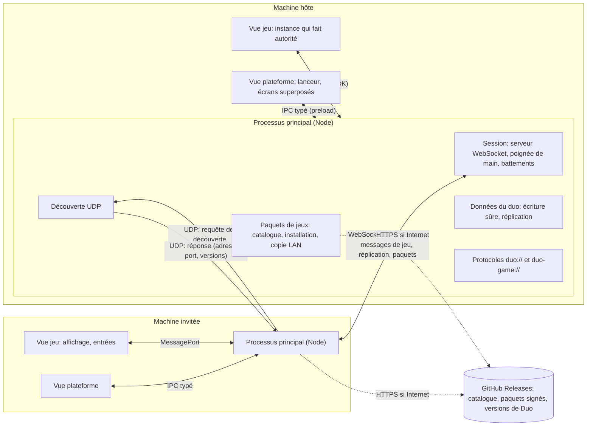
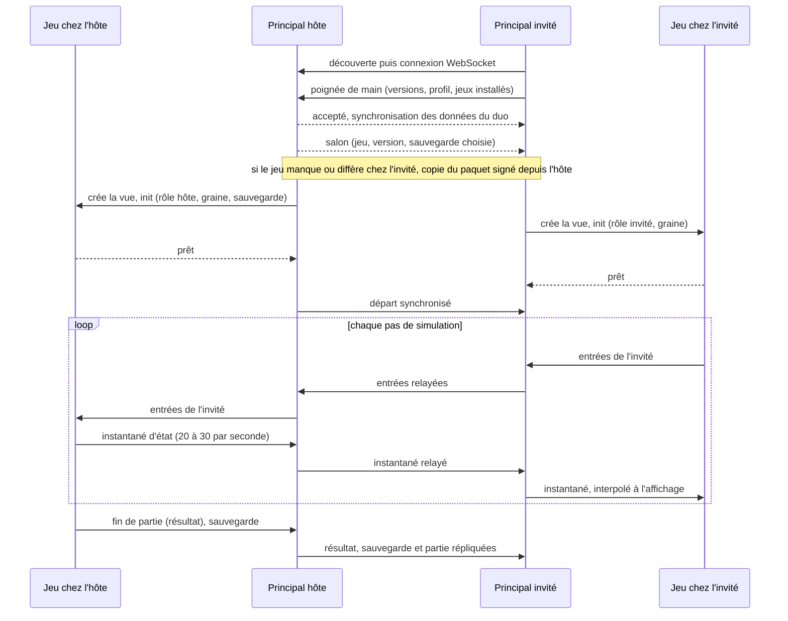
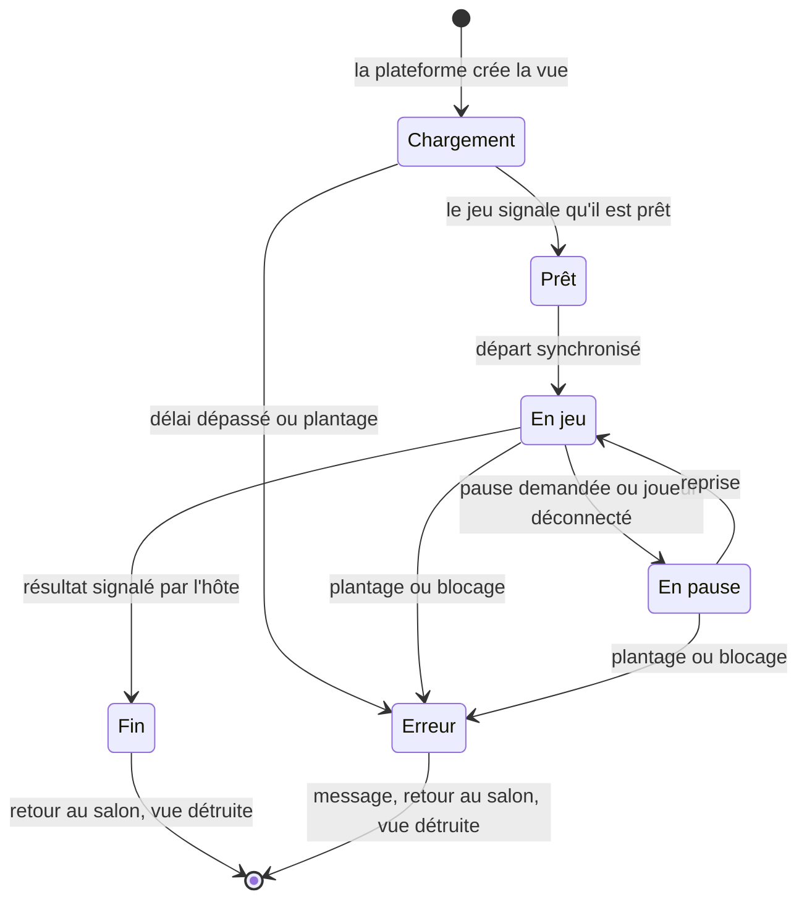
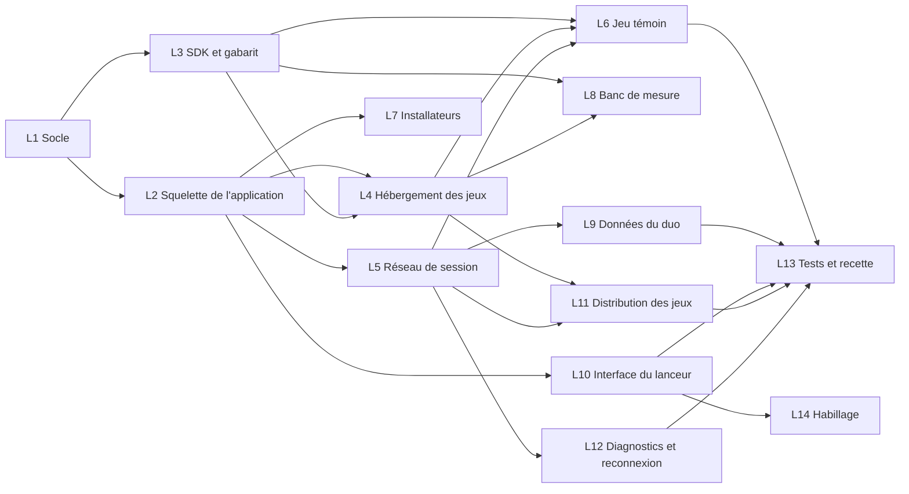

# Architecture de la plateforme Duo

| Champ | Valeur |
|---|---|
| Statut | proposition |
| Version du document | 0.1 |
| Dernière mise à jour | 2026-10-30 |
| Rédacteur | architecte-technique |
| Sources | `docs/plateforme/cahier-des-charges.md` (brouillon v0.1), fiches de l'équipe |

> Proposition à valider en même temps que le cahier des charges de la plateforme. Après validation, chaque choix structurant devient un ADR dans `docs/plateforme/decisions/` (liste ordonnée en section 16) et ce document en reste la synthèse vivante. Les faits marqués « vérifié » l'ont été le 2026-10-30 (versions npm, documentation officielle, essai jetable d'Electron 45 sous `xvfb-run`); les points marqués « à vérifier » restent ouverts et sont regroupés en section 18.

## 1. L'essentiel

1. Une fenêtre Electron et un seul processus principal, qui porte tout ce qui touche au système (réseau, fichiers, paquets de jeux). Deux sortes de vues web isolées: la vue de la plateforme (lanceur et écrans superposés au jeu) et une vue par partie en cours (le jeu).
2. Chaque jeu tourne dans son propre processus de rendu, en bac à sable, sans Node ni accès réseau. S'il plante ou se bloque, la plateforme ferme sa vue et ramène les deux joueurs au salon.
3. Un jeu est un paquet web statique (HTML, JavaScript, assets) accompagné d'un manifeste. Il parle à la plateforme par un unique canal de messages versionné, au travers du SDK `@duo/sdk` compilé dans le jeu.
4. Réseau: seuls les deux processus principaux se parlent, en WebSocket sur le LAN; les jeux ne voient que des messages relayés. Par défaut, l'instance du jeu qui tourne chez l'hôte fait autorité.
5. Les données du duo (sauvegardes, historique) sont des fichiers JSON du dossier de l'utilisateur, écrits de façon sûre et répliqués sur l'autre machine. L'historique est immuable; les scores en sont calculés.
6. Les jeux s'installent et se mettent à jour sans réinstaller l'application: paquets signés publiés sur GitHub Releases, et copie automatique du paquet de l'hôte vers l'invité sur le LAN.
7. Monorepo pnpm, TypeScript 6.0 strict, Vite 8, Vitest et Playwright; installateurs fabriqués par electron-builder dans GitHub Actions.

## 2. Contexte, contraintes et versions

### 2.1 Contraintes qui structurent tout

- Deux joueurs, deux machines: un Mac M1 (macOS arm64) et un PC Windows 11 x64 (hypothèse: Intel Core i3 de 2018, Intel UHD 620, mémoire inconnue, écran de portable possible). Clavier AZERTY et souris, pas de manette.
- Hors ligne: aucune dépendance réseau pendant le jeu en dehors du LAN. Internet sert seulement à récupérer les jeux et les nouvelles versions.
- Pas de certificat de signature payant. Dépôt GitHub `Haeev/duo` public: ses fichiers de release se téléchargent sans authentification.
- Ajouter ou mettre à jour un jeu ne doit pas imposer de réinstaller l'application (F12).
- Les machines du client ne sont pas accessibles depuis le studio: ce qui ne se mesure que chez lui doit être instrumenté (journaux, rapport de diagnostic exportable, banc de mesure).
- Electron 45 exige macOS 13 ou plus et Windows 10 ou plus (README du paquet): compatible avec les deux machines.

### 2.2 Versions relevées le 2026-10-30

Vérifié avec `npm view`; poids mesurés avec esbuild (minifié, puis gzip -9) sur un point d'entrée représentatif.

| Brique | Version | Licence | Remarque |
|---|---|---|---|
| electron | 45.2.0 | MIT | Chromium 156, Node 24.22.1, V8 15.6 (lus dans le binaire); 45.0.0 sortie le 2026-10-21; une majeure toutes les 8 semaines, seules les trois dernières sont maintenues (environ 6 mois chacune) |
| electron-builder et electron-updater | 26.18.0 et 6.8.11 | MIT | |
| electron-vite | 6.0.0 | MIT | accepte Vite 6 à 8 |
| vite | 8.3.5 | MIT | empaqueteur Rolldown |
| vitest | 5.0.5 | MIT | Node 22.12 ou plus |
| playwright | 1.64.1 (1.63.0 préinstallé) | Apache-2.0 | pilote Electron (vérifié avec 1.63.0) |
| typescript | 7.0.2 (dernière), 6.0.3 | Apache-2.0 | typescript-eslint 8.72.1 exige `typescript <6.1.0`: on retient 6.0.3 |
| eslint et typescript-eslint | 10.14.0 et 8.72.1 | MIT | |
| pnpm | 12.16.1 | MIT | corepack 0.34.0 présent avec Node 22.22.0 |
| three | 0.187.0 | MIT | 155 Ko gzip avec `GLTFLoader` et les classes courantes |
| pixi.js | 8.22.0 | MIT | 173 Ko gzip pour un usage courant |
| phaser | 4.2.1 | MIT | 4.0.0 sortie le 2026-04-10; 360 Ko gzip (bibliothèque entière) |
| ws | 8.22.0 | MIT | serveur et client WebSocket des processus principaux |
| valibot | 1.5.0 | MIT | validation sans génération de code, de l'ordre du kilo-octet |
| zod | 4.6.7 | MIT | 90 Ko gzip en API classique, 4 Ko en `zod/mini` |
| preact | 11.1.0 | MIT | 5 Ko gzip |

Node pour l'outillage: 22 (préinstallé dans l'environnement cloud, maintenu jusqu'en avril 2027). Electron embarque son propre Node 24.

## 3. Vue d'ensemble



Déroulé d'une partie, de la connexion au résultat:



## 4. Processus Electron

### 4.1 Processus principal

Un seul processus principal porte tout ce qui touche au système.

| Module | Responsabilités |
|---|---|
| `window` | une `BaseWindow` et deux vues empilées (jeu dessous, plateforme dessus), plein écran, focus clavier, instance unique, blocage de la mise en veille pendant une partie (`powerSaveBlocker`) |
| `protocols` | `duo://app/...` sert l'interface du lanceur; `duo-game://<id>/...` sert les fichiers du jeu installé, avec CSP, types MIME, requêtes partielles et contrôle des chemins |
| `ipc` | API de la vue plateforme: canaux nommés, arguments validés par schéma, émetteur vérifié (URL du cadre) |
| `game-host` | crée et détruit la vue jeu, relaie le canal du SDK, battement de cœur, détection de plantage et de blocage |
| `session` | serveur WebSocket (hôte) ou client (invité), poignée de main, salon, battements, pause et reprise, relais des messages de jeu |
| `discovery` | requêtes et réponses UDP, liste des hôtes visibles, adresses à afficher |
| `data` | profil, réglages, sauvegardes, historique, scores; écriture sûre; réplication et conflits |
| `packages` | catalogue, téléchargement, vérification de signature, installation, copie LAN, import depuis un fichier |
| `versions` | numéros de version, règles de compatibilité, avis de nouvelle version de Duo |
| `diagnostics` | journaux tournants (dont les erreurs de console des vues), rapports de plantage locaux (`crashReporter` sans envoi), état du rendu et du réseau, rapport exportable |

Règles: aucun accès disque ou réseau synchrone; les traitements lourds (empreinte et extraction d'un paquet de 50 Mo) se font en flux ou dans un `worker_threads`, pour ne pas faire trembler le relais réseau. Option écartée pour la v1: déporter la session dans un `utilityProcess`. Le relais coûte 0,1 ms par passage (vérifié) et le principal a peu d'autres tâches; on y reviendra si une mesure montre de la gigue.

### 4.2 Vues

- **Vue plateforme**: une seule, toujours vivante. Elle affiche le lanceur quand aucune partie ne tourne et, pendant une partie, les écrans bloquants par-dessus le jeu (pause, joueur déconnecté, erreur, résultats), sur fond transparent. Elle est masquée (`setVisible(false)`) le reste du temps pour que le jeu reçoive clavier et souris.
- **Vue jeu**: une `WebContentsView` créée au chargement de la partie et détruite à sa fin, dans une session Chromium dédiée aux jeux et non persistante.

Isolation d'un jeu, quatre options comparées:

| Option | Plantage ou blocage du jeu | Libération des ressources | Écrans de la plateforme par-dessus | Complexité |
|---|---|---|---|---|
| A. Import dynamique dans la page du lanceur | aucune isolation: une boucle infinie ou une fuite fige le lanceur | dépend de la discipline de chaque jeu | triviaux (DOM) | la plus faible |
| B. iframe d'un autre schéma dans la page du lanceur | processus séparé grâce à l'isolation des sites (vérifié sous Electron 45), mais sans garantie contractuelle; plantage visible seulement par battement de cœur | à la fermeture de l'iframe | triviaux (DOM) | faible |
| C. `WebContentsView` dédiée dans la même fenêtre | processus séparé garanti; plantage signalé par `render-process-gone`; blocage tué par `forcefullyCrashRenderer()` | complète: le processus du jeu disparaît (vérifié) | vue plateforme transparente au-dessus (vérifié sous Linux) | moyenne |
| D. Fenêtre dédiée au jeu | comme C | comme C | délicats (deux fenêtres, plein écran et Spaces de macOS) | forte |

Recommandation: **C**. Elle apporte la garantie demandée par F05 sans dépendre d'un comportement implicite de Chromium, et elle règle la question des fuites côté jeu: chaque partie démarre dans un processus neuf. Repli si la superposition transparente pose problème sous macOS ou Windows: une image figée du jeu (`capturePage`) en fond des écrans de la plateforme, vue jeu masquée.

### 4.3 Preloads

- `preload-platform`: expose par `contextBridge` un objet `duo` typé (appels et abonnements), généré à partir d'une table de canaux partagée avec le principal.
- `preload-game`: une dizaine de lignes qui transmettent à la page le `MessagePort` reçu du principal par `window.postMessage`, rien d'autre (vérifié dans l'essai). Depuis Electron 45, un preload en bac à sable n'a plus `Buffer`, `events`, `timers` ni `url`: API web uniquement.

### 4.4 Sécurité

- Toutes les vues: `sandbox: true`, `contextIsolation: true`, `nodeIntegration: false`, `webSecurity: true`; navigation et ouverture de fenêtres refusées; demandes d'autorisation refusées, sauf plein écran et verrouillage du pointeur.
- Pas de `file://`: protocoles personnalisés `duo://` et `duo-game://` déclarés `standard` et `secure` (contexte sécurisé, `fetch` permis), `stream` pour `duo-game://` (lecture en flux des musiques).
- CSP des jeux, envoyée par le protocole: `default-src 'self'; script-src 'self' 'wasm-unsafe-eval'; connect-src 'self'; img-src 'self' blob: data:; media-src 'self' blob:; style-src 'self' 'unsafe-inline'`. Vérifié: `eval` bloqué, `fetch` vers une adresse IP bloqué, `fetch` des fichiers du jeu permis, ni `require` ni `process` visibles depuis la page.
- Les jeux n'ont aucun accès au réseau ni au disque: tout passe par le SDK et le principal, qui valide chaque message par schéma.
- Fusibles Electron (option `electronFuses` d'electron-builder): `runAsNode`, `enableNodeOptionsEnvironmentVariable` et `enableNodeCliInspectArguments` désactivés; `onlyLoadAppFromAsar` et `enableEmbeddedAsarIntegrityValidation` activés (validation de l'archive prise en charge sous macOS et Windows selon la documentation d'Electron 45, à valider sur les deux systèmes).
- Pas de menu d'application sous Windows (neutralise Alt, Ctrl+R, Ctrl+W et les outils de développement); sous macOS, un menu minimal (Quitter, Copier, Coller, Plein écran). Outils de développement fermés dans les versions publiées.

### 4.5 Faits vérifiés par l'essai d'Electron 45.2.0 sous `xvfb-run`

Essai jetable, hors dépôt: une `BaseWindow`, une vue jeu et une vue plateforme transparente par-dessus, une iframe d'un autre schéma, protocoles personnalisés, preload minimal.

| Hypothèse | Résultat |
|---|---|
| Vue jeu, vue plateforme et iframe d'un autre schéma dans des processus distincts | oui, trois PID différents |
| Vue plateforme transparente au-dessus de la vue jeu | oui sous Linux (capture examinée); à confirmer sous macOS et Windows |
| Plantage forcé du jeu | `render-process-gone` (raison `crashed`); la vue plateforme reste vivante |
| Jeu bloqué dans une boucle infinie | détecté en 2 s par battement de cœur sur le `MessagePort`; l'événement natif `unresponsive` ne s'est pas déclenché en 45 s (il attend des entrées utilisateur en souffrance) |
| Aller-retour principal et page de jeu par `MessagePort` | médiane 0,10 ms, 99e centile 0,55 ms |
| `navigator.keyboard.getLayoutMap()` dans `duo-game://` | disponible (contexte sécurisé) |
| `AudioContext` sans geste de l'utilisateur | état `running` (politique par défaut d'Electron: `no-user-gesture-required`) |
| WebGL2 sans processeur graphique (rendu logiciel) | seulement avec `--enable-unsafe-swiftshader`: Chromium ne bascule plus seul sur SwiftShader |
| Mémoire d'Electron presque vide (trois pages blanches) | 260 à 300 Mo en PSS, 140 à 165 Mo privés, sous Linux; la fermeture de la vue jeu rend 25 à 35 Mo |
| Lancement en root (environnement cloud) | refusé sans `--no-sandbox` |
| Playwright 1.63 pilote l'application | oui: chaque `WebContentsView` apparaît comme une page, captures possibles |

## 5. Monorepo et outillage

### 5.1 Arborescence proposée

```text
duo/
  apps/
    duo/                  application Electron
      src/main/           processus principal (modules de la section 4.1)
      src/preload/        preload-platform, preload-game
      src/renderer/       interface du lanceur et écrans superposés
      tests/e2e/          Playwright sur Electron (deux instances)
  packages/
    protocol/             @duo/protocol: schémas (pont, session LAN, manifeste, catalogue) et numéros de version
    sdk/                  @duo/sdk: pont, cycle de vie, boucle à pas fixe, entrées, réseau, audio, sauvegardes, résultats
    sdk-dev/              @duo/sdk-dev: faux hôte navigateur, relais local avec latence simulée, bots, aides Playwright
    config/               configurations partagées (tsconfig, ESLint, Vitest)
  games/
    _template/            gabarit copié par le script de création d'un jeu
    jeu-temoin/           premier jeu
      src/simulation/     logique pure, testable dans Node
      src/render/         Three.js, PixiJS ou Phaser
      assets/             fichiers livrés et leurs sources
      duo-game.json       manifeste
  outils/                 scripts du dépôt (création de jeu, empaquetage, signature, contrôles)
  docs/
```

Règles: un jeu dépend de `@duo/sdk` et de son moteur, jamais d'un autre jeu; le code utile à deux jeux monte dans `packages/`; l'application ne dépend d'aucun jeu (hors jeu témoin intégré, copié au moment de l'empaquetage).

### 5.2 Gestionnaire de paquets

| Critère | npm workspaces | pnpm workspaces |
|---|---|---|
| Installation | déjà présent | par corepack (présent avec Node 22), version figée par le champ `packageManager` |
| Dépendances fantômes (un jeu qui importe `three` sans le déclarer) | possibles (installation à plat) | refusées (liens stricts) |
| Une version commune d'un moteur pour les jeux | à surveiller à la main | catalogues (`catalog:`) |
| Commandes par paquet | `-w`, limité | `--filter`, avec les dépendances |
| Electron et electron-builder | sans souci | sans souci si l'application est entièrement empaquetée par Vite (aucun `node_modules` à embarquer), sinon `node-linker=hoisted` pour l'application |

Recommandation: **pnpm**, pour la rigueur des dépendances entre une dizaine de jeux et les catalogues de versions. Depuis Electron 42, le paquet `electron` ne télécharge plus son binaire au `postinstall` (vérifié dans le paquet 45.2.0): plus de conflit avec le blocage des scripts d'installation par pnpm; le binaire arrive au premier lancement ou par `npx install-electron --no` (à prévoir dans le cache de CI).

### 5.3 Construction et qualité

Construction et empaquetage de l'application, trois options:

| Option | Pour | Contre |
|---|---|---|
| electron-vite 6 et electron-builder 26 | une configuration Vite pour principal, preloads et interface; NSIS par utilisateur; electron-updater fonctionne avec un NSIS non signé (vérifié); fusibles intégrés | deux outils tiers à suivre |
| Electron Forge 8 (greffon Vite, fabricants DMG, ZIP et Squirrel.Windows) | outil officiel d'Electron, tout en un | installateur Windows Squirrel plutôt que NSIS; intégration Vite plus jeune; changerait la fiche d'ingenieur-build |
| Vite seul et scripts maison, puis electron-builder | aucune dépendance de plus | rechargement à chaud et relance du principal à écrire soi-même |

Recommandation: **electron-vite et electron-builder**.

- Application: electron-vite (principal, preloads et interface dans une seule configuration, rechargement à chaud). Le principal est empaqueté avec ses dépendances (`ws`, `valibot`): l'archive de l'application ne contient pas de `node_modules`.
- Jeux: Vite en mode application, `base: './'`, sortie dans `games/<id>/dist/`, puis script d'empaquetage (zip, manifeste, empreintes, signature).
- TypeScript 6.0.3 strict partout (`strict`, `noUncheckedIndexedAccess`, `exactOptionalPropertyTypes`, `verbatimModuleSyntax`). Passage à TypeScript 7 quand typescript-eslint le prendra en charge.
- ESLint 10 et typescript-eslint en mode typé, formatage Prettier, contrôle typographique du dépôt (commande de CLAUDE.md), scripts npm sans bash (Windows doit pouvoir tout lancer).
- Validation à l'exécution: **Valibot** plutôt que Zod 4. Valibot ne génère pas de code, donc s'accorde avec la CSP des jeux, et pèse de l'ordre du kilo-octet. Zod 4 sonde `new Function` pour accélérer ses analyses; sous une CSP stricte, cette sonde produit un rapport de violation (commentaire de son code source, vérifié) sauf configuration `jitless`, et l'API classique pèse 90 Ko gzip.
- Interface du lanceur: bibliothèque à trancher par ADR. Recommandation: Preact (API de React, la plus répandue, pour 5 Ko gzip mesurés). Alternatives: TypeScript sans bibliothèque (simple au début, lourd à mesure que les états d'écran se multiplient), Svelte 5 (syntaxe récente, moins connue).

### 5.4 Moteurs de rendu

- 3D: Three.js 0.187 (orientation validée par le client), WebGL2.
- 2D: PixiJS ou Phaser, à trancher au premier jeu 2D (ADR 0014). PixiJS est un moteur de rendu seul: il s'accorde naturellement avec une simulation pure qui vit hors du moteur. Phaser 4 est un cadre complet (scènes, physique, entrées, audio, caméras, cartes Tiled) dont une partie double le SDK (boucle, entrées, audio) et dont la physique vivrait côté rendu, hors de la simulation testable. Recommandation: PixiJS par défaut; Phaser possible pour un jeu qui tire parti de ses cartes et caméras, la simulation restant hors de Phaser.
- Les moteurs sont empaquetés dans chaque jeu (155 à 360 Ko gzip): aucun moteur partagé à l'exécution, chaque jeu garde la version avec laquelle il a été testé.

## 6. Contrat d'un jeu

### 6.1 Paquet et manifeste

Un jeu publié est une archive zip qui contient le site statique construit et un manifeste `duo-game.json` à la racine. Les clés sont des identifiants du code (anglais), les textes affichés sont en français.

```json
{
  "schema": 1,
  "id": "jeu-temoin",
  "name": "Jeu témoin",
  "version": "1.0.0",
  "sdk": "1.0",
  "view": "3d",
  "engine": "three",
  "mode": "coop",
  "durationMinutes": [5, 10],
  "network": "host-authority",
  "entry": "index.html",
  "thumbnail": "thumbnail.webp",
  "description": "Un mini-jeu à deux qui éprouve toute la chaîne.",
  "actions": [
    { "id": "up", "label": "Monter", "keys": ["KeyW", "ArrowUp"] },
    { "id": "act", "label": "Agir", "keys": ["Space"], "mouse": "left" }
  ],
  "saves": { "slots": 3, "maxBytes": 1048576, "moments": ["level-end", "exit"] },
  "result": "winner",
  "progress": null
}
```

- `view`: `2d`, `3d` ou `iso`; `mode`: `coop` ou `versus` (F04); `network`: `host-authority`, `lockstep` ou `turns`; `result`: `winner`, `score` ou `progress` (F09); `progress` décrit la progression commune d'un jeu en coopération (`{ "label": "niveaux", "max": 12 }`).
- Touches par défaut en `KeyboardEvent.code`, c'est-à-dire par position physique: `KeyW` est la touche marquée Z sur un clavier AZERTY. La plateforme affiche le vrai libellé grâce à `navigator.keyboard.getLayoutMap()`.
- `saves` déclare les emplacements et les moments de sauvegarde (section 4 du cahier); `null` si le jeu ne sauvegarde rien.
- Le manifeste est validé par le schéma de `@duo/protocol` à l'installation, au chargement et en CI. Le catalogue reprend le manifeste et ajoute adresse, taille, empreinte SHA-256 et signature.

### 6.2 Cycle de vie



- Plateforme vers jeu: `init` (rôle, joueurs, graine, réglages, sauvegarde chargée chez l'hôte), `start` (tic de départ), `pause` (raison), `resume`, `stop` (raison, sauvegarde demandée ou non).
- Jeu vers plateforme: `loading` (progression), `ready`, `heartbeat` (automatique, chaque seconde), `requestPause`, `saveWrite`, `matchEnd`, `error`.
- Délais proposés: chargement au plus 30 s; 3 s sans battement de cœur et le jeu est déclaré bloqué, sa vue est tuée; à la sortie, 2 s laissées au jeu pour sauvegarder.
- Libération: la vue est détruite à la fin de chaque partie, ce qui libère WebGL, audio, écouteurs et minuteurs. Le SDK fournit quand même `dispose()` pour les tests et le faux hôte.
- Un plantage chez l'un ramène les deux joueurs au salon, avec un message chez chacun; la partie est marquée interrompue (règle d'historique à valider, section 14).

### 6.3 Pont entre le jeu et la plateforme

Un seul `MessagePort` par partie, ouvert par le principal et transmis par `preload-game`. Les messages sont des objets typés et versionnés, validés à l'arrivée dans le principal, et dans le SDK pour ceux qui viennent de la plateforme.

Deux options comparées:

- SDK compilé dans chaque jeu, qui parle un protocole versionné (recommandé): chaque jeu garde la version du SDK avec laquelle il a été testé; la plateforme doit seulement rester compatible avec les versions majeures du protocole qu'elle annonce; un jeu se teste hors d'Electron avec le faux hôte.
- SDK fourni par la plateforme à l'exécution (script injecté ou API exposée par le preload): un correctif touche tous les jeux d'un coup, mais une mise à jour de l'application peut casser un jeu publié, et un jeu ne se teste plus seul.

Versionnement: le protocole du pont porte une version `majeure.mineure`; une mineure n'ajoute que des messages ou des champs facultatifs. Le manifeste déclare la version minimale (`"sdk": "1.2"`), l'application celle qu'elle implémente (par exemple 1.4): compatible si même majeure et si la mineure de l'application est supérieure ou égale.

### 6.4 API offerte par le SDK

| Module | Ce qu'il offre | Règles |
|---|---|---|
| `session` | rôle (`host` ou `guest`), joueurs (identifiant, pseudo, couleur, local ou non), graine, version du jeu, événements du cycle de vie | |
| `loop` | boucle à pas fixe (60 Hz par défaut, réglable par jeu), facteur d'interpolation pour le rendu | chez l'hôte, la simulation n'est pas cadencée par `requestAnimationFrame` (fenêtre réduite) |
| `random` | générateur pseudo-aléatoire à graine | `Math.random` interdit dans la simulation |
| `input` | actions du manifeste (`isDown`, `wasPressed` par pas de simulation), pointeur (position, boutons, verrouillage), libellé réel d'une touche | touches lues par `KeyboardEvent.code`; tout est relâché à la perte de focus; liaisons fournies par les réglages (F10); Échap réservé à la pause; pas de manette |
| `net` | envoi et réception de messages de jeu par canal; aides pour les instantanés (hôte vers invité) et les entrées (invité vers hôte); schémas Valibot; latence estimée | taille et débit plafonnés par la plateforme |
| `audio` | un `AudioContext`, bus musique, effets et interface reliés aux volumes de la plateforme, effets décodés au chargement, musiques lues en flux | |
| `assets` | préchargement avec progression, pour l'écran de chargement | adresses relatives au paquet, servies par `duo-game://` |
| `saves` | lister, lire et écrire (hôte seulement) des emplacements JSON; sauvegarde automatique périodique si le jeu la demande | taille plafonnée par le manifeste et par un plafond absolu de la plateforme |
| `results` | `endMatch` (hôte seulement): issue, scores par joueur, progression | alimente l'historique et les scores |
| `ui` | facteur de taille de l'interface, réduction des animations, demande de pause | les écrans bloquants restent ceux de la plateforme |
| `dev` | compteur d'images, latence, mode bot | absent des paquets publiés |

Simulation séparée du rendu: la simulation de chaque jeu est du TypeScript pur (`src/simulation/`), testable dans Node par Vitest; chez l'hôte elle tourne dans la vue jeu, chez l'invité seule la présentation tourne (plus une éventuelle prédiction locale).

### 6.5 Faux hôte pour le développement et les tests

`@duo/sdk-dev` émule la plateforme dans un navigateur: deux onglets (hôte et invité) reliés par un petit relais local, qui sait ajouter latence, gigue et pertes. Un jeu se développe avec le serveur de Vite sans lancer Electron, et se teste avec Playwright à deux contextes. En mode développement, l'application accepte aussi de charger un jeu depuis le serveur de Vite (rechargement à chaud).

## 7. Réseau, à grands traits

dev-reseau détaillera ces choix dans `docs/plateforme/reseau.md`.

### 7.1 Topologie

Seuls les processus principaux se parlent. Un message de jeu suit le chemin: jeu, principal (`MessagePort`), WebSocket, principal de l'autre machine, jeu. Coût mesuré d'un passage par le principal: 0,1 ms, négligeable devant les quelques millisecondes du Wi-Fi.

Où tourne la simulation de l'hôte? Deux options:

- Dans la vue jeu de l'hôte (recommandé): le code d'un jeu ne s'exécute qu'en bac à sable, jamais avec les droits de Node; une seule cible d'exécution par jeu; aucune latence pour le joueur hôte.
- Dans un processus Node (`utilityProcess`) de l'hôte: séparation nette du serveur, mais du code téléchargé tournerait avec un accès complet au système, chaque jeu aurait deux points d'entrée, et le joueur hôte passerait lui aussi par l'interpolation.

### 7.2 Transport

| Option | Pour | Contre |
|---|---|---|
| WebSocket sur TCP (`ws`) | simple, fiable, ordonné; une seule connexion pour la session, le jeu, la réplication et les paquets | une perte bloque la file (pics de quelques dizaines à quelques centaines de millisecondes en Wi-Fi chargé) |
| WebRTC DataChannel non fiable | pas de blocage de file | pile lourde, négociation, aucun besoin connu |
| UDP brut avec fiabilité maison | contrôle total | tout à écrire et à éprouver |

Recommandation: **WebSocket** par défaut. Une variante non fiable seulement si un jeu d'action la justifie, mesures à l'appui. Messages JSON validés; binaire compact seulement si la mesure le justifie.

### 7.3 Découverte et pare-feu

| Option | Pour | Contre |
|---|---|---|
| Diffusion UDP sur un port fixe: l'invité interroge, l'hôte répond (et peut s'annoncer) | aucune dépendance; identique sur les deux systèmes; sous Windows, la réponse unicast à une diffusion passerait sans règle d'entrée chez l'invité (à vérifier) | à écrire; interfaces multiples à gérer |
| mDNS et DNS-SD (`bonjour-service`) | standard | Windows a son propre répondeur mDNS sur le port 5353 (conflits possibles), Bonjour absent par défaut sous Windows, déclaration `NSBonjourServices` sous macOS |

Recommandation: **diffusion UDP** sur toutes les interfaces privées (Wi-Fi, Ethernet), saisie d'adresse IP en recours (l'hôte affiche ses adresses). Le serveur n'écoute que pendant qu'un salon est ouvert.

macOS 15 et suivants, autorisation « Réseau local » (vérifié dans la note technique TN3179 d'Apple, révisée le 2026-10-06):

- exigée pour une connexion TCP sortante vers le LAN, tout envoi UDP (unicast, diffusion, multicast) et la réception de diffusion ou de multicast;
- non exigée pour écouter et accepter des connexions TCP, ni pour recevoir de l'UDP unicast: un Mac hôte joint par adresse IP fonctionne même sans l'autorisation;
- clé `NSLocalNetworkUsageDescription` dans `Info.plist`; pas d'entitlement multicast sur macOS;
- le système suit l'application par sa signature; Apple recommande une identité de signature délivrée par Apple, car une signature ad hoc rend ce suivi peu fiable. La note demande aussi un UUID unique pour l'exécutable principal; or celui d'Electron 45.2.0 arm64 est le même pour toutes les applications bâties sur cette version (vérifié dans l'archive officielle: `4c4c446b-5555-3144-a1a1-136b14fc37ac`);
- les programmes lancés depuis le Terminal sont autorisés d'office: un essai en développement ne reproduit pas le comportement de l'application installée;
- l'alerte peut refuser la première opération avant même la réponse de l'utilisateur: prévoir des reprises;
- remettre l'autorisation à zéro n'est possible qu'à partir de macOS 27.2; avant, l'utilisateur peut seulement la basculer dans Réglages Système.

Windows (à vérifier sur le PC):

- la première écoute déclenche l'alerte du pare-feu, et l'autoriser demande des droits d'administrateur; « Annuler » crée des règles de blocage qui ne redemanderont plus rien: le diagnostic doit les détecter et guider vers « Autoriser une application via le pare-feu Windows »;
- un réseau classé « Public » bloque les connexions entrantes: diagnostic du profil réseau et marche à suivre pour le passer en « Privé »;
- l'installation par utilisateur garde le même chemin d'exécutable d'une version à l'autre, donc la règle survit aux mises à jour.

Pour expliquer avant que la fenêtre du système n'apparaisse (parcours 1 du cahier), la plateforme déclenche volontairement ces autorisations pendant le premier lancement, après un écran d'explication.

### 7.4 Modèles de synchronisation

| Modèle | Pour quels jeux | Principe |
|---|---|---|
| Hôte qui fait autorité (par défaut) | action, coopération, la plupart des jeux | l'hôte simule à pas fixe et envoie des instantanés (20 à 30 par seconde); l'invité envoie ses entrées et interpole (environ 100 ms de tampon); prédiction locale de l'invité si le ressenti l'exige |
| Lockstep déterministe | stratégie, nombreux objets, physique déterministe | les deux machines simulent à partir des entrées échangées; graine partagée, pas fixe, somme de contrôle régulière; versions identiques exigées |
| Tour par tour ou événements | plateau, cartes, réflexion | l'hôte valide chaque action et diffuse l'état ou l'événement |

Déterminisme entre arm64 et x64: les opérations de base sont identiques bit à bit, mais la norme ECMAScript ne garantit pas que `Math.sin`, `Math.exp`, `Math.pow` et les autres fonctions approchées donnent le même résultat d'une architecture à l'autre. Un jeu en lockstep s'en passe dans sa simulation (entiers, virgule fixe, tables) et compare une somme de contrôle de l'état.

### 7.5 Session et robustesse

- Battement de cœur chaque seconde; l'autre machine est déclarée perdue après 3 s sans nouvelle, et la partie se met en pause des deux côtés.
- Reconnexion: l'invité se reconnecte au même salon et à la même partie, l'hôte renvoie un instantané complet, la partie reprend quand les deux sont prêts. Si l'application de l'hôte s'est arrêtée, l'état en mémoire est perdu: reprise au dernier point de sauvegarde (voir F06 en section 14).
- Sécurité: connexion refusée si l'adresse source n'est pas privée, si la requête porte un en-tête `Origin` (page web d'un navigateur du réseau) ou si la poignée de main échoue; débit et taille des messages plafonnés; l'invité n'envoie que des intentions, jamais d'état.
- Hôte en arrière-plan: `backgroundThrottling` désactivé pour la vue jeu (les images restent dessinées, selon la documentation d'Electron 45) et blocage de la suspension (`prevent-app-suspension`) pendant une partie. À valider quand la fenêtre de l'hôte est réduite (App Nap sous macOS, occultation sous Windows).

## 8. Données: profils, réglages, sauvegardes, historique, scores

### 8.1 Emplacement

Dossier de données de l'application (`app.getPath('userData')`): `~/Library/Application Support/Duo` sous macOS, `%APPDATA%\Duo` sous Windows. Tous les chemins sont construits avec `path.join`; aucun nom de fichier ne vient d'une saisie libre (identifiants validés: minuscules, chiffres, traits d'union), ce qui évite les soucis d'accents, d'espaces et de casse.

### 8.2 Arborescence

```text
<userData>/
  machine.json                  identifiant stable de la machine
  profile.json                  F01: pseudo, couleur (propre à la machine)
  settings.json                 F10: volumes, affichage, taille de l'interface, touches par jeu (propre à la machine)
  duo/<duoId>/                  données du duo, répliquées sur les deux machines
    duo.json                    les deux machines et leurs profils
    saves/<jeu>/<emplacement>.json, et .json.bak
    saves/<jeu>/backup/<emplacement>-<date>.json      copies perdantes d'un conflit
    history/<année>/<partieId>.json                   une partie terminée, immuable
    outbox.json                 écritures pas encore confirmées par l'autre machine
  games/<jeu>/<version>/        paquet extrait, servi par duo-game://
  games/<jeu>/<version>.zip     archive signée gardée pour la copie vers l'autre machine
  logs/                         journaux tournants, rapports de plantage locaux
```

`duoId` dérive des identifiants des deux machines, triés: il est identique des deux côtés.

### 8.3 Formats

Trois options de stockage comparées:

| Option | Pour | Contre |
|---|---|---|
| Fichiers JSON, un par sauvegarde et par partie (recommandé) | lisibles par un humain (diagnostic à distance), réplication fichier par fichier, aucune dépendance, volume faible (quelques Mo) | écriture sûre et index à écrire soi-même |
| SQLite par `node:sqlite` (disponible dans le Node d'Electron 45, SQLite 3.53.4, vérifié) | transactions, requêtes | base à répliquer par enregistrements plutôt que par fichiers, illisible sans outil, module récent de Node |
| Stockage du navigateur (IndexedDB) dans une vue | rien à installer | données liées à une vue en bac à sable, hors de portée du principal qui réplique: exclu |

- JSON UTF-8 avec un champ `schema` (version du format), validé par schéma à chaque lecture; migration explicite d'une version à la suivante.
- Une sauvegarde porte `game`, `slot`, `revision` (compteur), `parent` (empreinte de la révision précédente), `updatedAt`, `writtenBy`, `gameVersion`, `dataSchema` (version du format propre au jeu), `checksum` (SHA-256 des données) et `data`.
- Une partie de l'historique porte son identifiant, le jeu et sa version, les dates de début et de fin, la durée, l'issue (`win` avec le vainqueur, `draw`, `coop` avec la progression, `aborted`) et les scores par joueur.

### 8.4 Écriture sûre

1. Écrire `x.json.tmp` dans le même dossier, puis `fsync`.
2. Copier l'actuel `x.json` vers `x.json.bak`, s'il existe.
3. Renommer `x.json.tmp` en `x.json` (remplacement atomique sur un même volume).

Sous Windows, un antivirus ou l'indexeur peut retenir un fichier un instant: reprises courtes sur `EPERM`, `EBUSY` et `EACCES`, pendant une seconde au plus. À la lecture: fichier absent ou invalide, puis `.bak`, puis `.tmp` s'il est valide; la plateforme signale toute récupération. Toutes les écritures passent par une file unique dans le principal: jamais deux écritures concurrentes du même fichier.

### 8.5 Réplication

- Seule l'instance de l'hôte écrit sauvegardes et résultats. La plateforme de l'hôte écrit en local, puis transmet l'écriture à l'autre machine, qui l'écrit à son tour et accuse réception.
- Sans accusé de réception (coupure), l'écriture reste dans `outbox.json`.
- À chaque connexion, avant le salon, les deux machines comparent leurs index (emplacement, révision, empreinte; liste des parties) et échangent ce qui manque. Le salon n'affiche les sauvegardes qu'après cette synchronisation.
- L'historique ne peut pas entrer en conflit: chaque partie est un fichier immuable à identifiant unique, on fait l'union des deux copies.

### 8.6 Conflits (section 4 du cahier)

- Révisions différentes dont l'une descend de l'autre (chaîne `parent`): la plus avancée remplace l'autre, sans conflit. C'est le cas normal après une coupure.
- Révisions divergentes (aucune ne descend de l'autre, cas d'une synchronisation interrompue): la plus récente selon `updatedAt` l'emporte, l'autre est rangée dans `backup/`, et la plateforme le signale aux deux joueurs. Un écart de quelques secondes entre les horloges des deux machines est sans gravité, puisque la copie perdante est gardée.
- Pourquoi une chaîne de révisions plutôt que la seule comparaison des dates: elle distingue la simple mise à jour en retard (aucun conflit à signaler) de la vraie divergence, et ne dépend des horloges que dans ce dernier cas.

### 8.7 Scores

Le score cumulé (F09) se calcule à partir de l'historique: victoires de chacun par jeu et au total pour les jeux en affrontement, progression commune pour les jeux en coopération. Aucune donnée dérivée à synchroniser, donc aucune incohérence possible. Proposition: les parties interrompues n'y comptent pas.

## 9. Distribution des jeux sans réinstaller l'application (F12)

### 9.1 Options

| Option | Satisfait F12 | Sans Internet | Écart de versions entre les machines | Coût |
|---|---|---|---|---|
| A. Jeux embarqués dans l'application | non: chaque jeu impose une nouvelle installation et les alertes de sécurité qui vont avec | oui | aucun si les deux applications sont à jour | nul |
| B. Paquets publiés sur GitHub Releases, catalogue téléchargé | oui | jeux déjà installés jouables | possible si une machine n'a pas récupéré la dernière version | moyen |
| C. B, plus copie automatique du paquet de l'hôte vers l'invité sur le LAN | oui | l'invité n'a même pas besoin d'Internet | supprimé: l'invité joue la version de l'hôte | moyen |
| D. Fichiers du jeu chargés directement depuis l'hôte, sans installation chez l'invité | oui | oui | supprimé | contenu distant non vérifié dans une vue, rechargé à chaque partie, CSP liée à l'adresse de l'hôte |

Recommandation: **C**, avec deux compléments: « Installer un jeu depuis un fichier » (recours sans Internet, ou si le dépôt devient privé) et le jeu témoin intégré à l'application (premier essai possible sans rien télécharger).

### 9.2 Fonctionnement proposé

- Publication par GitHub Actions, sur un tag `jeu-<id>-v<version>`: construction, tests, archive zip, manifeste, empreinte SHA-256, signature Ed25519 (clé privée dans les secrets GitHub, clé publique compilée dans l'application; Node vérifie Ed25519 sans dépendance), release, puis mise à jour du catalogue.
- Catalogue: `catalogue.json` attaché à une release de référence, lu par son adresse directe (`https://github.com/Haeev/duo/releases/download/<tag>/catalogue.json`). Les adresses directes de téléchargement d'un dépôt public répondent par une redirection vers le fichier (vérifié avec `releases/latest/download/...`); c'est ainsi que `@electron/get` télécharge Electron, sans jeton. Elles ne consomment pas le quota de l'API GitHub (60 requêtes par heure sans jeton): l'application n'utilise jamais l'API.
- Installation: téléchargement en flux, vérification de l'empreinte et de la signature, extraction protégée (chemins normalisés, aucune sortie du dossier, taille totale plafonnée), puis bascule atomique vers la nouvelle version. L'ancienne version reste en place tant qu'une partie l'utilise.
- Copie LAN: dans le salon, si l'invité n'a pas le jeu choisi (identifiant, version, empreinte), il le reçoit de l'hôte par la connexion de session, vérifie la signature et l'installe; la progression s'affiche chez les deux joueurs.
- Un paquet n'est jamais exécuté avec les droits de Node: il est servi par `duo-game://` dans une vue en bac à sable. La signature protège surtout la copie LAN (un appareil du réseau qui se ferait passer pour l'hôte). Option plus simple écartée: se fier à la seule empreinte publiée dans le catalogue, qui ne protège pas un invité hors ligne recevant le paquet de l'hôte.

### 9.3 Si le dépôt passe en privé

- Les fichiers de release d'un dépôt privé exigent une authentification: l'application ne peut plus les télécharger, et embarquer un jeton dans l'application est exclu (ce serait un secret diffusé).
- Parades: un second dépôt public réservé aux fichiers publiés (par exemple `Haeev/duo-jeux`), alimenté par la CI du dépôt privé grâce à un jeton rangé dans ses secrets (recommandé); ou l'import manuel des paquets, téléchargés depuis GitHub par une personne connectée.
- Autres effets: sur un dépôt privé, les minutes de CI sont comptées (2 000 par mois sur le plan gratuit, macOS compté dix fois et Windows deux fois, soit environ 200 minutes de construction macOS par mois); les avis de nouvelle version de Duo doivent eux aussi pointer vers le dépôt public de distribution.

## 10. Compatibilité des versions (F13)

Deux options: exiger des versions identiques de l'application (simple à expliquer, mais une mise à jour faite sur une seule machine bloque la soirée) ou vérifier la compatibilité par numéros de protocole (recommandé, détaillé ci-dessous).

| Numéro | Porté par | Règle |
|---|---|---|
| Version de l'application (SemVer) | l'application | affichée; ne bloque pas à elle seule |
| Version du protocole de session (entier, incrémenté seulement en cas de changement incompatible) | l'application | identique sur les deux machines, sinon blocage |
| Version de l'API du pont (`majeure.mineure`) | l'application | doit couvrir la version `sdk` exigée par le jeu |
| Version du jeu (SemVer) et empreinte du paquet | le paquet | identiques, sinon copie depuis l'hôte (section 9) |
| Version d'Electron | l'application | identique pour les jeux en lockstep |

- Poignée de main (premier message de l'invité): signature de l'application, versions ci-dessus, système et architecture, profil, jeux installés (identifiant, version, empreinte). L'hôte répond accepté ou refusé, avec une raison typée.
- Messages au joueur: « Duo doit être mis à jour sur <machine> » avec la version visée et la marche à suivre, ou « Copie du jeu depuis <hôte> » avec la progression. Le message désigne toujours la machine à mettre à jour, jamais un code d'erreur.
- Comme le protocole ne change qu'en cas d'incompatibilité, deux versions proches de l'application jouent ensemble: une mise à jour de Duo sur une seule machine ne bloque pas la soirée.

## 11. Installation et mises à jour de l'application

### 11.1 Fabrication

electron-builder sur les runners GitHub Actions du système visé (`macos-latest`, `windows-latest`), sur tag `v*`:

- macOS arm64: dmg et zip, signature ad hoc explicite (`mac.identity: "-"`). Sans identité, electron-builder 26 ne signe pas du tout: il n'y a pas de repli ad hoc automatique (vérifié dans son schéma de configuration). `hardenedRuntime: false`, sinon la validation des bibliothèques rejette les cadres Electron déjà signés (même source). `NSLocalNetworkUsageDescription` dans `Info.plist`.
- Windows x64: NSIS par utilisateur, sans droits d'administrateur, non signé. Variante à étudier dans l'ADR 0011 avec dev-reseau: une installation par machine demande les droits d'administrateur une fois, mais peut créer la règle du pare-feu dès l'installation (plus d'alerte au premier salon, plus de risque de clic sur « Annuler »), au prix de droits d'administrateur à chaque mise à jour.
- Poids attendu: de 90 à 130 Mo par installateur (l'archive zip officielle d'Electron 45.2.0 pour macOS arm64 pèse à elle seule 121 Mo, vérifié; NSIS compresse davantage).

### 11.2 Premier lancement

- macOS 15 et suivants: le contournement par clic droit puis « Ouvrir » a disparu. Il faut tenter d'ouvrir Duo, puis aller dans Réglages Système > Confidentialité et sécurité > « Ouvrir quand même », et saisir son mot de passe (sources secondaires concordantes). Variantes pour le guide: retirer l'attribut de quarantaine (`xattr -dr com.apple.quarantine /Applications/Duo.app`) ou télécharger avec `curl`, qui n'en pose pas.
- Windows: SmartScreen (« Informations complémentaires », puis « Exécuter quand même »). Si Smart App Control est actif, il bloque les applications non signées, sans exception possible par application: il faudrait le désactiver (Sécurité Windows > Contrôle des applications et du navigateur). Selon des sources secondaires, il se réactive sans réinstaller Windows depuis les mises à jour d'avril 2026, mais la mise à jour d'octobre 2026 (KB5127648) peut l'en empêcher. À vérifier sur le PC.
- Notifications système: depuis Electron 42, macOS n'affiche les notifications natives que pour une application signée. Duo signale donc l'invitation dans sa fenêtre, par le rebond de l'icône du Dock et par le clignotement de la barre des tâches.

### 11.3 Mises à jour

| Option | macOS | Windows | Coût |
|---|---|---|---|
| Avis de nouvelle version et téléchargement manuel | oui, alerte Gatekeeper à chaque version | oui, SmartScreen possible | faible |
| electron-updater (installation automatique) | non: il passe par Squirrel.Mac (vérifié dans le code de `MacUpdater`), qui exige une signature Developer ID | oui avec un NSIS non signé: la signature n'est vérifiée que si `publisherName` est renseigné (vérifié dans le code de `NsisUpdater`) | faible |
| Mise à jour maison sous macOS (téléchargement par l'application, remplacement du paquet, relance) | possible sans quarantaine, à prototyper | sans objet | moyen, risqué |
| Signature payante (compte Apple Developer, certificat Windows) | tout fonctionne, autorisations stables | plus d'alerte | exclue par le client |

Recommandation v1: avis de nouvelle version (au démarrage, si Internet est là, l'application lit le fichier de version de la dernière release) et téléchargement manuel. La mise à jour automatique sous Windows par electron-updater peut venir tôt, pour un coût faible; macOS reste manuel. Comme les jeux se mettent à jour sans l'application, les versions de Duo resteront rares. À tester chez le client: une nouvelle version ad hoc redemande-t-elle l'autorisation Réseau local?

Leviers pour plus tard, si la friction gêne: SignPath Foundation offre une signature Windows gratuite aux projets libres (licence approuvée par l'OSI, dépôt public, aucune partie propriétaire: conditions à vérifier pour Duo); côté Apple, seul le programme payant règle Gatekeeper et l'autorisation Réseau local.

## 12. Stratégie de test

| Niveau | Outil | Cible | Quand |
|---|---|---|---|
| Unitaire | Vitest dans Node | simulations des jeux (graine fixe), protocole et schémas, stockage (écriture sûre, conflits, réplication), règles de compatibilité, catalogue et paquets | chaque push |
| Intégration réseau | Vitest dans Node | deux sessions (hôte et invité) dans un même processus, sur localhost, avec latence, gigue et pertes injectées (par exemple 80 ms, 20 ms, 2 %) | chaque push |
| Jeu à deux | Playwright Chromium, deux contextes | un jeu dans le faux hôte, deux joueurs ou deux bots, captures examinées | chaque push |
| Application | Playwright `_electron` sous `xvfb-run`, deux instances (dossiers de données et ports distincts) | parcours complets: héberger, rejoindre, jouer, pause, déconnexion, fin, historique | chaque push, ou chaque nuit si c'est trop long |
| Endurance | deux bots | dix parties d'affilée, mémoire suivie, désynchronisations | avant chaque jalon |
| Installateurs | GitHub Actions macOS et Windows | fabrication, puis démarrage minimal de l'application fabriquée | sur tag |
| Performance et réseau réel | banc de mesure, check-list de recette | images par seconde, temps de chargement, pare-feu, autorisations | chez le client, à chaque jalon |

Pièges vérifiés pour l'environnement cloud et la CI:

- Electron refuse de tourner en root sans `--no-sandbox`; l'environnement cloud tourne en root, donc le bac à sable de Chromium n'y est pas éprouvé.
- WebGL2 en rendu logiciel exige `--enable-unsafe-swiftshader`; un rendu logiciel vaut pour l'image, pas pour mesurer les performances.
- L'application doit accepter en ligne de commande son dossier de données et ses ports, pour faire tourner deux instances sur une même machine.
- À vérifier en CI: le bac à sable de Chromium sur les runners Ubuntu récents (restriction AppArmor des espaces de noms utilisateur).

## 13. Budgets de performance

### 13.1 Machine de référence

PC Windows 11, hypothèse prudente: Intel Core i3 de 8e génération (2 cœurs, 4 fils, de 2,2 à 3,4 GHz), Intel UHD 620 (24 unités d'exécution, mémoire partagée), 4 à 8 Go de mémoire, disque SSD ou disque dur, écran 1366x768 ou 1920x1080 avec une mise à l'échelle de 100, 125 ou 150 %. Le Mac M1 est environ deux fois plus rapide sur un cœur et bien plus puissant en graphisme: les budgets se calent sur le PC, y compris quand c'est lui qui héberge (il simule alors en plus d'afficher).

### 13.2 Budgets

| Poste | Budget sur le PC de référence | Mesure |
|---|---|---|
| Images par seconde | 60 stables dans la scène la plus chargée: 99 % des images sous 16,7 ms, aucune au-delà de 33 ms en régime établi | compteur du SDK, banc de mesure |
| Simulation chez l'hôte | 2 ms au plus par pas à 60 Hz, sérialisation réseau comprise | banc de simulation sous Vitest (cible de 1 ms en CI, soit une marge de 2), puis chez le client |
| Fil principal du jeu | 8 ms au plus par image (simulation, mise à jour de la scène, commandes de dessin) | profileur de Chromium |
| Appels de dessin en 3D | 150 au plus par image, toutes passes comprises | `renderer.info.render.calls` |
| Triangles en 3D | 250 000 au plus par image, toutes passes, dont 100 000 au plus pour l'ombre | `renderer.info.render.triangles` |
| Lumières et effets en 3D | une lumière directionnelle avec ombre (carte de 1024, 2048 au plus), une lumière hémisphérique, 4 lumières ponctuelles sans ombre au plus; une seule passe plein écran à pleine résolution; bloom à demi-résolution au plus; ni occlusion ambiante, ni réflexions, ni profondeur de champ | revue technique |
| Programmes de shader | 12 au plus par scène, tous compilés pendant le chargement (`compileAsync`): sous Windows, la compilation par ANGLE coûte cher si elle survient en pleine partie | `renderer.info.programs` |
| Résolution de rendu en 3D | 1920x1080 pixels physiques au plus sur le PC (rapport de pixels plafonné), rapport de 2 au plus sur le Mac; résolution dynamique jusqu'à 0,75 si le temps d'image dépasse | SDK |
| Rendu 2D | 50 lots de dessin au plus par image, 5 000 sprites visibles, 2 000 particules, 2 filtres plein écran | outils de PixiJS ou de Phaser |
| Mémoire de textures | 256 Mo au plus par jeu, mipmaps comprises (une texture RGBA de 2048x2048 en occupe environ 22 Mo); 2048 pixels de côté au plus, 4096 pour un atlas | inventaire au chargement |
| Mémoire de l'application au repos | 350 Mo au plus, tous processus (mémoire privée; Electron presque vide en occupe déjà de 140 à 165 Mo sous Linux) | `app.getAppMetrics()` (`privateBytes` sous Windows) |
| Mémoire de l'application en partie | 1 Go au plus, tous processus; dont tas JavaScript du jeu 200 Mo au plus et audio décodé 64 Mo au plus (environ 3 minutes de stéréo: les musiques sont lues en flux) | idem, et `performance.memory` |
| Fuites | après dix parties successives, la vue plateforme ne grossit pas de plus de 10 % | test d'endurance |
| Démarrage à froid | 3 s au plus jusqu'au lanceur utilisable (6 s sur disque dur) | chronomètre du diagnostic |
| Chargement d'une partie | 5 s au plus du départ au jeu jouable, sur les deux machines | idem |
| Découverte | hôte visible chez l'invité en 3 s au plus après l'ouverture du salon | test d'intégration, puis chez le client |
| Parcours complet | 15 s au plus de temps machine, de l'ouverture de Duo au début de la partie; le reste de la minute du pilier 1 revient aux joueurs | recette |
| Paquet d'un jeu | 50 Mo conseillés, 100 Mo au plus (moteur: de 155 à 360 Ko gzip; les musiques dominent, environ 1 Mo par minute en OGG) | contrôle en CI |
| Installateur | 150 Mo au plus | CI |
| Réseau | instantanés de 20 à 30 par seconde, 2 Ko au plus chacun, 100 Ko/s au plus; jouable à 100 ms d'aller-retour avec 20 ms de gigue et 2 % de pertes; perte de l'autre machine détectée en 3 s au plus | banc d'injection |

### 13.3 Conséquences sur les styles de jeux

- 3D: low poly en aplats ou toon, couleurs de sommets ou petite texture palette (un seul matériau), répétitions instanciées, décor statique fusionné, lumière précalculée dans Blender, ombres factices sous les personnages, arènes et niveaux compacts. À écarter: rendu réaliste à textures multiples, végétation dense, grands mondes à longue distance de vue, post-traitements empilés, nombreuses lumières dynamiques.
- 2D: pixel art à basse résolution interne agrandie (le moins coûteux), ou vectoriel en atlas. À écarter: shaders plein écran à pleine résolution, fonds géants non compressés, sprites hors atlas.
- Isométrique: en sprites 2D (le moins coûteux) ou en 3D orthographique, avec les budgets 3D.
- Simulation: quelques centaines d'entités dynamiques à 60 Hz avec l'hôte qui fait autorité; au-delà, pas de 30 Hz, intérêt limité aux objets proches ou lockstep.
- Jeux de réflexes à l'image près (combat très exigeant): ils demanderaient une resynchronisation par retour arrière, hors de la v1.
- Les budgets se vérifient tôt: un banc de mesure (scènes de charge 3D et 2D) part chez le client dès le prototype pour recaler ces chiffres sur le vrai PC.

## 14. Faisabilité des fonctions F01 à F13

| # | Réponse technique | Faisabilité | Risque nommé |
|---|---|---|---|
| F01 Profil | `profile.json` local, identifiant stable, pseudo et couleur | sûre | deux joueurs de même couleur: règle à fixer par l'UX |
| F02 Découverte et connexion | requête et réponse UDP, WebSocket, saisie d'adresse IP, diagnostic (profil réseau Windows, règles de blocage, autorisation macOS, absence d'adresse privée) | sûre pour la connexion, partielle pour le diagnostic | l'isolation des clients Wi-Fi et un pare-feu qui jette les paquets donnent le même symptôme (délai dépassé): le diagnostic propose des causes probables et des étapes, sans toujours nommer la cause; autorisation Réseau local peu fiable avec une signature ad hoc |
| F03 Salon | état de session tenu par le principal de l'hôte et reflété chez l'invité; départ quand les deux sont prêts, versions compatibles et paquets identiques | sûre | aucun notable |
| F04 Bibliothèque | manifestes des jeux installés et du catalogue (vignette, description, mode, durée), sauvegardes du duo | sûre | aucun notable |
| F05 Cycle de vie | vue jeu dédiée, pont versionné, battement de cœur, `render-process-gone`, destruction de la vue | sûre (vérifiée par l'essai) | un blocage se détecte en 3 s environ, pas instantanément; un plantage d'un côté ramène les deux joueurs au salon |
| F06 Déconnexion | battements (perte détectée en 3 s), pause des deux côtés, reconnexion, instantané complet renvoyé par l'hôte | sûre tant que l'application de l'hôte reste ouverte | si l'hôte plante ou s'éteint, l'état en mémoire est perdu: reprise au dernier point de sauvegarde (formulation à corriger) |
| F07 Sauvegardes | emplacements JSON par jeu, écriture sûre, réplication, synchronisation avant le salon | sûre | conflit rare après une synchronisation interrompue, traité par la règle de la section 8.6 |
| F08 Historique | un fichier immuable par partie, union des deux copies | sûre | sort des parties interrompues à décider |
| F09 Score cumulé | calculé à partir de l'historique | sûre | chaque jeu doit déclarer ce qui compte (vainqueur, score, progression) |
| F10 Réglages | `settings.json` local; volumes reliés aux bus du SDK; zoom de la vue plateforme; liaisons de touches tirées des actions du manifeste | sûre | la taille de l'interface ne s'applique au HUD d'un jeu que si ce jeu lit le facteur fourni par le SDK |
| F11 Installation | electron-builder: dmg et zip ad hoc pour arm64, NSIS par utilisateur pour x64; guide de premier lancement | faisable | Gatekeeper à chaque version sous macOS, SmartScreen, et surtout Smart App Control qui bloque sans recours tant qu'il est actif |
| F12 Nouveaux jeux | paquets signés sur GitHub Releases, catalogue, copie LAN de l'hôte vers l'invité, import par fichier | sûre si le dépôt reste public | dépôt privé: second dépôt public ou import manuel |
| F13 Compatibilité | poignée de main versionnée: protocole identique, API du pont suffisante, jeu identique grâce à la copie | sûre | formulation à corriger: les versions doivent être compatibles, pas toutes identiques |

Fonctions à reformuler dans le cahier (propositions):

- F06: « Pause automatique, attente de reconnexion, reprise là où la partie en était tant que l'application de l'hôte reste ouverte; sinon reprise au dernier point de sauvegarde (sauvegarde automatique périodique pour les jeux longs). »
- F13: « Les deux machines vérifient que leurs versions sont compatibles; le jeu de l'hôte est copié automatiquement chez l'invité s'il lui manque ou diffère; si l'application d'une machine est trop ancienne, message clair et marche à suivre. »
- F02: « Diagnostic qui nomme la cause quand elle est détectable (réseau Public sous Windows, autorisation refusée, aucune connexion au réseau local) et guide pas à pas sinon. »
- F08: préciser le sort des parties interrompues (recommandation: inscrites comme interrompues, sans effet sur le score cumulé).
- Section 6: « 60 images par seconde » sous réserve du respect des budgets de la section 13 et d'un rendu matériel (pilote graphique à jour), à confirmer par le banc de mesure dès le prototype.
- Ajout proposé: un rapport de diagnostic exportable en un clic (journaux, configuration, état réseau et graphique), parce que les machines du client ne sont pas accessibles depuis le studio.

Incidences de l'idée du premier jeu (simulation de vie en coopération d'une centaine d'heures, cadrage en cours) sur la plateforme:

- Sauvegardes: un monde persistant (village, ferme, maisons, personnages, quêtes) pèse plusieurs mégaoctets en JSON. Le plafond absolu par emplacement se fixe dans l'ADR 0009 (de l'ordre de quelques dizaines de Mo); l'écriture reste asynchrone et peut être compressée.
- Sauvegarde automatique périodique (par exemple toutes les 5 minutes et à chaque pause), offerte par le SDK: c'est elle qui rend acceptable la reprise au dernier point de sauvegarde quand l'hôte s'arrête (F06).
- Migrations: un jeu qui évolue pendant des mois doit relire ses anciennes sauvegardes (`dataSchema` et migrations testées en CI).
- Réseau: un grand monde ne s'envoie pas en instantanés complets 30 fois par seconde; il faudra des instantanés différentiels ou par zone, ou une synchronisation par événements, à trancher avec dev-reseau dans le cahier du jeu.
- Rendu: une vue 2D ou isométrique en sprites tient bien plus facilement les budgets d'un village peuplé qu'une vue 3D; en 3D, découpage du monde en zones et instanciation deviennent obligatoires.
- Poids: musiques et sprites d'un grand jeu peuvent dépasser 100 Mo; le budget du paquet sera revu dans le cahier du jeu. Les mises à jour différentielles ne sont pas prévues en v1 (paquet complet à chaque version).

## 15. Risques et parades

| Risque | Probabilité | Impact | Parade | Responsable |
|---|---|---|---|---|
| PC plus faible que l'hypothèse (4 Go, disque dur, pilote ancien) | moyenne | fort | relevé de configuration (Q4) avant le prototype; banc de mesure; budgets recalés | manager, tech-artist |
| WebGL indisponible ou en rendu logiciel sur le PC (pilote écarté par Chromium, qui ne bascule plus seul sur SwiftShader) | faible | fort | détection au démarrage, message « mettre à jour le pilote graphique », rapport de diagnostic | dev-plateforme |
| Smart App Control actif sur le PC | moyenne | bloquant | vérifier son état avec Q4; guide pour le désactiver; plus tard, signature Windows gratuite si Duo devient un projet libre | ingenieur-build |
| Autorisation Réseau local instable sous macOS (signature ad hoc, UUID de l'exécutable Electron partagé) | moyenne | fort | essai dès le prototype sur le Mac; réécriture de l'UUID avant la signature ad hoc à étudier; guide pour réactiver l'autorisation; recours: le Mac héberge et le PC se connecte par adresse IP (accepter une connexion TCP ne demande pas l'autorisation) | ingenieur-build, dev-reseau |
| Pare-feu Windows: « Annuler » crée des règles de blocage silencieuses; réseau classé Public | moyenne | fort | écran d'explication avant l'alerte, diagnostic des règles et du profil réseau, guide; ou installation par machine qui crée la règle (ADR 0011) | dev-reseau, ux-ui-designer |
| Gigue du Wi-Fi (balayages, économie d'énergie, AWDL sous macOS) | moyenne | moyen | tampon d'interpolation, mesures au banc d'injection, conseils (même réseau, PC branché sur secteur) | dev-reseau |
| Simulation de l'hôte ralentie quand sa fenêtre est réduite ou masquée | moyenne | moyen | boucle du SDK indépendante de `requestAnimationFrame` chez l'hôte, `backgroundThrottling` désactivé, blocage de la suspension; sinon pause automatique | dev-plateforme |
| Désynchronisation en lockstep entre arm64 et x64 | faible, et seulement pour ces jeux | fort | fonctions mathématiques maison, somme de contrôle, versions identiques | dev-reseau, devs gameplay |
| Corruption ou perte de données (coupure, antivirus) | faible | fort | écriture sûre, `.bak`, reprises, réplication, tests de coupure | dev-plateforme |
| Montées de version d'Electron (chaque majeure maintenue environ 6 mois) | certaine | moyen | version figée par ADR, montée planifiée deux fois par an, tests de bout en bout avant chaque montée | architecte-technique, ingenieur-build |
| Pile très récente (Vite 8, TypeScript 6 et 7, Phaser 4) mal connue des agents | moyenne | moyen | vérifier les API dans `node_modules` avant usage (règle de l'équipe), exemples dans le gabarit | toute l'équipe |
| Superposition transparente et focus clavier entre vues non vérifiés sous macOS et Windows | faible | moyen | essai dès le lot L2; repli sur une image figée du jeu derrière les écrans de la plateforme | dev-plateforme |
| Dépôt passé en privé | faible | moyen | second dépôt public de distribution, import manuel | ingenieur-build |

## 16. ADR à rédiger après validation du cahier

Dans cet ordre, qui suit les dépendances de la phase 2.

| # | Titre | Question tranchée | Rédacteur (avec) |
|---|---|---|---|
| 0001 | Pile technique et versions figées | Electron, Node d'outillage, TypeScript 6.0, Vite 8 et electron-vite, Vitest, Playwright, Valibot ou Zod; politique de montée de version | architecte-technique |
| 0002 | Monorepo et outillage | pnpm ou npm; arborescence; scripts communs; lint, formatage, contrôle typographique | architecte-technique (ingenieur-build) |
| 0003 | Processus Electron et sécurité | répartition entre principal, preloads et vues; IPC validé; protocoles personnalisés; CSP; fusibles; autorisations | architecte-technique (dev-plateforme) |
| 0004 | Isolation et hébergement des jeux | import dynamique, iframe, vue dédiée ou fenêtre; écrans superposés; battement de cœur et délais | architecte-technique (dev-plateforme) |
| 0005 | Contrat des jeux et SDK | manifeste, cycle de vie, pont par `MessagePort`, API du SDK; SDK compilé dans le jeu ou fourni à l'exécution | architecte-technique |
| 0006 | Versions et compatibilité | numéros portés, règles, poignée de main, messages au joueur | architecte-technique (dev-reseau, ingenieur-build) |
| 0007 | Modèle réseau et transport | relais par les principaux; WebSocket, WebRTC ou UDP; lieu de la simulation de l'hôte; modèle par défaut et variantes | dev-reseau (architecte-technique) |
| 0008 | Découverte et pare-feu | diffusion UDP ou mDNS; ports; déclenchement des autorisations; diagnostic | dev-reseau |
| 0009 | Données du duo | formats, emplacement, écriture sûre, réplication, conflits, scores dérivés | architecte-technique (dev-plateforme, dev-reseau) |
| 0010 | Distribution des jeux | embarqués, Releases, copie LAN ou chargement distant; format de paquet, signature, catalogue; cas du dépôt privé | architecte-technique (ingenieur-build) |
| 0011 | Installateurs, signature et mises à jour de l'application | cibles, signature ad hoc, NSIS par utilisateur, avis de version ou mise à jour automatique | ingenieur-build |
| 0012 | Interface du lanceur | Preact, TypeScript seul ou Svelte; état de l'interface; intégration des jetons du design system | architecte-technique (dev-plateforme, ux-ui-designer) |
| 0013 | Stratégie de test et CI | niveaux de test, faux hôte, Electron sous `xvfb-run`, bots, banc de mesure, déclencheurs de CI | architecte-technique (qa-testeur, ingenieur-build) |
| 0014 | Moteur 2D par défaut | PixiJS ou Phaser 4 | architecte-technique (dev-gameplay-2d), au premier jeu 2D |

## 17. Découpage de la phase 2

| Lot | Contenu | Responsable | Dépend de | Jalon |
|---|---|---|---|---|
| L1 Socle du dépôt | monorepo pnpm, TypeScript strict partagé, ESLint, Prettier, Vitest, Playwright, scripts multiplateformes, contrôle typographique, CI Linux à chaque push | ingenieur-build (revue: architecte-technique) | ADR 0001, 0002 | prototype |
| L2 Squelette de l'application | principal, preloads, vue plateforme, protocoles, CSP, test de fumée Electron sous `xvfb-run`, essai de superposition et de focus sur les runners macOS et Windows de la CI (captures examinées) | architecte-technique (squelette), puis dev-plateforme | L1, ADR 0003 | prototype |
| L3 SDK v0 et gabarit de jeu | `@duo/protocol`, `@duo/sdk` (pont, cycle de vie, boucle à pas fixe, aléa à graine, entrées, audio minimal, sauvegardes, résultats), `@duo/sdk-dev` (faux hôte), gabarit et script de création d'un jeu | architecte-technique (squelette), puis dev-plateforme | L1, ADR 0005, 0006 | prototype |
| L4 Hébergement des jeux | vue jeu dédiée, protocole `duo-game://` (requêtes partielles comprises), chargement, écrans superposés de pause et d'erreur, battement de cœur, plantage puis retour au salon, dix lancements sans fuite | dev-plateforme | L2, L3, ADR 0004 | prototype |
| L5 Réseau de session | découverte UDP, saisie d'adresse IP, serveur WebSocket, poignée de main versionnée, salon minimal, relais des messages de jeu, battements, pause sur déconnexion, banc d'injection de latence | dev-reseau | L2, ADR 0006, 0007, 0008 | prototype (reconnexion complète en alpha) |
| L6 Jeu témoin | mini-jeu à deux en Three.js (vue de dessus orthographique, formes simples), mode bot, une sauvegarde, un résultat, trois sons; règles en une page par game-designer | dev-gameplay-3d (game-designer, sound-designer) | L3 (développement dans le faux hôte), puis L4 et L5 | prototype |
| L7 Installateurs de prototype | electron-builder: macOS arm64 ad hoc (dmg et zip, `Info.plist` réseau local), Windows x64 NSIS par utilisateur, fusibles; fabrication sur tag; guide minimal de premier lancement | ingenieur-build | L2, ADR 0011 | prototype |
| L8 Banc de mesure | scènes de charge 3D (Three.js) et 2D (PixiJS) aux limites des budgets, relevé des temps d'image, détection du rendu logiciel, rapport exportable | tech-artist (dev-plateforme) | L3, L4 | prototype |
| L9 Données du duo | profil, réglages, écriture sûre, sauvegardes, historique, scores, réplication, conflits | dev-plateforme (dev-reseau pour le transport) | L2, L5, ADR 0009 | alpha |
| L10 Interface du lanceur | écrans des maquettes UX: accueil, profil, bibliothèque, salon, historique et scores, réglages (volumes, affichage, touches), erreurs, premier lancement et autorisations; version réduite dès le prototype | dev-plateforme (spécifications de ux-ui-designer) | L2, maquettes UX, ADR 0012 | alpha |
| L11 Distribution des jeux | format de paquet, signature, catalogue, publication en CI, téléchargement, installation, mise à jour, copie LAN, import par fichier, avis de nouvelle version de Duo | ingenieur-build (publication, signature), dev-plateforme (installation), dev-reseau (copie LAN) | L3, L4, L5, ADR 0010 | alpha |
| L12 Diagnostics et reconnexion | profil réseau et règles du pare-feu sous Windows, autorisation Réseau local sous macOS, reprise après coupure, guide de dépannage | dev-reseau | L5 | alpha |
| L13 Tests de bout en bout et recette | plans tracés depuis les critères d'acceptation, Playwright à deux contextes, Electron sous `xvfb-run`, endurance, check-list chez le client | qa-testeur | L4 à L12, au fil de l'eau | de l'alpha à la 1.0 |
| L14 Habillage | identité visuelle et sonore appliquées, guide d'installation complet, installateurs finalisés | dev-plateforme (directeur-artistique, sound-designer, ingenieur-build) | L10, identités validées | bêta |



Parallélisme: après L1, les lots L2 et L3 avancent en parallèle (worktrees séparés); puis L4, L5 et L7; L6 démarre dans le faux hôte dès que L3 existe. Le prototype rassemble L1 à L8 (L5 sans la reconnexion complète, L10 réduit au strict nécessaire); l'alpha ajoute L9 à L12; la bêta ajoute L14; la 1.0 conclut la recette L13 chez le client.

## 18. Points restant à vérifier

- Superposition transparente et passage du focus clavier entre les vues, sous macOS et Windows (lot L2).
- Autorisation Réseau local d'une application signée ad hoc, après une mise à jour; effet de l'UUID partagé de l'exécutable Electron (sur le Mac).
- Pare-feu Windows: réponse unicast à une diffusion, alerte éventuelle à l'ouverture d'un socket UDP éphémère (sur le PC).
- État de Smart App Control sur le PC.
- Bac à sable de Chromium sur les runners Ubuntu de GitHub Actions.
- Validation d'intégrité de l'archive de l'application (`enableEmbeddedAsarIntegrityValidation`) sur les deux systèmes.
- Simulation de l'hôte quand sa fenêtre est réduite (App Nap sous macOS, occultation sous Windows).
- Requêtes partielles du protocole `duo-game://` pour la lecture en flux des musiques.

## 19. Historique

| Date | Version | Changement | Auteur |
|---|---|---|---|
| 2026-10-30 | 0.1 | Proposition initiale | architecte-technique |
