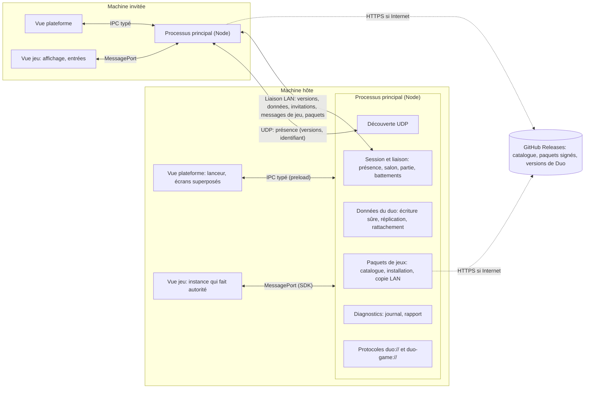
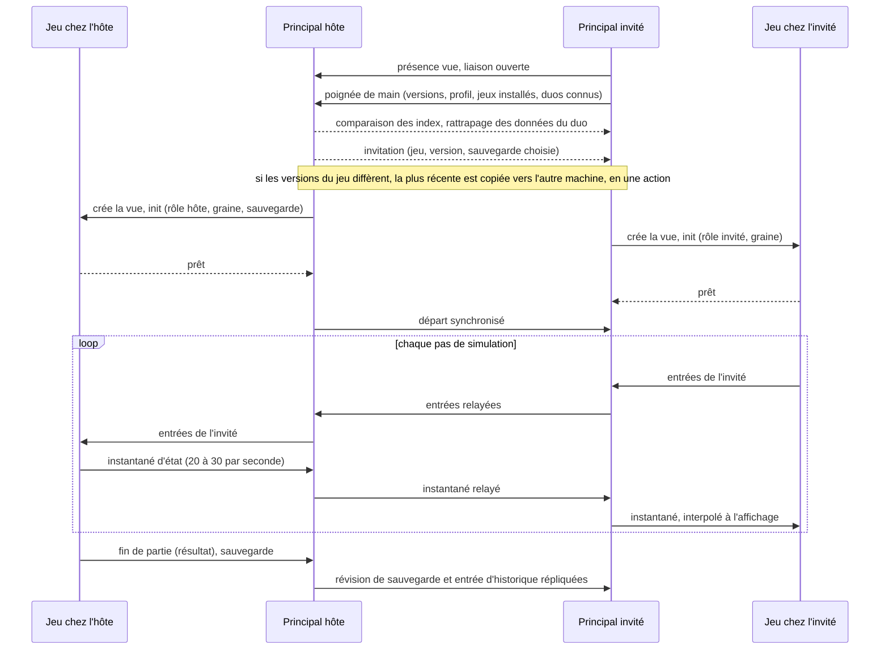
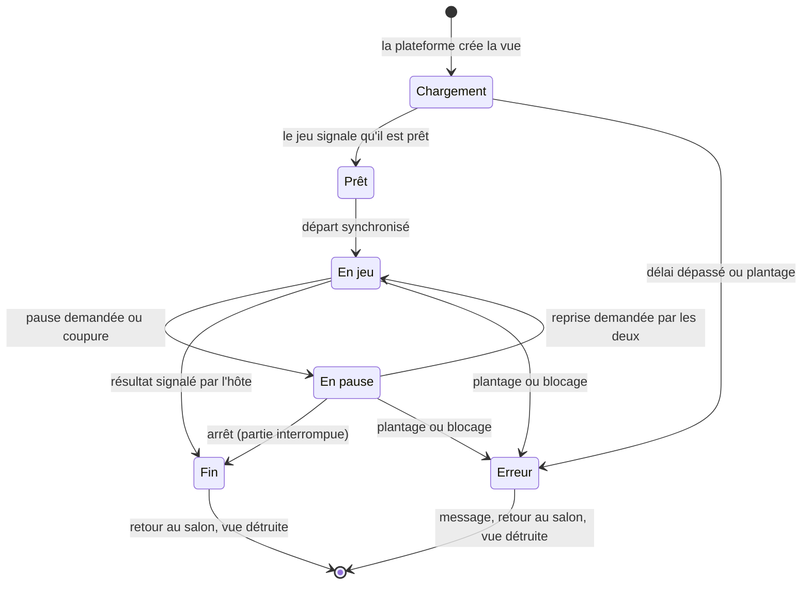
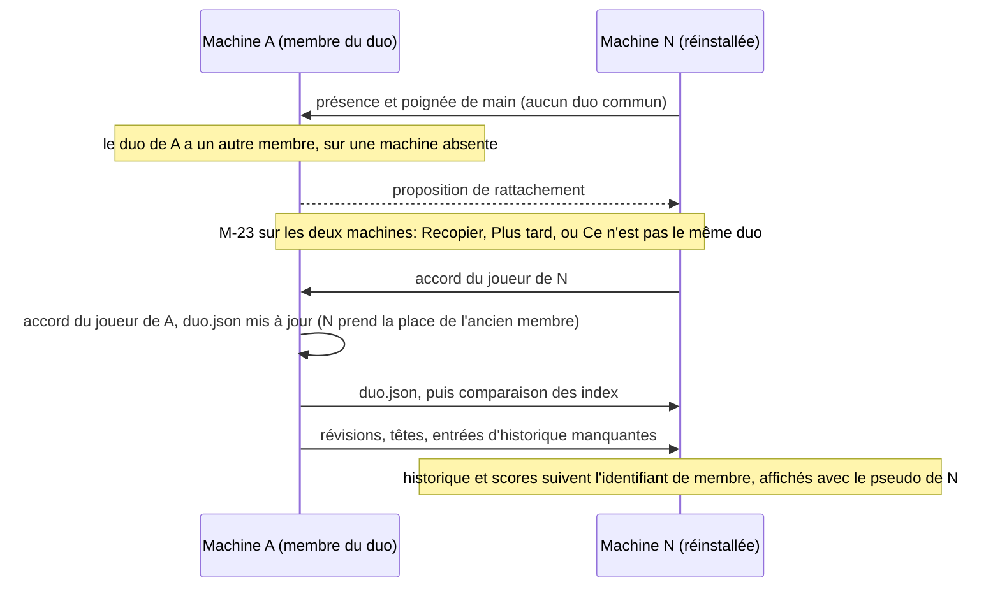
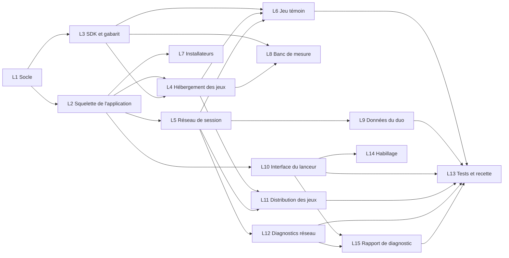

# Architecture de la plateforme Duo

| Champ | Valeur |
|---|---|
| Statut | synthèse vivante; les décisions sont dans les ADR (`docs/plateforme/decisions/`), proposées le 2026-10-30 |
| Version du document | 0.2 |
| Dernière mise à jour | 2026-10-30 |
| Rédacteur | architecte-technique |
| Sources | `cahier-des-charges.md` 1.0 (validé le 2026-10-30), `ux/parcours.md` 0.1, `criteres-acceptation.md` 0.2, ADR 0001 à 0015 |

> Ce document résume l'architecture de la plateforme: processus, modules, flux de données, contrat des jeux, budgets, risques et découpage. Chaque choix structurant y renvoie à son ADR, qui fait foi (index: `decisions/README.md`). Le réseau (ADR 0007 et 0008, `reseau.md`) appartient à dev-reseau, les installateurs et les mises à jour de Duo (ADR 0011) à ingenieur-build: les sections 7 et 11 n'en donnent que ce que le reste de la plateforme en attend. Les faits marqués « vérifié » l'ont été le 2026-10-30 (versions npm, documentation officielle au tag de la version, essais jetables hors du dépôt); ce qui reste ouvert est regroupé en section 19. La correspondance entre les hypothèses H-01 à H-35 des critères et les décisions est dans `decisions/resolution-hypotheses.md`.

## 1. L'essentiel

1. Une fenêtre Electron et un seul processus principal, qui porte tout ce qui touche au système (réseau, fichiers, paquets de jeux, diagnostics). Deux sortes de vues web en bac à sable: la vue de la plateforme (lanceur et écrans superposés au jeu) et une vue par partie (le jeu). ADR 0003.
2. Chaque jeu tourne dans son propre processus. S'il plante, les deux joueurs reviennent au salon en moins de 2 s; s'il se fige, en moins de 7 s. ADR 0004.
3. Un jeu est un paquet web statique accompagné d'un manifeste. Il parle à la plateforme par un unique canal de messages versionné, au travers du SDK `@duo/sdk` compilé dans le jeu. ADR 0005.
4. Réseau: seuls les deux processus principaux se parlent. Les deux applications se relient dès qu'elles se voient (présence, comparaison des versions, profils, données du duo, invitations); en partie, l'hôte fait autorité par défaut. ADR 0007 et 0008 (dev-reseau).
5. Les données du duo sont des fichiers JSON du dossier de l'utilisateur, copiés sur les deux machines. Le duo a son propre identifiant et deux membres, ce qui permet à une machine réinstallée de reprendre sa place. Une sauvegarde est une suite de révisions immuables; deux copies divergentes se départagent par leur chaîne de révisions, jamais par les horloges. L'historique est immuable, parties interrompues comprises; les scores en sont calculés. ADR 0009.
6. Les jeux s'installent et se mettent à jour sans réinstaller l'application: paquets signés publiés sur GitHub Releases, et copie par le réseau local de la version la plus récente présente sur l'une des deux machines, en une action, dans un sens ou dans l'autre. ADR 0006 et 0010.
7. Un rapport de diagnostic texte, lisible et vérifié avant envoi, sans donnée personnelle hors des pseudos (F14). ADR 0015.
8. Monorepo pnpm, TypeScript 6.0 strict, Vite 8, Preact 11 pour le lanceur, Vitest et Playwright; installateurs fabriqués par electron-builder dans GitHub Actions. ADR 0001, 0002, 0011, 0012, 0013.

## 2. Contexte, contraintes et versions

### 2.1 Contraintes qui structurent tout

- Deux joueurs, deux machines: un Mac M1 (macOS arm64) et un PC Windows 11 x64 (hypothèse: Intel Core i3 de 2018, Intel UHD 620, mémoire inconnue, écran de portable possible). Clavier AZERTY et souris, pas de manette.
- Hors ligne: aucune dépendance réseau pendant le jeu en dehors du LAN. Internet sert seulement à récupérer les jeux et les nouvelles versions.
- Pas de certificat de signature payant. Dépôt GitHub `Haeev/duo` public (Q3): ses fichiers de release se téléchargent sans authentification.
- Ajouter ou mettre à jour un jeu ne doit pas imposer de réinstaller l'application (F12); on joue toujours la version la plus récente d'un jeu présente sur l'une des deux machines (F13).
- Les données du duo existent sur les deux machines; une machine réinstallée se rattache au duo et récupère ses données (cahier, section 4).
- Les machines du client ne sont pas accessibles depuis le studio: ce qui ne se mesure que chez lui est instrumenté (journal, rapport de diagnostic F14, affichage des performances, banc de mesure).
- Electron 45 exige macOS 13 ou plus et Windows 10 ou plus (README du paquet): compatible avec les deux machines.

### 2.2 Versions figées

Relevées avec `npm view` le 2026-10-30, deux fois dans la journée (identiques), et figées par l'ADR 0001, qui fixe aussi la politique de montée de version.

| Brique | Version | Licence | Remarque |
|---|---|---|---|
| electron | 45.2.0 | MIT | Chromium 156, Node 24.22.1, V8 15.6 (lus dans le binaire); 45.0.0 sortie le 2026-10-21; une majeure toutes les 8 semaines, les trois dernières maintenues |
| electron-vite | 6.0.0 | MIT | accepte Vite 6 à 8 |
| electron-builder et electron-updater | 26.18.0 et 6.8.11 | MIT | usage fixé par l'ADR 0011 |
| vite | 8.3.5 | MIT | empaqueteur Rolldown |
| vitest | 5.0.5 | MIT | Node 22.12 ou plus |
| playwright et @playwright/test | 1.64.1 (1.63.0 préinstallé) | Apache-2.0 | pilote Electron (vérifié avec 1.63.0) |
| typescript | 6.0.3 (7.0.2 est la dernière) | Apache-2.0 | typescript-eslint 8.72.1 exige `typescript <6.1.0` |
| eslint et typescript-eslint | 10.14.0 et 8.72.1 | MIT | |
| prettier | 3.9.10 | MIT | |
| pnpm | 12.16.1 | MIT | corepack 0.34.0 présent avec Node 22.22.0 |
| valibot | 1.5.0 | MIT | validation sans génération de code; `object()` retire les champs inconnus |
| ws | 8.22.0 | MIT | WebSocket des processus principaux |
| preact et @preact/signals | 11.1.0 et 2.11.4 | MIT | 8,4 Ko gzip ensemble (mesuré); Preact 11.0.0 sortie le 2026-09-30 |
| yauzl et yazl | 3.4.0 et 3.3.1 | MIT | lecture et écriture des paquets de jeux |
| @fontsource-variable/jost et dm-sans | 5.3.0 | OFL-1.1 | polices de l'identité « Étoile double » |
| three | 0.187.0 | MIT | 155 Ko gzip avec `GLTFLoader` et les classes courantes |
| pixi.js | 8.22.0 | MIT | 173 Ko gzip pour un usage courant |
| phaser | 4.2.1 | MIT | 360 Ko gzip (bibliothèque entière) |
| zod (écarté) | 4.6.7 | MIT | sonde `new Function` sous CSP stricte, 90 Ko gzip en API classique |

Node pour l'outillage: 22 (préinstallé dans l'environnement cloud, maintenu jusqu'en avril 2027), avec `@types/node` en 22. Electron embarque son propre Node 24.

## 3. Vue d'ensemble



Déroulé d'une partie, de la rencontre au résultat:



## 4. Processus Electron

Décisions: ADR 0003 (processus et sécurité) et 0004 (isolation et hébergement des jeux).

### 4.1 Processus principal

Un seul processus principal. Règles: aucun accès disque ou réseau synchrone; traitements lourds en flux, par l'API asynchrone de `zlib` ou dans un `worker_threads`; modules reliés par des appels typés, pour qu'un module puisse partir dans un `utilityProcess` si une mesure le justifie (le relais coûte 0,1 ms par passage, vérifié).

| Module | Responsabilités |
|---|---|
| `window` | une `BaseWindow` et deux vues empilées (jeu dessous, plateforme dessus); fenêtre agrandie au premier lancement, plein écran retenu; instance unique; invitation signalée par le Dock ou la barre des tâches |
| `protocols` | `duo://app/` sert le lanceur; `duo-game://<id>/` sert le jeu installé, avec CSP, types MIME, requêtes partielles et contrôle des chemins |
| `ipc` | API de la vue plateforme: canaux nommés, arguments validés, émetteur vérifié |
| `game-host` | vue jeu, pont du SDK, battement de cœur, plantages, interception d'Échap, blocage de la mise en veille |
| `session` | liaison avec l'autre machine, poignée de main, salon, partie, pause et reprise, relais des messages de jeu (ADR 0007) |
| `discovery` | présence et découverte sur le LAN, adresses à afficher (ADR 0008) |
| `duo` | identité de la machine, profil, formation du duo, rattachement d'une machine |
| `data` | réglages, sauvegardes, historique, scores; écriture sûre; réplication et conflits |
| `packages` | catalogue, téléchargement, vérification de signature, installation, copie LAN, import depuis un fichier |
| `versions` | numéros de version, règle de compatibilité, avis de nouvelle version de Duo |
| `diagnostics` | journal, état du rendu et du réseau, rapport pour le studio, rapports de plantage locaux |

### 4.2 Vues et isolation

- **Vue plateforme**: une seule, toujours vivante. Elle affiche le lanceur quand aucune partie ne tourne et, pendant une partie, les écrans bloquants par-dessus le jeu (pause, connexion perdue, erreur, résultats), sur fond transparent, panneaux opaques à 92 % sans flou. Masquée le reste du temps pour que le jeu reçoive clavier et souris.
- **Vue jeu**: une `WebContentsView` par partie, détruite à la fin, dans une session Chromium dédiée aux jeux et non persistante.

Quatre options d'isolation ont été comparées (import dynamique, iframe, vue dédiée, fenêtre dédiée): la vue dédiée l'emporte, car elle garantit le processus séparé, signale le plantage (`render-process-gone`), permet de tuer un jeu figé (`forcefullyCrashRenderer()`) et libère tout à sa destruction (ADR 0004). Repli si la superposition transparente pose problème sous macOS ou Windows: une image figée du jeu derrière les écrans de la plateforme.

| Événement | Détection | Retour des deux joueurs au salon |
|---|---|---|
| Plantage du processus du jeu | `render-process-gone` | moins de 2 s |
| Erreur non rattrapée, promesse rejetée non gérée | gestionnaires du SDK, message `fatal` | moins de 2 s |
| Jeu figé | 5 s sans battement de cœur en partie (10 s au chargement) | moins de 7 s (F05: 10 s) |
| Chargement trop long | 30 s sans `ready` | échec du chargement, rien n'est inscrit |

Autres règles: Échap et F11 interceptés par `before-input-event` et jamais transmis au jeu; aucune pause à la perte du focus ni fenêtre réduite (touches relâchées, simulation de l'hôte cadencée par des minuteurs, `backgroundThrottling` désactivé); `powerSaveBlocker` en `prevent-display-sleep` pendant toute la partie; fermeture de Duo en partie interceptée, avec confirmation, sauvegarde de sortie et avis à l'autre machine.

### 4.3 Preloads

- `preload-platform`: expose par `contextBridge` un objet `duo` généré à partir de la table des canaux de `@duo/protocol`: appels et abonnements à des flux d'état.
- `preload-game`: transmet à la page le `MessagePort` du pont, rien d'autre. Depuis Electron 45, un preload en bac à sable n'a plus `Buffer`, `events`, `timers` ni `url`: API web uniquement.

### 4.4 Sécurité

- Toutes les vues: `sandbox`, `contextIsolation`, pas de `nodeIntegration`, `webSecurity`, pas de `webviewTag`; navigation et ouverture de fenêtres refusées; autorisations refusées, sauf plein écran et verrouillage du pointeur pour la vue jeu; liens externes et réglages du système ouverts par `shell.openExternal` sur une liste fermée.
- Pas de `file://`: protocoles `duo://` et `duo-game://` déclarés `standard`, `secure`, `supportFetchAPI` (et `stream` pour les jeux).
- CSP du lanceur: `default-src 'self'; script-src 'self'; style-src 'self'; img-src 'self' data:; font-src 'self'; connect-src 'self'; object-src 'none'; base-uri 'none'; form-action 'none'`.
- CSP des jeux: `default-src 'self'; script-src 'self' 'wasm-unsafe-eval'; connect-src 'self'; img-src 'self' blob: data:; media-src 'self' blob:; style-src 'self' 'unsafe-inline'`. Vérifié: `eval` bloqué, `fetch` vers une adresse IP bloqué, `fetch` des fichiers du jeu permis, ni `require` ni `process` visibles.
- IPC et pont validés par schéma (Valibot), comme tout message du réseau.
- Fusibles: `runAsNode`, `enableNodeOptionsEnvironmentVariable` et `enableNodeCliInspectArguments` désactivés; `onlyLoadAppFromAsar` et `enableEmbeddedAsarIntegrityValidation` activés.
- Pas de menu d'application sous Windows; sous macOS, un menu minimal en français. Outils de développement fermés dans les versions publiées.
- Aucune socket avant la validation de l'écran E03 du premier lancement (CA-PF-079).
- `--duo-data-dir` appliqué par `app.setPath('userData', ...)` avant le verrou d'instance unique, qui est pris dans `userData` (vérifié dans le code source d'Electron 45.2.0): deux instances de test aux dossiers distincts coexistent.

### 4.5 Faits vérifiés par l'essai d'Electron 45.2.0 sous `xvfb-run`

Essai jetable, hors dépôt: une `BaseWindow`, une vue jeu et une vue plateforme transparente par-dessus, une iframe d'un autre schéma, protocoles personnalisés, preload minimal.

| Hypothèse | Résultat |
|---|---|
| Vue jeu, vue plateforme et iframe d'un autre schéma dans des processus distincts | oui, trois PID différents |
| Vue plateforme transparente au-dessus de la vue jeu | oui sous Linux (capture examinée); à confirmer sous macOS et Windows |
| Plantage forcé du jeu | `render-process-gone` (raison `crashed`); la vue plateforme reste vivante |
| Jeu bloqué dans une boucle infinie | détecté en 2 s par battement de cœur sur le `MessagePort`; l'événement natif `unresponsive` ne s'est pas déclenché en 45 s |
| Aller-retour principal et page de jeu par `MessagePort` | médiane 0,10 ms, 99e centile 0,55 ms |
| `navigator.keyboard.getLayoutMap()` dans `duo-game://` | disponible (contexte sécurisé) |
| `AudioContext` sans geste de l'utilisateur | état `running` |
| WebGL2 sans processeur graphique (rendu logiciel) | seulement avec `--enable-unsafe-swiftshader` |
| Mémoire d'Electron presque vide (trois pages blanches) | 260 à 300 Mo en PSS, 140 à 165 Mo privés, sous Linux; la fermeture de la vue jeu rend 25 à 35 Mo |
| Lancement en root (environnement cloud) | refusé sans `--no-sandbox` |
| Playwright 1.63 pilote l'application | oui: chaque `WebContentsView` apparaît comme une page, captures possibles |

## 5. Monorepo, outillage et interface

Décisions: ADR 0001 (versions), 0002 (monorepo), 0012 (interface du lanceur).

```text
duo/
  apps/duo/               application Electron (main, preload, renderer, tests e2e)
  packages/
    protocol/             @duo/protocol: schémas (IPC, pont, liaison LAN, manifeste, catalogue, données), numéros de version, règle de compatibilité
    sdk/                  @duo/sdk: API des jeux
    sdk-dev/              @duo/sdk-dev: faux hôte navigateur, relais local avec latence simulée, aides de test
    config/               tsconfig, ESLint, Vitest partagés
  games/
    _template/            gabarit copié par `pnpm nouveau-jeu <id>`
    _essais/              jeux d'essai des tests, jamais publiés
    jeu-temoin/           src/simulation, src/render, assets, duo-game.json
  outils/                 scripts en Node (création de jeu, empaquetage, signature, contrôles)
  docs/
```

- pnpm 12 (dépendances strictes, catalogues de versions des moteurs), versions exactes et fichier de verrouillage; un jeu dépend de `@duo/sdk` et de son moteur, jamais d'un autre jeu; l'application ne dépend d'aucun jeu.
- TypeScript 6.0.3 strict (`strict`, `noUncheckedIndexedAccess`, `exactOptionalPropertyTypes`, `verbatimModuleSyntax`), ESLint 10 typé, Prettier, contrôles du dépôt en un script Node (tirets interdits, `TODO` sans référence, crédits, règles de dépendance); scripts sans bash.
- Application construite par electron-vite (principal empaqueté avec ses dépendances, aucun `node_modules` dans l'archive); jeux construits par Vite (`base: './'`), puis empaquetés (ADR 0010).
- Lanceur en Preact 11 et @preact/signals: le principal publie l'état (présence, salon, partie, téléchargements), l'interface en est une projection et n'envoie que des intentions; écrans en union discriminée, sans routeur; un seul fichier de textes; jetons de l'identité « Étoile double » en propriétés CSS, polices Jost et DM Sans embarquées; taille de l'interface par la taille de police de la racine (`rem`); `data-testid` et `data-message` sur chaque élément utile aux tests.

### 5.1 Moteurs de rendu

- 3D: Three.js 0.187, WebGL2. Le premier jeu (« La Petite Ligne », simulation de vie en coopération) est envisagé en 3D low poly isométrique, à confirmer par un essai de style mesuré.
- 2D: PixiJS ou Phaser, à trancher au premier jeu 2D (ADR 0014, différé). PixiJS est un moteur de rendu seul, qui s'accorde avec une simulation pure hors du moteur; Phaser 4 est un cadre complet dont une partie double le SDK (boucle, entrées, audio). Recommandation: PixiJS par défaut; Phaser possible pour un jeu qui tire parti de ses cartes et caméras, la simulation restant hors de Phaser.
- Les moteurs sont empaquetés dans chaque jeu (155 à 360 Ko gzip): chaque jeu garde la version avec laquelle il a été testé.

## 6. Contrat d'un jeu

Décision: ADR 0005.

### 6.1 Paquet et manifeste

Un jeu publié est une archive `<id>-<version>.duogame` (zip) qui contient le site statique construit, son manifeste `duo-game.json`, et la liste signée de ses fichiers (ADR 0010).

```json
{
  "schema": 1,
  "id": "jeu-temoin",
  "name": "Jeu témoin",
  "version": "1.0.0",
  "sdk": "1.0",
  "view": "3d",
  "engine": "three",
  "mode": "coop",
  "play": "match",
  "durationMinutes": [5, 10],
  "network": "host-authority",
  "entry": "index.html",
  "thumbnail": "thumbnail.webp",
  "description": "Un mini-jeu à deux qui éprouve toute la chaîne.",
  "whatsNew": "Première version.",
  "actions": [
    { "id": "up", "label": "Monter", "keys": ["KeyW", "ArrowUp"] },
    { "id": "act", "label": "Agir", "keys": ["Space"], "mouse": "left" }
  ],
  "saves": { "slots": 3, "maxBytes": 1048576, "moments": ["level-end", "exit"], "help": "Le jeu enregistre à la fin de chaque niveau." },
  "credits": "credits.json"
}
```

- `mode`: `coop` ou `versus` (F04, F09); `play`: `match` (parties avec un résultat) ou `session` (séances sans fin de partie); `network`: `host-authority`, `lockstep` ou `turns`.
- Touches en `KeyboardEvent.code`, c'est-à-dire par position physique: `KeyW` est la touche marquée Z sur un clavier AZERTY; la plateforme affiche le vrai libellé par `navigator.keyboard.getLayoutMap()`. `Escape` est interdit.
- `saves`: emplacements, plafond de taille (32 Mio au plus), moments parmi `level-end`, `exit`, `auto` (avec `autosaveSeconds`) et `manual`; `null` si le jeu ne sauvegarde rien.
- Le manifeste est validé par le schéma de `@duo/protocol` en CI, à l'installation et au chargement.

### 6.2 Cycle de vie



- Plateforme vers jeu: `init`, `start`, `pause`, `resume`, `settings`, `saveRequest`, `stop` (avec sa raison), `net`.
- Jeu vers plateforme: `loading`, `ready`, `heartbeat` et `perf` (chaque seconde), `net`, `saveWrite` (hôte), `matchEnd` ou `sessionEnd` (hôte), `fatal`, `log`.
- L'API est typée par rôle: chez l'invité, écrire une sauvegarde ou un résultat n'existe pas.
- Un plantage ou un blocage, chez l'un ou chez l'autre, ramène les deux joueurs au salon; la partie est inscrite « interrompue » par l'hôte (section 8.5).

### 6.3 Pont entre le jeu et la plateforme

Un seul `MessagePort` par partie, ouvert par le principal et transmis par `preload-game`; messages typés et versionnés, validés à l'arrivée. Le SDK est compilé dans chaque jeu, qui garde la version avec laquelle il a été testé (l'option d'un SDK fourni à l'exécution, qui permettrait de corriger tous les jeux d'un coup, exposerait chaque jeu publié aux évolutions de l'application). Le pont porte une version `majeure.mineure`; le manifeste déclare la version minimale (`"sdk": "1.2"`), écrite par le script d'empaquetage; compatible si même majeure et mineure de l'application au moins égale.

### 6.4 API offerte par le SDK

| Module | Ce qu'il offre | Règles |
|---|---|---|
| `session` | rôle, joueurs (identifiant de membre, pseudo, couleur, symbole, local ou non), graine, version, cycle de vie | |
| `loop` | boucle à pas fixe (60 Hz par défaut), facteur d'interpolation | simulation cadencée par des minuteurs chez l'hôte, rendu par `requestAnimationFrame` |
| `random` | générateur pseudo-aléatoire à graine | `Math.random` interdit dans la simulation |
| `input` | actions du manifeste, pointeur, libellé réel d'une touche | `KeyboardEvent.code`; tout relâché à `blur`; liaisons de la machine; pas de manette |
| `net` | messages entre les deux instances, instantanés, entrées | défini par dev-reseau (ADR 0007) |
| `audio` | un `AudioContext`, bus musique, effets et interface | gain effectif = général × catégorie |
| `assets` | préchargement avec progression | adresses relatives au paquet; shaders compilés au chargement |
| `saves` | sauvegarde choisie (dans `init`), écriture (hôte), sauvegarde automatique | seul l'emplacement choisi s'écrit, aux moments déclarés |
| `results` | `end` (parties), `sessionEnd` (séances), hôte seulement | issue, scores, trois statistiques au plus, progression, libellé de « Rejouer » |
| `ui` | taille de l'interface, réduction des animations | appliquées au HUD du jeu |
| `perf` | temps d'image et rythme de simulation | présent dans toutes les versions (affichage des performances) |
| `log` | journal du jeu | `console.log` interdit |

Obligations d'un jeu: simulation en TypeScript pur (`src/simulation/`), sans DOM, sans `Math.random` ni horloge, testable dans Node, qui fournit `hash(state)` (empreinte de son état, pour les tests et le lockstep); données de sauvegarde en JSON avec un `dataSchema` et des migrations testées; textes en français, tutoiement, rédaction neutre; polices qui affichent tout pseudo valide; aucun accès au réseau, au disque ni au stockage du navigateur hors du SDK; budgets de la section 14; un robot facultatif pour les tests.

### 6.5 Faux hôte pour le développement et les tests

`@duo/sdk-dev` émule la plateforme dans un navigateur: deux onglets (hôte et invité) reliés par un relais local, qui sait ajouter latence, gigue et pertes. Un jeu se développe avec le serveur de Vite sans lancer Electron, et se teste avec Playwright à deux contextes. En développement, l'application accepte aussi un jeu servi par Vite.

## 7. Réseau: ce que la plateforme en attend

Les décisions de réseau appartiennent à dev-reseau: ADR 0007 (modèle réseau et transport), ADR 0008 (découverte et pare-feu) et `reseau.md`, qui font foi. Cette section rappelle les exigences que le reste de la plateforme et le cahier 1.0 leur imposent, et les faits relevés en phase 1.

### 7.1 Exigences

| Exigence | Source |
|---|---|
| Seuls les deux processus principaux se parlent; un jeu ne voit que des messages relayés (le relais coûte 0,1 ms, vérifié) | ADR 0003, 0005 |
| Chaque Duo ouvert s'annonce sur le LAN après l'accord du premier lancement, salon ouvert ou non; l'autre ordinateur apparaît en 3 s au plus | F02, H-34 |
| Les deux applications se relient dès qu'elles se voient: présence, comparaison des versions avant toute invitation, profils (CA-PF-005), comparaison des index des données du duo, invitations | F02, F13, ADR 0006, 0009 |
| Annonce de présence et premier message de la liaison à enveloppe figée pour toujours (signature, version de l'enveloppe, identifiant de machine, version de Duo, protocole) | ADR 0006 |
| Transport des données: révisions de sauvegarde (compressées au-delà de 64 Kio), entrées d'historique, paquets de jeux en flux avec reprise; accusés de réception | ADR 0009, 0010 |
| Pause des deux côtés en 3 s au plus après une coupure, aucune pour 500 ms ou moins, attente sans limite, reconnexion sans action | F06, H-14 |
| Un plantage, un blocage, un arrêt ou la fermeture de Duo d'un côté est annoncé à l'autre | ADR 0004 |
| Aucune socket avant la validation de E03; ports imposables en ligne de commande pour les tests | CA-PF-079, ADR 0013 |
| Tout message reçu validé par schéma; adresses non privées et en-tête `Origin` refusés; débit et taille plafonnés | ADR 0003, CA-PF-021 |

### 7.2 Orientation proposée en phase 1 (à confirmer par les ADR 0007 et 0008)

- Transport: WebSocket sur TCP (`ws`), une seule connexion pour la liaison, le jeu, la réplication et les paquets; une variante non fiable seulement si un jeu d'action la justifie, mesures à l'appui.
- Découverte: diffusion UDP sur les interfaces privées, saisie d'adresse IP en recours (l'hôte affiche ses adresses). mDNS écarté pour ses conflits avec le répondeur de Windows et la déclaration Bonjour sous macOS.
- Simulation de l'hôte dans sa vue jeu (le code d'un jeu ne s'exécute jamais avec les droits de Node; une seule cible d'exécution par jeu; aucune latence pour le joueur hôte), plutôt que dans un processus Node.

### 7.3 Faits relevés sur les systèmes

macOS 15 et suivants, autorisation « Réseau local » (note technique TN3179 d'Apple, révisée le 2026-10-06, vérifié): exigée pour une connexion TCP sortante vers le LAN, tout envoi UDP et la réception de diffusion ou de multicast; non exigée pour écouter et accepter des connexions TCP, ni pour recevoir de l'UDP unicast; clé `NSLocalNetworkUsageDescription`; suivi de l'application par sa signature, peu fiable avec une signature ad hoc; UUID de l'exécutable principal d'Electron 45.2.0 arm64 partagé par toutes les applications de cette version (`4c4c446b-5555-3144-a1a1-136b14fc37ac`, vérifié dans l'archive officielle); programmes lancés depuis le Terminal autorisés d'office; première opération parfois refusée avant la réponse de l'utilisateur; remise à zéro possible seulement à partir de macOS 27.2.

Windows (à vérifier sur le PC): la première écoute déclenche l'alerte du pare-feu, l'autoriser demande des droits d'administrateur, « Annuler » crée des règles de blocage silencieuses; un réseau classé « Public » bloque les connexions entrantes; l'installation par utilisateur garde le même chemin d'exécutable d'une version à l'autre.

### 7.4 Modèles de synchronisation

| Modèle | Pour quels jeux | Principe |
|---|---|---|
| Hôte qui fait autorité (par défaut) | action, coopération, la plupart des jeux | l'hôte simule à pas fixe et envoie des instantanés (20 à 30 par seconde); l'invité envoie ses entrées et interpole; prédiction locale si le ressenti l'exige |
| Lockstep déterministe | stratégie, nombreux objets | les deux machines simulent à partir des entrées échangées; graine partagée, pas fixe, empreinte de l'état comparée régulièrement; même version du jeu et même Electron exigés (ADR 0006) |
| Tour par tour ou événements | plateau, cartes, réflexion | l'hôte valide chaque action et diffuse l'état ou l'événement |

Déterminisme entre arm64 et x64: les opérations de base sont identiques bit à bit, mais `Math.sin`, `Math.exp`, `Math.pow` et les autres fonctions approchées peuvent différer d'une architecture à l'autre. Un jeu en lockstep s'en passe dans sa simulation (entiers, virgule fixe, tables).

## 8. Données du duo

Décision: ADR 0009.

### 8.1 Arborescence

Dossier de données de l'application (`~/Library/Application Support/Duo` sous macOS, `%APPDATA%\Duo` sous Windows). Chemins construits avec `path.join`; aucun nom de fichier ne vient d'une saisie libre.

```text
<userData>/
  format.json                   format du dossier
  machine.json                  identifiant de cette machine
  profile.json                  pseudo et couleur de cette machine (F01)
  settings.json                 réglages de cette machine (F10)
  duos/<duoId>/                 données d'un duo, répliquées sur ses deux machines
    duo.json                    membres (identifiant de membre, machine, dernier profil connu), rattachements
    saves/<jeu>/<emplacement>/
      head.json                 tête: révision, chaîne, libellé, progression, copies de secours
      <sha256>.json             révisions immuables (données du jeu)
    history/<AAAA-MM>/<partieId>.json   une entrée par partie ou séance, immuable
    live/<partieId>.json        partie en cours, chez l'hôte
  games/                        paquets installés et archives gardées pour la copie
  logs/                         journal et rapports de plantage locaux
  backups/                      copies faites avant une migration du format
```

### 8.2 Identités

- Machine: identifiant UUID tiré au premier lancement, gardé par la désinstallation (H-27).
- Profil: pseudo de 1 à 16 graphèmes en alphabet latin (accents, chiffres, espaces intérieures, trait d'union, apostrophes; ni émoji ni symbole), couleur parmi six, chacune liée à son symbole.
- Duo: identifiant tiré au hasard à la première rencontre, deux membres; historique, scores et sauvegardes se rattachent au duo et aux membres, affichés avec les pseudos actuels. Si deux couleurs se rencontrent égales, la machine au plus grand identifiant prend la suivante et l'annonce.

### 8.3 Sauvegardes et écriture sûre

- Une révision est un fichier immuable: les octets JSON écrits par le jeu, nommés par leur SHA-256; au plus 32 Mio par emplacement.
- La tête (`head.json`) donne la révision courante (compteur), sa parente, ses 64 derniers ancêtres, le libellé et la progression du jeu, et les copies de secours: les trois révisions précédentes (F07), plus les cinq dernières copies remplacées, supprimées ou perdantes d'un conflit.
- Écriture sûre des petits fichiers: `x.tmp` puis `fsync`, copie de `x` en `x.bak`, renommage atomique; une révision n'est jamais réécrite. Reprises d'une seconde au plus sur `EPERM`, `EBUSY` et `EACCES` sous Windows; une file d'écriture par fichier.
- Lecture: validation par schéma, empreinte vérifiée; en cas de fichier abîmé, `.bak`, puis la copie de l'autre machine, puis la révision précédente, avec M-20; le fichier abîmé est gardé à part.

### 8.4 Réplication et conflits

- Chaque écriture part aussitôt vers l'autre machine (révision, puis tête, puis accusé). À chaque connexion et reconnexion, avant que le salon ne propose les sauvegardes, les deux machines comparent leurs index et s'envoient ce qui manque. Ce seul mécanisme rattrape coupures, arrêts brutaux, machines restaurées ou rattachées: pas de file d'attente.
- Une seule source par donnée: sauvegardes et historique, la plateforme de l'hôte de la partie; profil, sa machine; membres du duo, la machine qui reste lors d'un rattachement.
- Conflits (section 4 du cahier): une copie en retard est remplacée par la plus avancée, sans message; une vraie divergence se départage par le plus grand numéro de révision (à égalité, la plus petite empreinte), la perdante devient une copie de secours et M-21 s'affiche sur les deux machines. Aucune horloge n'intervient.

### 8.5 Historique et parties interrompues

- Une entrée par partie ou séance, écrite une fois par l'hôte: jeu et version, début (ISO 8601 avec décalage), durée hors pauses et hors attentes de reconnexion, joueurs, issue. Les deux copies se fusionnent par union des identifiants.
- Issues: `versus` (vainqueur ou égalité), `coop` (réussite ou échec), `session`, `interrupted` (arrêt par un joueur, plantage ou blocage, fermeture de Duo), avec scores, statistiques et progression quand le jeu les fournit. Un échec du chargement n'inscrit rien.
- Marqueur `live/<partieId>.json` chez l'hôte, mis à jour aux changements d'état et toutes les 30 s: s'il reste au démarrage, Duo s'est arrêté chez l'hôte; la partie est inscrite interrompue et l'accueil des deux machines propose de reprendre depuis la dernière sauvegarde (M-19). Pas d'instantané complet de la partie en version 1.
- Un invité relancé retrouve la partie en cours, que l'hôte a gardée en mémoire.

### 8.6 Rattachement d'une machine réinstallée



« Plus tard » ne change rien (pas de partie commune avant décision, la proposition revient); « Ce n'est pas le même duo » forme un nouveau duo et laisse l'ancien intact. Si l'ancienne machine revient, elle apprend qu'elle a été remplacée et garde ses données locales.

### 8.7 Scores

Fonction pure de l'historique, recalculée à l'affichage: victoires et égalités par jeu et au total pour les jeux en affrontement; nombre de parties et dernière progression pour les jeux en coopération. Les parties interrompues ne comptent pour rien dans le score; l'historique les affiche.

## 9. Distribution des jeux

Décision: ADR 0010.

- Paquet `.duogame`: zip qui contient le jeu, son manifeste, la liste de ses fichiers avec leurs SHA-256 (`duo-files.json`) et la signature Ed25519 de cette liste. La même vérification sert au téléchargement, à la copie LAN et à l'import d'un fichier: signature par une clé de confiance, chaque fichier listé et d'empreinte juste, noms d'entrée valides, 200 Mo extraits au plus.
- Clé privée dans les secrets de GitHub Actions; clés publiques de confiance compilées dans l'application (rotation possible); clé de test versionnée, connue des seules versions de test.
- Catalogue `catalogue.json` sur une release au tag `catalogue`, lu par son adresse directe de téléchargement (sans jeton ni API GitHub); il donne pour chaque jeu sa dernière version, sa taille, son adresse et l'empreinte de l'archive.
- Recherche au démarrage (après l'affichage du lanceur), toutes les 6 heures et à la demande; aucun téléchargement pendant une partie; installation sans action, puis notification; trois essais espacés, puis attente de « Réessayer maintenant ».
- Installation: archive reçue et contrôlée, extraction vérifiée dans un dossier temporaire, renommage, bascule atomique du pointeur de version; l'archive est gardée pour la copie vers l'autre machine. Jamais pendant que le jeu est au salon ou en partie, jamais vers une version plus ancienne.
- Copie LAN: la machine qui a la version la plus récente l'envoie à l'autre, en flux, avec reprise; « Installer et rejoindre », « Mettre à jour et rejoindre », « Mettre à jour » (UX section 9). Proposé à l'UX: copier depuis la bibliothèque un jeu que seule l'autre machine possède.
- Jeu témoin: paquet signé comme les autres, embarqué dans l'application et installé au premier lancement.
- Dépôt passé en privé: second dépôt public de distribution alimenté par la CI, ou import manuel.

## 10. Compatibilité des versions

Décision: ADR 0006.

| Numéro | Porté par | Règle |
|---|---|---|
| Version de Duo (SemVer) | l'application | désigne la machine à mettre à jour; ne bloque pas à elle seule |
| Protocole de la liaison (entier) | l'application | identique, sinon la machine au Duo le plus ancien doit être mise à jour (M-27) |
| Versions du pont (`majeure.mineure`) | l'application | doivent couvrir le `sdk` de la version du jeu qu'on va jouer, sur chaque machine (sinon M-13) |
| Format des données (entier) | le dossier de données | plus récent que connu: rien n'est modifié (M-29) |
| Version du jeu et empreinte | le paquet | identiques au départ, après copie de la plus récente dans un sens ou dans l'autre (M-28) |
| Version d'Electron | l'application | identique pour un jeu en lockstep seulement |

- Comparaison dès que les machines se voient: une incompatibilité de Duo s'affiche sur l'accueil des deux, avant toute invitation; un écart de version d'un jeu s'affiche sur l'invitation et dans le salon.
- La règle est une fonction pure, testée sur toutes les combinaisons (CA-PF-107), qui rend `ok`, `copy`, `app-too-old`, `engine-mismatch` ou `save-too-new`.
- Jamais de retour en arrière d'un jeu. Une sauvegarde écrite par une version plus récente du jeu n'est ni lue ni écrite par une plus ancienne (M-34).
- Le protocole ne change qu'en cas d'incompatibilité: une addition mineure doit fonctionner face à un pair qui l'ignore (champs inconnus retirés par Valibot, messages inconnus ignorés). Deux versions proches de Duo jouent donc ensemble: une mise à jour faite sur une seule machine ne bloque pas la soirée.
- Les messages nomment toujours la machine à mettre à jour par le pseudo de son joueur et disent « trop ancienne », jamais un code d'erreur.

## 11. Installation et mises à jour de l'application

ADR 0011 (ingenieur-build) fait foi. Faits relevés en phase 1, versés à cet ADR:

- electron-builder 26 sur les runners GitHub Actions du système visé. Sans `mac.identity`, aucune signature (pas de repli ad hoc automatique, vérifié dans son schéma); `"-"` pour l'ad hoc, avec `hardenedRuntime: false`. Windows: NSIS par utilisateur, non signé; `deleteAppDataOnUninstall` vaut `false` par défaut (vérifié): la désinstallation garde les données du duo.
- macOS 15 et suivants: plus de contournement par clic droit et « Ouvrir »; passage par Réglages Système > Confidentialité et sécurité > « Ouvrir quand même ». Windows: SmartScreen; Smart App Control, s'il est actif, bloque les applications non signées sans exception possible.
- Depuis Electron 42, macOS n'affiche les notifications natives que pour une application signée: Duo signale l'invitation dans sa fenêtre, par le Dock et par la barre des tâches.
- electron-updater passe par Squirrel.Mac sous macOS (signature Developer ID exigée); sous Windows il accepte un NSIS non signé tant que `publisherName` est absent. Le cahier retient pour la version 1 l'avis de nouvelle version et le téléchargement manuel.
- Poids attendu: de 90 à 130 Mo par installateur (l'archive officielle d'Electron 45.2.0 pour macOS arm64 pèse 121 Mo).

## 12. Journal et rapport de diagnostic (F14)

Décision: ADR 0015.

- Journal en JSON Lines écrit par le principal seul (les vues lui envoient leurs entrées), avec horodatage ISO et horloge monotone: événements de session (présence, salon, départ, pause, coupure, reprise, sauvegarde, copie, plantage) et erreurs. Il fournit les délais et le temps machine mesurés à la recette. Rotation: 7 fichiers de 5 Mo au plus.
- Nettoyage dès l'écriture: dossier personnel remplacé par `~`; ni nom d'ordinateur, ni nom du compte, ni adresse matérielle, ni nom du Wi-Fi, ni adresse IPv6; identifiants de machine et de duo remplacés par une empreinte courte, identique dans les rapports des deux machines.
- Rapport texte en six sections (versions, machine, rendu, réseau, duo, événements récents), 2 Mo au plus, montré dans un aperçu avant « Enregistrer dans Téléchargements » ou « Copier ». Les rapports de plantage natifs restent locaux et n'y entrent jamais (mémoire du processus); seules leurs raisons y figurent.

## 13. Stratégie de test

Décision: ADR 0013. Modes de vérification des critères: U, P2, E, EL, CI, D, M (`criteres-acceptation.md`, section 1.2).

| Niveau | Outil | Cible | Quand |
|---|---|---|---|
| Unitaire (U) | Vitest dans Node | simulations à graine fixe, schémas, compatibilité, fusion des données, machines à états, textes | chaque push |
| Intégration réseau | Vitest, deux sessions sur la boucle locale | liaison, reconnexion, réplication, avec latence, gigue et pertes injectées | chaque push |
| Deux contextes (P2) | Playwright Chromium | lanceur avec faux pont; jeux dans le faux hôte, avec robots | chaque push |
| Application (E) | Playwright `_electron` sous `xvfb-run`, deux instances | parcours complets | rapide à chaque push, complet à chaque fusion |
| Réseau virtuel (EL) | E dans deux espaces de noms reliés par un pont, passerelle piège, nftables, Toxiproxy | découverte, coupures, absence d'Internet, réseau dégradé, endurance | chaque fusion; endurance chaque nuit |
| Systèmes réels (CI) | runners macOS et Windows | chemins, fichiers, installateurs, compte au nom accentué | chaque fusion, et sur tag |
| Mesure | banc de mesure, affichage des performances | images par seconde, mémoire, chargements | chez le client, à chaque jalon |

Prérequis de testabilité de qa-testeur, tous retenus (détail dans l'ADR 0013): deux instances sur une machine (dossier de données et ports en ligne de commande, verrou pris ensuite); `data-testid` et `data-message`; mode test compilé seulement dans les versions de test, absent des versions publiées (contrôlé sur chaque binaire publié); jeux d'essai signés avec la clé de test; journal local; affichage des performances dans toutes les versions; banc réseau virtuel.

Pièges vérifiés pour l'environnement cloud: Electron refuse de tourner en root sans `--no-sandbox` (le bac à sable de Chromium n'y est donc pas éprouvé); WebGL2 en rendu logiciel exige `--enable-unsafe-swiftshader` et ne mesure aucune performance; le noyau n'a pas netem (latence par un mandataire); les variables de mandataire HTTP de l'environnement doivent être retirées des tests hors ligne.

## 14. Budgets de performance

### 14.1 Machine de référence

PC Windows 11, hypothèse prudente: Intel Core i3 de 8e génération (2 cœurs, 4 fils, de 2,2 à 3,4 GHz), Intel UHD 620 (mémoire partagée), 4 à 8 Go de mémoire, disque SSD ou disque dur, écran 1366x768 ou 1920x1080 à 100, 125 ou 150 %. Le Mac M1 est bien plus puissant: les budgets se calent sur le PC, y compris quand c'est lui qui héberge.

### 14.2 Budgets

| Poste | Budget sur le PC de référence | Mesure |
|---|---|---|
| Images par seconde | sur 60 s par scénario: moyenne d'au moins 58, au moins 99 % des intervalles à 20 ms ou moins, aucun au-delà de 34 ms après les 5 premières secondes (définition des critères, H-30) | affichage des performances, banc de mesure |
| Simulation chez l'hôte | 2 ms au plus par pas à 60 Hz, sérialisation réseau comprise | banc de simulation sous Vitest (cible de 1 ms en CI), puis chez le client |
| Fil principal du jeu | 8 ms au plus par image; aucun calcul de plus de 5 s d'affilée (sinon le jeu est déclaré figé) | profileur de Chromium |
| Appels de dessin en 3D | 150 au plus par image, toutes passes comprises | `renderer.info.render.calls` |
| Triangles en 3D | 250 000 au plus par image, dont 100 000 au plus pour l'ombre | `renderer.info.render.triangles` |
| Lumières et effets en 3D | une lumière directionnelle avec ombre (carte de 1024, 2048 au plus), une hémisphérique, 4 ponctuelles sans ombre au plus; une seule passe plein écran à pleine résolution; bloom à demi-résolution au plus; ni occlusion ambiante, ni réflexions, ni profondeur de champ | revue technique |
| Programmes de shader | 12 au plus par scène, tous compilés pendant le chargement (`compileAsync`) | `renderer.info.programs` |
| Résolution de rendu en 3D | 1920x1080 pixels physiques au plus sur le PC, rapport de 2 au plus sur le Mac; résolution dynamique jusqu'à 0,75 si le temps d'image dépasse | SDK |
| Rendu 2D | 50 lots de dessin, 5 000 sprites visibles, 2 000 particules, 2 filtres plein écran au plus | outils de PixiJS ou de Phaser |
| Mémoire de textures | 256 Mo au plus par jeu, mipmaps comprises; 2048 pixels de côté au plus, 4096 pour un atlas | inventaire au chargement |
| Mémoire de Duo au repos | 350 Mo au plus, tous processus (mémoire privée) | `app.getAppMetrics()` |
| Mémoire de Duo en partie | 1 Go au plus, tous processus; tas JavaScript du jeu 200 Mo au plus, audio décodé 64 Mo au plus | idem, et `performance.memory` |
| Fuites | après dix parties successives, la vue plateforme ne grossit pas de plus de 10 % | test d'endurance |
| Démarrage à froid | 3 s au plus jusqu'au lanceur utilisable (6 s sur disque dur) | journal |
| Chargement d'une partie | 5 s au plus du départ au jeu jouable, sur les deux machines | journal |
| Découverte | l'autre ordinateur visible en 3 s au plus | journal, banc EL |
| Parcours complet | 15 s au plus de temps machine, de l'ouverture de Duo au début de la partie | recette |
| Retour au salon | moins de 2 s après un plantage, moins de 7 s après un blocage | banc E |
| Sauvegarde | 20 Mo copiés sur l'autre machine en moins de 10 s (compression en transit) | banc EL |
| Paquet d'un jeu | 50 Mo conseillés, 100 Mo au plus par défaut (200 Mo extraits, plafond de la plateforme) | contrôle en CI |
| Installateur | 150 Mo au plus | CI |
| Réseau | instantanés de 20 à 30 par seconde, 2 Ko au plus chacun, 100 Ko/s au plus; jouable à 100 ms d'aller-retour avec 20 ms de gigue et 2 % de pertes; perte de l'autre machine détectée en 3 s au plus | banc d'injection |

### 14.3 Conséquences sur les styles de jeux

- 3D: low poly en aplats ou toon, couleurs de sommets ou petite texture palette, répétitions instanciées, décor statique fusionné, lumière précalculée, ombres factices, niveaux compacts. À écarter: rendu réaliste à textures multiples, végétation dense, grands mondes à longue distance de vue, post-traitements empilés.
- 2D: pixel art à basse résolution interne agrandie, ou vectoriel en atlas. À écarter: shaders plein écran à pleine résolution, fonds géants non compressés, sprites hors atlas.
- Isométrique: en sprites 2D ou en 3D orthographique, avec les budgets 3D.
- Simulation: quelques centaines d'entités dynamiques à 60 Hz avec l'hôte qui fait autorité; au-delà, pas de 30 Hz, intérêt limité aux objets proches, ou lockstep.
- Jeux de réflexes à l'image près: ils demanderaient une resynchronisation par retour arrière, hors de la version 1.
- Un banc de mesure part chez le client dès le prototype pour recaler ces chiffres sur le vrai PC.

## 15. Faisabilité des fonctions F01 à F14

| # | Réponse technique | Faisabilité | Risque nommé |
|---|---|---|---|
| F01 Profil | `profile.json` local, pseudo validé (graphèmes, alphabet latin), six couleurs liées à un symbole, règle déterministe si les couleurs se rencontrent égales | sûre | aucun notable |
| F02 Découverte et connexion | présence UDP, liaison WebSocket, saisie d'adresse IP, diagnostic (ADR 0008) | sûre pour la connexion, partielle pour le diagnostic | l'isolation des clients Wi-Fi et un pare-feu qui jette les paquets donnent le même symptôme; autorisation Réseau local peu fiable avec une signature ad hoc |
| F03 Salon | état tenu par le principal de l'hôte, reflété chez l'invité | sûre | aucun notable |
| F04 Bibliothèque | manifestes des jeux installés et du catalogue, sauvegardes du duo | sûre | aucun notable |
| F05 Cycle de vie | vue jeu dédiée, pont versionné, battement de cœur, Échap intercepté, destruction de la vue | sûre (vérifiée par l'essai) | superposition et focus à vérifier sous macOS et Windows |
| F06 Déconnexion | pause des deux côtés, reconnexion, l'hôte garde l'état; marqueur de partie en cours et reprise à la dernière sauvegarde si Duo s'arrête chez l'hôte | sûre | ce qui suit la dernière sauvegarde est perdu si l'hôte s'arrête: la sauvegarde automatique du jeu le borne |
| F07 Sauvegardes | révisions immuables et tête, écriture sûre, réplication, chaîne de révisions, copies de secours | sûre | place disque des grosses sauvegardes (jusqu'à 80 Mo pour 20 Mo et trois versions précédentes) |
| F08 Historique | une entrée immuable par partie, écrite par l'hôte, union des deux copies; parties interrompues inscrites | sûre | 2 000 fichiers à lire sous Windows avec antivirus: mesure en CI, cache si besoin |
| F09 Score cumulé | fonction pure de l'historique, parties interrompues exclues | sûre | aucun notable |
| F10 Réglages | `settings.json` local; volumes reliés aux bus du SDK; taille de l'interface en `rem`; liaisons de touches tirées du manifeste | sûre | le HUD d'un jeu ne suit la taille de l'interface que s'il lit la valeur du SDK |
| F11 Installation | electron-builder, ad hoc pour arm64, NSIS par utilisateur pour x64 (ADR 0011) | faisable | Gatekeeper à chaque version sous macOS, SmartScreen, Smart App Control bloquant |
| F12 Nouveaux jeux | paquets signés sur GitHub Releases, catalogue, copie LAN dans les deux sens, import par fichier | sûre si le dépôt reste public | dépôt privé: second dépôt public ou import manuel |
| F13 Compatibilité | enveloppes figées, protocole, pont, version la plus récente du jeu copiée en une action | sûre | une machine dont Duo est trop ancien et sans Internet ne peut pas se mettre à jour par le LAN en version 1 |
| F14 Rapport de diagnostic | rapport texte nettoyé, aperçu, Téléchargements ou presse-papiers | sûre | une donnée personnelle qui passerait le nettoyage: fonction unique, testée par des marqueurs |

Incidences du premier jeu (« La Petite Ligne », simulation de vie en coopération d'une centaine d'heures, envisagée en 3D low poly isométrique) sur la plateforme:

- Sauvegardes: un monde persistant pèse plusieurs mégaoctets en JSON; le plafond de 32 Mio par emplacement et l'écriture asynchrone y suffisent; transport compressé (rapport de 8,7 mesuré sur un monde simulé de 8 Mo).
- Sauvegarde automatique (période du manifeste, et à chaque pause): c'est elle qui rend acceptable la reprise au dernier point de sauvegarde quand l'hôte s'arrête (F06).
- Séances (`play: session`): chaque séance s'inscrit à l'historique avec sa progression.
- Migrations: un jeu qui évolue pendant des mois relit ses anciennes sauvegardes (`dataSchema` et migrations testées en CI).
- Réseau: un grand monde ne s'envoie pas en instantanés complets 30 fois par seconde; instantanés différentiels, par zone, ou synchronisation par événements, à trancher avec dev-reseau dans le cahier du jeu.
- Rendu en 3D isométrique: caméra orthographique, monde découpé en zones, instanciation et lumière précalculée obligatoires pour tenir les budgets d'un village peuplé sur le PC; l'essai de style mesuré le confirmera.
- Poids: musiques et modèles d'un grand jeu peuvent dépasser 100 Mo; le budget du paquet sera revu dans le cahier du jeu (plafond de la plateforme: 200 Mo extraits). Pas de mise à jour différentielle en version 1.

## 16. Risques et parades

| Risque | Probabilité | Impact | Parade | Responsable |
|---|---|---|---|---|
| PC plus faible que l'hypothèse (4 Go, disque dur, pilote ancien) | moyenne | fort | relevé de configuration (Q4) avant le prototype; banc de mesure; budgets recalés | manager, tech-artist |
| WebGL indisponible ou en rendu logiciel sur le PC | faible | fort | détection au démarrage, message « mettre à jour le pilote graphique », rapport de diagnostic | dev-plateforme |
| Smart App Control actif sur le PC | moyenne | bloquant | vérifier son état avec Q4; guide pour le désactiver | ingenieur-build |
| Autorisation Réseau local instable sous macOS (signature ad hoc, UUID partagé) | moyenne | fort | essai dès le prototype sur le Mac; guide pour réactiver l'autorisation; recours: le Mac héberge et le PC se connecte par adresse IP | ingenieur-build, dev-reseau |
| Pare-feu Windows: règles de blocage silencieuses; réseau classé Public | moyenne | fort | écran d'explication avant l'alerte, diagnostic, guide (ADR 0008, 0011) | dev-reseau, ux-ui-designer |
| Gigue du Wi-Fi | moyenne | moyen | tampon d'interpolation, banc d'injection, conseils | dev-reseau |
| Simulation de l'hôte ralentie fenêtre réduite (App Nap, occultation) | moyenne | moyen | minuteurs, `backgroundThrottling` désactivé, blocage de la veille; sinon pause automatique | dev-plateforme |
| Désynchronisation en lockstep entre arm64 et x64 | faible, et seulement pour ces jeux | fort | fonctions mathématiques maison, empreinte de l'état, versions identiques | dev-reseau, devs gameplay |
| Corruption ou perte de données (coupure, antivirus) | faible | fort | révisions immuables, écriture sûre, `.bak`, reprises, réplication, tests d'arrêt brutal | dev-plateforme |
| Rattachement accepté à tort (une machine de passage prend la place de l'autre) | faible | moyen | accord exigé sur les deux machines; l'ancienne machine garde ses données et peut se rattacher à nouveau | dev-plateforme |
| Duo trop ancien sur une machine sans Internet | faible | moyen | message et guide; installateur sur une clé; copie de Duo par le LAN envisageable plus tard | ingenieur-build |
| Faux positif du battement de cœur pendant un chargement lourd sur le PC | faible | moyen | 10 s de tolérance au chargement, travaux asynchrones; mesure au banc | dev-plateforme |
| Preact 11 jeune (sorti le 2026-09-30) | faible | faible | repli sur Preact 10.29.8, API identique pour notre usage | dev-plateforme |
| Montées de version d'Electron (chaque majeure maintenue environ 6 mois) | certaine | moyen | version figée, montée planifiée deux fois par an, tests sur trois systèmes | architecte-technique, ingenieur-build |
| Pile très récente (Vite 8, TypeScript 6 et 7, Preact 11, Phaser 4) mal connue des agents | moyenne | moyen | lire les API dans `node_modules` avant usage (règle de l'ADR 0001), exemples dans le gabarit | toute l'équipe |
| Superposition transparente et focus entre vues non vérifiés sous macOS et Windows | faible | moyen | essai dès le lot L2; repli sur une image figée | dev-plateforme |
| Dépôt passé en privé | faible | moyen | second dépôt public de distribution, import manuel | ingenieur-build |

## 17. Décisions (ADR)

Index tenu dans `decisions/README.md`. État au 2026-10-30:

| # | Titre | Statut | Rédacteur |
|---|---|---|---|
| 0001 | Pile technique et versions figées | proposée | architecte-technique |
| 0002 | Monorepo et outillage | proposée | architecte-technique |
| 0003 | Processus Electron et sécurité | proposée | architecte-technique |
| 0004 | Isolation et hébergement des jeux | proposée | architecte-technique |
| 0005 | Contrat des jeux et SDK | proposée | architecte-technique |
| 0006 | Versions et compatibilité | proposée | architecte-technique |
| 0007 | Modèle réseau et transport | en rédaction | dev-reseau |
| 0008 | Découverte et pare-feu | en rédaction | dev-reseau |
| 0009 | Données du duo | proposée | architecte-technique |
| 0010 | Distribution des jeux | proposée | architecte-technique |
| 0011 | Installateurs, signature et mises à jour de l'application | en rédaction | ingenieur-build |
| 0012 | Interface du lanceur | proposée | architecte-technique |
| 0013 | Stratégie de test et CI | proposée | architecte-technique |
| 0014 | Moteur 2D par défaut | différée au premier jeu 2D | architecte-technique |
| 0015 | Journal et rapport de diagnostic (F14) | proposée | architecte-technique |

## 18. Découpage de la phase 2

| Lot | Contenu | Responsable | Dépend de | Jalon |
|---|---|---|---|---|
| L1 Socle du dépôt | monorepo pnpm, TypeScript strict partagé, ESLint, Prettier, Vitest, Playwright, scripts multiplateformes, `pnpm controler`, CI Linux à chaque push | ingenieur-build (revue: architecte-technique) | ADR 0001, 0002 | prototype |
| L2 Squelette de l'application | principal, preloads, vue plateforme, protocoles, CSP, ligne de commande des tests, verrou d'instance après le dossier de données, journal (ADR 0015, partie journal), constante `DUO_TEST`, test de fumée Electron sous `xvfb-run`, essai de superposition et de focus sur les runners macOS et Windows (captures examinées) | architecte-technique (squelette), puis dev-plateforme | L1, ADR 0003, 0013 | prototype |
| L3 SDK v0 et gabarit de jeu | `@duo/protocol` (schémas, règle de compatibilité), `@duo/sdk` (pont, cycle de vie, boucle, aléa, entrées, audio minimal, sauvegardes, résultats, `perf`, `log`), `@duo/sdk-dev`, gabarit et `pnpm nouveau-jeu` | architecte-technique (squelette), puis dev-plateforme | L1, ADR 0005, 0006 | prototype |
| L4 Hébergement des jeux | vue jeu dédiée, `duo-game://` (requêtes partielles), chargement, écrans superposés, battement de cœur, plantage puis retour au salon, Échap intercepté, veille bloquée, dix lancements sans fuite | dev-plateforme | L2, L3, ADR 0004 | prototype |
| L5 Réseau de session | présence et découverte, saisie d'adresse IP, liaison, poignée de main à enveloppe figée, salon minimal, relais des messages de jeu, battements, pause sur déconnexion, banc d'injection | dev-reseau | L2, ADR 0006, 0007, 0008 | prototype (reconnexion complète en alpha) |
| L6 Jeu témoin | mini-jeu à deux, formes simples, robot, une sauvegarde, un résultat, trois sons, `hash` de la simulation | dev-gameplay-3d (game-designer, sound-designer) | L3 (faux hôte), puis L4 et L5 | prototype |
| L7 Installateurs de prototype | macOS arm64 ad hoc (`Info.plist` réseau local), Windows x64 NSIS par utilisateur, fusibles, fabrication sur tag, guide minimal | ingenieur-build | L2, ADR 0011 | prototype |
| L8 Banc de mesure | scènes de charge 3D et 2D aux limites des budgets, affichage des performances, détection du rendu logiciel | tech-artist (dev-plateforme) | L3, L4 | prototype |
| L9 Données du duo | profil, réglages, formation du duo, révisions et têtes, écriture sûre, réplication, conflits, historique et parties interrompues, marqueur de partie en cours, scores, rattachement d'une machine, migrations du format | dev-plateforme (dev-reseau pour le transport) | L2, L5, ADR 0009 | alpha |
| L10 Interface du lanceur | écrans des maquettes UX en Preact, textes, jetons de l'identité, focus et clavier, faux pont pour les tests P2; version réduite dès le prototype | dev-plateforme (spécifications de ux-ui-designer) | L2, maquettes UX, ADR 0012 | alpha |
| L11 Distribution des jeux | format `.duogame`, signature, catalogue, publication en CI, téléchargement, installation, mise à jour, copie LAN dans les deux sens, import par fichier, jeu témoin embarqué | ingenieur-build (publication, signature), dev-plateforme (installation), dev-reseau (copie LAN) | L3, L4, L5, ADR 0010 | alpha |
| L12 Diagnostics réseau et reconnexion | profil réseau et pare-feu sous Windows, Réseau local sous macOS, reprise après coupure, guide de dépannage | dev-reseau | L5 | alpha |
| L13 Tests de bout en bout et recette | plans tracés depuis les critères, banc réseau virtuel, jeux d'essai, Playwright à deux contextes, endurance, check-list chez le client | qa-testeur | L4 à L12, au fil de l'eau | de l'alpha à la 1.0 |
| L14 Habillage | identités visuelle et sonore appliquées, guide d'installation complet, installateurs finalisés | dev-plateforme (directeur-artistique, sound-designer, ingenieur-build) | L10, identités validées | bêta |
| L15 Rapport de diagnostic | assemblage du rapport, nettoyage testé par marqueurs, aperçu, enregistrement et copie (F14) | dev-plateforme (dev-reseau pour l'état du réseau) | L2, L10, L12, ADR 0015 | alpha |



Parallélisme: après L1, les lots L2 et L3 avancent en parallèle (worktrees séparés); puis L4, L5 et L7; L6 démarre dans le faux hôte dès que L3 existe. Le prototype rassemble L1 à L8 (L5 sans la reconnexion complète, L10 réduit au strict nécessaire); l'alpha ajoute L9 à L12 et L15; la bêta ajoute L14; la 1.0 conclut la recette L13 chez le client.

## 19. Points restant à vérifier

- Superposition transparente et passage du focus clavier entre les vues, sous macOS et Windows (lot L2).
- Autorisation Réseau local d'une application signée ad hoc, après une mise à jour; effet de l'UUID partagé de l'exécutable Electron (sur le Mac).
- Pare-feu Windows: réponse unicast à une diffusion, alerte éventuelle à l'ouverture d'un socket UDP éphémère (sur le PC; ADR 0008).
- État de Smart App Control sur le PC (Q4).
- Bac à sable de Chromium, espaces de noms réseau et nftables sur les runners Ubuntu de GitHub Actions (lot L1, ADR 0013).
- Validation d'intégrité de l'archive (`enableEmbeddedAsarIntegrityValidation`) sur les deux systèmes (lot L7).
- Simulation de l'hôte fenêtre réduite (App Nap sous macOS, occultation sous Windows).
- Requêtes partielles du protocole `duo-game://` pour la lecture en flux des musiques (lot L4).
- Lecture de 2 000 entrées d'historique sous Windows avec antivirus actif, en moins d'1 s (lot L9).
- Reprises sur `EPERM` et `EBUSY` face à Microsoft Defender (CI Windows, puis chez le client).
- Absence de faux positif du battement de cœur pendant un chargement lourd sur le PC (lot L8).
- Débit et reprise de la copie LAN d'un paquet de 50 Mo en Wi-Fi (chez le client).
- Contenu de `app.getGPUInfo('basic')` sur l'Intel UHD 620 et sur le M1, pour le rapport de diagnostic.

## 20. Historique

| Date | Version | Changement | Auteur |
|---|---|---|---|
| 2026-10-30 | 0.1 | Proposition initiale | architecte-technique |
| 2026-10-30 | 0.2 | Accord avec le cahier 1.0 et renvoi aux ADR 0001 à 0015: version la plus récente d'un jeu copiée dans un sens ou dans l'autre (F13); duo à identifiant propre et rattachement d'une machine réinstallée; sauvegardes en révisions immuables, chaîne de révisions sans horloge, rattrapage silencieux; parties interrompues inscrites sans effet sur le score, marqueur de partie en cours; rapport de diagnostic (F14, ADR 0015); présence et liaison dès que les machines se voient (exigences pour dev-reseau); Preact retenu; prérequis de testabilité; budgets d'images par seconde alignés sur les critères; lot L15 | architecte-technique |
