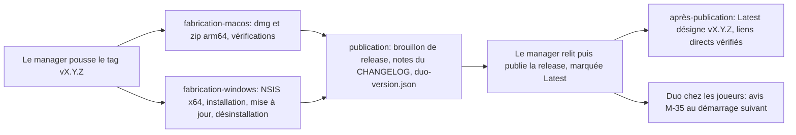

# ADR 0011: installateurs, signature et mises à jour de l'application

| Champ | Valeur |
|---|---|
| Statut | proposée |
| Date | 2026-10-30 |
| Rédacteur | ingenieur-build |
| À relire par | architecte-technique (cohérence avec les ADR 0001, 0002, 0003, 0006, 0010, 0013 et 0015), dev-reseau (pare-feu, `Info.plist`, autorisation Réseau local, ADR 0008), dev-plateforme (avis de nouvelle version), qa-testeur (critères vérifiés en CI) |
| Références | `docs/plateforme/cahier-des-charges.md` 1.0 (F11, F12, F13, F14, section 6); `docs/plateforme/architecture.md` (sections 9, 10, 11 et 15); `docs/plateforme/criteres-acceptation.md` (CA-PF-013, 053, 076, 077, 078, 081, 082, 101, 102, 127) |

## 1. Contexte

Duo s'installe sur deux machines: un Mac à puce M1 (macOS arm64) et un PC Windows 11 x64. Le client a exclu les certificats payants (compte Apple Developer, certificat de signature Windows). Le dépôt `Haeev/duo` est public: ses releases se téléchargent sans compte.

Ce que le cahier impose:

- F11: installateurs pour macOS (puce Apple) et Windows, et un guide d'installation hors de l'application.
- F12: les jeux s'ajoutent et se mettent à jour sans réinstaller l'application. Les versions de Duo restent donc rares: montées d'Electron (deux par an, architecture section 15) et correctifs de la plateforme.
- F13: si l'application est trop ancienne sur une machine, message clair et marche à suivre.
- Section 6: alertes de sécurité au premier lancement, et à chaque nouvelle version de Duo sous macOS; en version 1, mise à jour de l'application par avis et téléchargement manuel; Smart App Control, s'il est actif, bloque Duo.

Risques relevés par l'architecte (section 15): Smart App Control qui bloque une application non signée, alerte Gatekeeper à chaque version, autorisation « Réseau local » instable avec une signature ad hoc, règle du pare-feu Windows selon le mode d'installation.

Questions tranchées ici, une par sous-section de la section 3:

1. cibles, formats et outil de fabrication;
2. signature sous macOS;
3. signature sous Windows et Smart App Control;
4. installation Windows par utilisateur ou par machine, et effet sur le pare-feu;
5. fusibles d'Electron et intégrité de l'archive;
6. mise à jour de l'application, en version 1 et plus tard;
7. publication sur GitHub Releases et numéros de version;
8. jobs de CI macOS et Windows.

## 2. Faits vérifiés le 2026-10-30

Sources: les paquets eux-mêmes, installés dans un dossier jetable (`npm install --ignore-scripts electron-builder@26.18.0 electron-updater@6.8.11`, dernières versions publiées ce jour); la documentation d'Electron au tag `v45.2.0` de son dépôt; les notes techniques d'Apple; deux essais jetables hors du dépôt.

| # | Fait | Où |
|---|---|---|
| V1 | Sans `mac.identity`, electron-builder ne signe pas du tout, sans repli ad hoc; `"-"` demande la signature ad hoc. `hardenedRuntime` vaut `true` par défaut; combiné à une signature ad hoc, il exige l'entitlement `com.apple.security.cs.disable-library-validation`, sinon l'application ne se lance pas. L'autre issue est `hardenedRuntime: false`. | `scheme.json`, `out/mac/MacTargetHelper.js` |
| V2 | Ordre d'empaquetage: crochet `afterPack`, puis fusibles, puis signature. Un crochet `afterPack` peut donc modifier l'exécutable avant qu'il soit signé. | `out/platformPackager.js` |
| V3 | NSIS par utilisateur: `RequestExecutionLevel user`, installation dans `%LOCALAPPDATA%\Programs\<nom>` (dossier connu `UserProgramFiles`), chemin relu dans `HKCU` à chaque réinstallation. Par machine: `RequestExecutionLevel admin`. | `templates/nsis/installer.nsi`, `multiUser.nsh` |
| V4 | En un clic et par utilisateur, le nom du dossier d'installation vient du champ `name` du `package.json`, nettoyé: `duo` reste `duo`, `@duo/app` deviendrait `@duoapp`. Le GUID de l'installateur dérive de `appId`: changer `appId` casse les mises à jour par-dessus. | `out/targets/targetUtil.js`, `out/targets/nsis/NsisTarget.js`, essai de `sanitizeFileName` |
| V5 | La désinstallation garde les données (`deleteAppDataOnUninstall` vaut `false`), et une mise à jour passe `--updated` au désinstallateur pour la même raison. Les macros `customInstall` et `customUnInstall` permettent d'ajouter des commandes à l'installateur. | `templates/nsis/uninstaller.nsh`, `include/installUtil.nsh`, `installSection.nsh` |
| V6 | L'exécutable Windows reçoit `FileDescription` et `ProductName` égaux à `productName`, niveau d'exécution `asInvoker` par défaut; ressources modifiées par `resedit`, en JavaScript pur. | `out/winPackager.js`, `scheme.json` |
| V7 | electron-builder écrit l'empreinte de l'en-tête de `app.asar` dans `Info.plist` (`ElectronAsarIntegrity`) sous macOS, et dans une ressource `INTEGRITY/ELECTRONASAR` de l'exécutable sous Windows. Electron 45 valide l'archive sous macOS (depuis Electron 16) et Windows (depuis Electron 30), et arrête l'application si l'empreinte ne correspond pas. | `out/electron/electronMac.js`, `out/electron/electronWin.js`; `docs/tutorial/asar-integrity.md` |
| V8 | Le câblage des fusibles d'Electron 45.2.0 compte 9 fusibles, dont `wasm_trap_handlers` (actif par défaut). `@electron/fuses` 1.8.0, qu'utilise electron-builder 26.18, n'en connaît que 8; `@electron/fuses` 2.1.3 connaît le neuvième. | `build/fuses/fuses.json5` au tag `v45.2.0`; `dist/config.d.ts` des deux versions |
| V9 | Essai: application jetable empaquetée par electron-builder 26.18 sous Linux (cible `dir`) avec les fusibles de la section 3.5. Câblage relu dans le binaire: `000011001`, soit les 8 fusibles réglés et le neuvième intact. `ELECTRON_RUN_AS_NODE=1`, `NODE_OPTIONS` et `--inspect=0` restent sans effet; le dossier de données s'appelle `Duo` grâce à `productName`. Le binaire d'Electron non empaqueté, lui, ouvre l'inspecteur avec `--inspect=0`. | essai hors du dépôt |
| V10 | Playwright 1.63 lance Electron avec `--inspect=0 --remote-debugging-port=0` et attend la ligne « Debugger listening »: il ne peut pas piloter une application dont le fusible `nodeCliInspect` est coupé. | `playwright-core/lib/coreBundle.js` |
| V11 | Sous macOS, le chiffrement des cookies et `safeStorage` passent par le trousseau: sans signature stable, macOS peut redemander l'accès au trousseau après chaque mise à jour. `autoUpdater` (Squirrel.Mac) exige une application signée. | `docs/tutorial/code-signing.md` et `docs/api/auto-updater.md` d'Electron 45.2.0 |
| V12 | electron-updater passe, sous macOS, par l'`autoUpdater` natif (Squirrel.Mac). Sous Windows, `NsisUpdater` ne vérifie aucune signature quand `publisherName` est absent de `app-update.yml`. | `out/MacUpdater.js`, `out/NsisUpdater.js` |
| V13 | Le fournisseur GitHub d'electron-updater lit `github.com/<propriétaire>/<dépôt>/releases/latest` (page web demandée en JSON, sans l'API ni son quota), puis `latest.yml` sous ce tag. L'adresse de l'ancienne carte de blocs (téléchargement différentiel) se déduit de la nouvelle en remplaçant le numéro de version: des noms de fichiers sans numéro restent compatibles, puisque le tag en porte un. | `out/providers/GitHubProvider.js`, `out/providers/Provider.js` |
| V14 | `latest.yml` et `latest-mac.yml` s'écrivent dès qu'une configuration de publication existe, même avec `--publish never`. | `out/publish/PublishManager.js` |
| V15 | GitHub marque une release « Latest » automatiquement, d'après sa date et sa version, sauf `--latest=false`. `releases/latest/download/<fichier>` télécharge directement un fichier de la dernière release. Avec les releases immuables (réglage du dépôt), fichiers et tag ne changent plus après la publication; un brouillon reste modifiable. | aide de `gh` 2.89; sources de la documentation GitHub (`github/docs`) |
| V16 | `macos-latest` désigne macOS 26 arm64; `windows-latest` désigne Windows Server 2025 x64, pas Windows 11; le seul Windows 11 hébergé par GitHub est arm64 (`windows-11-arm`). Les runners standard sont gratuits pour un dépôt public. | README de `actions/runner-images`; `github/docs` |
| V17 | Note technique TN3179 d'Apple (révisée le 2026-10-06): l'autorisation Réseau local suit l'identité du programme par sa signature, ce qui est peu fiable avec une signature ad hoc; elle s'appuie aussi sur l'UUID de l'exécutable principal, qui doit être unique; son état est propre à chaque compte d'utilisateur; la remettre à zéro n'est possible qu'à partir de macOS 27.2. TN3178: deux applications au même UUID peuvent se voir appliquer les contraintes réseau l'une de l'autre. | developer.apple.com |
| V18 | L'exécutable principal d'Electron 45.2.0 pour arm64 est un Mach-O mince dont l'UUID vaut `4c4c446b-5555-3144-a1a1-136b14fc37ac`, le même pour toute application bâtie sur cette version. Essai: la commande de chargement `LC_UUID` se relit et se réécrit (UUID v5) avec un script Node d'une quarantaine de lignes. Son `Info.plist` fixe `LSMinimumSystemVersion` à `13.0` et ne déclare pas `LSFileQuarantineEnabled`. | archive officielle `electron-v45.2.0-darwin-arm64.zip` |
| V19 | Electron 45 offre `app.isInApplicationsFolder()` et `app.moveToApplicationsFolder()` sous macOS. | `docs/api/app.md` |

Non vérifiable depuis l'environnement cloud, et repris en section 5: libellés et déroulé exacts de Gatekeeper, de SmartScreen, de Smart App Control et de l'alerte du pare-feu sur les machines du client; tenue de l'autorisation Réseau local d'une version ad hoc à la suivante; absence de SmartScreen au lancement de Duo une fois installé.

## 3. Options et décisions

### 3.1 Cibles, formats et outil de fabrication

| Option | Pour | Contre |
|---|---|---|
| A. electron-builder 26: macOS dmg et zip arm64, Windows NSIS x64 en un clic | NSIS par utilisateur au chemin stable (V3); signature ad hoc explicite (V1); fusibles et intégrité de l'archive sur les deux systèmes (V7, V9); electron-updater possible plus tard sous Windows avec un NSIS non signé (V12) | outil tiers à suivre de près |
| B. Electron Forge 8: DMG, ZIP et Squirrel.Windows | outil officiel d'Electron | Squirrel.Windows installe chaque version dans un dossier `app-<version>`: le chemin de l'exécutable change à chaque mise à jour, donc la règle du pare-feu aussi, avec une nouvelle alerte à chaque version (fonctionnement connu de Squirrel.Windows, non essayé ici); intégration de Vite plus jeune |
| C. Autres formats: application universelle (x64 et arm64), `pkg` pour macOS, MSI, MSIX, exécutable portable | | universelle: environ deux fois le poids, pour aucune machine Intel; `pkg`: droits d'administrateur en plus de la même alerte; MSI: installation par machine; MSIX: s'installe seulement s'il est signé par un certificat de confiance (hors mode développeur de Windows); portable: aucune entrée dans le menu Démarrer et extraction à chaque lancement, lente sur un disque dur |

**Décision: A.** C'est la seule option qui garde, sous Windows et sans droits, le même chemin d'exécutable d'une version à l'autre, donc la même règle du pare-feu; elle prend aussi en charge tout le reste de cet ADR (V1, V7, V9, V12), et c'est l'outil déjà retenu par l'architecture (section 5.3).

- macOS: `dmg` pour les joueurs (fenêtre « glisser Duo dans Applications »), `zip` pour la future mise à jour et pour les vérifications de la CI; arm64 seulement. Système minimal: macOS 13, celui d'Electron 45 (V18).
- Windows: NSIS en un clic, x64 seulement, en français (`language: 1036`), raccourcis dans le menu Démarrer et sur le Bureau, Duo lancé à la fin de l'installation. Système minimal: Windows 10, celui d'Electron 45.
- Noms de fichiers stables, sans numéro de version: `Duo-macOS.dmg`, `Duo-macOS.zip`, `Duo-Windows.exe`. Le guide peut ainsi donner des liens directs qui ne changent jamais (`https://github.com/Haeev/duo/releases/latest/download/Duo-Windows.exe`), et personne n'a à choisir parmi les fichiers techniques d'une release. V13 garantit que ce choix reste compatible avec electron-updater.
- Langues d'Electron réduites au français et à l'anglais (`electronLanguages`), pour tenir le budget de 150 Mo par installateur (architecture 13.2); les menus en français restent vérifiés par CA-PF-122.
- Le paquet signé du jeu témoin (ADR 0010) entre dans les ressources de l'application par `extraResources`.
- Configuration dans `apps/duo/electron-builder.yml` (le YAML accepte les commentaires qui expliquent les choix).

Identifiants figés à la première version installée chez le client, car chacun casse quelque chose s'il change:

| Identifiant | Valeur | Ce qui casse |
|---|---|---|
| `appId`, donc `CFBundleIdentifier` | `io.github.haeev.duo` | mise à jour par-dessus sous Windows (GUID dérivé, V4); autorisations de macOS liées à l'application |
| `productName` | `Duo` | dossier de données (`%APPDATA%\Duo`, `~/Library/Application Support/Duo`): les données sembleraient perdues; nom affiché par Windows (V6) |
| `name` du paquet de l'application | `duo` | dossier d'installation `%LOCALAPPDATA%\Programs\duo` (V4), donc la règle du pare-feu (section 3.4). L'ADR 0002 doit nommer le paquet de l'application `duo`, sans portée `@duo/` |
| exécutables | `Duo.app/Contents/MacOS/Duo`, `Duo.exe` | règle du pare-feu, raccourcis |

### 3.2 Signature sous macOS

| Option | Gatekeeper | Autorisation Réseau local | Mise à jour automatique | Coût |
|---|---|---|---|---|
| A. Aucune signature (`identity: null`) | sur puce Apple, un code à la signature invalide ne se lance pas: l'application modifiée par l'empaquetage (renommage, `Info.plist`, fusibles) serait refusée | sans objet | non | nul |
| B. Ad hoc (`identity: "-"`, `hardenedRuntime: false`) | alerte au premier lancement de chaque version, franchie par Réglages Système > Confidentialité et sécurité > « Ouvrir quand même » | suivie par l'empreinte du code, qui change à chaque version: nouvelle demande ou état incohérent possibles (V17) | non: Squirrel.Mac exige une signature (V11) | nul |
| C. Certificat auto-signé, clé privée dans les secrets de GitHub | même alerte attendue (application non notarisée), à vérifier | identité stable d'une version à l'autre (exigence de signature fondée sur le certificat), mais non délivrée par Apple: effet inconnu | Squirrel.Mac compare la mise à jour à l'exigence de signature de l'application en place: peut-être, non vérifié | nul, mais une clé à garder à vie et un trousseau temporaire à monter en CI |
| D. Developer ID et notarisation | aucune alerte | fiable | oui | 99 dollars par an: exclu par le client |

**Décision: B**, avec deux précisions.

1. `hardenedRuntime: false` plutôt que l'entitlement `disable-library-validation` (V1): le runtime renforcé ne sert qu'à la notarisation, que Duo n'aura pas. Une pièce de moins, même résultat.
2. L'UUID de l'exécutable principal est réécrit par le crochet `afterPack` (`apps/duo/build/after-pack.mjs`), avant les fusibles et la signature (V2). Valeur: UUID v5 dérivé de `appId`, de la version d'Electron et de l'architecture. Il devient propre à Duo, comme le demandent TN3179 et TN3178 (V17), et ne change qu'avec le binaire, c'est-à-dire à chaque montée d'Electron. La réécriture est vérifiée sur l'archive officielle (V18); son effet sur l'autorisation Réseau local se constate sur le Mac du client dès le prototype (section 5).

Raisons: B est la seule option gratuite qui produit une application lançable sur puce Apple sans secret à garder. C pourrait stabiliser l'autorisation Réseau local et ouvrir la mise à jour automatique, mais aucun de ses effets n'est vérifiable avant un essai sur le vrai Mac: elle devient l'essai suivant si B perd l'autorisation à chaque version.

Conséquences sous macOS:

- Alerte Gatekeeper au premier lancement, puis à chaque version téléchargée par le navigateur: le fichier porte l'attribut de quarantaine, et l'accord donné vaut pour une empreinte de code précise. Le guide d'installation décrit le passage, sans ligne de commande (CA-PF-078).
- Ni `safeStorage` ni chiffrement des cookies: le trousseau redemanderait l'accord à chaque version (V11). Pas de notifications natives non plus (architecture 11.2).
- Duo ouvert depuis l'image disque ou depuis Téléchargements tourne depuis un emplacement temporaire en lecture seule (translocation de Gatekeeper). Au premier lancement, Duo vérifiera `app.isInApplicationsFolder()` et proposera de s'y déplacer (`app.moveToApplicationsFolder()`, V19).
- `Info.plist`, à arrêter avec dev-reseau: `NSLocalNetworkUsageDescription` en français (proposition: « Duo utilise le réseau local pour trouver l'autre ordinateur de la maison et jouer à deux. »); `NSBonjourServices` seulement si l'ADR 0008 retient mDNS, la diffusion UDP n'en ayant pas besoin; `LSApplicationCategoryType` à `public.app-category.games`.

### 3.3 Signature sous Windows et Smart App Control

| Option | SmartScreen | Smart App Control actif | Coût et conditions |
|---|---|---|---|
| A. Pas de signature | alerte sur l'installateur téléchargé, à chaque version (chaque nouveau fichier non signé part sans réputation) | Duo bloqué, sans exception possible pour une seule application | nul |
| B. Certificat payant (OV ou EV) | l'alerte s'efface à mesure que la réputation s'établit | accepté | payant: exclu |
| C. Azure Artifact Signing | plus d'alerte | accepté | abonnement payant, ouvert à certains pays seulement (documentation d'Electron 45): exclu |
| D. SignPath Foundation | plus d'alerte | accepté | gratuit, mais réservé aux projets sous licence libre approuvée par l'OSI et sans partie propriétaire (conditions relevées par l'architecte, à relire); Duo n'a aujourd'hui aucune licence |
| E. Certificat auto-signé | inchangé | inchangé | il faudrait déclarer ce certificat comme autorité de confiance sur le PC, ce qui affaiblit sa sécurité: exclu |

**Décision: A pour la version 1.** Smart App Control (« Contrôle intelligent des applications » dans Windows en français) se traite d'abord par le relevé des machines (`docs/guides/releve-machines.md`, question Q4 du cahier), puis par le guide d'installation:

- « Désactivé »: rien à faire.
- « Activé »: il faut le désactiver avant d'installer Duo, dans Sécurité Windows > Contrôle des applications et du navigateur > Paramètres du contrôle intelligent des applications. L'antivirus Microsoft Defender et SmartScreen restent actifs. C'est une décision du client (section 6).
- « Évaluation »: Windows peut l'activer de lui-même plus tard et bloquer Duo du jour au lendemain. Même recommandation que pour « Activé ».
- Selon des sources secondaires relevées par l'architecte (architecture 11.2), on peut le réactiver sans réinstaller Windows depuis les mises à jour d'avril 2026; à vérifier sur le PC avant de l'annoncer au client.

Levier pour plus tard: D, si le client décide un jour de publier Duo sous licence libre. La décision est lourde (le code et les jeux deviendraient réutilisables par tous): elle ne se prend pas pour une alerte.

### 3.4 Installation Windows par utilisateur ou par machine, et pare-feu

| Critère | A. Par utilisateur, en un clic | B. Par machine, en un clic, règle du pare-feu créée par l'installateur | C. Installateur assisté qui demande « pour moi » ou « pour tous » |
|---|---|---|---|
| Droits demandés | aucun (V3) | administrateur (Contrôle de compte d'utilisateur), à l'installation et à chaque mise à jour | selon la réponse |
| CA-PF-077: aucune demande d'administrateur | satisfait | contredit | seulement avec la bonne réponse |
| Compte standard sans mot de passe d'administrateur | s'installe | ne s'installe pas | selon la réponse |
| Alerte du pare-feu | au premier salon (première écoute réseau); « Autoriser » demande l'accord d'un administrateur (architecture 7.3, à vérifier sur le PC); « Annuler » crée des règles de blocage silencieuses, que le diagnostic doit détecter (ADR 0008) | aucune sur un réseau Privé: la règle existe avant le premier lancement (`netsh` dans `customInstall`, V5) | selon la réponse |
| Règle du pare-feu après une mise à jour | conservée: même chemin d'exécutable, `%LOCALAPPDATA%\Programs\duo\Duo.exe`, relu dans `HKCU` (V3) | conservée | selon la réponse |
| Mise à jour automatique plus tard | silencieuse et sans droits | demande de droits à chaque version | selon la réponse |
| Exposition | l'exécutable vit dans un dossier modifiable par l'utilisateur: un programme de ce compte pourrait le remplacer et hériter de la règle | dossier protégé (`Program Files`) | selon la réponse |

**Décision: A**, la seule option compatible avec CA-PF-077, avec la fiche de l'équipe et avec une future mise à jour silencieuse. Elle laisse une alerte du pare-feu au premier salon: l'écran E03 la prépare (« Laisse "Réseaux privés" coché, clique sur "Autoriser", réponds "Oui" ») et le diagnostic la rattrape en cas de refus (M-03). L'exposition de la colonne A est acceptée: un programme qui tourne déjà sous le compte du joueur peut faire bien pire qu'hériter d'une règle limitée au réseau privé.

Variante qui ne touche pas à l'installateur, laissée à l'ADR 0008 (dev-reseau): Duo crée lui-même la règle « réseaux privés » par une demande d'élévation explicite après l'écran E03, au lieu de laisser Windows afficher son alerte à cases à cocher. Cet ADR ne l'empêche pas.

Conséquences:

- Ne jamais passer plus tard à une installation par machine: le chemin changerait, Windows redemanderait l'autorisation, et deux installations coexisteraient.
- Les règles créées par Windows survivent à la désinstallation (les retirer exigerait des droits d'administrateur); une réinstallation au même chemin les retrouve, ce qui sert CA-PF-082.
- Le diagnostic lit les règles du pare-feu par des objets (PowerShell ou COM), jamais en analysant le texte affiché par `netsh`, qui dépend de la langue du système: la CI tourne sur Windows Server (V16), en anglais selon toute vraisemblance (langue non documentée), le PC sur un Windows 11 en français.

### 3.5 Fusibles d'Electron et intégrité de l'archive

Trois options: A. l'option `electronFuses` d'electron-builder (8 fusibles réglables, le neuvième laissé à sa valeur par défaut); B. les 9 fusibles posés dans le crochet `afterPack` avec `@electron/fuses` 2.x et son option `strictlyRequireAllFuses`; C. aucun fusible.

**Décision: A**, essayée avec succès (V9). B devient nécessaire le jour où une version d'Electron ajoute un fusible qu'il faut régler. C laisse ouvertes des portes que Duo n'utilise pas.

| Fusible | Valeur | Raison et conséquence |
|---|---|---|
| `runAsNode` | coupé | `ELECTRON_RUN_AS_NODE` ignoré; `child_process.fork` devient impossible, on emploie `utilityProcess` ou `worker_threads` |
| `cookieEncryption` | coupé (défaut) | il passe par le trousseau de macOS, qui redemanderait l'accord à chaque version ad hoc (V11); Duo n'a pas de cookies à protéger |
| `nodeOptions` | coupé | `NODE_OPTIONS` et `NODE_EXTRA_CA_CERTS` ignorés |
| `nodeCliInspect` | coupé | `--inspect` ignoré; Playwright ne pilote donc pas l'application empaquetée (V10) |
| `embeddedAsarIntegrityValidation` | actif | empreintes écrites par electron-builder sous macOS et Windows (V7) |
| `onlyLoadAppFromAsar` | actif | sans lui, un dossier `app` posé à côté contournerait la validation |
| `loadBrowserProcessSpecificV8Snapshot` | coupé (défaut) | pas d'instantané V8 propre à Duo |
| `grantFileProtocolExtraPrivileges` | coupé | Duo ne sert rien en `file://` (protocoles `duo://` et `duo-game://`) |
| `wasmTrapHandlers` | actif (défaut) | inconnu d'electron-builder 26.18 (V8), laissé intact; il accélère le WebAssembly, qu'emploieraient par exemple des bibliothèques de physique |

Limite assumée: sans signature de confiance, ces protections ne résistent pas à quelqu'un qui peut déjà écrire dans le dossier de l'application. Elles ferment les entrées faciles (variables d'environnement, options de ligne de commande, code hors de l'archive) et font échouer franchement une archive abîmée.

Conséquences pour les tests, cohérentes avec l'ADR 0013: les tests Playwright, et les versions de test qui exposent leurs crochets par `electronApp.evaluate()`, tournent sur l'application non empaquetée (binaire d'Electron de `node_modules` et code compilé), sans fusibles. L'application empaquetée se vérifie par un test de lancement sans Playwright: lancée avec `--duo-data-dir` (option présente dans les versions publiées, ADR 0003, point 9), elle écrit dans son journal l'événement « lanceur prêt » (ADR 0015), que la CI attend.

### 3.6 Mise à jour de l'application

En version 1:

| Option | macOS | Windows | Pour | Contre |
|---|---|---|---|---|
| A. Avis de nouvelle version et téléchargement manuel, sur les deux systèmes | alerte Gatekeeper à chaque version | SmartScreen à chaque version | conforme au cahier (section 6); un seul parcours sur les deux machines; un seul petit fichier à publier et à lire | deux alertes à franchir par version |
| B. A sous macOS, electron-updater sous Windows dès la version 1 | idem | silencieuse | moins d'étapes sur le PC | deux parcours à expliquer et à tester dès la version 1; hors du périmètre de la version 1 du cahier |
| C. electron-updater partout | impossible avec une signature ad hoc (V11, V12) | silencieuse | | |

**Décision pour la version 1: A.**

- Chaque release de l'application porte un fichier `duo-version.json`, que Duo lit à l'adresse `https://github.com/Haeev/duo/releases/latest/download/duo-version.json`: une requête, sans l'API de GitHub ni son quota (V15).
- Lecture au démarrage, puis toutes les 6 heures si Duo reste ouvert, avec un délai de 10 s et sans relance insistante. Sans Internet, ou si le fichier est absent ou invalide, rien ne s'affiche (CA-PF-088, CA-PF-127). L'avis M-35 n'apparaît jamais pendant une partie.
- Contenu (clés en anglais, textes en français):

```json
{
  "schema": 1,
  "version": "1.2.0",
  "publishedAt": "2026-11-20",
  "summary": "Corrige la reconnexion après une mise en veille.",
  "page": "https://github.com/Haeev/duo/releases/tag/v1.2.0",
  "guide": "https://github.com/Haeev/duo/blob/main/docs/plateforme/installation.md",
  "requires": { "darwin": "13.0", "win32": "10.0" },
  "files": {
    "darwin-arm64": { "name": "Duo-macOS.dmg", "size": 123456789, "sha256": "..." },
    "win32-x64": { "name": "Duo-Windows.exe", "size": 98765432, "sha256": "..." }
  }
}
```

- Le module `versions` du processus principal (dev-plateforme, lot L11) valide ce fichier par schéma, n'accepte que des adresses commençant par `https://github.com/Haeev/duo/`, compare les versions selon SemVer avec `app.getVersion()`, et si `requires` exclut le système de la machine, l'avis le dit au lieu de proposer un téléchargement.
- M-35 propose « Télécharger Duo 1.2.0 » (lien direct du fichier pour ce système) et un lien vers la section « Mettre Duo à jour » du guide d'installation, qui sert aussi de page de téléchargement (`docs/plateforme/installation.md`).
- Le même lien de guide sert à M-13 et M-27 (« Comment mettre Duo à jour », F13).

Plus tard (rubrique « Plus tard » du cahier), par étapes, chacune après un essai chez le client:

1. Windows: electron-updater, fournisseur GitHub (V13): téléchargement en arrière-plan, installation à la fermeture de Duo, jamais pendant une partie, sans droits (V3) et sans `publisherName` (V12). Un fichier téléchargé par Duo ne porte pas la marque de provenance Internet que pose le navigateur: SmartScreen ne devrait plus apparaître, à vérifier. Dès la version 1, la CI publie `latest.yml` et les cartes de blocs (V14), pour que la première version équipée d'electron-updater trouve tout en place.
2. macOS: mise à jour maison. Le processus principal télécharge le zip, vérifie une signature Ed25519 du fichier de version (clé publique dans l'application, clé privée dans les secrets de GitHub), remplace `/Applications/Duo.app`, puis relance. Un fichier écrit par Node ne reçoit pas l'attribut de quarantaine (Electron ne déclare pas `LSFileQuarantineEnabled`, V18): plus d'alerte Gatekeeper attendue, à vérifier. Autre piste: le certificat auto-signé de la section 3.2 avec electron-updater. Conditions: Duo installé dans Applications, compte autorisé à y écrire, autorisation Réseau local observée après une mise à jour.

### 3.7 Publication sur GitHub Releases et numéros de version

Deux options: A. chaque job de fabrication publie lui-même (`--publish always`, fournisseur `github`), les deux jobs écrivant dans le même brouillon; B. les jobs de fabrication produisent leurs fichiers sans rien publier (`--publish never`), puis un dernier job sous Linux crée le brouillon de release, y joint tous les fichiers et y met les notes.

**Décision: B**: un seul endroit qui crée la release, des notes en français maîtrisées, et rien de visible tant que tout n'est pas prêt.



Règles:

- Tag `vX.Y.Z` égal à la version de `apps/duo/package.json`, sinon la publication échoue. SemVer propre à l'application, distinct de celui du SDK et de chaque jeu.
- Les versions remises au client n'ont pas de suffixe: jalons `0.x` avant la 1.0 (par exemple 0.1 pour le prototype, 0.5 pour l'alpha, 0.9 pour la bêta). Un suffixe (`-rc.1`) marque une version d'essai interne: release « préversion », jamais « Latest », donc jamais annoncée aux joueurs. C'est la raison de la règle: une bêta numérotée `1.0.0-beta.1` et publiée en préversion n'atteindrait jamais l'avis de nouvelle version.
- Notes de version: la section de la version dans `apps/duo/CHANGELOG.md` (format Keep a Changelog en français: Ajouté, Modifié, Corrigé, Retiré, Sécurité), écrite pour le client, plus un pied fixe (liens vers le guide, rappel de l'alerte de sécurité à franchir). Sa première phrase devient `summary`. La publication échoue si la section manque, et le contrôle typographique s'y applique.
- Fichiers joints: `Duo-macOS.dmg`, `Duo-macOS.zip`, `Duo-Windows.exe`, `latest.yml`, `latest-mac.yml`, les cartes de blocs, `duo-version.json`, `SHA256SUMS.txt`.
- Brouillon créé par `gh release create vX.Y.Z --draft --verify-tag --title "Duo X.Y.Z" --notes-file ...`; le manager relit, puis publie avec `gh release edit vX.Y.Z --draft=false --latest`. Les joueurs ne voient rien avant cette commande, car un brouillon n'est pas « Latest ».
- La marque « Latest » est réservée aux releases de l'application: toute autre release du dépôt (jeux et catalogue, ADR 0010) se crée avec `--latest=false`. Sinon, le lien direct du guide et `duo-version.json` désigneraient la release d'un jeu (V15). Garde-fou: un job déclenché à chaque publication de release vérifie que `releases/latest` désigne un tag `v*` et que les liens directs répondent avec les empreintes attendues. Si la règle est enfreinte, l'avis de version échoue sans bruit (fichier absent) et le job le signale.
- Releases immuables (V15): elles protégeraient les installateurs publiés, mais interdisent de réécrire un fichier dans une release existante. Or l'ADR 0010 met à jour `catalogue.json` dans la release au tag fixe `catalogue` à chaque publication de jeu. Décision: on ne les active pas tant que le catalogue garde cette forme. L'ADR 0010 doit aussi créer cette release et celles des jeux avec `--latest=false`.
- Si le dépôt devenait privé, les releases de l'application et `duo-version.json` passeraient au dépôt public de distribution prévu par l'ADR 0010; l'adresse lue par Duo changerait par une version de Duo.

### 3.8 Jobs de CI macOS et Windows

Quand lancer les jobs macOS et Windows:

| Option | Pour | Contre |
|---|---|---|
| A. Tous, à chaque push | régressions vues au plus tôt | runners macOS et Windows plus lents à obtenir et à exécuter que Linux: chaque push des branches de session attendrait |
| B. Tests sur ces systèmes à chaque demande de fusion vers `main`, à chaque push sur `main`, sur tag et à la demande; fabrication des installateurs sur tag et à la demande | CA-PF-053 et CA-PF-101 (jalon alpha) suivis à chaque étape reportée sur `main`; fabrication seulement quand elle sert | une régression propre à macOS ou Windows se voit au report sur `main`, pas avant (sauf déclenchement manuel) |
| C. Seulement sur tag et à la demande (fiche d'ingenieur-build) | le moins de minutes | régressions vues au moment de publier, trop tard pour les critères de l'alpha |

**Décision: B.** Le dépôt est public, donc les minutes macOS et Windows sont gratuites (V16): la règle de la fiche, pensée pour un dépôt privé, ne s'impose pas. Si le dépôt devenait privé, `systemes.yml` passerait à C, une ligne à changer.

| Workflow et job | Runner | Déclencheurs | Contenu | Critères |
|---|---|---|---|---|
| `verifications.yml` | `ubuntu-latest` | chaque push | défini par l'ADR 0013: lint, typecheck, tests unitaires, construction des jeux, contrôle typographique, E2E sous `xvfb-run`; en plus, validation de `electron-builder.yml` et des identifiants figés (section 3.1) | |
| `systemes.yml`, matrice | `macos-latest`, `windows-latest` | demande de fusion vers `main`, push sur `main` (déclencheurs de l'ADR 0013), tag `v*`, déclenchement manuel sur toute branche | installation avec cache; Vitest complet, dont l'arrêt brutal pendant l'écriture d'une sauvegarde de 20 Mo (100 essais), lancé si possible sous le Node d'Electron (`ELECTRON_RUN_AS_NODE` sur le binaire non empaqueté); Playwright sur l'application non empaquetée, dossiers personnel et de données aux chemins de test (espace, accents, apostrophe, émoji, forme décomposée); sous Windows, règle de blocage créée par `New-NetFirewallRule`, puis détection par le module de diagnostic | CA-PF-053, CA-PF-101, CA-PF-013 (partie CI) |
| `publication.yml`, `fabrication-macos` | `macos-latest` | tag `v*`, déclenchement manuel (fichiers gardés 7 jours, sans release) | voir ci-dessous | CA-PF-076, CA-PF-081 |
| `publication.yml`, `fabrication-windows` | `windows-latest` | idem | voir ci-dessous | CA-PF-077, CA-PF-081, CA-PF-082, CA-PF-102 |
| `publication.yml`, `publication` | `ubuntu-latest` | tag `v*`, après les deux fabrications | contrôle du tag et de la version, notes extraites du CHANGELOG, `duo-version.json` et `SHA256SUMS.txt`, brouillon de release | CA-PF-078 (liens), CA-PF-127 (fichier de version) |
| `apres-publication.yml` | `ubuntu-latest` | release publiée | « Latest » désigne un tag `v*`; `duo-version.json` et les trois fichiers se téléchargent par les liens directs, empreintes conformes | |

`fabrication-macos`:

1. Garde: `uname -m` vaut `arm64`.
2. Fabrication: `electron-builder --mac --arm64 --publish never`.
3. Architecture: `lipo -archs` sur l'exécutable et sur le cadre Electron ne renvoie que `arm64`.
4. Signature: `codesign --verify --deep --strict` réussit et `codesign -dv` indique `Signature=adhoc`, sur l'application construite, sur celle extraite du zip et sur celle copiée depuis le dmg.
5. UUID: `dwarfdump --uuid` donne la valeur attendue (section 3.2), différente de celle d'Electron (V18).
6. Fusibles: les 9 valeurs relues avec `@electron/fuses` 2.1.3 (commande `read`) sont celles de la section 3.5.
7. `Info.plist`: identifiant, version égale au tag, `NSLocalNetworkUsageDescription`, `ElectronAsarIntegrity`, `LSMinimumSystemVersion`.
8. Poids: 150 Mo au plus par fichier; absence des marqueurs des crochets de test et de la clé publique de test dans l'archive de l'application (ADR 0013).
9. Lancement: image disque montée (`hdiutil attach -nobrowse`), Duo copié dans `/Applications`, lancé avec `--duo-data-dir` sur un dossier temporaire; la ligne « lanceur prêt » paraît dans le journal en 30 s au plus, puis Duo se ferme sans rapport de plantage. Ce lancement prouve aussi que la validation de l'archive passe.
10. Installation par-dessus (CA-PF-081): la version publiée précédente (dernière release `v*`, récupérée par `gh release download`) est installée et lancée sur un dossier de données de référence (produit par les tests E sous Linux), puis remplacée par la nouvelle; les données restent intactes (empreintes) ou migrées selon l'ADR 0009, et le lancement réussit. Étape sautée à la toute première release.

`fabrication-windows`:

1. Garde: architecture x64.
2. Fabrication: `electron-builder --win nsis --x64 --publish never`.
3. `Duo.exe` est un exécutable x64; son manifeste et celui de l'installateur demandent `asInvoker`; la ressource `ELECTRONASAR` est présente; les 9 fusibles relus sont ceux de la section 3.5.
4. Poids: 150 Mo au plus; absence des marqueurs des crochets de test et de la clé publique de test (ADR 0013).
5. Installation silencieuse (`Duo-Windows.exe /S`), CA-PF-077: fichiers dans `%LOCALAPPDATA%\Programs\duo\`, entrée de désinstallation sous `HKCU` et non sous `HKLM`, raccourci dans le menu Démarrer, rien dans `Program Files`; test de lancement comme sous macOS.
6. Installation par-dessus (CA-PF-081): version précédente puis nouvelle, en silencieux; une seule entrée de désinstallation, à la nouvelle version; données intactes; lancement réussi.
7. Désinstallation (CA-PF-082): désinstallateur silencieux; exécutable et raccourcis retirés, `%APPDATA%\Duo` intact; une réinstallation retrouve le profil.
8. Compte au nom accentué (CA-PF-102): compte standard `Hélène D` créé par `New-LocalUser`, avec un mot de passe aléatoire généré dans le job et jamais conservé; installation et test de lancement sous ce compte (dossier `C:\Users\Hélène D`), puis le scénario E2E de partie avec sauvegarde, sur l'application non empaquetée, sous le même compte. Comme le compte est standard, une installation réussie prouve aussi qu'aucun droit d'administrateur n'est requis: sur le runner, le compte habituel est administrateur et le Contrôle de compte d'utilisateur n'y affiche rien. La façon de lancer un programme sous un autre compte sur le runner (`Start-Process -Credential -LoadUserProfile`, ou tâche planifiée) reste à éprouver.

Pour tous les workflows: actions tierces épinglées par empreinte de commit; permissions `contents: read` par défaut et `contents: write` pour le seul job `publication`; aucun secret pour publier l'application (le jeton fourni par GitHub suffit); `timeout-minutes` sur chaque job. Caches: magasin de pnpm (clé: système et empreinte du lockfile), binaire d'Electron (`~/Library/Caches/electron`, `%LOCALAPPDATA%\electron\Cache`) et outils d'electron-builder (`~/Library/Caches/electron-builder`, `%LOCALAPPDATA%\electron-builder\Cache`).

Limite: `windows-latest` est un Windows Server, pas un Windows 11 (V16). Smart App Control, SmartScreen, l'alerte du pare-feu, les libellés en français et le matériel ne se vérifient que sur le PC du client.

## 4. Conséquences

Ce qu'on gagne: aucun coût ni secret pour publier l'application; un seul pipeline pour les deux systèmes; des liens de téléchargement stables pour le guide; une installation Windows sans droits, au chemin stable, qui garde la règle du pare-feu d'une version à l'autre; une mise à jour automatique sous Windows possible plus tard sans changer d'installateur.

Ce qu'on accepte: une alerte de sécurité à chaque version (Gatekeeper sous macOS, SmartScreen sur l'installateur Windows); une autorisation Réseau local peut-être redemandée à chaque version sur le Mac; Smart App Control à désactiver s'il est actif; une mise à jour manuelle en version 1, acceptable parce que les versions de Duo resteront rares (F12).

Travail qui en découle:

| Qui | Quoi |
|---|---|
| ingenieur-build | lot L7: `electron-builder.yml`, crochet `after-pack.mjs` (UUID), workflows `systemes.yml`, `publication.yml` et `apres-publication.yml`, génération de `duo-version.json`, `apps/duo/CHANGELOG.md`; guide d'installation `docs/plateforme/installation.md`, minimal au prototype et complet à la bêta avec ux-ui-designer (CA-PF-078) |
| dev-plateforme | module `versions` et avis M-35; proposition de déplacement dans Applications; option du dossier de données et ligne « lanceur prêt » dans le journal; ni `safeStorage`, ni chiffrement des cookies, ni `child_process.fork` |
| dev-reseau | texte de `NSLocalNetworkUsageDescription`; ADR 0008 (déclenchement de l'alerte du pare-feu, variante de la règle créée par Duo, diagnostic); lecture des règles par objets et non par le texte de `netsh`; test de détection sur le runner Windows |
| architecte-technique | ADR 0002: paquet de l'application nommé `duo`; ADR 0010: `--latest=false` pour toute release qui n'est pas l'application (catalogue compris), pas de releases immuables tant que `catalogue.json` est réécrit; ADR 0013: E2E sur l'application non empaquetée, test de lancement sans Playwright pour l'application empaquetée |
| qa-testeur | preuve en CI de l'absence de droits d'administrateur par le compte standard (CA-PF-077); points de recette de la section 5 |
| ux-ui-designer | textes du guide (E00) pour Gatekeeper et SmartScreen à chaque version, texte de M-35, fenêtre de l'image disque |

Point ouvert, à trancher sur le Mac: l'ADR 0015 enregistre le rapport pour le studio dans Téléchargements et n'y attend aucune demande d'autorisation. D'expérience (non vérifié ici), macOS demande souvent l'accord d'une application qui écrit dans Téléchargements, et l'accord d'une application ad hoc pourrait être redemandé à chaque version. Si l'essai du prototype le confirme (section 5), le rapport passera par la fenêtre d'enregistrement du système, qui donne l'accès sans demande.

## 5. À vérifier sur les machines du client, dès le prototype

Le prototype publie deux versions successives (par exemple 0.1.0 puis 0.1.1) pour éprouver la mise à jour.

1. Mac, première installation depuis le dmg: message et libellés exacts de Gatekeeper, passage par « Ouvrir quand même ». Si macOS dit l'application « endommagée », la signature est cassée: c'est un défaut de fabrication, pas une étape du guide.
2. Mac, installation de la version suivante par-dessus: alerte Gatekeeper de nouveau; autorisation Réseau local conservée, redemandée ou incohérente (Réglages Système > Confidentialité et sécurité > Réseau local); aucune demande d'accès au trousseau. Si l'autorisation se perd à chaque version, essai du certificat auto-signé (section 3.2, option C).
3. Mac: Duo ouvert depuis l'image disque propose bien de se déplacer dans Applications; enregistrer un rapport pour le studio dans Téléchargements, sur la première version puis sur la suivante, pour voir si macOS demande un accord.
4. PC: état de Smart App Control (relevé des machines); avertissement éventuel du navigateur au téléchargement; libellés de SmartScreen; aucune demande d'administrateur à l'installation; aucun SmartScreen au lancement de Duo une fois installé; Microsoft Defender ne signale pas l'installateur (sinon, le soumettre à l'analyse gratuite de Microsoft).
5. PC: alerte du pare-feu au premier salon (libellés, demande d'accord d'un administrateur), puis règle conservée après l'installation de la version suivante.

## 6. Questions pour le client

- Si Smart App Control est « Activé » ou en « Évaluation » sur le PC, accepter de le désactiver avant d'installer Duo? Recommandation: oui; c'est la seule façon d'utiliser Duo sans certificat payant, et l'antivirus Microsoft Defender comme SmartScreen restent actifs.
- Plus tard seulement, si les alertes de Windows gênent vraiment: publier Duo sous licence libre pour obtenir une signature gratuite (SignPath Foundation)? Recommandation: ne pas trancher maintenant.

## 7. Historique

| Date | Statut | Changement | Auteur |
|---|---|---|---|
| 2026-10-30 | proposée | première version | ingenieur-build |
