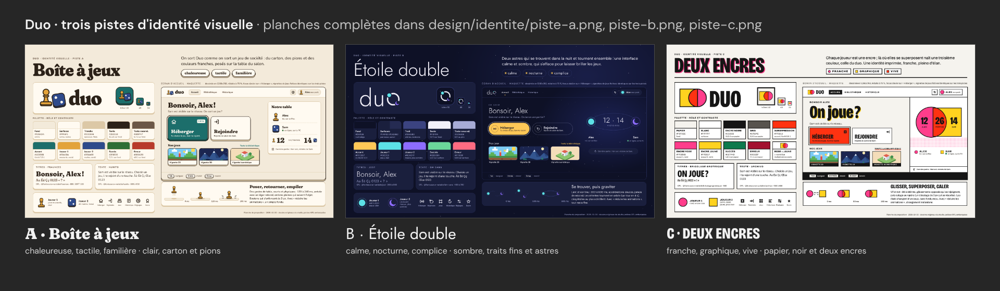
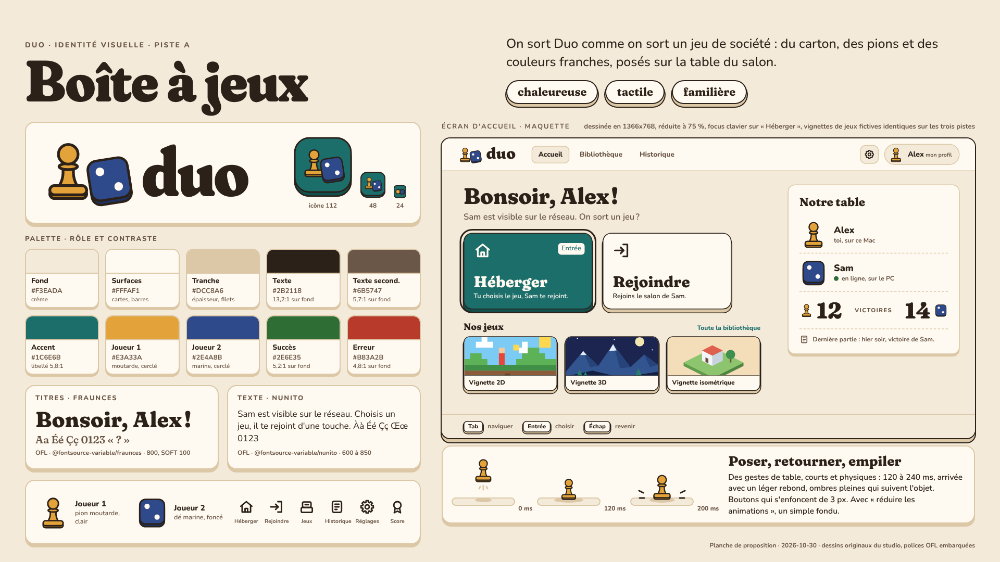
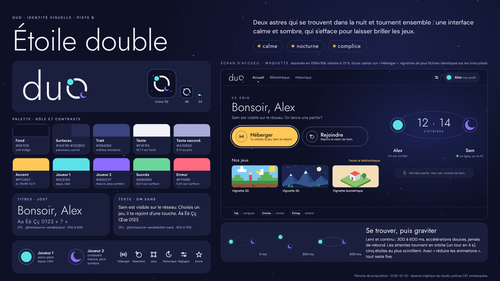
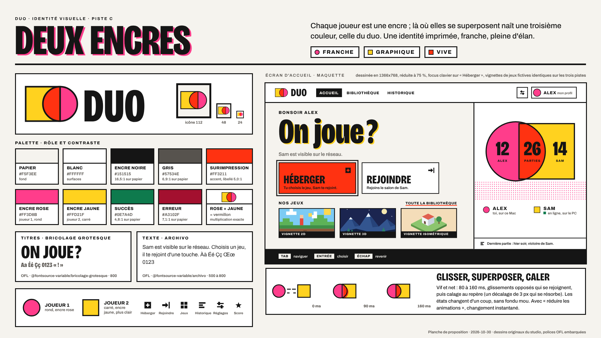

# Identité visuelle de Duo: trois pistes

| Champ | Valeur |
|---|---|
| Statut | proposition, en attente du choix du client (question Q1 du cahier des charges) |
| Version | 0.1 |
| Date | 2026-10-30 |
| Auteur | directeur-artistique |
| Planches | `design/identite/piste-a.png`, `piste-b.png`, `piste-c.png`, `comparatif.png` |

> Trois directions réellement différentes pour l'habillage de la plateforme: lanceur, salon, menus communs aux jeux. Le client en choisit une; elle deviendra `docs/plateforme/identite-visuelle.md`, avec ses jetons de design, écrite avec ux-ui-designer.

## Ce que l'identité doit réussir

1. **Encadrer sans écraser.** Duo accueillera des jeux en 2D, en 3D et en isométrique, chacun avec sa propre direction artistique. L'identité vit dans le cadre (barres, boutons, signes des joueurs, transitions, menus communs), jamais dans la zone de jeu. Pour comparer honnêtement, les trois maquettes montrent les mêmes trois vignettes de jeux fictives: 2D en pixels, 3D en facettes, isométrique.
2. **Deux joueurs distincts au premier coup d'oeil**, daltonisme compris: chaque joueur a une couleur, un écart de clarté avec l'autre et un signe (une forme) qui suffit à lui seul.
3. **Légère** pour le PC de référence (Core i3 de 2018, graphique intégré): aplats, ombres pleines sans flou, aucun flou plein écran ni post-traitement, animations limitées à `transform` et `opacity`. De toute façon, les écrans de la plateforme superposés au jeu vivent dans une vue séparée (voir `architecture.md`): un flou d'arrière-plan n'y verrait pas le jeu. Les trois pistes posent donc leurs menus sur des voiles opaques ou semi-opaques.
4. **Lisible en 1366x768**: texte courant à 16 px au moins, traits de 1,5 px au moins, contraste WCAG AA (4,5:1 pour le texte, 3:1 pour les composants graphiques).
5. **Produisible par l'équipe**: SVG, CSS et scripts; polices sous licence OFL embarquées depuis `@fontsource`, aucun chargement réseau.

Chaque maquette d'accueil est dessinée en 1366x768 (le PC peut être un portable), au tutoiement décidé par le client, avec le focus clavier visible sur « Héberger ».

## Méthode des contrôles

- **Contraste**: formule WCAG 2.x (luminance relative calculée en sRGB linéarisé); seuils AA de 4,5:1 pour le texte et de 3:1 pour les composants graphiques.
- **Clarté et écarts**: L* CIELAB (illuminant D65) et écart de couleur ΔE2000.
- **Daltonisme**: matrices de Machado, Oliveira et Fernandes (2009), sévérité totale, appliquées en RGB linéaire à chaque planche:
  - deutéranopie: `convert piste-a.png -colorspace RGB -color-matrix "0.367322 0.860646 -0.227968 0.280085 0.672501 0.047413 -0.011820 0.042940 0.968881" -colorspace sRGB piste-a-deuteranopie.png`
  - protanopie: même commande avec `0.152286 1.052583 -0.204868 0.114503 0.786281 0.099216 -0.003882 -0.048116 1.051998`
- **Niveaux de gris**: `convert piste-a.png -colorspace Gray piste-a-gris.png`.
- **Reproduire**: `cd design/identite && npm install && node rendre.cjs && node controler.cjs`. `rendre.cjs` signale toute requête hors du disque et liste les polices réellement chargées; `controler.cjs` relit les couleurs dans le bloc `palette` de chaque planche et produit les tableaux de ce document: après toute retouche de palette, le relancer et reporter ses tableaux ici (la légende des planches, elle, se recalcule seule).

## Fichiers

| Fichier | Rôle |
|---|---|
| `design/identite/piste-a.html`, `piste-b.html`, `piste-c.html` | planches sources, autonomes; palette dans le bloc `palette` |
| `design/identite/piste-a.png`, `piste-b.png`, `piste-c.png` | rendus 1920x1080 |
| `design/identite/comparatif.html`, `comparatif.png` | les trois planches réduites côte à côte (1920x560) |
| `design/identite/controles/piste-*-controles.png` | vues de contrôle: original, niveaux de gris, deutéranopie, protanopie |
| `design/identite/rendre.cjs` | rendu Playwright et vues de contrôle ImageMagick |
| `design/identite/controler.cjs` | contrastes et simulations, lus dans les planches |
| `design/identite/package.json` | polices OFL installées localement (`npm install`) |

## Piste A: Boîte à jeux

- **Intention**: on sort Duo comme on sort un jeu de société, avec du carton, des pions et des couleurs franches posés sur la table du salon.
- **Adjectifs**: chaleureuse, tactile, familière.
- **Références**, décrites avec des mots: boîtes de jeux de société des années 1960 et 1970, pions de bois peint, carnets de scores, cartes à coins arrondis.

### Palette

| Rôle | Couleur | Usage |
|---|---|---|
| Fond | `#F3EADA` crème | fond des écrans |
| Surfaces | `#FFFAF1` | cartes, barres, champs |
| Tranche (soutien) | `#DCC8A6` carton | épaisseur des cartes, filets, pointillés |
| Texte | `#2B2118` brun encre | texte, contours, anneau de focus |
| Texte secondaire | `#6B5747` | légendes, aides |
| Accent | `#1C6E6B` bleu canard | action principale, liens, sélection; libellé posé dessus en `#FFFAF1` |
| Joueur 1 | `#E3A33A` moutarde, clair | le pion; toujours cerclé de brun; texte posé dessus en `#2B2118` |
| Joueur 2 | `#2E4A8B` marine, foncé | le dé; texte posé dessus en `#FFFAF1` |
| Succès | `#2E6E35` | toujours accompagné de l'icône de validation |
| Erreur | `#B83A2B` tomate | toujours accompagné d'une icône et d'une consigne |

Teintes d'épaisseur dérivées, sans rôle propre: `#12504E` (accent), `#B07A1E` (joueur 1), `#1D3263` (joueur 2).

### Typographies

- Titres: **Fraunces**, variable, graisse 800 à 850 avec les axes SOFT 100 et WONK 1 (terminaisons rondes, un peu de fantaisie). Paquet `@fontsource-variable/fraunces`, OFL 1.1.
- Texte: **Nunito**, variable, graisse 600 à 850. Paquet `@fontsource-variable/nunito`, OFL 1.1.

### Formes, icônes, animation

- **Formes**: rectangles très arrondis (rayon 14 à 22 px), pastilles, cartes. Tout objet qu'on peut presser a une épaisseur: ombre pleine décalée de 5 à 8 px vers le bas, sans flou, dans une teinte plus sombre de l'objet, avec un contour brun de 2 px. Les panneaux passifs ont une tranche carton, sans contour sombre.
- **Signes des joueurs**: le pion (joueur 1) et le dé qui montre deux points (joueur 2), deux silhouettes différentes même en 16 px.
- **Icônes**: trait de 2,25 px sur une grille de 24 px, bouts arrondis, objets de la maison et de la table: maison (Héberger), porte (Rejoindre), boîtes empilées (bibliothèque), carnet de scores (historique), molette (réglages), médaille (score).
- **Animation**: des gestes de table, courts et physiques. Poser un objet en 120 à 240 ms avec un léger rebond (`cubic-bezier(.34, 1.56, .64, 1)`), retourner une carte (rotation 3D de 200 ms), enfoncer un bouton de 3 px. Avec « réduire les animations », un simple fondu de 120 ms.
- **Cadre des jeux**: les vignettes sont posées comme des couvercles de boîte. Les menus communs aux jeux (pause, joueur déconnecté) sont des cartes crème posées sur un voile sombre opaque à 60 %, pour ne pas éblouir par-dessus un jeu sombre.

### Logo

Un pion et un dé qui montre deux points, posés côte à côte, puis « duo » en Fraunces très gras et doux. Icône d'application: la boîte bleu canard qui contient le pion et le dé; en 16 et 24 px, un rond moutarde et un carré marine simplifiés. Le logo définitif sera vectorisé (lettres converties en contours), sans dépendre de la police.

### Ambiance sonore suggérée

Bois, carton et feutre: pion posé, cartes battues, petits grelots; marimba et kalimba chaleureux, tempo posé.

### Production et pièges

- Tout en SVG (symboles du pion et du dé réutilisés partout) et en CSS (`box-shadow` sans flou pour l'épaisseur). Aucune texture photo; un grain de papier, si on en veut un, tient dans une tuile PNG statique de 64 px.
- À éviter: bois ou carton photoréalistes, reliefs en dégradé, la silhouette de petit bonhomme en bois devenue l'emblème d'un jeu de plateau célèbre, contours noirs épais partout (registre de la piste C).

### Points forts

- La plus proche de l'intention du cahier des charges (« aussi simple que de sortir un jeu de société ») et la plus chaleureuse; elle s'accorde naturellement avec un jeu de vie de village en coopération.
- Joueurs reconnaissables par tous: 39 points de clarté d'écart, deux silhouettes différentes.
- Très légère à afficher: aplats et ombres pleines.

### Risques

- Fond clair: peut éblouir le soir dans une pièce tamisée. Une variante sombre doublerait le travail sur la palette.
- Peut glisser vers l'enfantin ou le daté si l'épaisseur et les contours ne sont pas dosés.
- Contraste fort entre le cadre crème et les jeux sombres ou au néon, d'où le voile sombre sous les menus communs.
- La moutarde n'atteint que 1,84:1 sur le fond: le contour brun du pion est obligatoire.

### Contrôles

| Premier plan | Fond | Rapport | Seuil | Résultat |
|---|---|---|---|---|
| texte `#2B2118` | fond `#F3EADA` | 13,19:1 | 4,5:1 (texte) | AA |
| texte `#2B2118` | surface `#FFFAF1` | 15,15:1 | 4,5:1 (texte) | AA |
| texte-2 `#6B5747` | fond `#F3EADA` | 5,71:1 | 4,5:1 (texte) | AA |
| texte-2 `#6B5747` | surface `#FFFAF1` | 6,56:1 | 4,5:1 (texte) | AA |
| sur-accent `#FFFAF1` | accent `#1C6E6B` | 5,78:1 | 4,5:1 (texte) | AA |
| accent `#1C6E6B` | fond `#F3EADA` | 5,04:1 | 4,5:1 (texte) | AA |
| succes `#2E6E35` | fond `#F3EADA` | 5,18:1 | 4,5:1 (texte) | AA |
| succes `#2E6E35` | surface `#FFFAF1` | 5,94:1 | 4,5:1 (texte) | AA |
| erreur `#B83A2B` | fond `#F3EADA` | 4,78:1 | 4,5:1 (texte) | AA |
| erreur `#B83A2B` | surface `#FFFAF1` | 5,49:1 | 4,5:1 (texte) | AA |
| sur-j1 `#2B2118` | j1 `#E3A33A` | 7,17:1 | 4,5:1 (texte) | AA |
| sur-j2 `#FFFAF1` | j2 `#2E4A8B` | 8,18:1 | 4,5:1 (texte) | AA |
| j1 `#E3A33A` | fond `#F3EADA` | 1,84:1 | 3,0:1 (composant) | sous 3:1, contour sombre obligatoire |
| j2 `#2E4A8B` | fond `#F3EADA` | 7,13:1 | 3,0:1 (composant) | AA |

| Joueurs | Joueur 1 | Joueur 2 | Écart de clarté L* | Écart ΔE2000 |
|---|---|---|---|---|
| vision normale | `#E3A33A` (L* 71,4) | `#2E4A8B` (L* 32,6) | 38,9 | 62,5 |
| niveaux de gris (ImageMagick) | 66 % | 29 % | 38 points | sans objet |
| deutéranopie | `#CAB53E` (L* 73,5) | `#1A498A` (L* 31,4) | 42,1 | 67,6 |
| protanopie | `#BAA62B` (L* 67,9) | `#2A518D` (L* 34,6) | 33,3 | 61,7 |

| Couleurs voisines | ΔE2000 normal | ΔE2000 deutéranopie |
|---|---|---|
| succes / erreur | 55,6 | 10,3 |
| accent / erreur | 48,8 | 30,9 |
| accent / j1 | 46,7 | 45,9 |
| accent / j2 | 28,1 | 17,2 |
| erreur / j1 | 37,2 | 23,4 |
| erreur / j2 | 40,8 | 50,5 |

Vues de la planche: `design/identite/controles/piste-a-controles.png` (original, niveaux de gris, deutéranopie, protanopie). Pixels mesurés sur la planche convertie: pion `#A9A9A9` contre dé `#484848` en niveaux de gris, `#C9B53D` contre `#194889` en deutéranopie.

Lecture: tous les textes passent AA. Les joueurs restent très éloignés dans toutes les simulations, et leurs silhouettes diffèrent. Succès et erreur se confondent en deutéranopie (ΔE 10,3): chaque message porte son icône.

## Piste B: Étoile double

- **Intention**: deux astres qui se trouvent dans la nuit et tournent ensemble; une interface calme et sombre, qui s'efface pour laisser briller les jeux.
- **Adjectifs**: calme, nocturne, complice.
- **Références**, décrites avec des mots: cartes du ciel anciennes, horloges astronomiques, planétariums, nuits d'été à la campagne.

### Palette

| Rôle | Couleur | Usage |
|---|---|---|
| Fond | `#0E1126` nuit indigo | fond des écrans, avec un léger dégradé radial statique |
| Surfaces | `#1A1F3D`, surface haute `#252B52` | panneaux, pastilles; survol et éléments surélevés |
| Trait (soutien) | `#3B4380` | orbites, bordures, touches |
| Texte | `#F3F1FA` blanc lunaire | texte, anneau de focus |
| Texte secondaire | `#A7ABD6` lavande | légendes, aides |
| Accent | `#FFC857` or | action principale, liens, point de navigation; libellé posé dessus en `#0E1126` |
| Joueur 1 | `#5CE1E6` aqua, clair | l'astre plein; texte posé dessus en `#0E1126` |
| Joueur 2 | `#8D6CFF` mauve, plus sombre | le croissant; texte posé dessus en `#0E1126` |
| Succès | `#6BD69A` | toujours accompagné de l'icône de validation |
| Erreur | `#FF6B81` rose corail | toujours accompagné d'une icône et d'une consigne |

Filet de séparation dérivé, sans rôle propre: `#2A3060`.

### Typographies

- Titres: **Jost**, variable, graisse 300 à 500, capitales espacées pour les surtitres. Paquet `@fontsource-variable/jost`, OFL 1.1.
- Texte: **DM Sans**, variable, graisse 400 à 700, avec taille optique. Paquet `@fontsource-variable/dm-sans`, OFL 1.1.

### Formes, icônes, animation

- **Formes**: cercles, arcs, ellipses d'orbite, points. Les actions sont des capsules entièrement arrondies; les cartes ont un rayon de 22 px et un filet de 1 px. La lueur est simulée par des anneaux concentriques semi-transparents, jamais par du flou.
- **Signes des joueurs**: l'astre plein (joueur 1) et le croissant (joueur 2), chacun dans un halo en anneau.
- **Icônes**: trait de 1,75 px, bouts ronds, un point plein en signature: émettre (Héberger), entrer en orbite (Rejoindre), constellation (bibliothèque), orbite avec traîne (historique), curseurs (réglages), étoile (score).
- **Animation**: lente et continue. 300 à 600 ms, accélérations douces (`cubic-bezier(.45, 0, .25, 1)`), jamais de rebond. Les attentes tournent en orbite (un tour en 4 s, rotation CSS d'un petit élément); cinq étoiles au plus scintillent (opacité seule). Avec « réduire les animations », tout reste fixe.
- **Cadre des jeux**: les vignettes ressortent de la nuit, cernées d'un filet fin. Les menus communs aux jeux sont des panneaux indigo opaques à 92 %, sans flou d'arrière-plan.

### Logo

« du » en Jost Light, et le « o » devient une orbite qui porte les deux astres: l'aqua plein et le croissant mauve. Icône d'application: l'orbite et ses astres sur un carré de nuit; en 16 et 24 px, un disque aqua et un croissant mauve.

### Ambiance sonore suggérée

Nappes douces et cloches de verre (célesta, harpe, synthé chaud), sons longs qui s'éteignent lentement; deux notes qui s'accordent quand les machines se trouvent.

### Production et pièges

- SVG et CSS. Le ciel étoilé est tiré par un script à graine fixe et figé dans un fichier SVG: aucun calcul à l'exécution. Orbites et halos en SVG, attentes en rotation CSS.
- À éviter: nébuleuses floues, dégradés animés, néon obtenu par du flou, traits sous 1,5 px, texte courant en Jost Light (réservé aux titres de 40 px et plus), photos de ciel.

### Points forts

- Le cadre le plus neutre pour des jeux encore inconnus: n'importe quelle vignette ressort sur la nuit, et les menus sombres se posent sur n'importe quel jeu sans l'éblouir.
- Confortable le soir, dans une pièce tamisée.
- Une image pour le moment clé du produit: les deux machines qui se trouvent sur le réseau sont deux astres qui se rejoignent.
- Sobre à produire et à afficher.

### Risques

- Peut paraître froide ou « technologique »; l'or de l'accent et le ton tutoyant des textes la réchauffent.
- Traits fins à tenir sur l'écran du PC en 1366x768.
- Une dalle d'entrée de gamme peut écraser les nuits très sombres: les surfaces `#1A1F3D` et `#252B52` sont à vérifier sur place.
- Le mauve du joueur 2 atteint 5,08:1 sur le fond: suffisant, à ne pas foncer.

### Contrôles

| Premier plan | Fond | Rapport | Seuil | Résultat |
|---|---|---|---|---|
| texte `#F3F1FA` | fond `#0E1126` | 16,66:1 | 4,5:1 (texte) | AA |
| texte `#F3F1FA` | surface `#1A1F3D` | 14,36:1 | 4,5:1 (texte) | AA |
| texte `#F3F1FA` | surface-2 `#252B52` | 12,14:1 | 4,5:1 (texte) | AA |
| texte-2 `#A7ABD6` | fond `#0E1126` | 8,38:1 | 4,5:1 (texte) | AA |
| texte-2 `#A7ABD6` | surface `#1A1F3D` | 7,22:1 | 4,5:1 (texte) | AA |
| texte-2 `#A7ABD6` | surface-2 `#252B52` | 6,11:1 | 4,5:1 (texte) | AA |
| sur-accent `#0E1126` | accent `#FFC857` | 12,11:1 | 4,5:1 (texte) | AA |
| accent `#FFC857` | fond `#0E1126` | 12,11:1 | 4,5:1 (texte) | AA |
| succes `#6BD69A` | fond `#0E1126` | 10,39:1 | 4,5:1 (texte) | AA |
| succes `#6BD69A` | surface `#1A1F3D` | 8,96:1 | 4,5:1 (texte) | AA |
| erreur `#FF6B81` | fond `#0E1126` | 6,81:1 | 4,5:1 (texte) | AA |
| erreur `#FF6B81` | surface `#1A1F3D` | 5,87:1 | 4,5:1 (texte) | AA |
| sur-j1 `#0E1126` | j1 `#5CE1E6` | 11,86:1 | 4,5:1 (texte) | AA |
| sur-j2 `#0E1126` | j2 `#8D6CFF` | 5,08:1 | 4,5:1 (texte) | AA |
| j1 `#5CE1E6` | fond `#0E1126` | 11,86:1 | 3,0:1 (composant) | AA |
| j2 `#8D6CFF` | fond `#0E1126` | 5,08:1 | 3,0:1 (composant) | AA |

| Joueurs | Joueur 1 | Joueur 2 | Écart de clarté L* | Écart ΔE2000 |
|---|---|---|---|---|
| vision normale | `#5CE1E6` (L* 82,8) | `#8D6CFF` (L* 55,7) | 27,1 | 42,0 |
| niveaux de gris (ImageMagick) | 77 % | 49 % | 28 points | sans objet |
| deutéranopie | `#BDC7E7` (L* 80,4) | `#0082FC` (L* 55,1) | 25,4 | 26,2 |
| protanopie | `#D2D7E7` (L* 86,0) | `#0088FF` (L* 56,9) | 29,1 | 30,7 |

| Couleurs voisines | ΔE2000 normal | ΔE2000 deutéranopie |
|---|---|---|
| succes / erreur | 69,4 | 6,7 |
| accent / erreur | 44,3 | 17,9 |
| accent / j1 | 41,5 | 41,9 |
| accent / j2 | 65,9 | 66,1 |
| erreur / j1 | 71,1 | 31,5 |
| erreur / j2 | 34,2 | 49,0 |

Vues de la planche: `design/identite/controles/piste-b-controles.png`. Pixels mesurés sur la planche convertie: astre `#C5C5C5` contre croissant `#7D7D7D` en niveaux de gris, `#BCC7E6` contre `#0081FB` en deutéranopie.

Lecture: tous les textes passent AA. Les joueurs gardent 25 à 29 points de clarté d'écart et deux formes différentes (disque, croissant). Succès et erreur se confondent en deutéranopie (ΔE 6,7), et l'or se rapproche de l'erreur (ΔE 17,9): chaque message porte son icône, et l'erreur ne colore jamais un bouton.

## Piste C: Deux encres

- **Intention**: chaque joueur est une encre; là où elles se superposent naît une troisième couleur, celle du duo. Une identité imprimée, franche, pleine d'élan.
- **Adjectifs**: franche, graphique, vive.
- **Références**, décrites avec des mots: affiches et fanzines imprimés en deux couleurs (risographie, sérigraphie), graphisme suisse et ses grilles, papiers de couleur.

### Palette

| Rôle | Couleur | Usage |
|---|---|---|
| Fond | `#F5F3EE` papier | fond des écrans |
| Surfaces | `#FFFFFF` blanc | cartes, barres |
| Texte | `#151515` encre noire | texte, filets de 3 à 5 px, contours, anneau de focus |
| Texte secondaire | `#57534E` gris | légendes, aides |
| Accent | `#FF3211` vermillon, surimpression exacte du rose et du jaune | actions principales et états « ensemble »; libellé posé dessus en `#151515`; jamais en texte sur papier (3,31:1) |
| Joueur 1 | `#FF3D8B` encre rose | le rond; texte posé dessus en `#151515` |
| Joueur 2 | `#FFD21F` encre jaune, plus claire | le carré; contour noir obligatoire (1,31:1 sur papier); texte posé dessus en `#151515` |
| Succès | `#0E7A4D` | toujours accompagné de l'icône de validation |
| Erreur | `#A3102F` carmin | toujours accompagné d'une icône; nettement plus sombre que le vermillon |

La surimpression est une multiplication exacte des deux encres: (255, 61, 139) x (255, 210, 31) / 255 donne (255, 50, 17), soit `#FF3211`.

### Typographies

- Titres: **Bricolage Grotesque**, variable, graisse 800, chasse étroite à 75 %, taille optique (ses pièges à encre évoquent l'imprimé). Paquet `@fontsource-variable/bricolage-grotesque`, OFL 1.1.
- Texte: **Archivo**, variable, graisse 500 à 800. Paquet `@fontsource-variable/archivo`, OFL 1.1.

### Formes, icônes, animation

- **Formes**: angles vifs, filets noirs de 3 px (5 px pour les grandes séparations), grille stricte, aplats sans ombre. Trame de points d'encre en motif SVG statique. Le décalage d'impression (4 à 5 px) est réservé aux grands titres, en ombre de texte pleine, sans flou.
- **Signes des joueurs**: le rond rose (joueur 1) et le carré jaune (joueur 2), toujours cernés de noir. Quand les deux joueurs sont réunis (salon, score), leurs formes se chevauchent et l'intersection prend la surimpression: dans la maquette, les victoires d'Alex sont dans le rond, celles de Sam dans le carré, et les parties jouées ensemble dans l'intersection.
- **Icônes**: pictogrammes pleins, géométriques, noirs: carré marqué d'une croix (Héberger), flèche pleine vers une barre (Rejoindre), quatre carrés (bibliothèque), barres (historique), curseurs (réglages), étoile (score).
- **Animation**: vive et nette. 80 à 160 ms (`cubic-bezier(.2, 0, 0, 1)` ou `steps()`), glissements opposés qui se rejoignent, puis calage au repère: un décalage de 3 px qui se résorbe. Les états changent d'un coup, sans fondu mou. Avec « réduire les animations », changement instantané.
- **Cadre des jeux**: vignettes cernées de noir avec un bandeau titre noir, comme des épreuves sur une planche. Menus communs aux jeux en blocs papier à filet noir.

### Logo

Le carré jaune et le rond rose qui se chevauchent, l'intersection en vermillon, puis « DUO » en Bricolage Grotesque très gras et étroit. Icône d'application: la marque sur papier dans un cadre noir; en 16 et 24 px, les deux formes sans filets.

### Ambiance sonore suggérée

Sons d'atelier d'impression (tampon, déclic, rouleau) et percussions sèches; synthés pop courts et une basse qui rebondit.

### Production et pièges

- SVG géométrique. Les intersections sont découpées par `clip-path` et leur couleur est calculée à l'avance: aucun mode de fusion, une couleur exacte et un coût nul. Trame en motif SVG, décalage d'impression en `text-shadow` sans flou.
- À éviter: `mix-blend-mode` (coût d'affichage, couleurs imprévisibles), décalage d'impression sur le texte courant, encres en couleur de texte sur papier, ombres floues, coins arrondis.

### Points forts

- La plus originale et la plus « Duo »: deux qui, ensemble, en font un troisième. Le système de couleurs raconte qui a fait quoi.
- Très reconnaissable, même en petit.
- Légère: aplats, filets, aucune ombre.

### Risques

- Couleurs vives: elles peuvent fatiguer sur une longue soirée et concurrencer les vignettes des jeux.
- Trois rouges voisins à tenir avec rigueur: rose du joueur 1, vermillon de l'accent, carmin de l'erreur (ΔE 25 à 27 entre eux).
- En niveaux de gris, la surimpression a presque la valeur de l'encre rose (L* 56 contre 58): seuls les filets noirs les séparent.
- Style affiche, plus clivant; fond clair le soir.

### Contrôles

| Premier plan | Fond | Rapport | Seuil | Résultat |
|---|---|---|---|---|
| texte `#151515` | fond `#F5F3EE` | 16,47:1 | 4,5:1 (texte) | AA |
| texte `#151515` | surface `#FFFFFF` | 18,26:1 | 4,5:1 (texte) | AA |
| texte-2 `#57534E` | fond `#F5F3EE` | 6,88:1 | 4,5:1 (texte) | AA |
| texte-2 `#57534E` | surface `#FFFFFF` | 7,63:1 | 4,5:1 (texte) | AA |
| sur-accent `#151515` | accent `#FF3211` | 4,97:1 | 4,5:1 (texte) | AA |
| accent `#FF3211` | fond `#F5F3EE` | 3,31:1 | 3,0:1 (composant) | AA |
| succes `#0E7A4D` | fond `#F5F3EE` | 4,84:1 | 4,5:1 (texte) | AA |
| succes `#0E7A4D` | surface `#FFFFFF` | 5,37:1 | 4,5:1 (texte) | AA |
| erreur `#A3102F` | fond `#F5F3EE` | 7,09:1 | 4,5:1 (texte) | AA |
| erreur `#A3102F` | surface `#FFFFFF` | 7,86:1 | 4,5:1 (texte) | AA |
| sur-j1 `#151515` | j1 `#FF3D8B` | 5,47:1 | 4,5:1 (texte) | AA |
| sur-j2 `#151515` | j2 `#FFD21F` | 12,60:1 | 4,5:1 (texte) | AA |
| j1 `#FF3D8B` | fond `#F5F3EE` | 3,01:1 | 3,0:1 (composant) | AA |
| j2 `#FFD21F` | fond `#F5F3EE` | 1,31:1 | 3,0:1 (composant) | sous 3:1, contour sombre obligatoire |

| Joueurs | Joueur 1 | Joueur 2 | Écart de clarté L* | Écart ΔE2000 |
|---|---|---|---|---|
| vision normale | `#FF3D8B` (L* 58,5) | `#FFD21F` (L* 85,7) | 27,3 | 64,1 |
| niveaux de gris (ImageMagick) | 42 % | 81 % | 39 points | sans objet |
| deutéranopie | `#9F9A86` (L* 63,5) | `#F6DC30` (L* 87,5) | 24,0 | 28,5 |
| protanopie | `#6C758D` (L* 49,3) | `#EBCF00` (L* 83,1) | 33,8 | 50,7 |

| Couleurs voisines | ΔE2000 normal | ΔE2000 deutéranopie |
|---|---|---|
| succes / erreur | 64,6 | 9,0 |
| accent / erreur | 24,8 | 25,2 |
| accent / j1 | 26,6 | 20,0 |
| accent / j2 | 46,7 | 19,4 |
| erreur / j1 | 26,1 | 26,3 |
| erreur / j2 | 64,6 | 43,3 |

Vues de la planche: `design/identite/controles/piste-c-controles.png`. Pixels mesurés sur la planche convertie: rond `#6B6B6B` contre carré `#CECECE` en niveaux de gris, `#9F9A86` contre `#F5DB2F` en deutéranopie.

Lecture: tous les textes passent AA; l'accent ne sert jamais de couleur de texte. Les joueurs gardent 24 à 34 points de clarté d'écart et deux formes différentes (rond, carré). Succès et erreur se confondent en deutéranopie (ΔE 9,0): chaque message porte son icône.

## Comparaison

| Critère | A · Boîte à jeux | B · Étoile double | C · Deux encres |
|---|---|---|---|
| Valeur dominante | clair et chaud | sombre | clair neutre, noir franc |
| Cadre pour les jeux | bon, contraste fort avec les jeux sombres | le plus neutre: les vignettes ressortent de la nuit | bon pour les jeux clairs; les encres vives concurrencent les vignettes |
| Menus par-dessus un jeu | cartes claires sur voile sombre | panneaux sombres, neutres sur tout jeu | blocs papier très contrastés |
| Confort en soirée | moyen (fond clair) | le meilleur | moyen (fond clair, couleurs vives) |
| Singularité | familière | évocatrice | la plus originale |
| Écart de clarté des joueurs (normal, deutéranopie) | 38,9 et 42,1 | 27,1 et 25,4 | 27,3 et 24,0 |
| Signes des joueurs | pion et dé | astre plein et croissant | rond et carré |
| Six symboles de profil prévus par l'UX | à redessiner en pièces de jeu | à redessiner en astres | correspondance directe |
| Point faible | peut faire daté ou enfantin | traits fins à tenir en 1366x768 | rouges voisins (rose, vermillon, erreur) |
| Coût de production et d'affichage | faible | faible | faible |

## Suites, quelle que soit la piste

1. Rédiger `docs/plateforme/identite-visuelle.md` avec ux-ui-designer: jetons CSS (couleurs, typographies, espacements, rayons, durées), composants et leurs états, focus compris.
2. Vectoriser le logo et produire les icônes d'application (macOS et Windows) par script.
3. Couleurs de profil (F01): `docs/plateforme/ux/parcours.md` prévoit six couleurs liées chacune à un symbole (rond, carré, triangle, losange, étoile, hexagone), deux joueurs ne pouvant pas avoir la même. La piste retenue fournira ces six teintes, dont les deux couleurs de joueurs de sa planche, et dessinera les six symboles dans son style: formes cernées de noir pour C (correspondance directe), pièces de jeu pour A, astres pour B (noms des symboles à ajuster avec ux-ui-designer). Je recommande trois teintes claires et trois foncées, avec une paire claire et foncée proposée par défaut, pour que l'écart de clarté s'ajoute au symbole dans la plupart des cas.
4. Inscrire les deux polices retenues dans `CREDITS.md` au moment de leur intégration dans l'application (OFL 1.1; le texte de la licence est fourni dans chaque paquet).
5. Transmettre la piste choisie au sound-designer pour l'identité sonore.

## Recommandation

**Je recommande la piste B, Étoile double.**

1. **Elle encadre le mieux des jeux qu'on ne connaît pas encore.** Un cadre sombre et calme met en valeur n'importe quelle vignette, en pixels, en 3D ou en isométrique, comme le font les consoles de salon. Les menus communs (pause, joueur déconnecté) en panneaux sombres se posent sur n'importe quel jeu sans l'éblouir: c'est le point qui départage le plus nettement, puisque ces menus apparaîtront par-dessus tous les jeux.
2. **Elle colle à l'usage réel**: deux personnes qui jouent le soir, dans la même pièce, souvent en lumière tamisée.
3. **Sa métaphore sert le moment clé du produit**: les deux machines qui se trouvent sur le réseau sont deux astres qui se rejoignent, l'attente devient une orbite, l'historique commun une trajectoire partagée. Le pilier « zéro friction » a une image.
4. **Elle reste la plus sobre** à produire et à afficher: aplats, traits, un ciel figé en SVG, des rotations simples.

Conditions pour la tenir: traits de 1,5 px au moins, Jost Light réservé aux titres de 40 px et plus, cinq étoiles animées au plus, vérification des surfaces sombres sur l'écran du PC.

Si le couple préfère une ambiance de jour, chaleureuse et ludique, la piste A est la meilleure alternative; elle demandera un voile sombre sous les menus communs aux jeux. La piste C est la plus originale; je la réserve à un goût affirmé pour le graphisme imprimé, car ses couleurs vives concurrencent les jeux.
