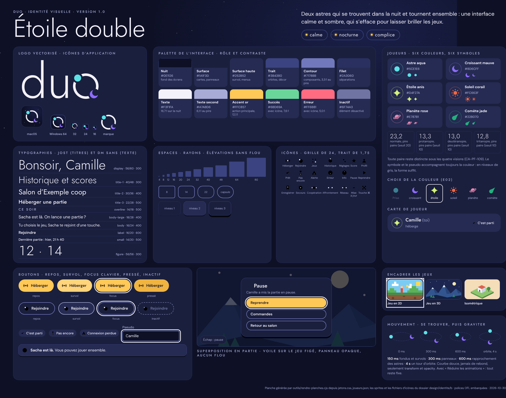
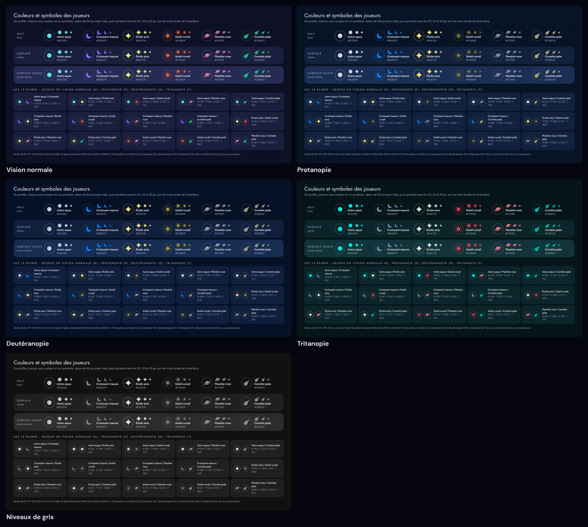
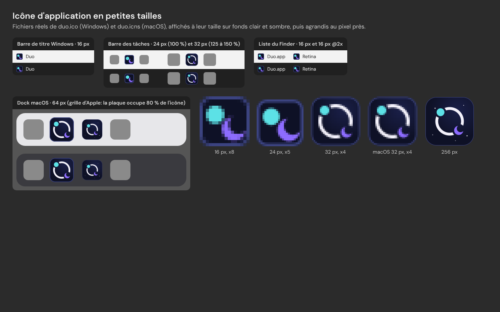

# Identité visuelle de Duo: Étoile double

| Champ | Valeur |
|---|---|
| Statut | version 1.0, à relire par le manager; piste B choisie par le client le 2026-10-30 (Q1 du cahier des charges) |
| Version | 1.0 |
| Date | 2026-10-30 |
| Auteur | directeur-artistique |
| Destinataires | ux-ui-designer (maquettes haute fidélité), dev-plateforme (lot L10, habillage L14), architecte-technique (ADR 0012), qa-testeur (CA-PF-108, 109, 110, 112, 114, 122) |
| Fichiers | `design/identite/b/` (jetons, symboles, icônes, logo, icônes d'application, planches, scripts) |
| Planche | `design/identite/b/planche-identite.png` |

> Ce document fixe l'identité de la plateforme: ce que chaque couleur, chaque taille et chaque mouvement veut dire, et ce qu'on s'interdit. Les valeurs vivent dans une seule source (`design/identite/b/source/jetons.cjs`), d'où sortent `jetons.css` et `jetons.json`: si un chiffre de ce document diffère des jetons, les jetons font foi et ce document est à corriger.

## 1. Intention

Deux astres qui se trouvent dans la nuit et tournent ensemble: une interface calme et sombre, qui s'efface pour laisser briller les jeux.

| Pilier | Ce que ça veut dire à l'écran |
|---|---|
| **Calme** | peu d'éléments à la fois, beaucoup de nuit autour; mouvements lents et doux, jamais de rebond; une seule action dorée par écran |
| **Nocturne** | fonds indigo profonds, texte blanc lunaire, lumière simulée par des anneaux et des points, jamais par du flou; confortable le soir dans une pièce tamisée |
| **Complice** | les deux joueurs sont deux astres, chacun sa couleur et son symbole; les moments à deux (se trouver, attendre l'autre, partir ensemble) sont des orbites partagées; tutoiement chaleureux, or de l'accent |

Ce que l'identité doit réussir, par ordre de priorité:

1. **Lisibilité**: texte et composants au contraste AA au moins, deux joueurs distincts pour tous, daltoniens compris, focus clavier toujours visible.
2. **Encadrer sans écraser**: l'identité vit dans le cadre (barres, menus, cartes, superpositions), jamais dans la zone de jeu. La nuit met en valeur n'importe quel jeu, en pixels, en 3D ou en isométrique.
3. **Légèreté**: le PC de référence (Intel UHD 620) affiche tout en aplats, traits et ombres pleines. Aucun flou, aucun mode de fusion, animations de `transform` et `opacity` seulement.
4. **Cohérence**: un même vocabulaire de formes (cercles, arcs, orbites, points) du logo aux icônes.

Références, décrites avec des mots: cartes du ciel anciennes, horloges astronomiques, planétariums, nuits d'été à la campagne. Aucune image existante n'a été copiée.

## 2. Fichiers livrés

Tout est généré par script depuis le dossier `source/`; rien n'est dessiné à la main dans un éditeur. Les fichiers produits sont versionnés pour être utilisés tels quels.

| Fichier | Contenu | Pour qui |
|---|---|---|
| `design/identite/b/jetons.css` | 122 variables CSS dans `:root`, dont 6 redéfinies par la variante `:root[data-motion="reduced"]` | lanceur (ADR 0012), maquettes |
| `design/identite/b/jetons.json` | les mêmes noms et valeurs, en JSON (`tokens`, `variants`) | SDK et HUD des jeux, outils |
| `design/identite/b/joueurs.json` | les six profils de joueur: identifiant, ordre, couleur, noms, chemin SVG du symbole | lanceur, SDK, jeux |
| `design/identite/b/symboles/` | les six symboles en SVG (`orb.svg`...) et leur planche de `<symbol>` (`symboles.svg`) | lanceur, maquettes |
| `design/identite/b/icones/` | 35 icônes d'interface en SVG et leur planche `icones.svg` | lanceur, maquettes |
| `design/identite/b/logo/` | `logo.svg` (couleur, sur fond de nuit), `logo-mono.svg` (une couleur), `marque.svg` (l'orbite seule), `marque.json` (géométrie) | lanceur, guide d'installation, dépôt |
| `design/identite/b/icone-app/` | `duo.icns` (macOS, 16 à 1024 px), `duo.ico` (Windows, 16 à 256 px), `duo-1024.png`, les SVG sources par taille et les PNG intermédiaires | ingenieur-build (electron-builder) |
| `design/identite/b/ciel.svg` | ciel étoilé figé (120 étoiles, graine fixe), dont 5 marquées `scintille` | lanceur |
| `design/identite/b/planche-identite.html` et `.png` | planche récapitulative, construite uniquement avec les fichiers ci-dessus | tous |
| `design/identite/b/controles/` | `joueurs.png` et `joueurs-controles.png` (quatre visions et niveaux de gris), `icones-app-petites-tailles.png`, `logo-fidelite.png`, `mesures.json` | preuves |
| `design/identite/b/source/` | `jetons.cjs` (source unique des jetons et des profils), `formes.cjs` (paramètres des symboles), `icones.cjs` (dessin des icônes) | qui retouche l'identité |
| `design/identite/b/outils/` | scripts de génération et de contrôle | qui retouche l'identité |

Régénérer et contrôler tout, dans `design/identite/b/`: `npm ci`, puis `npm run tout`. Étapes: `jetons` (génère et compare CSS et JSON), `formes` (symboles, icônes, logo, ciel), `icones-app` (SVG sources, PNG, `.icns`, `.ico`, relus à la fin), `controler` (contrastes, paires de joueurs, silhouettes; sort en erreur si un seuil n'est pas tenu), `planches` (rendus Chromium sans réseau, simulations ImageMagick, fidélité du logo, polices réellement employées). Outils requis: Node 22, Playwright et Chromium, `rsvg-convert`, ImageMagick (tous présents dans l'environnement du studio). Dépendances npm du dossier: les deux polices, plus `fontkit`, `polygon-clipping` et `@fontsource/jost` pour la seule production (non livrés).

## 3. Palette de l'interface

### 3.1 Couleurs et rôles

Les identifiants sont en anglais (règle du studio), le nom de la variable CSS suit le chemin du jeton.

| Jeton | Valeur | Nom | Rôle | Règle |
|---|---|---|---|---|
| `--color-bg` | `#0E1126` | nuit | fond des écrans | toujours sous la lueur radiale (3.3) et, au besoin, le ciel |
| `--color-bg-glow` | `#1A1F48` | lueur | centre du dégradé radial statique du fond | jamais en aplat ni sous du texte de petite taille |
| `--color-surface` | `#1A1F3D` | surface | cartes, panneaux, superpositions | niveau 1 et 3 des élévations |
| `--color-surface-raised` | `#252B52` | surface haute | survol, menus, notifications, puces, cartes de joueur | niveau 2 |
| `--color-hairline` | `#2A3060` | filet | séparations de listes, liseré des cartes | décor: jamais seul porteur d'information |
| `--color-line` | `#3B4380` | trait | orbites, liseré des vignettes, décor | décor (2,04:1 sur la nuit): jamais pour délimiter un champ ou un bouton |
| `--color-outline` | `#7178BB` | contour | bord des boutons secondaires, champs, cases, curseurs | composant: 3:1 au moins sur les trois fonds |
| `--color-text` | `#F3F1FA` | blanc lunaire | texte principal, symboles d'icônes | |
| `--color-text-muted` | `#A7ABD6` | lavande | texte second: aides, légendes, libellés de touches | jamais pour une action principale |
| `--color-text-disabled` | `#6F74A3` | inactif | texte et contour des éléments désactivés | exempté de contraste, mais lisible (3:1 au pire) |
| `--color-accent` | `#FFC857` | or | action principale, lien, point de navigation active, curseur rempli | une seule action dorée par écran; jamais pour une erreur ni un joueur |
| `--color-accent-hover` | `#FFD47A` | or clair | survol de l'action principale | |
| `--color-accent-pressed` | `#F0B440` | or foncé | appui sur l'action principale | |
| `--color-on-accent` | `#0E1126` | | texte et icône posés sur l'or | |
| `--color-success` | `#6BD69A` | vert d'eau | succès, « C'est parti », présence | toujours avec l'icône `ready` ou `success` et un texte |
| `--color-error` | `#FF6B81` | rouge rosé | erreur, connexion perdue | toujours avec l'icône `error` ou `warning` et un texte; jamais en fond de bouton |
| `--color-focus` | `#F3F1FA` | | anneau de focus clavier | voir 6.3 |
| `--color-scrim` | `#0E1126B8` | voile | voile sur le jeu figé, sous les superpositions (72 %) | seule couleur semi-transparente de l'interface |
| `--color-shadow-1` à `-3` | `#090B1B`, `#070915`, `#05060F` | ombres | ombres pleines des élévations | déjà incluses dans `--elevation-*` |

### 3.2 Contrastes

Mesurés par `outils/controler.cjs` (formule WCAG 2.x), sur les jetons livrés.

| Premier plan | Usage | Sur la nuit | Sur surface | Sur surface haute | Seuil | Résultat |
|---|---|---|---|---|---|---|
| text `#F3F1FA` | texte | 16,66:1 | 14,36:1 | 12,14:1 | 4,5:1 | AA |
| text-muted `#A7ABD6` | texte | 8,38:1 | 7,22:1 | 6,11:1 | 4,5:1 | AA |
| accent `#FFC857` | texte (liens) | 12,11:1 | 10,44:1 | 8,83:1 | 4,5:1 | AA |
| success `#6BD69A` | texte | 10,39:1 | 8,96:1 | 7,57:1 | 4,5:1 | AA |
| error `#FF6B81` | texte | 6,81:1 | 5,87:1 | 4,96:1 | 4,5:1 | AA |
| text-disabled `#6F74A3` | inactif | 4,17:1 | 3,60:1 | 3,04:1 | aucun | exempté |
| outline `#7178BB` | composant | 4,53:1 | 3,91:1 | 3,30:1 | 3:1 | AA |
| focus `#F3F1FA` | composant | 16,66:1 | 14,36:1 | 12,14:1 | 3:1 | AA |
| accent `#FFC857` | composant (fond de bouton) | 12,11:1 | 10,44:1 | 8,83:1 | 3:1 | AA |
| line `#3B4380` | décor | 2,04:1 | 1,76:1 | 1,49:1 | aucun | décor seulement |

| Texte | Fond | Rapport |
|---|---|---|
| on-accent `#0E1126` | accent `#FFC857` / accent-hover `#FFD47A` / accent-pressed `#F0B440` | 12,11:1 / 13,27:1 / 10,03:1 |
| player-on `#0E1126` | chacune des six couleurs de joueur | de 5,08:1 (mauve) à 14,89:1 (anis) |

Les couleurs des joueurs, comme graphismes, sont en section 4.3. Aucune couleur de joueur ne sert de couleur de texte: le pseudo s'écrit en `--color-text`.

### 3.3 Structure des valeurs, lumière et ambiance

- Trois étages de valeur: la nuit et ses surfaces (L* 6 à 18, très sombres), les lignes et le texte second (moyens), puis le texte, l'or et les couleurs des joueurs (clairs). En niveaux de gris, ce qui se lit ou se touche ressort toujours du décor (bandeau « structure des valeurs » de la planche).
- Le fond est un dégradé radial statique, calculé une fois: `background: radial-gradient(1400px 900px at 78% 18%, var(--color-bg-glow) 0%, var(--color-bg) 62%);`. Jamais animé.
- Le ciel (`ciel.svg`) se pose sur le fond, en SVG en ligne pour pouvoir animer ses 5 étoiles `scintille` (opacité seule, section 9). Il est réservé aux grands écrans de la plateforme (accueil, salon, premier lancement, fin de partie); jamais sous un texte long, jamais dans une superposition en partie.
- La lueur d'un astre se fait par un anneau concentrique de la couleur du joueur à 45 % d'opacité (`--player-halo-opacity`), jamais par du flou ni une ombre floue.
- Les surfaces très sombres sont à vérifier sur l'écran du PC: une dalle d'entrée de gamme peut confondre la nuit et la surface (« À tester chez le client »). Le liseré `--elevation-1` garde les cartes visibles même dans ce cas.

## 4. Les joueurs: six couleurs, six symboles

### 4.1 Les profils

Chaque profil associe une couleur et un symbole, pour toujours; deux joueurs n'ont jamais le même (F01). L'identifiant du profil est celui de son symbole.

| Ordre | Identifiant | Symbole | Couleur | Valeur | Clarté (L*) | Libellé (lecteurs d'écran) |
|---|---|---|---|---|---|---|
| 1 | `orb` | astre (disque plein) | aqua | `#5CE1E6` | claire (82,8) | Astre aqua |
| 2 | `crescent` | croissant | mauve | `#8D6CFF` | soutenue (55,7) | Croissant mauve |
| 3 | `star` | étoile à quatre branches | anis | `#D4F27A` | claire (91,2) | Étoile anis |
| 4 | `sun` | soleil (disque et huit rayons) | corail | `#FC663F` | moyenne (62,1) | Soleil corail |
| 5 | `planet` | planète à anneau | rose | `#E787B1` | moyenne (67,6) | Planète rose |
| 6 | `comet` | comète | jade | `#22B07D` | moyenne (64,1) | Comète jade |

L'astre aqua et le croissant mauve sont les deux astres du logo et de la planche choisie par le client. Les noms servent aux phrases de l'interface: « tu passes en comète », « Prise par Sacha » sur l'option indisponible, « Comète jade » pour le nom accessible d'une option du choix de couleur.

> **Écart avec F01 à faire acter**: le cahier des charges cite « rond, carré, triangle, losange, étoile, hexagone ». La piste B annonçait des astres; ce document les fixe. La règle de F01 (six couleurs, chacune liée à un symbole, jamais deux fois la même) ne change pas, seuls les noms changent. Voir « Questions » en fin de document.

### 4.2 Dessin des symboles

- Grille de 24 unités, centre (12, 12), zone utile d'un rayon de 11. Formes pleines, sans trait, dessinées par `source/formes.cjs`: le croissant est une soustraction exacte de deux disques (ouverture en haut à droite, comme dans le logo), la planète un disque et un anneau incliné de 24° qui passe derrière puis devant lui avec un jour, la comète une tête ronde et une queue effilée vers le haut à droite.
- Masses équilibrées à l'oeil: le disque plein, le plus lourd, est le plus petit (rayon 7,6); l'étoile et le soleil vont jusqu'au bord.
- Un seul chemin par symbole (`path` de `joueurs.json`): il se dessine tel quel dans un `<path>`, dans un `Path2D` (canvas des jeux 2D) ou par un chargeur SVG.
- Silhouettes deux à deux (recouvrement IoU à 48 px, 1 = identiques): 0,66 au plus (astre et étoile, que leurs pointes distinguent sans hésitation dès 16 px). Garde-fou du script: 0,75.

### 4.3 Règles d'usage

- **Jamais la couleur seule** (CA-PF-110): le symbole et le pseudo écrit accompagnent toujours la couleur d'un joueur. Le symbole seul suffit à distinguer les joueurs sans voir les couleurs.
- **Tailles**: 16 px au moins. À partir de 32 px, le symbole se présente en **jeton**: anneau de halo (rayon 0,47 fois la taille, trait de 3 % de la taille et 1,5 px au moins, couleur du joueur à `--player-halo-opacity`), symbole réduit à 62 % au centre. Sous 32 px, pas de halo.
- **Fonds**: nuit, surface et surface haute uniquement. Contraste graphique de chaque couleur, au pire sur la surface haute: 3,70:1 (mauve) à 10,85:1 (anis), tous au-dessus de 3:1.
- **Sur une couleur de joueur** (pastille pleine, barre de score), le texte ou le symbole se pose en `--player-on` (`#0E1126`): 5,08:1 au moins.
- Les couleurs de joueur ne servent à rien d'autre: ni bouton, ni état, ni décor. Elles ne se mélangent pas (pas de dégradé d'une couleur de joueur à l'autre).
- **Toi à gauche, l'autre à droite** (UX 0.4): la règle de placement est de l'UX; l'identité n'impose aucun ordre de couleurs.
- Le choix de couleur est un groupe de boutons radio (6.5, « Choix de couleur »).

### 4.4 Distinction pour les daltoniens (CA-PF-109)

Écart CIEDE2000 de chaque paire, en vision normale puis après simulation (Machado, Oliveira et Fernandes 2009, sévérité 1, en RGB linéaire). Seuils: 20 en vision normale, 10 après chaque simulation.

| Paire | Normale | Protanopie | Deutéranopie | Tritanopie | Écart de clarté L* |
|---|---|---|---|---|---|
| Astre aqua / Croissant mauve | 42,0 | 30,7 | 26,2 | 30,1 | 27,1 |
| Astre aqua / Étoile anis | 34,1 | 34,8 | 40,2 | 22,5 | 8,4 |
| Astre aqua / Soleil corail | 56,5 | 38,9 | 41,6 | 71,0 | 20,7 |
| Astre aqua / Planète rose | 57,8 | 16,4 | 13,0 | 73,6 | 15,2 |
| Astre aqua / Comète jade | 23,2 | 27,4 | 27,8 | 14,5 | 18,8 |
| Croissant mauve / Étoile anis | 80,8 | 65,5 | 65,0 | 32,6 | 35,5 |
| Croissant mauve / Soleil corail | 45,1 | 54,3 | 60,8 | 43,7 | 6,4 |
| Croissant mauve / Planète rose | 26,8 | 19,2 | 28,5 | 38,5 | 12,0 |
| Croissant mauve / Comète jade | 48,6 | 47,0 | 40,8 | 23,6 | 8,4 |
| Étoile anis / Soleil corail | 55,5 | 28,6 | 17,1 | 46,8 | 29,1 |
| Étoile anis / Planète rose | 62,9 | 42,8 | 30,4 | 39,3 | 23,5 |
| Étoile anis / Comète jade | 27,7 | 21,7 | 26,3 | 26,9 | 27,1 |
| Soleil corail / Planète rose | 27,4 | 34,6 | 27,5 | 12,8 | 5,5 |
| Soleil corail / Comète jade | 62,7 | 13,3 | 17,3 | 66,9 | 1,9 |
| Planète rose / Comète jade | 66,1 | 26,9 | 13,9 | 59,7 | 3,6 |

| Vision | Pire paire | ΔE2000 | Seuil | Marge |
|---|---|---|---|---|
| normale | Astre aqua / Comète jade | 23,2 | 20 | 16 % |
| protanopie | Soleil corail / Comète jade | 13,3 | 10 | 33 % |
| deutéranopie | Astre aqua / Planète rose | 13,0 | 10 | 30 % |
| tritanopie | Soleil corail / Planète rose | 12,8 | 10 | 28 % |

Lecture:

- Les 15 paires tiennent les seuils sous les quatre visions, avec 16 à 33 % de marge sur la pire paire.
- **Niveaux de gris**: six couleurs toutes lisibles sur la nuit (4,5:1 au moins) ne peuvent pas avoir six clartés bien séparées. Corail, rose et jade ont des gris voisins (écart ΔE2000 de 1,6 au pire): en vision achromate, c'est le symbole qui distingue, comme le prévoit la règle de l'UX. Les deux profils clairs (aqua, anis) et le profil soutenu (mauve) se détachent aussi par la clarté.
- Les simulations calculées et celles d'ImageMagick concordent à 1/255 près par canal. Vues: `design/identite/b/controles/joueurs-controles.png`.
- Voisinages avec l'interface (information, rôles différents): l'anis est à 22,5 de l'or, le rose à 12,5 de l'erreur, le jade à 11,2 du succès. Ces couleurs n'apparaissent jamais sans leur forme (symbole de joueur, icône d'état), et l'or ne colore jamais un joueur.

## 5. Typographie

### 5.1 Familles

| Rôle | Police | Paquet et fichier CSS à importer | Graisses employées |
|---|---|---|---|
| Titres, chiffres, surtitres | **Jost**, variable | `@fontsource-variable/jost/wght.css` (famille « Jost Variable ») | 300 (40 px et plus), 400, 500 |
| Texte, libellés, boutons | **DM Sans**, variable, avec taille optique | `@fontsource-variable/dm-sans/standard.css` (famille « DM Sans Variable », axes graisse et taille optique) | 400, 500, 600 |

Les deux paquets sont épinglés en 5.3.0 (ADR 0012), installés par npm et embarqués: aucun chargement réseau. Licence OFL-1.1, inscrite dans `CREDITS.md`; le texte de la licence (`LICENSE` de chaque paquet) doit être livré avec l'application et cité dans « À propos ». Fichiers réellement chargés: Jost latin, latin étendu et cyrillique (référencé par `wght.css`, jamais téléchargé par le navigateur sans caractère cyrillique), DM Sans latin et latin étendu; 148 Ko en tout. Vérifié sous Chromium: les planches ne chargent que ces deux familles, depuis le disque.

### 5.2 Échelle

Tailles en `rem` (1 rem vaut 16 px à la taille d'interface 100 %; ADR 0012). Chaque niveau a cinq jetons: `--type-<niveau>-family`, `-size`, `-line-height`, `-weight`, `-tracking`.

| Niveau | Police | Taille / interligne (px à 100 %) | Graisse | Approche | Usage |
|---|---|---|---|---|---|
| `display` | Jost | 56 / 60 | 300 | -0,01 em | grand titre d'écran: « Bonsoir, Camille », « Tu as gagné ! » |
| `title-1` | Jost | 40 / 48 | 300 | 0 | titre de page: Bibliothèque, Historique et scores |
| `title-2` | Jost | 30 / 36 | 400 | 0 | titre de section, titre de fenêtre de confirmation |
| `title-3` | Jost | 22 / 28 | 500 | 0,01 em | titre de carte, libellé des grandes capsules, pseudo sur une carte de joueur |
| `overline` | Jost | 14 / 18 | 500 | 0,24 em, capitales | surtitre: « CE SOIR », étiquettes de groupe |
| `body-large` | DM Sans | 18 / 28 | 400 | 0 | phrase d'accroche sous un grand titre |
| `body` | DM Sans | 16 / 24 | 400 | 0 | texte courant, descriptions, messages |
| `label` | DM Sans | 16 / 20 | 600 | 0 | boutons, onglets, libellés de champ importants |
| `small` | DM Sans | 14 / 20 | 500 | 0,01 em | aides, légendes, puces d'état, touches |
| `figure` | Jost | 56 / 56 | 300 | 0,02 em | scores et chiffres mis en avant, avec `font-variant-numeric: tabular-nums` |
| `countdown` | Jost | 160 / 160 | 300 | 0 | compte à rebours du salon |

Règles:

- Rien sous 14 px. Texte courant à 16 px au moins.
- Jost Light (300) seulement à 40 px et plus; en dessous, Jost 400 ou 500. Jamais de texte courant en Jost.
- Pas d'italique (les fichiers italiques ne sont pas embarqués): l'insistance passe par la graisse 600.
- Chiffres alignés: Jost a des chiffres tabulaires (`tnum`), DM Sans n'en a pas. Scores, chronomètres et colonnes de chiffres en Jost.
- Majuscule seulement en début de libellé; les capitales espacées sont réservées à `overline`.
- La lecture à 1280x720 sans défilement (cahier, section 5) tient avec cette échelle: un écran type empile une barre du haut de 72 px, un `display` et son accroche (environ 110 px), un bloc d'actions de 100 px et une rangée de vignettes de 160 px, avec des marges de 40 px.

### 5.3 Caractères absents des deux polices (vérifié sous Chromium)

| Caractère | Constat | Consigne |
|---|---|---|
| espace fine insécable U+202F (avant ! ? ; %) | absente des fichiers, mais Chromium la compose avec l'espace de la police elle-même (moteur HarfBuzz): aucun repli visible, vérifié par `CSS.getPlatformFontsForNode` | à employer comme prévu par l'UX (0.3) |
| espace insécable U+00A0 | présente | à employer |
| trait d'union insécable U+2011 (« Wi‑Fi ») | absent: Chromium prend le glyphe d'une police du système (dessin et épaisseur différents) | écrire « Wi-Fi » avec un trait d'union ordinaire dans un `` |
| ⌘, ⌃, ⇧, flèches ← → (et ↑ ↓ en Jost) | absents: police du système | icônes `key-cmd`, `arrow-left`, `arrow-right`, `arrow-up`, `arrow-down` |
| guillemets « », apostrophe ’, points de suspension …, Œ œ, accents du latin étendu | présents | |

## 6. Espaces, rayons, traits, élévations

### 6.1 Espacements

Pas de 4 px: `--space-1` (4), `-2` (8), `-3` (12), `-4` (16), `-5` (20), `-6` (24), `-8` (32), `-10` (40), `-12` (48), `-16` (64), `-20` (80). Le numéro compte des pas de 4 px.

Repères de mise en page (recommandations pour ux-ui-designer): marges latérales `--space-10` jusqu'à 1366 px de large, `--space-12` au-delà; gouttières `--space-6`; espacement interne des cartes `--space-6`, des panneaux `--space-8`; entre un titre et son contenu `--space-4`.

### 6.2 Rayons

`--radius-small` 8 px (champs, touches, cases), `--radius-medium` 14 px (vignettes de jeux, notifications, options du choix de couleur), `--radius-large` 22 px (cartes, panneaux, superpositions), `--radius-pill` (boutons, puces, bandeau d'indication). Les actions sont des capsules: c'est la forme d'une orbite vue de profil.

### 6.3 Traits et focus

| Jeton | Valeur à 100 % | Usage |
|---|---|---|
| `--stroke-hairline` | 1 px | filets et liserés décoratifs; reste à 1 px à toutes les tailles d'interface |
| `--stroke-component` | 2 px | bord des composants (boutons secondaires, champs, cases, option choisie) |
| `--stroke-focus` | 3 px | anneau de focus |
| `--stroke-focus-offset` | 3 px | décalage de l'anneau |

- Pourquoi 2 px et non 1,5: Chromium arrondit les épaisseurs de bordure à l'entier inférieur. Une bordure de 1,5 px s'affiche à 1 px (mesuré par `getComputedStyle` à 100, 125, 150 et 200 %); 2 px et 3 px restent intacts. Les traits d'icônes SVG, eux, ne sont pas arrondis.
- **Anneau de focus** (UX 0.5, CA-PF-112): `outline: var(--stroke-focus) solid var(--color-focus); outline-offset: var(--stroke-focus-offset);`, affiché par `:focus-visible`. Blanc lunaire sur la nuit, la surface ou la surface haute: 12,14:1 au pire. Sur un bouton doré, l'anneau passe autour, sur le fond: il reste blanc. Dans un conteneur qui coupe ce qui déborde (liste qui défile, grille de vignettes), prévoir 6 px de marge intérieure ou un anneau intérieur (`outline-offset: calc(-1 * var(--stroke-focus))`), pour qu'il ne soit jamais caché.
- Traits d'information (orbite d'attente, jauge, séparation porteuse de sens): 1,5 px au moins, couleur `--color-outline` ou plus claire.

### 6.4 Élévations sans flou

Une élévation, c'est une surface plus claire, un liseré d'un pixel et une ombre pleine décalée vers le bas: aucun flou, coût nul.

| Jeton | Valeur | Avec la surface | Usage |
|---|---|---|---|
| `--elevation-1` | liseré filet, ombre de 2 px | `--color-surface` | cartes posées sur la nuit |
| `--elevation-2` | liseré trait, ombre de 4 px | `--color-surface-raised` | notifications, menus, survol de carte |
| `--elevation-3` | liseré trait, ombre de 8 px | `--color-surface` | bandeau d'invitation, fenêtres de confirmation, panneaux des superpositions |

Superpositions en partie (UX 0.6, ADR 0004): le jeu figé reçoit le voile `--color-scrim` (72 %), puis le panneau se pose dessus, **opaque** (`--color-surface` et `--elevation-3`). Le panneau opaque garantit les contrastes de la section 3.2 quel que soit le jeu derrière (le voile ramène un pixel blanc du jeu à `#515362`, un pixel noir à `#0A0C1B`). Aucun `backdrop-filter`, qui de toute façon ne verrait pas le jeu depuis la vue de la plateforme.

## 7. Iconographie

- **Grille de 24**, trait de 1,75 (`--icon-stroke`), bouts et jonctions ronds, formes ouvertes et aérées; un point plein en signature quand l'objet s'y prête (Héberger, Rejoindre, Historique, Enregistrer...). Aucune icône ne se « creuse » avec la couleur du fond: toutes marchent sur n'importe quelle surface.
- **Tailles**: 24 px par défaut (`--icon-size`), 32 px dans les grandes capsules (`--icon-size-large`), 20 px au plus petit (`--icon-size-small`, avec `--icon-stroke-small` 1,8 pour garder 1,5 px affichés). Jamais sous 20 px.
- **Couleur**: `currentColor`. Texte ou texte second en général; couleur d'état pour les icônes d'état, toujours suivies de leur texte.
- **Emploi**: planche `icones/icones.svg` incluse une fois dans la page, puis `<svg class="icone" aria-hidden="true"><use href="#icon-host"/></svg>`, avec `.icone { width: var(--icon-size); height: var(--icon-size); stroke-width: var(--icon-stroke); }`. L'épaisseur vient de l'élément qui affiche l'icône: un `<use>` n'hérite pas des attributs de la racine de la planche. Une icône seule (bouton icône) porte un `aria-label`; à côté d'un texte, elle est `aria-hidden`.

| Identifiant | Nom | Usage | | Identifiant | Nom | Usage |
|---|---|---|---|---|---|---|
| `host` | Héberger | action d'accueil, salon | | `resume` | Reprendre | superposition de pause |
| `join` | Rejoindre | action d'accueil, invitation | | `save` | Enregistrer | indicateur d'enregistrement |
| `library` | Jeux | onglet Bibliothèque | | `backup` | Secours | copies de secours d'une sauvegarde |
| `history` | Historique | onglet, dernière partie | | `delete` | Supprimer | sauvegarde |
| `settings` | Réglages | onglet, bouton icône | | `coop` | Coopération | type de jeu |
| `score` | Score | score cumulé | | `versus` | Affrontement | type de jeu |
| `profile` | Profil | réglages du profil | | `back` | Retour | revenir (Échap) |
| `ready` | Prêt | puce « C'est parti » | | `close` | Fermer | fermer une notification |
| `not-yet` | Pas encore | puce « Pas encore », attente | | `fullscreen` | Plein écran | réglage d'affichage |
| `warning` | Alerte | « Connexion perdue », diagnostic | | `download` | Mise à jour | nouveau jeu, nouvelle version |
| `error` | Erreur | message d'erreur | | `network` | Réseau | diagnostic, l'autre ordinateur |
| `info` | Info | aide, précision | | `computer` | Ordinateur | « sur le PC », « sur ce Mac » |
| `success` | Succès | confirmation, notification | | `display` | Affichage | onglet Affichage |
| `new` | Nouveau | nouveau jeu (E19) | | `sound` | Son | onglet Son |
| `pause` | Pause | superposition, indice « Échap : pause » | | `keyboard` | Clavier | onglet Touches, commandes |
| `key-cmd` | Touche ⌘ | raccourcis sur Mac | | `arrow-left`, `-right`, `-up`, `-down` | Flèches | rappels de touches |

## 8. Logo et icône d'application

### 8.1 Construction

- « du » en Jost Light, lettres converties en tracés: aucune police n'est nécessaire pour afficher le logo. La conversion est fidèle: le texte composé en Jost Variable 300 et les tracés diffèrent sur 1 205 pixels de bord, sur 85 122 pixels encrés à 1 210 px de large, soit l'anticrénelage seul (`controles/logo-fidelite.png`).
- Le « o » devient une orbite: un anneau de l'épaisseur exacte du fût de Jost Light (52 millièmes de cadratin), un peu plus grand que le o pour porter deux astres, l'astre aqua en haut à gauche et le croissant mauve en bas à droite (le même croissant que le symbole du joueur). L'anneau est réellement interrompu autour des astres: le fond passe à travers, le logo marche sur n'importe quelle nuit, ciel compris.
- Fichiers: `logo.svg` (lettres et anneau blanc lunaire, astres aqua et mauve), `logo-mono.svg` (une seule couleur, `currentColor`), `marque.svg` (l'orbite seule, carrée).

### 8.2 Règles

- Le logo vit sur la nuit: `--color-bg`, la lueur, `--color-surface`. Sur un fond clair (document, page web claire), on emploie l'icône d'application, qui apporte sa propre nuit.
- Zone de protection: la moitié de la hauteur de l'anneau, tout autour. Taille minimale: 56 px de large (28 px de haut) à l'écran; en dessous, la marque seule (24 px au moins) ou l'icône d'application.
- Dans la barre du haut, le logo mesure 36 px de haut (environ 74 px de large).
- Interdits: changer les couleurs des astres (sauf version monochrome entière), déformer, ajouter ombre, contour, lueur ou dégradé, recomposer « duo » dans une police, faire tourner l'anneau du logo (l'orbite animée de l'attente est un autre élément, section 9).

### 8.3 Icônes d'application

| Taille | Dessin | macOS | Windows |
|---|---|---|---|
| 128 px et plus | plaque de nuit avec lueur, cinq étoiles, orbite et astres | plaque de 824 sur 1024 (grille d'Apple), rayon 185 | plaque presque pleine page, rayon de 22 % |
| 32 à 64 px | plaque, orbite et astres, sans étoiles | plaque à 81 % de l'icône | plaque pleine page |
| 16 à 24 px | plaque, disque aqua et croissant mauve agrandis, sans anneau | plaque à 87,5 % | plaque pleine page |

- `duo.icns`: entrées PNG `icp4` (16), `icp5` (32), `icp6` (64), `ic07` (128), `ic08` (256), `ic09` (512), `ic10` (1024), et les doubles résolutions `ic11` à `ic14`, chacune avec le dessin de sa taille en points. `duo.ico`: 16, 20, 24, 32, 40, 48, 64 et 128 px en BMP 32 bits, 256 px en PNG. Les deux fichiers sont relus par le script, et ImageMagick décode l'ICO au pixel près.
- Pour electron-builder (ingenieur-build): `mac.icon` vers `design/identite/b/icone-app/duo.icns`, `win.icon` vers `duo.ico` (ou une copie dans le dossier de build).
- Lisibilité vérifiée sur capture (`controles/icones-app-petites-tailles.png`): en 16 px, barre de titre Windows et liste du Finder, sur fonds clair et sombre, le disque et le croissant restent séparés et reconnaissables; en 24 et 32 px dans la barre des tâches, le disque et le croissant, puis l'orbite, se lisent; dans le Dock, les tailles 64 et 128 gardent la même plaque.

## 9. Mouvement

### 9.1 Principes

Lent et continu: on se trouve, puis on gravite. Seulement `transform` et `opacity` (ADR 0012); jamais de rebond, jamais de mouvement de couleur, de taille de boîte ou de flou.

| Jeton | Valeur | Usage |
|---|---|---|
| `--duration-fast` | 150 ms | fondu entre écrans (UX 0.6), apparition de l'indicateur d'enregistrement, fermeture d'un panneau |
| `--duration-medium` | 300 ms | ouverture d'un panneau, d'une fenêtre, d'une notification, du bandeau d'invitation |
| `--duration-slow` | 600 ms | rapprochement des deux astres (l'autre ordinateur est trouvé, E04), révélation du score (E14) |
| `--duration-orbit` | 4 000 ms | un tour de l'orbite d'attente |
| `--duration-twinkle` | 3 600 ms | un cycle de scintillement d'une étoile |
| `--easing-standard` | `cubic-bezier(0.45, 0, 0.25, 1)` | déplacements, rapprochements |
| `--easing-enter` | `cubic-bezier(0.2, 0, 0.2, 1)` | ce qui apparaît (décélère) |
| `--easing-exit` | `cubic-bezier(0.45, 0, 0.85, 0.5)` | ce qui disparaît (accélère doucement) |
| `--loops-state` | `running` | `animation-play-state` des boucles décoratives |

### 9.2 Moments

| Moment | Mouvement |
|---|---|
| Changement d'écran | fondu enchaîné, opacité, `--duration-fast` |
| Panneau, fenêtre, notification, bandeau | opacité de 0 à 1 et glissement de 8 px (vers le haut pour un panneau, vers le bas pour le bandeau), `--duration-medium`, `--easing-enter`; fermeture en `--duration-fast`, `--easing-exit` |
| Survol | changement immédiat, ou fondu de 150 ms d'un calque en `opacity`; jamais de transition de couleur |
| L'autre ordinateur est trouvé (E04), salon complet | les deux jetons glissent l'un vers l'autre sur leur orbite, `--duration-slow`, `--easing-standard` |
| Attente (recherche, chargement, l'autre joueur) | un petit élément (24 à 48 px) tourne sur son orbite en `--duration-orbit`, linéaire, `animation-play-state: var(--loops-state)`; toujours accompagné d'un texte |
| Ciel | 5 étoiles au plus scintillent (opacité de 1 à 0,35), cycles décalés, `--duration-twinkle`, `animation-play-state: var(--loops-state)` |
| Compte à rebours | chaque chiffre apparaît en fondu, de 96 à 100 % de sa taille (`transform: scale`), `--duration-fast` |

### 9.3 Réduire les animations (CA-PF-122)

- L'application pose `data-motion="reduced"` sur la racine quand la case est cochée; au premier démarrage, la case suit `prefers-reduced-motion`. Les jetons ne lisent pas la requête média directement: la case de Duo peut contredire le réglage du système.
- La variante remet toutes les durées à 0 ms et fige les boucles (`--loops-state: paused`). Résultat: changements d'écran instantanés, compte à rebours qui change seulement de chiffre, astres et étoiles immobiles, attente montrée par une orbite fixe et son texte.
- Le code ne doit pas attendre `transitionend` ou `animationend` pour avancer (ils peuvent ne jamais venir avec une durée nulle).
- Le réglage passe aux jeux par le SDK (`ui`), qui l'appliquent à leur HUD.

## 10. Encadrer les jeux

- L'identité s'arrête au bord de la zone de jeu. En partie, la plateforme n'affiche que l'indice « Échap : pause » et l'indicateur « Progression enregistrée » (UX, E10), chacun dans une capsule opaque (`--color-surface`, liseré filet), en `small`, dans un coin, pour rester lisibles sur n'importe quel jeu.
- **Vignettes** (bibliothèque, accueil, salon): format 16:9, fournies par chaque jeu en 960 x 540 px; la plateforme ne les affiche jamais à plus de 480 x 270 px CSS, donc la définition double couvre l'écran Retina (CA-PF-114); sRGB, PNG ou WebP, sans transparence, sans coins arrondis ni cadre dessinés (la plateforme applique `--radius-medium` et le liseré `0 0 0 1px var(--color-line)`), sans le logo de Duo, sans texte dans le quart inférieur (le nom du jeu s'écrit dessous, en `label`); sujet principal dans les 80 % centraux. Au focus, l'anneau passe autour de l'image, jamais dessus.
- Chaque jeu garde sa propre direction artistique (sa bible). Recommandation pour les bibles de jeu: quand un jeu montre qui est qui (étiquette de pseudo, curseur, marqueur), il reprend la couleur et le symbole du profil du joueur, transmis par le SDK avec `joueurs.json`, pour que chacun se retrouve d'un jeu à l'autre.
- Les menus communs par-dessus un jeu suivent la section 6.4: voile, panneau opaque, aucun flou.

## 11. Composants: recettes pour la haute fidélité

Ces recettes fixent l'habillage; la structure, les textes et les comportements restent ceux de `docs/plateforme/ux/parcours.md`. Tous les états ont l'anneau de focus de la section 6.3.

| Composant | Repos | Survol | Pressé | Inactif | Précisions |
|---|---|---|---|---|---|
| Bouton principal | capsule `--color-accent`, texte et icône `--color-on-accent`, `label`, hauteur 48 px (56 px dans les grandes actions de l'accueil) | `--color-accent-hover` | `--color-accent-pressed` | sans fond, bord de 2 px en tirets `--color-text-disabled`, texte `--color-text-disabled` | une seule par écran; icône de 24 px à gauche |
| Bouton secondaire | capsule transparente, bord `--stroke-component` `--color-outline`, texte `--color-text` | fond `--color-surface-raised`, bord `--color-text-muted` | fond `--color-surface` | comme le principal | |
| Lien | texte `--color-accent`, `label` | souligné | | `--color-text-disabled` | « Toute la bibliothèque », « Que faire ? » |
| Bouton icône | cercle de 44 px, bord `--color-outline`, icône de 24 px | fond `--color-surface-raised` | fond `--color-surface` | icône `--color-text-disabled` | `aria-label` obligatoire |
| Champ de texte | fond `--color-bg`, bord 2 px `--color-outline`, `--radius-small`, hauteur 44 px, `body` | bord `--color-text-muted` | | fond `--color-surface` | erreur: bord `--color-error`, icône `error` et message dessous en `small` |
| Onglet, navigation | `label` en `--color-text-muted` | `--color-text` | | | actif: `--color-text` et point doré de 6 px dessous |
| Puce d'état | capsule `--color-surface-raised`, hauteur 30 px, icône de 18 px colorée, texte `small` en `--color-text` | | | | « C'est parti » `ready` en succès, « Pas encore » `not-yet` en texte second, « Connexion perdue » `warning` en erreur |
| Carte | `--color-surface`, `--elevation-1`, `--radius-large`, marge intérieure `--space-6` | carte cliquable: `--elevation-2`, `--color-surface-raised` | | | |
| Carte de joueur | `--color-surface-raised`, `--radius-large`; jeton de 48 px, pseudo en `title-3`, « (toi) » et rôle en texte second, puce à droite | | | | toi à gauche, l'autre à droite |
| Choix de couleur (E02, Réglages) | groupe de 6 boutons radio dans l'ordre de `joueurs.json`; symbole de 32 px coloré, nom en `small` | fond `--color-surface-raised` | | couleur de l'autre: opacité 50 %, « Prise par Sacha », non sélectionnable | choisie: bord 2 px `--color-text` et `aria-checked`; flèches pour changer |
| Vignette de jeu | section 10 | liseré `--color-text-muted` | | | |
| Bandeau d'invitation | `--color-surface`, `--elevation-3`, `--radius-large`, en haut au centre; jeton de l'autre, texte, bouton principal « Rejoindre » | | | | entrée: glissement vers le bas, `--duration-medium` |
| Notification | `--color-surface-raised`, `--elevation-2`, `--radius-medium`, icône d'état colorée et texte | | | | en haut à droite, 6 s |
| Fenêtre de confirmation, superposition | voile, panneau `--color-surface` opaque, `--elevation-3`, `--radius-large`, titre `title-2` ou `title-3` | | | | section 6.4 |
| Compte à rebours | `countdown` en `--color-text` sur le voile, phrase en `body-large` | | | | section 9.2 |
| Curseur de volume | piste de 4 px `--color-outline`, partie remplie `--color-accent`, poignée de 20 px `--color-text` | | | | valeur écrite à côté |
| Case à cocher | carré de 20 px, rayon 6, bord 2 px `--color-outline` | | | | cochée: fond `--color-accent`, coche `--color-on-accent` |

## 12. À faire et à éviter

À faire:

- Partir des jetons, jamais d'une valeur recopiée.
- Une seule action dorée par écran; tout le reste en secondaire ou en lien.
- Laisser de la nuit autour des éléments: l'espace fait partie du calme.
- Écrire l'état en toutes lettres à côté de sa couleur et de son icône.
- Tester chaque écran en niveaux de gris et sous simulation de daltonisme (commandes ci-dessous).

Interdits:

- Flou sous toutes ses formes (`filter: blur`, `backdrop-filter`, ombre floue, lueur floue ou « néon » obtenu par du flou), `mix-blend-mode`, dégradés animés, nébuleuses, photos de ciel.
- Transitions de couleur, de taille de boîte, d'ombre; rebonds; plus de 5 étoiles animées.
- Traits porteurs d'information sous 1,5 px; bordures CSS de composant sous 2 px.
- Texte courant en Jost; Jost Light sous 40 px; texte sous 14 px; italique.
- Couleur de joueur employée pour du texte, un bouton, un état ou un décor; couleur seule pour désigner un joueur ou un état.
- Or pour une erreur; rouge d'erreur en fond de bouton; trait `--color-line` pour délimiter un champ ou un bouton.
- Logo recoloré, déformé, recomposé dans une police, posé sur un fond clair.
- Superposition semi-transparente sans voile, ou panneau transparent par-dessus un jeu.

Contrôles d'un écran, sur une capture: niveaux de gris `convert capture.png -colorspace Gray gris.png`; deutéranopie `convert capture.png -colorspace RGB -color-matrix "0.367322 0.860646 -0.227968 0.280085 0.672501 0.047413 -0.011820 0.042940 0.968881" -colorspace sRGB deuteranopie.png`; protanopie avec `0.152286 1.052583 -0.204868 0.114503 0.786281 0.099216 -0.003882 -0.048116 1.051998`; tritanopie avec `1.255528 -0.076749 -0.178779 -0.078411 0.930809 0.147602 0.004733 0.691367 0.303900`.

## 13. Suites et points ouverts

| Pour | Point |
|---|---|
| client (par le manager) | noms des six symboles dans F01 (question ci-dessous) |
| ux-ui-designer | maquettes haute fidélité avec ces jetons; noms des symboles et textes associés dans `parcours.md` (E02, E04 « même couleur », M-02 « tu passes en comète »); « Wi-Fi » sans U+2011 (5.3); icône `key-cmd` pour les raccourcis Mac |
| architecte-technique | ADR 0012, point 7: « panneaux indigo opaques à 92 % » devient « voile `--color-scrim` (72 %) sur le jeu figé, panneau opaque »; noms anglais des jetons et tailles en `rem`, déjà conformes au point 5; livrer le texte OFL des deux polices |
| dev-plateforme, architecte-technique | profils de joueur: l'identifiant de couleur stocké dans le profil et transmis aux jeux est celui de `joueurs.json` (`orb`, `crescent`, `star`, `sun`, `planet`, `comet`) |
| ingenieur-build | `duo.icns` et `duo.ico` dans la configuration d'electron-builder |
| qa-testeur | CA-PF-109 se calcule sur `joueurs.json` (résultats en 4.4, script `outils/controler.cjs`); CA-PF-108 sur les jetons de la section 3 |
| directeur-artistique | revue visuelle des maquettes haute fidélité, puis de l'application au jalon bêta |

**Question pour le client**: le cahier (F01) nomme les six symboles « rond, carré, triangle, losange, étoile, hexagone ». L'identité Étoile double les dessine en astres: astre, croissant, étoile, soleil, planète, comète. Recommandation: garder les astres, cohérents avec le logo et l'univers choisis, et mettre à jour la liste de F01 dans l'historique du cahier; la règle de F01 ne change pas. Si le client préfère les formes géométriques, elles se dessinent dans le même style en une journée, avec les mêmes couleurs.

À tester chez le client: distinction de la nuit et des surfaces sur l'écran du PC (dalle d'entrée de gamme), finesse des traits de 1,5 à 2 px en 1366x768 à 100 %, netteté sur l'écran Retina du Mac, rendu des icônes d'application dans la barre des tâches de Windows 11 et dans le Dock.
