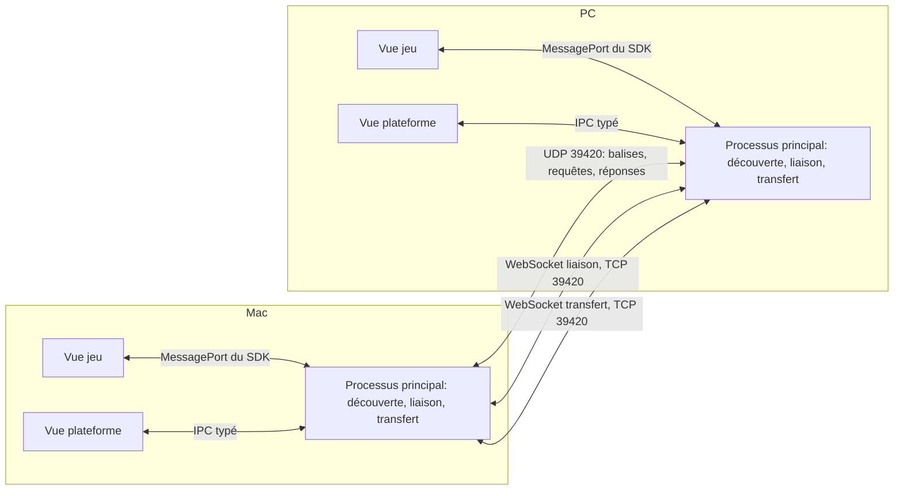
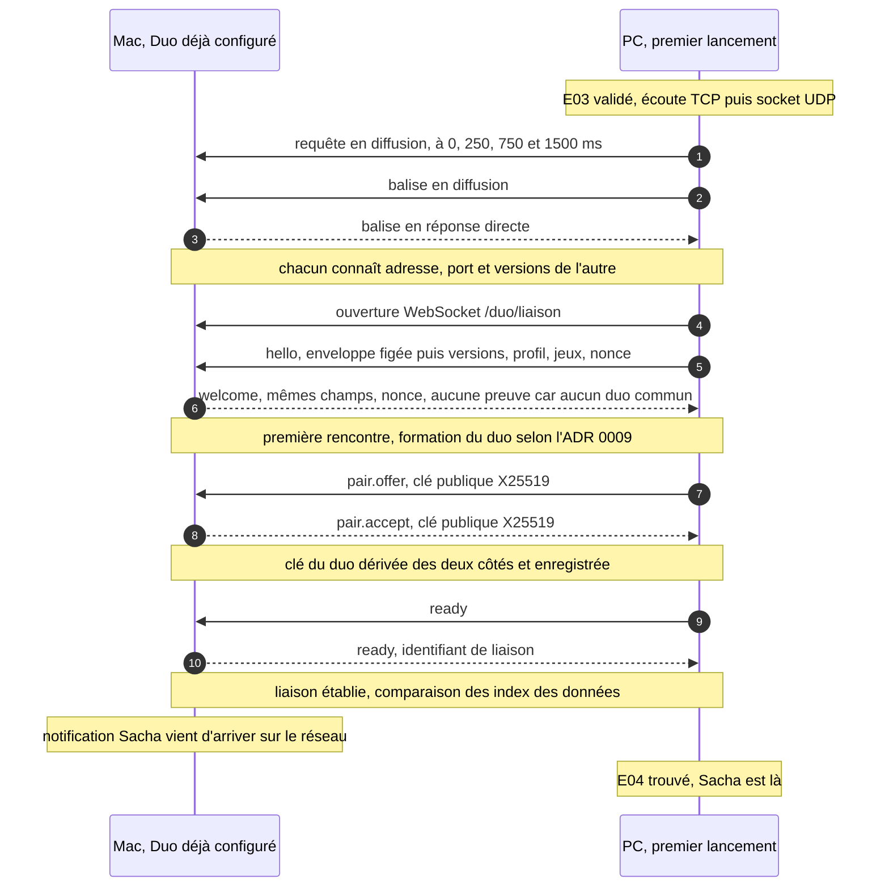
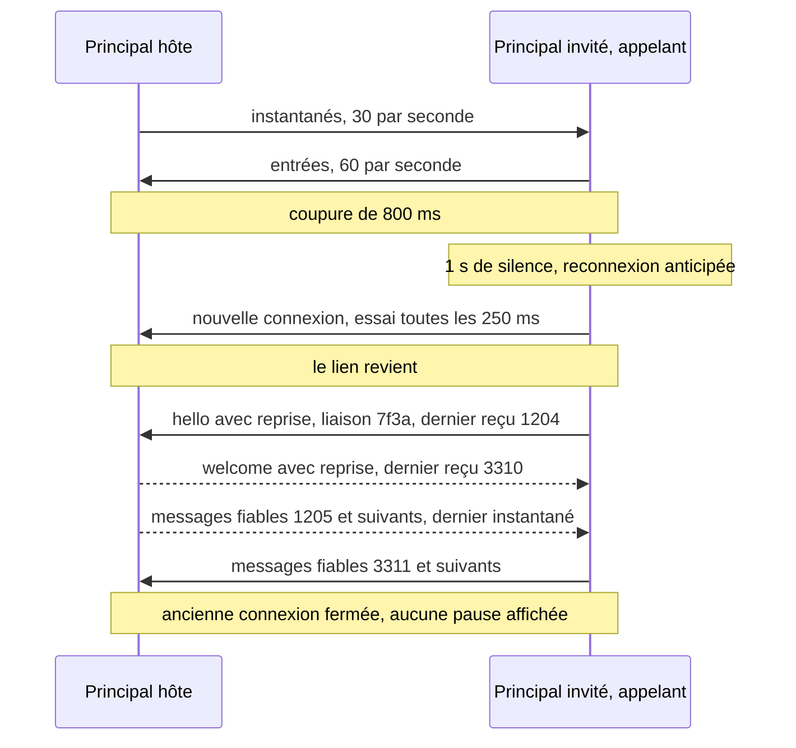
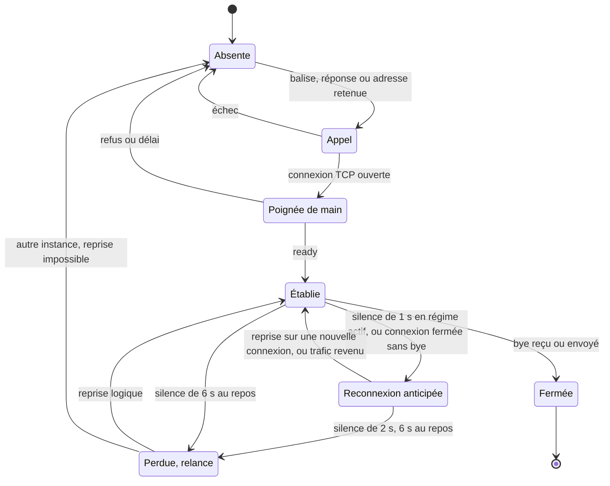
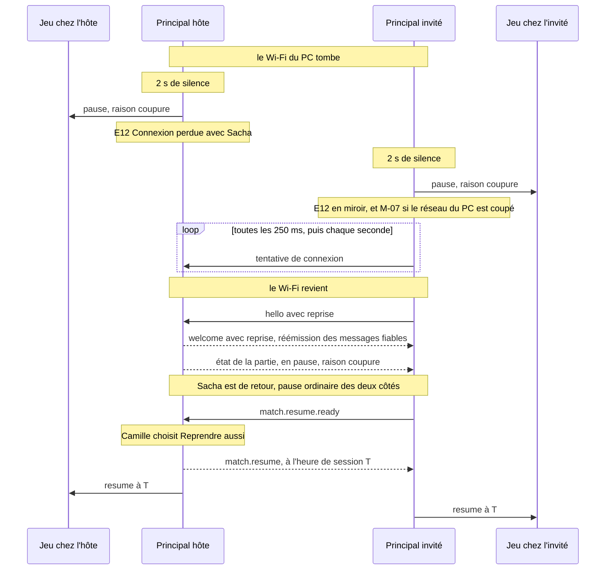
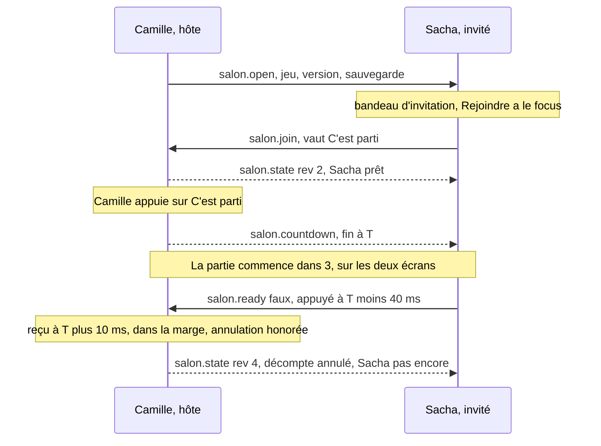
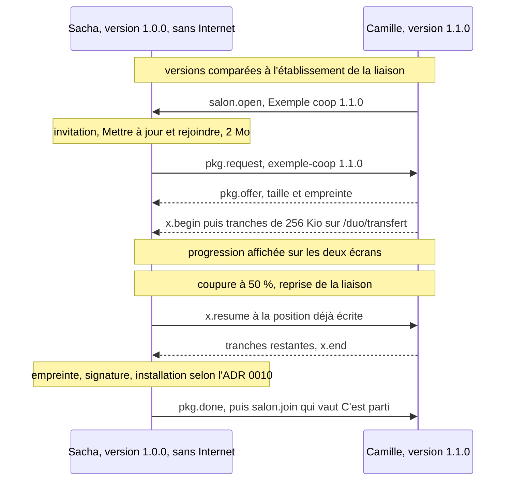
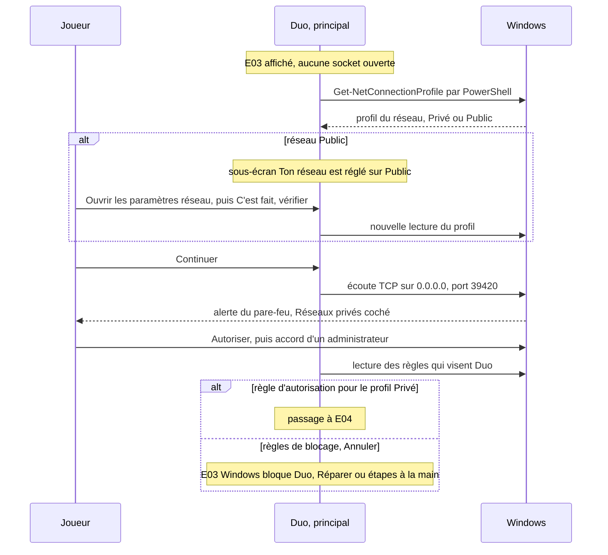
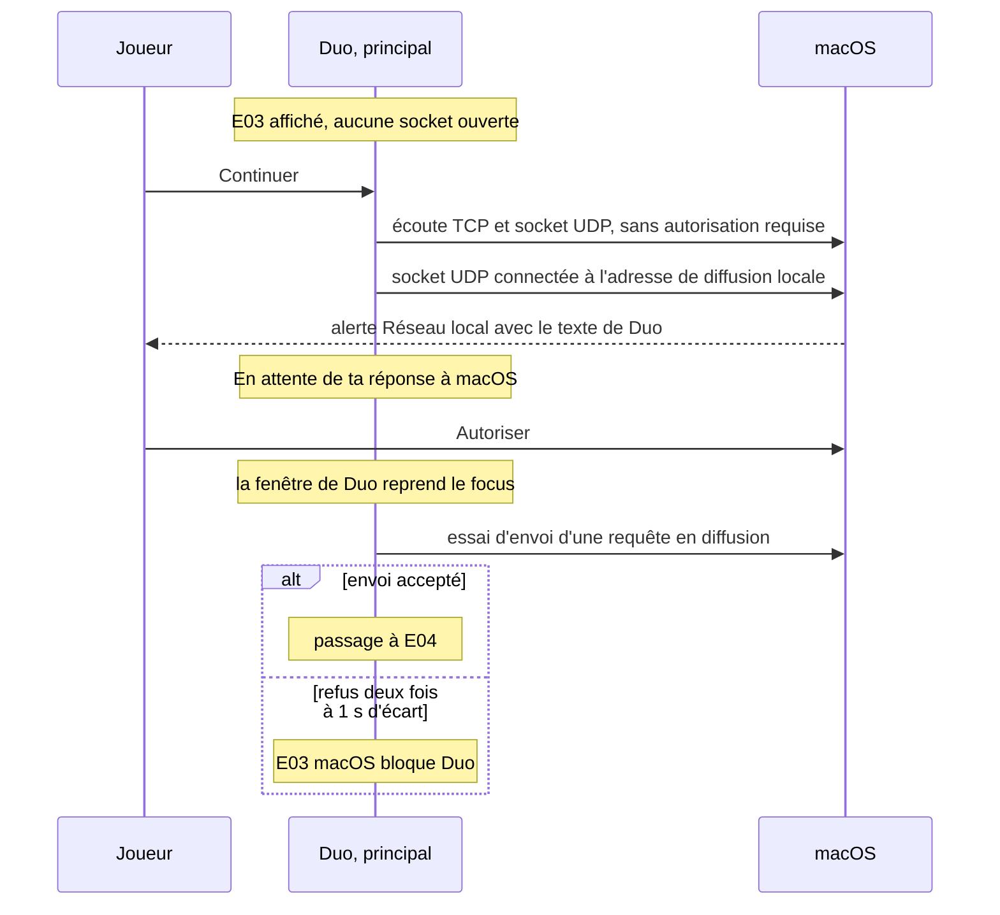
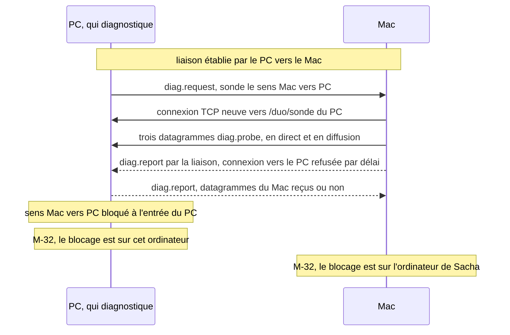

# Réseau de la plateforme Duo

| Champ | Valeur |
|---|---|
| Statut | proposition, portée par les ADR 0007 et 0008 (statut « proposée ») |
| Version du document | 0.1 |
| Dernière mise à jour | 2026-10-30 |
| Rédacteur | dev-reseau |
| Sources | cahier des charges 1.0 (F02, F03, F05 à F08, F12 à F14), `architecture.md`, `ux/parcours.md`, `criteres-acceptation.md`, ADR 0003 à 0006, 0009 à 0011, 0013, 0015; note technique TN3179 d'Apple (lue le 2026-10-30); essais jetables du 2026-10-30 (section 20) |

> Ce document détaille la conception réseau de la plateforme et l'API réseau offerte aux jeux. Les choix structurants sont tranchés dans l'ADR 0007 (modèle réseau et transport) et l'ADR 0008 (découverte et pare-feu); en cas d'écart, les ADR font foi. Les valeurs chiffrées sont des constantes du module réseau, regroupées dans un fichier de configuration typé, et le journal relève ce qu'il faut pour les recaler sur les vraies machines.

## 1. L'essentiel

1. Seuls les deux processus principaux se parlent. Un jeu ne voit que des messages relayés par le SDK.
2. Chaque Duo ouvert s'annonce sur le réseau local par diffusion UDP (port 39420), après l'accord du premier lancement, salon ouvert ou non. Les deux applications se relient dès qu'elles se voient: c'est la **liaison**, permanente tant que les deux Duo sont ouverts.
3. La liaison ne dépend pas des rôles. L'une ou l'autre machine peut l'établir (chacune écoute en TCP sur le port 39420): elle passe dans le sens que les pare-feu et les autorisations laissent passer. Hôte et invité ne sont que des rôles d'un salon.
4. Transport: WebSocket (`ws`) sur TCP, en deux connexions. La connexion **liaison** porte le contrôle, le salon et les messages de jeu; la connexion **transfert** porte les gros contenus (sauvegardes, historique, paquets de jeux), à un débit régulé pour ne jamais retarder la liaison. Mesuré: un transfert de 20 Mo sur la même connexion retarde les instantanés de 240 ms en médiane, contre 7 ms sur une connexion à part, et moins de 8 ms quand le transfert est régulé.
5. Vivacité: un battement toutes les 500 ms en salon et en partie; une reconnexion anticipée dès 1 s de silence; la liaison est déclarée perdue à 2 s de silence, ce qui met la partie en pause des deux côtés en 2,1 s au plus (mesuré: 1 995 à 2 047 ms). Aucune pause pour une coupure de 500 ms, ni même d'1 s (mesuré).
6. Une coupure ne perd rien: la liaison est une session logique numérotée qui survit au changement de connexion TCP. Les messages fiables non acquittés sont réémis à la reprise.
7. Par défaut, l'instance du jeu qui tourne chez l'hôte fait autorité; l'invité envoie des intentions, jamais d'état. Le lockstep déterministe et le tour par tour sont offerts aux jeux qui s'y prêtent.
8. Les deux machines forment un duo authentifié: une clé commune, tirée à la première rencontre (échange X25519), prouve l'identité de l'autre à chaque connexion. Un appareil du réseau qui imite une balise ne devient jamais « Sacha est là ».
9. Trois chemins indépendants pour se trouver: les balises, les requêtes (réponse directe), et les adresses retenues du partenaire, sondées en TCP. Le dernier fonctionne même si le Mac a perdu son autorisation « Réseau local », car accepter une connexion TCP ne la demande pas (TN3179).
10. Le diagnostic teste la visibilité dans les deux sens par des sondes croisées, nomme la cause quand elle est détectable et ouvre le bon réglage du système.

## 2. Ce que ce document sert dans le cahier

| Fonction | Ce que le réseau apporte | Sections |
|---|---|---|
| F02 Découverte et connexion | présence de chaque Duo, apparition en 3 s, connexion par adresse retenue, diagnostic dans les deux sens | 4, 5, 6.5, 17 |
| F03 Salon | état tenu par l'hôte, prêt des deux côtés, décompte annulable, deux salons | 9 |
| F05 Cycle de vie | chargement et départ synchronisés, pause et reprise à deux, plantage annoncé à l'autre | 10, 13 |
| F06 Déconnexion | pause en 2,1 s, aucune pour une micro-coupure, attente sans limite, reprise logique | 8, 10.3, 10.4 |
| F07, F08 Sauvegardes et historique | transport de la réplication, comparaison des index à chaque connexion | 14.3 |
| F12, F13 Nouveaux jeux et compatibilité | versions comparées dès la liaison, copie d'un jeu dans un sens ou dans l'autre, avec reprise | 6.2, 14.4 |
| F14 Rapport de diagnostic | partie réseau du rapport | 17.5 |

## 3. Topologie



- **Modules du principal** (ADR 0003): `discovery` (balises, requêtes, présence vue par le réseau), `session` (liaison, salon, partie, relais des messages de jeu), `transfer` (canal de transfert, utilisé par `data` et `packages`), et la partie réseau de `diagnostics`.
- **Liaison et rôles**: la liaison relie deux machines; le salon désigne l'hôte (celle qui l'ouvre) et l'invité. Le sens de la connexion TCP n'a aucune importance pour les couches du dessus.
- **Simulation de l'hôte** dans sa vue jeu, comme le recommande l'architecture: le code d'un jeu ne tourne jamais avec les droits de Node, une seule cible d'exécution par jeu, aucune latence pour le joueur hôte. Le principal de l'hôte relaie, il ne simule pas.
- **IPv4 seulement** en version 1: un réseau domestique en a toujours, et l'on évite les adresses IPv6 qui peuvent porter l'adresse matérielle de la carte (ADR 0015). Écoute sur `0.0.0.0`, jamais sur `::`.

## 4. Ports, écoute et interfaces

### 4.1 Ports

| Usage | Protocole | Port | Repli |
|---|---|---|---|
| Balises, requêtes, réponses, sondes de diagnostic | UDP | 39420 | aucun: le port doit être le même partout pour recevoir les diffusions. S'il est pris, Duo interroge depuis un port éphémère (il voit les autres par leurs réponses, sans être vu par leurs balises) et le diagnostic le signale |
| Liaison, transfert, sonde (WebSocket) | TCP | 39420 | 39421, puis 39422. Le port réellement ouvert est annoncé dans les balises; la connexion par adresse essaie les trois en parallèle, donc le joueur ne tape jamais de port (H-05) |

Pourquoi 39420: absent de `/etc/services` (vérifié), sous la plage éphémère de Windows (49152 à 65535) où l'Hyper-V et WSL réservent des blocs de ports, à l'écart des ports connus d'un foyer (mDNS 5353, SSDP 1900, WS-Discovery 3702, LLMNR 5355, AirPlay 5000 et 7000 sous macOS, Tailscale 41641, Steam 27015 à 27050, BACnet 47808).

Ligne de commande (ADR 0003, point 9; présente aussi dans les versions publiées, utile au dépannage):

| Option | Effet |
|---|---|
| `--duo-port=<n>` | port UDP et TCP de base (39420 par défaut) |
| `--duo-peer=<adresse>:<port>` | destination supplémentaire, répétable: requêtes, balises et sondes TCP en direct. Sert aux tests de deux instances sur la boucle locale, où la diffusion n'existe pas |
| `--duo-allow-loopback` | accepte les sources 127.0.0.0/8 (tests à deux instances sur une machine) |

### 4.2 Quand Duo écoute

- Rien avant la validation de l'écran E03 au premier lancement (CA-PF-079, ADR 0003 point 10). Les vérifications locales qui précèdent (profil réseau de Windows) n'ouvrent aucune socket.
- Ensuite, tant que Duo est ouvert: écoute TCP sur `0.0.0.0:39420` et socket UDP sur `0.0.0.0:39420` (`reuseAddr`, diffusion activée). L'écoute est permanente parce que la présence (H-34), la comparaison des versions avant toute invitation (F13), la comparaison des index avant le salon (CA-PF-055) et les profils (CA-PF-005) en ont besoin, et parce que la liaison doit pouvoir s'établir dans le sens qui passe.
- Ordre au démarrage: écoute TCP d'abord (c'est elle qui déclenche l'alerte du pare-feu de Windows), puis socket UDP, puis, sous macOS, une socket UDP connectée à l'adresse de diffusion locale (elle déclenche l'alerte « Réseau local » sans rien émettre, section 16.2), puis la première requête.

### 4.3 Interfaces retenues et adresses

`os.networkInterfaces()` est relu toutes les 2 s, et toutes les secondes quand la liaison est absente ou que le diagnostic est ouvert. Un changement (adresse apparue ou disparue) relance aussitôt une série de requêtes.

Une interface est retenue si elle a une adresse IPv4 non interne dans une plage privée: 10.0.0.0/8, 172.16.0.0/12, 192.168.0.0/16, ou 169.254.0.0/16 (deux ordinateurs reliés par un câble sans box). Sont écartées 100.64.0.0/10 (Tailscale, opérateurs) et toute adresse publique.

Duo émet sur **toutes** les interfaces retenues: une diffusion dirigée par interface (adresse de diffusion calculée d'après l'adresse et le masque, par exemple 192.168.1.255), comme le recommande TN3179 pour une découverte maison. Une interface virtuelle reçoit des balises inutiles, sans gêne.

Classement des interfaces, pour l'ordre des adresses affichées et des essais de connexion:

1. celles où le partenaire a déjà été vu;
2. Wi-Fi et Ethernet physiques: sous Windows, d'après `Get-NetAdapter` (`PhysicalMediaType` 802.11 ou 802.3, `Virtual` faux), lu au démarrage et à chaque changement; sous macOS, d'après `networksetup -listallhardwareports` (types Wi-Fi et Ethernet). En repli, d'après le nom: TN3179 rappelle qu'un nom BSD comme `en0` n'est pas un contrat;
3. les interfaces dont le nom évoque un adaptateur virtuel ou un VPN (`vEthernet`, `VirtualBox`, `VMware`, `Hyper-V`, `WSL`, `docker`, `bridge`, `utun`, `tap`, `tun`, `wg`, `Tailscale`, `ZeroTier`, `NordLynx`, `OpenVPN`, `WireGuard`), toujours en dernier.

Réglages > Réseau et le salon (après 20 s d'attente) affichent toutes les adresses retenues avec le nom de leur interface, la première en grand (CA-PF-019). Le choix de l'adresse à joindre, lui, est empirique (section 5.4): on essaie, la première qui répond l'emporte.

## 5. Découverte et présence

### 5.1 Principe

Trois chemins indépendants, actifs en même temps:

| Chemin | Ce qui passe | Ce qu'il contourne |
|---|---|---|
| Balise (`announce`) en diffusion, toutes les secondes, par chaque Duo | « je suis là »: identité, versions, port | rien de particulier: c'est le chemin ordinaire |
| Requête (`query`) en diffusion, à laquelle chaque Duo répond **en direct** (unicast) à l'adresse et au port d'origine | la même balise, en réponse | sous Windows, une réponse unicast à une diffusion sortante est admise pendant 3 s sans règle d'entrée (réglage par défaut du pare-feu, à vérifier sur le PC): un PC qui bloque les balises voit quand même le Mac; une trame unicast est acquittée et réémise par le Wi-Fi, au contraire d'une diffusion |
| Sonde TCP vers les adresses retenues du partenaire (toutes ses adresses vues, plus celles saisies à la main) | une connexion de liaison directe | un réseau qui filtre les diffusions; un Mac privé de l'autorisation « Réseau local » (il accepte encore les connexions entrantes, TN3179) |

Une balise ne fait jamais apparaître personne à l'écran: elle déclenche seulement une tentative de liaison. Le partenaire n'est affiché présent qu'une fois la liaison authentifiée (section 6). Une balise forgée ou au format d'une autre application n'a donc aucun effet visible (CA-PF-021).

### 5.2 Format d'une balise

Datagramme JSON en UTF-8, 1 200 octets au plus (sous la taille d'un paquet, sans fragmentation). Les six premiers champs forment l'**enveloppe figée** de l'ADR 0006: ils ne changeront jamais, pour que deux versions très éloignées de Duo sachent au moins se dire qui doit se mettre à jour.

```json
{
  "app": "duo",
  "envelope": 1,
  "type": "announce",
  "machine": "5f0c2b7e-8d1a-4c3e-9f61-2a7b0e4d9c11",
  "appVersion": "1.0.2",
  "protocol": 1,
  "instance": "c3a9e0d4-1b7f-4f2a-8e55-90d2f1a6b7c8",
  "seq": 1742,
  "port": 39420,
  "pseudo": "Sacha",
  "color": "carre",
  "computer": "PC-SACHA",
  "setup": "done",
  "duos": ["a1b2c3d4"],
  "addresses": [{ "ip": "192.168.1.23", "prefix": 24 }]
}
```

| Champ | Règle |
|---|---|
| `app`, `envelope` | `"duo"` et `1`: tout autre datagramme est ignoré sans bruit |
| `type` | `announce`, `query` (même contenu, demande une réponse directe) ou `bye` (fermeture propre, envoyé trois fois à 50 ms d'écart) |
| `machine` | identifiant stable de la machine (`machine.json`, ADR 0009) |
| `appVersion`, `protocol` | version de Duo (SemVer) et protocole de la liaison (entier, ADR 0006). Un protocole différent suffit à afficher M-27 des deux côtés, sans attendre de liaison (CA-PF-090, moins de 3 s) |
| `instance` | tiré à chaque démarrage de Duo: distingue une reprise d'un redémarrage |
| `port` | port TCP réellement ouvert, `0` si l'écoute a échoué |
| `pseudo`, `color`, `computer` | profil (F01) et nom de l'ordinateur tronqué à 32 caractères, pour E04 (« Duo est ouvert sur « PC-SACHA » »). Visibles de tout le réseau local, comme le sont déjà ces noms par les services du système; jamais écrits dans le journal (ADR 0015) |
| `setup` | `done` ou `in-progress` (E04 « pas configuré ») |
| `duos` | empreintes courtes (8 caractères hexadécimaux du SHA-256) des duos dont la machine est membre: reconnaître son partenaire sans liaison |
| `addresses` | adresses IPv4 retenues et longueur de leur préfixe |

Validation par un schéma Valibot strict (longueurs, plages, formats). Plafonds de débit: 20 datagrammes par seconde et par source, 200 au total; au-delà, ils sont jetés et comptés pour le diagnostic.

### 5.3 Cadences

| Événement | Cadence | Pourquoi |
|---|---|---|
| Balise | toutes les 1 000 ms, plus ou moins 100 ms tirés au hasard; une tout de suite au démarrage | disparition comptée en secondes, quelques centaines d'octets par seconde |
| Requête | à 0, 250, 750 et 1 500 ms après le démarrage, après un changement d'interface et à l'ouverture de E04 ou E17; puis toutes les 5 s tant que le partenaire n'est pas relié | apparition en moins de 3 s même avec des pertes (mesuré: 2,8 s au pire avec 30 % de pertes, section 20) |
| Réponse à une requête | aussitôt, après un délai tiré entre 0 et 50 ms | évite que toutes les réponses partent au même instant |
| Sonde TCP des adresses retenues | toutes les 5 s tant que le partenaire n'est pas relié | chemin de secours, coût négligeable |
| Expiration d'une machine vue seulement par ses balises | 5 s sans datagramme | tolère quatre pertes de suite; disparition en moins de 10 s (CA-PF-118) |
| `bye` reçu | disparition immédiate | fermeture propre de Duo (CA-PF-009, CA-PF-118) |

### 5.4 De la balise à la liaison

1. Une balise ou une réponse d'une machine qui partage un duo avec nous, ou de n'importe quel Duo pendant un premier lancement ou un rattachement (ADR 0009, point 9), ajoute ses adresses aux candidates, à commencer par l'adresse source du datagramme.
2. Si aucune liaison n'existe avec elle, Duo l'appelle: une tentative par adresse candidate, décalées de 250 ms (première adresse à 0, deuxième à 250 ms, et ainsi de suite), 1 s de délai chacune; la première poignée de main réussie l'emporte, les autres sont fermées.
3. **Appel croisé**: les deux machines peuvent s'appeler en même temps. Si deux liaisons s'établissent, les deux côtés gardent celle dont l'appelant a le plus petit identifiant de machine et ferment l'autre (raison `duplicate`). La règle est la même des deux côtés, donc sans désaccord possible; elle se teste en unitaire.
4. Une machine qui ne partage aucun duo avec nous, hors premier lancement et rattachement, n'est pas appelée automatiquement: elle apparaît dans Réglages > Réseau (« Autres ordinateurs avec Duo »). Voir la question ouverte en section 22.

### 5.5 Présence affichée

| État de la liaison | Affiché (M-30) | Délai |
|---|---|---|
| établie et authentifiée | « Sacha est là » | moins de 3 s après le lanceur de l'autre (mesuré: 5 à 9 ms entre deux espaces de noms) |
| en reprise, moins de 6 s au repos | rien ne change | évite le clignotement de la présence pour une coupure brève |
| perdue au repos, ou `bye` reçu, ou connexion refusée par une machine joignable (Duo fermé) | « Sacha n'est pas visible pour l'instant. » | `bye` et refus: immédiat; silence: 6 s |
| balises reçues, liaison impossible | « Sacha n'est pas visible pour l'instant. », avec « Que faire ? »; le diagnostic sait déjà qu'il s'agit d'un blocage de la connexion | après l'échec des tentatives de la section 5.4 |
| protocole différent | M-27 (ADR 0006) | dès la première balise |

### 5.6 Premier démarrage et formation du duo



## 6. Liaison: établissement et poignée de main

### 6.1 Requête d'ouverture

Un serveur HTTP de Node reçoit les demandes de passage en WebSocket et les filtre avant `ws` (`noServer`):

| Contrôle | Sinon |
|---|---|
| adresse source privée (section 4.3), boucle locale seulement avec `--duo-allow-loopback` | connexion détruite sans réponse |
| aucun en-tête `Origin`: une page web l'envoie toujours, ce qui écarte toute page d'un navigateur du réseau, y compris par rebond DNS | 403 |
| chemin `/duo/liaison`, `/duo/transfert` ou `/duo/sonde`, sous-protocole WebSocket `duo` | 404 |
| au plus 4 connexions non authentifiées à la fois, 5 nouvelles connexions par seconde et par adresse | 503, puis destruction |
| toute autre requête HTTP | 404, corps vide, en-têtes d'attente courts (`headersTimeout` 3 s) |

Les chemins ne portent pas le numéro de protocole: deux versions incompatibles doivent pouvoir échanger leur enveloppe figée et afficher M-27. Options de `ws`: `perMessageDeflate: false` (la compression des contenus se fait par fichier, section 14), `maxPayload` de 128 Kio sur la liaison et de 512 Kio sur le transfert. `ws` désactive l'algorithme de Nagle sur chaque socket (`setNoDelay`, vérifié dans `ws` 8.22.0).

### 6.2 Poignée de main

| Étape | Sens | Message | Contenu |
|---|---|---|---|
| 1 | appelant vers appelé | `hello` | enveloppe figée (`app`, `envelope`, `type`, `machine`, `appVersion`, `protocol`), puis `instance`, profil, nom de l'ordinateur, système et architecture, `bridge` (versions du pont, ADR 0005), `electron`, `dataFormat` (ADR 0009), jeux installés (identifiant, version, empreinte), duos connus (empreintes courtes), `nonce` (16 octets aléatoires), `resume` facultatif (section 8.3) |
| 2 | appelé vers appelant | `welcome` ou `reject` | mêmes champs; `proof` si un duo est commun; ou `reject` avec une raison typée (`protocol`, `busy`, `bad-proof`, `duplicate`, `malformed`) |
| 3 | appelant vers appelé | `auth` | `proof` de l'appelant |
| 4 | les deux | `ready` | l'appelé fixe l'identifiant de liaison (128 bits aléatoires) |

- Délais: `hello` attendu 3 s après l'ouverture, poignée de main complète en 5 s, sinon fermeture. Du côté qui appelle, une machine qui accepte la connexion TCP mais ne répond pas en WebSocket valide dans ces 3 s n'est « pas Duo » (E17).
- **Protocoles différents**: chacun lit l'enveloppe figée de l'autre, répond `reject` (`protocol`) et affiche M-27, qui désigne la machine dont la version de Duo est la plus ancienne (ADR 0006). La comparaison des versions des jeux se fait sur les listes du `hello`, avec la fonction pure de l'ADR 0006.
- Tout message reçu passe par son schéma (section 7.3). Un `hello` invalide ferme la connexion.

### 6.3 Clé du duo et authentification

- **Formation** (première rencontre, ADR 0009 point 2): après `welcome`, échange `pair.offer` et `pair.accept` portant chacun une clé publique X25519 éphémère. Clé du duo: HKDF-SHA256 du secret partagé, sel égal à l'identifiant du duo, information `duo/cle-liaison/1`, 32 octets (fonctions natives de `node:crypto`, vérifiées sous Node 22). Un écouteur passif du réseau ne peut pas la calculer; une usurpation active au moment même de la première rencontre resterait possible (confiance à la première rencontre, acceptée pour un foyer).
- **Preuves**: `proof` de l'appelé, HMAC-SHA256 de la clé sur `liaison/appele`, les deux nonces et les deux identifiants de machine; preuve de l'appelant de même avec `liaison/appelant`. Comparaison en temps constant (`timingSafeEqual`). Une preuve fausse ferme la connexion, et l'adresse est ignorée 60 s.
- **Rattachement** (machine réinstallée, ADR 0009 point 9): la liaison reste « non appairée » (présence, versions, proposition M-23) jusqu'à l'accord des deux joueurs, puis même échange qu'à la formation.
- Une liaison non appairée n'accepte que les messages de présence, de versions, de formation et de rattachement: ni salon, ni données, ni jeu.
- **Rangement**: clé et adresses retenues dans `<userData>/reseau.json`, propre à la machine, jamais répliqué, droits restreints au compte (0600 sous macOS). La clé est un secret de la machine, pas du dépôt.
- **Pas de chiffrement** des échanges en version 1: le contenu (pseudos, entrées, sauvegardes de jeux) n'est pas sensible, il ne quitte pas la maison, et un chiffrement par TLS demanderait des certificats à fabriquer sans bibliothèque native. L'authentification protège ce qui compte: personne ne peut écrire dans les données du duo ni se faire passer pour l'autre machine. Les paquets de jeux restent vérifiés par leur signature (ADR 0010).

### 6.4 Ordre des échanges à l'établissement

1. Versions: compatibilité de Duo, puis écarts de version des jeux (affichés à l'invitation et au salon, ADR 0006).
2. Profils (pseudo, couleur, et règle de couleur de l'ADR 0009).
3. Comparaison des index des données du duo et envoi de ce qui manque (ADR 0009 point 6, section 14.3). Le salon ne propose les sauvegardes qu'après (CA-PF-055).
4. État du salon et de la partie en cours, s'il y en a (invitation, partie à rejoindre après un redémarrage de l'invité).

### 6.5 Connexion par adresse (recours)

- Le champ accepte une adresse IPv4 sans port (lecture de la saisie par l'UX: chiffres de la rangée du haut et du pavé, virgule pour point, H-05). Valeur mal formée: M-09 sans aucune tentative.
- Duo essaie les trois ports TCP en parallèle, 5 s au plus. Une fois relié, il retient l'adresse dans `reseau.json` et la sondera ensuite toutes les 5 s quand le partenaire n'est pas relié: le recours tapé une fois sert à chaque démarrage.

| Ce que voit Node (essai sous Linux, section 20) | Délai mesuré | Message |
|---|---|---|
| connexion refusée (`ECONNREFUSED`): un ordinateur répond, aucun programme n'écoute | 1 ms | M-10, variante proposée: « L'ordinateur à cette adresse répond, mais Duo n'y est pas ouvert. » |
| hôte injoignable (`EHOSTUNREACH`): personne à cette adresse sur le réseau | 3 s | M-10, variante proposée: « Aucun ordinateur ne répond à cette adresse sur ton réseau. »; sous macOS, d'abord vérifier l'autorisation « Réseau local » (même erreur attendue en cas de refus, à confirmer) |
| aucune réponse (paquets jetés: pare-feu, Wi-Fi qui isole les appareils, ordinateur éteint) | délai de 5 s | M-10 « pas de réponse » |
| connexion TCP acceptée, pas de WebSocket `duo` valide en 3 s | 3 s | M-10 « pas Duo » |
| protocole différent | immédiat | M-27 |

Tous ces délais tiennent sous les 10 s de CA-PF-011.

## 7. Messages et validation

### 7.1 Enveloppes

- **Liaison, contrôle**: trames texte, JSON. Chaque message porte `type` (discriminant); les messages fiables portent aussi `seq` (entier croissant, propre à chaque sens). Le battement porte `ack`, le dernier `seq` reçu de l'autre.
- **Liaison, messages de jeu**: trames texte `{"type":"g","ch":2,"seq":5120,"d":{...}}` pour un contenu JSON, ou trames binaires pour un contenu binaire, avec un en-tête de 8 octets (type `0x01`, canal, drapeaux, réservé, `seq` sur 32 bits) suivi des octets du jeu.
- **Transfert**: messages de contrôle en JSON (`x.begin`, `x.ack`, `x.end`, `x.abort`, `x.resume`) et trames binaires de données (en-tête: identifiant de transfert sur 32 bits, position sur 64 bits, puis 256 Kio au plus).

### 7.2 Familles de messages

| Famille | Messages | Fiable | Sens |
|---|---|---|---|
| Poignée de main | `hello`, `welcome`, `reject`, `auth`, `ready`, `pair.offer`, `pair.accept` | sans objet | les deux |
| Vivacité | `ping`, `pong`, `bye` | non (perdus sans dommage) | les deux |
| Présence et profils | `profile.update`, `games.update` | oui | les deux |
| Données du duo | `data.index`, `data.want`, `data.put` (contenu de 64 Kio au plus), `data.ack` | oui | les deux |
| Salon | `salon.open`, `salon.close`, `salon.select`, `salon.join`, `salon.leave`, `salon.ready`, `salon.state`, `salon.countdown`, `salon.cancel` | oui | intentions vers l'hôte, état depuis l'hôte |
| Partie | `match.load`, `match.loaded`, `match.start`, `match.pause.request`, `match.paused`, `match.resume.ready`, `match.resume`, `match.stop`, `match.end`, `match.crash`, `match.rejoin.offer`, `match.rejoin` | oui | intentions vers l'hôte, décisions depuis l'hôte |
| Jeu | `g` et trames binaires de jeu | selon le canal (section 11.2) | les deux |
| Diagnostic | `diag.request`, `diag.report`, `diag.probe` | oui | les deux |
| Copie de jeu | `pkg.request`, `pkg.offer`, `pkg.done` (contenu par le transfert) | oui | les deux |

### 7.3 Validation

- Chaque message reçu passe par son schéma Valibot de `@duo/protocol` (objets stricts, chaînes et tableaux bornés, nombres dans leurs plages, identifiants au format attendu) avant tout usage. Un JSON illisible ou un message de la poignée de main invalide ferme la connexion; un message invalide après la poignée de main est jeté et journalisé, et dix messages invalides en une minute ferment la liaison.
- Un `type` inconnu est ignoré et journalisé: c'est ce qui permet à une version mineure d'ajouter des messages (ADR 0006).
- Les contenus des messages de jeu sont opaques pour la plateforme, qui ne contrôle que l'en-tête, la taille et le débit; le SDK du jeu qui les reçoit les valide par le schéma que le jeu a déclaré (section 12.6).
- Aucun chemin de fichier ne vient du réseau: les données sont désignées par des identifiants validés et des empreintes, les chemins se construisent localement (ADR 0009 point 1).

### 7.4 Limites de taille et de débit

| Quoi | Limite | Au-delà |
|---|---|---|
| Trame de la liaison | 128 Kio (`maxPayload`) | fermeture par `ws` |
| Message de jeu | 64 Kio | refusé à l'envoi, erreur dans le SDK |
| Débit des messages de jeu, par sens | 120 messages par seconde et 512 Kio/s en moyenne sur 1 s, rafale de 1 Mio | jetés et journalisés; 10 s de dépassement continu: fin de la partie avec erreur, comme un plantage du jeu (M-14) |
| Messages de contrôle, par sens | 200 par seconde | jetés et journalisés |
| Trame du transfert | 512 Kio (`maxPayload`), données par tranches de 256 Kio | fermeture |
| Contenu d'un transfert | sauvegarde: plafond de l'ADR 0009 (32 Mio); paquet: plafond de l'ADR 0010 (200 Mo extraits) | refusé avant tout envoi |

### 7.5 Évolution du protocole

`protocol` (entier) ne change que pour une incompatibilité (ADR 0006). Dans un même protocole, une version de Duo peut ajouter des messages et des champs facultatifs, que l'autre ignore. Les tests de `@duo/protocol` gardent des messages de chaque version publiée et vérifient qu'ils restent lisibles.

## 8. Vivacité, coupures et reprise

### 8.1 Battements et mesure

- `ping { id, t0, ack }` et `pong { id, t0, t1, t2, ack }`, où `t0` est l'heure d'envoi chez l'émetteur, `t1` et `t2` les heures de réception et de réponse chez l'autre, toutes sur l'horloge monotone du principal (`performance.now()` de Node).
- Aller-retour: `(t3 - t0) - (t2 - t1)`. Écart d'horloge: `((t1 - t0) + (t2 - t3)) / 2`, retenu sur l'échantillon au plus court aller-retour parmi les 16 derniers (section 13).
- **Tout message reçu** compte comme signe de vie, pas seulement le battement: en partie, les messages de jeu arrivent toutes les 16 à 33 ms.

### 8.2 Seuils

| Paramètre | Repos (aucun salon ni partie) | Actif (salon, invitation en attente, chargement, partie) |
|---|---|---|
| Battement | 2 000 ms | 500 ms |
| Reconnexion anticipée (section 8.3) | non | dès 1 000 ms de silence, ou un `ping` sans `pong` depuis 1 000 ms |
| Liaison déclarée perdue | 6 000 ms de silence | 2 000 ms de silence |
| Contrôle du silence | toutes les 50 ms | toutes les 50 ms |
| Ce que voient les joueurs à la perte | la présence passe à « n'est plus visible » | partie: pause des deux côtés (E12); salon: « Connexion perdue »; décompte annulé |
| Relance après la perte | toutes les 250 ms pendant 10 s, puis toutes les secondes, sans fin tant que Duo est ouvert | idem |

Le régime actif commence pour les deux machines dès l'ouverture d'un salon (le message `salon.open` le déclenche aussi chez l'autre) et s'arrête au retour à l'accueil. Le repos économise le Wi-Fi des portables et tolère une application endormie par macOS (section 8.5).

Justification des valeurs actives, d'après l'essai de la section 20:

- 2 000 ms de silence avant la perte, battement compris, donnent une pause affichée en 2,1 s environ (mesuré: perte déclarée 1 995 à 2 047 ms après une coupure franche), sous les 3 s de F06 et de CA-PF-044, avec 0,9 s de marge pour l'affichage.
- Une coupure de 500 ms laisse au plus 1,43 s de silence en salon et 0,70 s en partie: aucune pause (CA-PF-045). Sans reconnexion anticipée, une coupure d'1 s déclenche déjà la perte, parce que TCP espace ses réémissions (200, puis 400, puis 800 ms sous Linux; le minimum est plus élevé sous Windows, 300 ms par défaut d'après les réglages de `netsh int tcp`, à mesurer sur le PC). Avec la reconnexion anticipée, aucune pause pour 1 s de coupure, et la nouvelle connexion prend le relais 30 à 270 ms après le retour du lien.
- Un battement plus rapide (250 ms) n'apporte rien (mesuré): c'est le recul des réémissions TCP qui domine, pas l'âge du dernier battement.

### 8.3 Reconnexion anticipée et reprise logique

La liaison est une **session logique** (identifiant de liaison, numéros `seq` dans chaque sens) portée par une connexion TCP à un instant donné. Elle survit au remplacement de cette connexion.

- **Tampon de réémission**: chaque côté garde les messages fiables qu'il a envoyés et que l'autre n'a pas encore acquittés (`ack` des battements), jusqu'à 4 Mio ou 30 s de production. Pour un canal de jeu en mode `latest` (section 11.2), seul le dernier message du canal est gardé.
- **Reprise**: la nouvelle connexion commence par `hello` avec `resume { liaison, received }` (dernier `seq` reçu); la preuve d'authentification couvre l'identifiant de liaison. L'autre répond `welcome` avec son propre `received`. Chacun réémet ce qui suit, puis l'ancienne connexion est fermée. Aucun message fiable n'est perdu ni dupliqué.
- **Reprise impossible**: l'autre a redémarré (`instance` différent), ou le tampon a débordé. Une nouvelle liaison s'établit; les couches du dessus resynchronisent leur état (salon renvoyé par l'hôte, partie à rejoindre, comparaison des index des données).
- **Qui rappelle**: l'appelant de la connexion perdue, qui connaît le chemin qui marche, rappelle aussitôt. L'autre côté commence à rappeler lui aussi 5 s après la perte (adresse changée, sens devenu impossible); un doublon se règle comme en section 5.4.
- **Où rappeler**: dernière adresse connue, puis adresses des balises reçues depuis (une adresse qui a changé après une reconnexion au Wi-Fi est retrouvée ainsi), puis adresses retenues.





### 8.4 Effets d'une perte, selon le moment

| Moment | Effet de la perte (2 s de silence en régime actif, 6 s au repos) | Au retour |
|---|---|---|
| Repos | rien avant 6 s, puis présence « n'est plus visible » | présence rétablie, comparaison des index |
| Salon | cartes « Connexion perdue », décompte annulé, les deux joueurs repassent à « Pas encore » | « Sacha est de retour. », puces à « Pas encore » (UX E08) |
| Chargement | les deux écrans l'indiquent; le départ attend | reprise du chargement, départ synchronisé |
| Partie | pause des deux côtés, raison « coupure » (E12, M-17 et M-18; M-07 chez celui qui a perdu son réseau) | pause ordinaire, « Reprendre » des deux côtés, puis « Reprise dans 3 » (H-09) |
| Fin de partie | « Rejouer » indisponible avec la raison (UX 4.3) | « Rejouer » de nouveau possible |
| Copie de jeu ou réplication | interrompue, la partie déjà reçue est gardée | reprise à la position atteinte (section 14) |

Une connexion qui se ferme sans `bye` (erreur du système, processus tué de l'autre côté, Wi-Fi qui retombe) ne met rien en pause par elle-même: Duo rappelle aussitôt, et seul le seuil de silence déclenche la pause. Une micro-coupure qui casse la connexion TCP reste donc invisible si la reprise aboutit à temps.

### 8.5 Cas particuliers

- **Fermeture propre de Duo**: `bye { reason: "quit" }` sur la liaison et trois balises `bye`. L'autre machine retire aussitôt la présence et l'invitation (CA-PF-009) et, en partie, revient au salon avec M-16 sans attendre de reconnexion (H-13, ADR 0004 point 8).
- **Processus tué**: le système de la machine tuée ferme ses connexions; l'autre côté rappelle et reçoit un refus immédiat (Duo n'écoute plus): présence retirée aussitôt au repos, pause à 2 s en partie, invitation retirée à 2 s (moins de 10 s exigées).
- **Plus de réseau sur cette machine**: aucune interface retenue, ou plus aucune adresse: M-07 dans la seconde qui suit la relecture des interfaces (CA-PF-017, moins de 3 s), dans E12 si une partie est en cours. Au retour d'une adresse, requêtes immédiates; le message disparaît dès que la liaison revient.
- **Veille**: au réveil, les minuteurs repartent, la relance reprend, la reprise logique aboutit si les deux Duo sont restés ouverts (CA-PF-050: moins de 30 s après le réveil, dont quelques secondes pour que le Wi-Fi se réassocie).
- **Application endormie par macOS** (App Nap): une application cachée peut voir ses minuteurs espacés, donc ses battements retardés. Parades: régime de repos tolérant (6 s); en régime actif, `powerSaveBlocker.start('prevent-app-suspension')` sur les deux machines dès qu'un salon s'ouvre ou qu'une invitation arrive (l'architecture le prévoit déjà pour la partie); clé `NSAppSleepDisabled` dans `Info.plist` à essayer avec ingenieur-build. Effet réel à mesurer sur le Mac (section 21).
- **Boucle d'événements du principal bloquée**: un traitement synchrone de 2 s ferait déclarer la perte par l'autre machine. Règle de l'ADR 0003 (rien de lourd sur le fil principal), surveillée par `monitorEventLoopDelay` de `node:perf_hooks`: retard au 99e centile et maximal relevés dans le journal et le rapport.

### 8.6 Coupure longue en partie



## 9. Salon

### 9.1 Autorité

L'état du salon vit dans le principal de l'hôte; l'invité envoie des intentions, l'hôte répond par l'état complet numéroté `salon.state { rev, game, version, save, players, phase, countdownEndsAt }`. La machine à états est une fonction pure (état, événement, heure) vers (état, messages), testée en unitaire sur les 1 000 séquences de CA-PF-025.

### 9.2 Règles

- `salon.open` part aussitôt sur la liaison: l'invitation s'affiche chez l'autre en quelques millisecondes (CA-PF-007, moins de 3 s). Si l'autre arrive plus tard, il reçoit l'état du salon à l'établissement de la liaison.
- `salon.join` vaut « C'est parti » (F03). `salon.ready { ready, at }` porte l'heure de session de l'appui.
- `salon.select` (hôte seulement: jeu, version, sauvegarde) remet les deux joueurs à « Pas encore » et prévient l'autre (CA-PF-026). Un `salon.select` venu de l'invité est refusé par schéma de rôle.
- Le nouvel état s'affiche chez l'autre en un aller-retour: quelques millisecondes en Wi-Fi, 100 ms avec le profil R1 (CA-PF-023: moins d'1 s).

### 9.3 Décompte et annulation tardive

- Quand les deux sont prêts, l'hôte fixe `countdownEndsAt` = maintenant + 3 s (heure de session de l'hôte) et l'envoie; chaque machine affiche les chiffres d'après cette heure convertie: ils changent au même instant sur les deux écrans, à l'écart d'horloge près (quelques millisecondes).
- Un « Pas encore » ou un Échap pendant le décompte annule pour les deux (CA-PF-024, moins d'1 s).
- **Annulation tardive**: un « Pas encore » de l'invité appuyé avant la fin du décompte (d'après son heure de session) peut arriver après. L'hôte attend donc, après la fin du décompte, une marge de min(250 ms, aller-retour / 2 + 50 ms) avant de lancer le chargement, et honore toute annulation horodatée avant la fin. Une annulation horodatée après la fin est ignorée. Ainsi la partie démarre si et seulement si les deux étaient prêts à la fin du décompte (CA-PF-025), et jamais deux fois.

### 9.4 Deux salons

Chaque machine peut ouvrir son salon; chacune voit l'invitation de l'autre (H-06). Le premier `salon.join` traité l'emporte: l'hôte qui le reçoit l'accepte, et la machine qui rejoint ferme son propre salon, ce qui retire son invitation chez l'autre (CA-PF-020). Si les deux `salon.join` se croisent (chacun a rejoint le salon de l'autre avant d'avoir reçu l'appel croisé), la règle est déterministe: c'est le salon de la machine au plus petit identifiant qui reste; l'autre machine devient l'invitée et reçoit « Ton salon est fermé : tu as rejoint celui de Sacha. ».

### 9.5 Ouverture, invitation et décompte



## 10. Partie

### 10.1 Chargement et départ synchronisé

1. À la fin du décompte, l'hôte envoie `match.load { matchId, game, version, seed, roles }`; les deux écrans passent au chargement en moins de 0,5 s (CA-PF-033).
2. Chaque machine charge son jeu et envoie sa progression (`match.loaded`).
3. Quand les deux sont prêts, l'hôte fixe le départ à maintenant + max(300 ms, deux fois l'aller-retour au 95e centile + 100 ms) et envoie `match.start { at }`. Chaque plateforme transmet `start` à son jeu pour cette heure convertie. Écart attendu entre les deux départs: l'erreur d'estimation de l'écart d'horloge (quelques millisecondes en Wi-Fi) plus une image, bien sous les 200 ms de CA-PF-033.
4. Chargement de plus de 20 s chez l'un: les deux écrans le disent et proposent « Revenir au salon ». Échec du chargement: `match.crash`, retour des deux au salon (CA-PF-034).

### 10.2 Pause et reprise à deux

- Échap chez l'invité: sa superposition s'affiche aussitôt, et `match.pause.request { at }` part vers l'hôte, qui fige la simulation au pas courant et diffuse `match.paused { by, tick }`. Échap chez l'hôte: même chose sans le premier trajet. Délai chez l'autre: un trajet simple, soit 50 ms avec le profil R1 (CA-PF-035: moins de 500 ms).
- Deux Échap à moins de 300 ms d'écart donnent une seule pause, avec les deux pseudos (UX 3.5).
- Reprise: chacun envoie `match.resume.ready`; quand l'hôte a les deux, il fixe la reprise à maintenant + 3 s et envoie `match.resume { at }` (« Reprise dans 3 »). Une perte de la liaison pendant ce décompte l'annule (CA-PF-044).
- Pendant la pause, l'hôte ne fait plus avancer la simulation: l'empreinte de l'état ne change pas (CA-PF-035).

Risque mesuré: avec 2 % de pertes, un message isolé peut attendre une réémission TCP (section 20, jusqu'à 600 ms pour un flux à 30 Hz). Une pause est souvent le dernier message d'une rafale: s'il se perd, TCP attend son délai de réémission. Parade, si le banc la montre nécessaire: après un message de pause, émettre trois petits battements à 30 ms d'intervalle, qui provoquent les accusés en double et une réémission rapide.

### 10.3 Coupure en partie (F06)

- Perte à 2 s de silence: chaque machine met son jeu en pause de son côté, sans attendre l'autre (on ne peut pas compter sur le réseau pour annoncer sa propre perte). L'hôte fige la simulation.
- Avant la perte (moins de 2 s), le jeu continue. Chez l'hôte, les entrées de l'invité qui n'arrivent plus depuis 200 ms sont considérées relâchées, pour que son personnage ne parte pas tout seul pendant un trou; à la reprise, les entrées arrivées en retard sont fusionnées (dernier état des touches, appuis cumulés), jamais rejouées une à une. Un jeu peut choisir de geler sa simulation dans ce cas (option du SDK).
- Attente sans limite (F06, CA-PF-047): la relance ne s'arrête jamais tant que Duo est ouvert, et la reprise logique n'a pas de date d'expiration tant que les deux applications tournent (essai de 10 min exigé par CA-PF-046).
- Au retour: reprise logique (section 8.3), puis pause ordinaire et reprise à deux (H-09). Reconnexion mesurée 48 à 72 ms après le retour du lien (CA-PF-046 exige moins de 5 s).
- « Arrêter la partie » pendant l'attente: décision locale; l'autre l'apprend à la reconnexion (`match.stop`), et c'est la plateforme de l'hôte qui inscrit la partie interrompue (ADR 0009 point 8).

### 10.4 Une application redémarre

- **Invité relancé** (CA-PF-048): la liaison qui revient a un autre `instance`, la reprise logique est impossible. L'hôte, qui garde la partie en pause, envoie `match.rejoin.offer`; l'accueil de l'invité propose de rejoindre d'une touche (moins de 10 s après le lanceur). L'invité recharge le jeu en mode reprise, l'hôte lui envoie l'état complet de la partie (section 14.5), puis pause ordinaire et reprise à deux. Empreinte d'état identique à celle de la coupure.
- **Hôte relancé** (CA-PF-049): l'état en mémoire est perdu. À la nouvelle liaison, l'invité apprend que l'instance de l'hôte a changé: il quitte la superposition E12 et affiche M-19; l'accueil de l'hôte propose de reprendre depuis la dernière sauvegarde (ADR 0009 point 8).

### 10.5 Fin, rejouer, retour au salon

`match.end` (résultat fourni par le jeu de l'hôte) part avec l'entrée d'historique; l'écran de fin s'affiche sur les deux machines en un trajet (CA-PF-037, moins d'1 s). « Rejouer » attend `match.replay.ready` des deux côtés (puis décompte); « Retour au salon » n'emmène que celui qui le choisit, et l'autre voit qu'il l'attend (H-10).

### 10.6 Plantage d'un jeu

La machine où le jeu plante ou se bloque envoie `match.crash { reason }` (ADR 0004 point 7). Les deux détruisent leur vue jeu et reviennent au salon (M-14). Si la liaison est perdue au même moment, chacun applique sa propre règle et ils se retrouvent au salon à la reconnexion.

## 11. Relais des messages de jeu

### 11.1 Chemin et coût

Jeu, `MessagePort`, principal, WebSocket, principal de l'autre machine, `MessagePort`, jeu. Le passage par le principal coûte 0,1 ms (vérifié par l'architecte); le transport, quelques millisecondes en Wi-Fi. Le principal ne décode pas le contenu: il vérifie le canal, la taille, le débit, et numérote.

### 11.2 Canaux et modes

- 16 canaux par partie, numérotés de 0 à 15 par le jeu, chacun déclaré avec un mode:
  - `reliable`: livré dans l'ordre, une seule fois, y compris à travers une reprise (entrées, événements, actions de tour par tour, entrées du lockstep);
  - `latest`: livré dans l'ordre tant que la connexion tient; à la reprise, seul le dernier message du canal est réémis (instantanés: un ancien instantané n'a plus de valeur).
- Les deux modes passent par la même connexion TCP: il n'y a pas, en version 1, de canal non fiable au sens d'UDP (section 12.5).

### 11.3 Contenus JSON ou binaires

Un jeu envoie un objet JSON (par défaut) ou un `ArrayBuffer` (transféré sans copie par le `MessagePort`). JSON suffit au budget de l'architecture (instantanés de 2 Ko au plus, 30 par seconde: 60 Ko/s, sérialisation de quelques dizaines de microsecondes). Le binaire est là pour le jour où une mesure le justifie (gros mondes, nombreux objets), sans changer la plateforme.

## 12. Modèles de synchronisation proposés aux jeux

Le modèle de chaque jeu est choisi dans son cahier des charges, avec les devs gameplay et l'architecte, et déclaré dans le manifeste (`network`, ADR 0005). Le SDK fournit une aide pour chacun.

### 12.1 Hôte qui fait autorité (`host-authority`, par défaut)

- **Hôte**: simulation à pas fixe (60 Hz par défaut) dans sa vue jeu, cadencée par des minuteurs et non par `requestAnimationFrame` (fenêtre réduite, ADR 0004); instantané tous les 2 pas (30 par seconde) ou tous les 3 (20 par seconde) sur un canal `latest`: `{ tick, lastInput, state }`, où `lastInput` est le numéro de la dernière entrée de l'invité appliquée.
- **Invité**: envoie ses entrées à chaque pas sur un canal `reliable`: numéro, état des actions tenues, appuis depuis le pas précédent, pointeur. Jamais d'état.
- **Interpolation chez l'invité**: affichage à l'heure de session de l'hôte moins un retard égal à deux intervalles d'instantané plus le 95e centile de la gigue d'arrivée sur 5 s, borné entre 50 et 250 ms (environ 70 à 100 ms en Wi-Fi ordinaire). Si le tampon se vide, extrapolation 100 ms au plus, puis image figée.
- **Prédiction et réconciliation** (facultatives, pour les déplacements nerveux de l'invité): l'invité simule son propre personnage avec la même fonction que l'hôte; à chaque instantané, il repart de l'état reçu et rejoue ses entrées postérieures à `lastInput`; une petite erreur se corrige en 100 ms, une grande d'un coup.
- **Entrées périmées** chez l'hôte: section 10.3.
- Latence ressentie par l'invité sans prédiction: un trajet, un intervalle d'instantané et le retard d'interpolation, soit 110 à 150 ms en Wi-Fi. Avec prédiction, celle d'une image pour ses propres gestes.

### 12.2 Lockstep déterministe (`lockstep`)

- Les deux machines simulent à partir des mêmes entrées. Graine partagée (`seed` de `match.load`), générateur du SDK, pas fixe, ordre d'itération garanti (tableaux, `Map` dans l'ordre d'insertion), aucune horloge ni `Math.random` dans la simulation (ADR 0005).
- Entrées du pas N envoyées pour le pas N + D sur un canal `reliable`; D, le retard d'entrée, vaut l'arrondi supérieur de (aller-retour au 95e centile / 2 + 8 ms) / durée d'un pas, entre 2 et 8 pas (33 à 133 ms à 60 Hz); l'hôte annonce un changement de D pour un pas précis. Sans les entrées de l'autre pour le pas courant, la simulation attend.
- Empreinte de l'état (`hash` de la simulation, ADR 0005) échangée tous les 30 pas. Écart: désynchronisation; l'hôte envoie son état complet (section 14.5), l'invité le prend, et le journal garde les deux empreintes et le pas (en développement, les deux états complets).
- Exigences: même version du jeu (toujours vrai après la copie de F13) et même version d'Electron (ADR 0006, `engine-mismatch`). Fonctions approchées (`Math.sin`, `Math.exp`, `Math.pow`) proscrites dans la simulation: entiers, virgule fixe ou tables fournies par le SDK.

### 12.3 Tour par tour et événements (`turns`)

L'invité envoie des intentions numérotées (`reliable`); l'hôte les valide avec les règles du jeu, les applique et diffuse l'événement ou le nouvel état. Une intention rejouée après une reprise porte le même numéro et n'est appliquée qu'une fois.

### 12.4 Monde persistant (premier jeu envisagé)

La simulation de vie du premier jeu (village, ferme, maisons, personnages) ne s'envoie pas en instantanés complets 30 fois par seconde. Pistes à trancher dans son cahier des charges, avec dev-gameplay-3d et l'architecte: hôte qui fait autorité avec des différences par entité et des événements (`reliable`), un intérêt limité aux zones proches des joueurs, l'état complet du monde envoyé par le transfert au départ et à chaque reprise d'un invité relancé (section 14.5).

### 12.5 Quand faudrait-il un canal non fiable?

Mesuré (section 20): avec 2 % de pertes réelles, TCP retarde un instantané à 30 Hz de 60 ms au 99e centile et de 625 ms au pire; 16 instantanés par minute dépassent 100 ms de retard; sans pertes, aucun. Sur un Wi-Fi domestique, le Wi-Fi réémet lui-même les trames perdues: les pertes vues par TCP y sont bien plus rares, au prix de pics de latence.

Un canal non fiable (datagrammes UDP entre les principaux, sur le même port, sans WebRTC: inutile sans traversée de NAT) ne sera ajouté que si un jeu d'action le justifie, sur mesure chez le client: plus d'un à-coup de plus de 150 ms par minute sur les instantanés, relevé par le journal au prototype. Il se placerait derrière le mode `latest`, sans changer l'API des jeux.

### 12.6 API réseau du SDK (proposition pour l'ADR 0005)

Module `net` du SDK, dans la vue jeu. Types publics:

```ts
import type { GenericSchema } from 'valibot';

export type PlayerRole = 'host' | 'guest';
export type ChannelMode = 'reliable' | 'latest';

export interface ChannelOptions<T> {
  readonly mode: ChannelMode;
  readonly schema: GenericSchema<T>;
}

export interface NetChannel<T> {
  send(message: T): void;
  onMessage(listener: (message: T) => void): () => void;
}

export interface LinkQuality {
  readonly rttMs: number;
  readonly jitterMs: number;
  readonly state: 'good' | 'unstable';
}

export interface DuoNet {
  readonly role: PlayerRole;
  sessionTimeMs(): number;
  quality(): LinkQuality;
  channel<T>(id: number, options: ChannelOptions<T>): NetChannel<T>;
}
```

- `channel` refuse un identifiant hors de 0 à 15 ou déjà pris; chaque message reçu passe par `schema` avant d'atteindre le jeu (un message invalide est jeté et journalisé).
- `quality()` vaut `unstable` quand rien n'est arrivé depuis 250 ms ou que la gigue dépasse 30 ms: un jeu peut afficher un petit indicateur, la plateforme se charge des pauses.
- Aides construites sur `DuoNet`: `createHostAuthority` (instantanés, entrées numérotées, interpolation, prédiction et réconciliation, entrées périmées), `createLockstep` (retard d'entrée, attente, empreintes, resynchronisation), `createTurns` (intentions numérotées). L'état complet d'une partie (section 14.5) passe par deux fonctions fournies par le jeu: `serialize()` et `restore(state)`.
- `dev`: aller-retour, gigue, écart d'horloge, messages et octets par seconde et par canal, affichés dans l'affichage des performances en développement.

## 13. Horloge de session et latence

- **Horloge de session**: l'horloge monotone du principal de l'hôte de la partie. Chaque machine estime l'écart entre sa propre horloge et celle de l'autre par les battements (section 8.1); on retient l'échantillon au plus court aller-retour des 16 derniers, l'erreur étant bornée par la moitié de cet aller-retour.
- **Dans la vue jeu**: le principal donne au jeu, dans `init`, l'écart entre l'horloge de la page et celle de session (mesuré par un aller-retour sur le `MessagePort`, 0,1 ms); `sessionTimeMs()` le convertit.
- **Usages**: décomptes du salon et de la reprise, départ synchronisé, horodatage des annulations tardives, ligne de temps de l'interpolation.
- **Mesures exposées**: aller-retour (médiane et 95e centile sur 10 s), gigue (écart moyen entre deux allers-retours successifs), écart d'horloge. Affichées en mode développement; résumées dans le journal toutes les minutes en partie, et dans le rapport.

## 14. Canal de transfert

### 14.1 Rôle et format

Deuxième connexion WebSocket (`/duo/transfert`), ouverte par l'appelant de la liaison juste après `ready`, authentifiée par une preuve dérivée de la liaison (HMAC de la clé du duo sur l'identifiant de liaison et un nonce). Elle porte tout contenu de plus de 64 Kio: révisions de sauvegarde, index des données s'il est gros, entrées d'historique en lot, paquets de jeux, état complet d'une partie.

- `x.begin { id, kind, size, sha256, meta }`, puis tranches de 256 Kio; au plus 1 Mio en vol, l'autre accusant par `x.ack { id, offset }`.
- Reprise après une coupure: `x.resume { id, offset }` d'après ce que le receveur a déjà écrit; le contenu partiel est gardé dans un fichier temporaire du receveur.
- Le receveur vérifie l'empreinte de l'ensemble avant de remettre le contenu au module qui l'attend (`data` ou `packages`), qui fait ses propres contrôles (signature d'un paquet, ADR 0010; empreinte et schéma d'une révision, ADR 0009).
- Écrire et empreinter se font en flux, hors du fil principal pour le calcul lourd (ADR 0003).

Pourquoi une connexion à part (mesuré, section 20): sur la même connexion que la liaison, un message de jeu attend derrière les tranches déjà confiées au système (jusqu'à plusieurs mégaoctets dans le tampon d'envoi de TCP, que l'application ne peut pas doubler): 240 ms de retard médian pendant un transfert de 20 Mo. Sur une connexion à part, il n'attend que dans la file du réseau: 7 ms.

### 14.2 Régulation pendant une partie

L'émetteur régule son débit pour que la file du point d'accès Wi-Fi reste courte et que les battements de la liaison ne prennent jamais de retard:

- toutes les 500 ms, si l'aller-retour médian de la liaison sur la dernière seconde dépasse de plus de 15 ms le minimum des 30 dernières secondes, le débit est divisé par deux (plancher 256 Kio/s); sinon il augmente de 256 Kio/s;
- pendant une partie: débit de départ 2 Mio/s, plafond 4 Mio/s;
- hors partie (salon, repos): départ à 4 Mio/s, sans plafond; la même règle de recul s'applique, car une box à file profonde pourrait sinon retarder les battements du salon de plus d'une seconde.

Mesuré: à 2 Mio/s sur un lien de 40 Mbit/s à file de 100 ms, les instantanés gardent un retard de 6 ms au 95e centile (8 ms au pire). Avec la compression des sauvegardes (gzip niveau 1, rapport de 8,7 mesuré par l'architecte sur une sauvegarde JSON, ADR 0009), une sauvegarde de 20 Mo pèse environ 2,3 Mo à transporter: un peu plus d'une seconde même régulée, sous les 10 s de CA-PF-051.

### 14.3 Réplication des données du duo (F07, F08)

Le module `data` (dev-plateforme, ADR 0009) décide quoi envoyer; le réseau le transporte:

- **Envoi immédiat**: une écriture de l'hôte (révision compressée, puis tête, entrée d'historique, `duo.json`, profil) part aussitôt. Contenu de 64 Kio au plus: `data.put` sur la liaison (fiable, réémis après reprise); au-delà: canal de transfert. Le receveur n'applique une tête qu'une fois la révision qu'elle cite présente et vérifiée (ADR 0009), puis répond `data.ack`.
- **Comparaison des index** à chaque établissement de liaison et après chaque reprise impossible (ADR 0009 point 6): `data.index` (par le transfert s'il dépasse 64 Kio), `data.want` pour ce qui manque, puis envoi. Pas de file d'attente sur le disque: c'est la comparaison des index qui rattrape une écriture interrompue (CA-PF-105: copie à jour moins de 5 s après la reconnexion).
- Seule une liaison authentifiée transporte des données du duo.

### 14.4 Copie d'un jeu (F12, F13)

La règle de l'ADR 0006 désigne la machine qui a la version la plus récente; elle envoie l'archive signée (ADR 0010) par le transfert, dans un sens ou dans l'autre.



- Une archive falsifiée (signature invalide) est refusée et supprimée; la version déjà installée reste jouable (CA-PF-126).
- Le jeu témoin intégré à l'application doit exister lui aussi sous forme d'archive signée dans le dossier des jeux, sinon il ne pourrait pas être copié vers une machine dont la version de Duo est plus ancienne (point à régler avec ingenieur-build et l'architecte).
- Proposition: quand le partenaire a une version plus récente d'un jeu, la copier aussi en tâche de fond au repos, sans attendre un salon, comme les téléchargements de F12; le réseau local est plus rapide qu'Internet et toujours là. L'ADR 0010 propose déjà « Copier depuis l'ordinateur de Camille » dans la bibliothèque.

### 14.5 État complet d'une partie

Pour un invité relancé (section 10.4) et pour une désynchronisation en lockstep: l'hôte appelle `serialize()` de son jeu, le principal envoie l'état par le transfert (à pleine vitesse: la partie est en pause), l'invité le remet à `restore(state)`. Taille plafonnée par le plafond des sauvegardes (32 Mio).

## 15. Sécurité

| Menace | Parade |
|---|---|
| Une page web du réseau (ou par rebond DNS) se connecte au port de Duo | en-tête `Origin` refusé; sous-protocole `duo` exigé |
| Une adresse hors du réseau local se connecte (redirection de port mal réglée sur la box) | adresses sources non privées refusées avant toute réponse |
| Un appareil du réseau envoie des datagrammes ou des messages aléatoires, tronqués, énormes | schémas stricts, plafonds de taille et de débit, aucune exception non rattrapée; aucun effet visible sans liaison authentifiée (CA-PF-021) |
| Un appareil se fait passer pour le partenaire (l'identifiant de machine circule en clair dans les balises) | preuve par la clé du duo à chaque connexion; une preuve fausse ferme la connexion et met l'adresse de côté 60 s |
| L'invité envoie un état truqué, ou des messages en rafale | l'invité n'envoie que des intentions (aides du SDK); débit des messages de jeu plafonné; la validation du contenu revient au jeu de l'hôte |
| Un paquet de jeu falsifié arrive par la copie LAN | signature Ed25519 vérifiée avant toute installation (ADR 0010) |
| Données du duo corrompues par l'autre machine | contenus désignés par empreinte et vérifiés; règles de révision de l'ADR 0009; aucun chemin venu du réseau |
| Saturation du principal par des connexions | 4 connexions non authentifiées à la fois, 5 par seconde et par adresse, poignée de main en 5 s |

Hors menace retenue: un attaquant qui contrôle déjà le réseau domestique au moment de la première rencontre, ou un programme qui tourne déjà sur l'une des machines.

## 16. Autorisations système et leur déclenchement

### 16.1 Windows: pare-feu et profil du réseau

Faits à vérifier sur le PC: la première écoute sur une adresse non locale déclenche l'alerte du pare-feu; « Autoriser » demande l'accord d'un administrateur; « Annuler » crée des règles de blocage de Duo pour le profil en cours, sans plus jamais rien demander; un réseau « Public » bloque les connexions entrantes.

Ce que la liaison change: le PC peut toujours appeler le Mac (les connexions sortantes sont permises) et voir le Mac par les réponses à ses requêtes. Un pare-feu qui bloque Duo en entrée sur le PC n'empêche donc plus de jouer, tant que le Mac accepte les connexions entrantes (son coupe-feu est désactivé par défaut). Le diagnostic le signale quand même: c'est un chemin de moins.

Déroulé de l'écran E03 sous Windows:



- **Lecture des règles**: `Get-NetFirewallApplicationFilter -Program <chemin de Duo.exe> | Get-NetFirewallRule` (action, sens, profils, activée), et `Get-NetFirewallProfile` (pare-feu actif, « bloquer toutes les connexions entrantes »), par objets et jamais par le texte de `netsh`, qui dépend de la langue (ADR 0011). PowerShell lancé avec `-NoProfile -NonInteractive -EncodedCommand` (le chemin de Duo peut contenir des espaces et des accents), délai de 8 s, résultat en JSON.
- **Pare-feu d'un autre éditeur**: `Get-CimInstance -Namespace root/SecurityCenter2 -ClassName FirewallProduct` liste les pare-feux déclarés au Centre de sécurité (Norton, Bitdefender, Kaspersky...). S'il y en a un, le diagnostic le nomme et renvoie à ses réglages (« à vérifier toi-même »).
- **Variante laissée par l'ADR 0011, retenue comme réparation et non comme premier geste**: un bouton « Réparer » (proposition à ux-ui-designer) lance, par une demande d'élévation explicite (`Start-Process -Verb RunAs` sur `powershell.exe`, éditeur vérifié Microsoft), la suppression des règles de blocage de Duo et la création d'une règle d'entrée « Privé » pour `Duo.exe`. Au premier lancement, on garde l'alerte habituelle de Windows, préparée par E03: elle est connue, et deux demandes d'accord à la suite (élévation puis alerte) seraient pires. Les étapes à la main restent affichées en second.
- **Profil Public**: même réparation possible (`Set-NetConnectionProfile -NetworkCategory Private`, élévation), ou les étapes de l'UX. Proposition à ux-ui-designer, à valider par le manager.

### 16.2 macOS: Réseau local et coupe-feu

Faits (TN3179): l'autorisation « Réseau local » est exigée pour une connexion TCP sortante vers le réseau local, tout envoi UDP, la connexion d'une socket UDP, la réception de diffusion; elle ne l'est pas pour écouter et accepter des connexions TCP, ni pour recevoir de l'UDP unicast. Le réseau local exclut les interfaces VPN. Aucune API ne dit si l'application a l'autorisation. Le système peut refuser la première opération avant même la réponse de l'utilisateur. Connecter une socket UDP à une adresse locale suffit à faire apparaître l'alerte, sans rien émettre.

Déroulé de l'écran E03 sous macOS:



- **Savoir si l'autorisation est accordée**: essai d'envoi d'une requête en diffusion; un refus du système (erreur `EHOSTUNREACH` attendue d'après les retours de développeurs, à confirmer sur le Mac) alors qu'une interface retenue existe signifie « pas d'autorisation ». L'essai est refait au retour du focus sur la fenêtre de Duo (l'alerte du système le lui prend), puis toutes les secondes. L'écran passe à « macOS bloque Duo » après deux refus à 1 s d'écart une fois le focus revenu, jamais pendant que l'alerte est affichée.
- **Après un changement dans Réglages Système**: « C'est fait, vérifier » refait l'essai; si macOS impose de relancer Duo pour en tenir compte, M-05 le dit (CA-PF-015, à vérifier sur le Mac).
- **Coupe-feu** (s'il est activé): `/usr/libexec/ApplicationFirewall/socketfilterfw --getglobalstate`, `--getblockall` et `--getappblocked <chemin de Duo.app>`, lus sans droits d'administrateur (à vérifier). Une application signée ad hoc peut voir revenir la demande « accepter les connexions entrantes » à chaque version.
- **Signature ad hoc** (ADR 0011): l'autorisation suit l'application par sa signature, ce qui est peu fiable sans identité délivrée par Apple, et dépend de l'UUID de l'exécutable principal, que l'ADR 0011 rend propre à Duo. Parades réseau: les adresses retenues et la liaison dans les deux sens (section 5.1): même privé d'autorisation, le Mac accepte la liaison que le PC ouvre vers lui; le diagnostic du PC voit alors que le Mac ne reçoit pas ses diffusions et le Mac affiche M-05.
- **Programmes lancés depuis le Terminal**: autorisés d'office (TN3179). Un essai en développement ne reproduit pas l'application installée: les essais de l'autorisation se font avec l'application empaquetée.
- **`Info.plist`** (ingenieur-build): `NSLocalNetworkUsageDescription` avec le texte de l'UX (« Duo cherche l'autre ordinateur de votre duo sur le réseau de la maison, pour lancer vos parties. »); pas de `NSBonjourServices` (aucun Bonjour); `NSAppSleepDisabled` à essayer (section 8.5). Aucun droit (entitlement) multicast n'est exigé sous macOS (TN3179).

### 16.3 Réglages à ouvrir

Liste fermée tenue dans le principal (ADR 0003 point 6), adresses à vérifier sur les machines:

| Bouton | Windows | macOS |
|---|---|---|
| Ouvrir les paramètres réseau | `ms-settings:network-wifi` ou `ms-settings:network-ethernet` selon l'interface, sinon `ms-settings:network-status` | sans objet |
| Ouvrir le pare-feu | `control.exe /name Microsoft.WindowsFirewall /page pageConfigureApps` (« Autoriser une application via le pare-feu ») | sans objet |
| Ouvrir les Réglages Système (Réseau local) | sans objet | `x-apple.systempreferences:com.apple.preference.security?Privacy_LocalNetwork`, repli `x-apple.systempreferences:com.apple.settings.PrivacySecurity.extension` |
| Coupe-feu | sans objet | `x-apple.systempreferences:com.apple.Network-Settings.extension?Firewall`, repli: le panneau Réseau |

## 17. Diagnostic

### 17.1 Vérifications locales

Lancées ensemble à l'ouverture de E17 (et en tâche de fond quand la liaison manque), résultats gardés 30 s. Chaque ligne a trois issues: réussi, problème, à vérifier soi-même.

| Vérification (UX 8.1) | Système | Méthode | Délai attendu | Problème si |
|---|---|---|---|---|
| Connecté à un réseau | les deux | interfaces retenues (section 4.3) | immédiat | aucune interface retenue (M-07) |
| Réseau « Privé » | Windows | `Get-NetConnectionProfile`, catégorie de chaque interface retenue | 1 à 3 s | `Public` sur l'interface du partenaire, ou sur toutes (M-04); `DomainAuthenticated`: à vérifier soi-même |
| Pare-feu de Windows | Windows | règles qui visent `Duo.exe` et profils (section 16.1) | 1 à 3 s | règle de blocage active pour le profil en cours, aucune règle d'autorisation, ou « bloquer toutes les connexions entrantes » (M-03) |
| Pare-feu d'un autre éditeur | Windows | Centre de sécurité (section 16.1) | 1 à 2 s | présent: à vérifier soi-même, avec son nom (ligne proposée à l'UX) |
| Réseau local de macOS | macOS | essai d'envoi en diffusion (section 16.2) | immédiat | envoi refusé alors qu'une interface est retenue (M-05) |
| Coupe-feu de macOS | macOS | `socketfilterfw` (section 16.2) | moins d'1 s | actif et Duo bloqué, ou tout bloquer (M-06) |
| Aucun VPN actif | les deux | fonction pure sur la liste des interfaces (noms, descriptions de `Get-NetAdapter` sous Windows, `utun` ou `ipsec` porteuse d'une adresse IPv4 sous macOS), plus `scutil --nc list` sous macOS | 1 s | VPN probable (M-31) |
| Ports de Duo ouverts | les deux | résultat de l'écoute TCP et UDP | immédiat | port pris par un autre programme (ligne proposée à l'UX) |
| Les deux ordinateurs se voient dans les deux sens | les deux | sondes croisées (section 17.2) | 3 à 5 s | voir le tableau de verdicts |
| Duo ouvert sur l'autre ordinateur, même Wi-Fi, pas le Wi-Fi « invités » | à vérifier soi-même | indices de la section 17.3 | | |

Toutes ces vérifications tiennent sous les 10 s de CA-PF-119, et sous les 5 s de CA-PF-013 à 016 pour celle du système concerné. « Relancer les vérifications » refait tout, sans redémarrer Duo.

### 17.2 Visibilité dans les deux sens

Quand la liaison existe, dans un sens au moins, les deux machines se comparent. Chaque machine compte en permanence les balises reçues de l'autre (par interface) et sait par quel sens la liaison s'est établie. Le diagnostic demande en plus à l'autre de sonder le sens inverse:



Verdicts, pour chaque sens A vers B:

| Constat | Côté du blocage | Message |
|---|---|---|
| TCP et datagrammes de A reçus par B | aucun | réussi |
| TCP de A vers B sans réponse, datagrammes non reçus par B | B, en entrée: pare-feu de Windows (ou d'un autre éditeur) si B est le PC, coupe-feu si B est le Mac | M-32 sur les deux, et M-03, M-04 ou M-06 sur B selon ses vérifications locales |
| TCP passe, diffusions de A non reçues par B, datagrammes directs reçus | B ne reçoit pas les diffusions: autorisation « Réseau local » si B est le Mac, sinon réseau qui filtre les diffusions | M-05 sur le Mac; sinon « Duo contourne le problème » (à vérifier soi-même) |
| A est le Mac et ses envois sont refusés localement | A | M-05 sur le Mac |

Quand aucune liaison n'existe dans aucun sens, seules restent les vérifications locales et les indices de la section 17.3; la ligne « dans les deux sens » est alors « à vérifier soi-même », avec ce que Duo sait (balises reçues ou non).

### 17.3 Wi-Fi invités et isolation des appareils

Un Wi-Fi qui isole les appareils jette tout ce qui passe d'un appareil à l'autre: pour Duo, c'est le même symptôme qu'un pare-feu qui jette les paquets (aucune réponse). La cause n'est donc jamais affirmée; Duo donne des indices:

- **Réseaux différents**: l'adresse retenue du partenaire n'appartient à aucun des réseaux de cette machine (par exemple 192.168.1.x d'un côté, 192.168.2.x de l'autre): « Vos deux ordinateurs ne semblent pas être sur le même réseau. L'un est peut-être sur le Wi-Fi invités. » Indice fort, détectable dès la deuxième soirée.
- **Box joignable, partenaire non**: si l'adresse retenue du partenaire est dans le même réseau, que la box répond (connexion TCP vers la passerelle, ports 80 ou 53: réponse ou refus) mais que le partenaire ne répond pas du tout: « Ta box répond, mais pas l'autre ordinateur: ton Wi-Fi empêche peut-être les appareils de se parler (Wi-Fi invités, isolation). » Passerelle lue par `route -n get default` sous macOS et `Get-NetRoute -DestinationPrefix 0.0.0.0/0` sous Windows.
- Le nom du Wi-Fi n'est pas lu: sous macOS il exige l'autorisation de localisation, et ce serait une donnée personnelle dans le rapport.
- Recours conseillé dans le guide: brancher un des deux ordinateurs par un câble à la box (l'isolation ne vise souvent que le Wi-Fi).

### 17.4 Pendant une coupure

Le texte de E12 après 30 s (« Duo est-il toujours ouvert chez Sacha ? Son Wi-Fi fonctionne-t-il ? ») peut être précisé par ce que voit la relance: refus immédiat (Duo fermé chez l'autre, ordinateur joignable), hôte injoignable (l'autre n'est plus sur le réseau), aucune réponse. Proposition de variantes à ux-ui-designer.

### 17.5 Rapport pour le studio (F14): partie réseau

Section « réseau » du rapport de l'ADR 0015, avec son nettoyage (ni nom d'ordinateur, ni adresse matérielle, ni nom de Wi-Fi, ni adresse IPv6; identifiants de machine remplacés par une empreinte courte):

- protocole, ports demandés et obtenus, erreurs d'écoute;
- interfaces: nom générique, type (Wi-Fi, Ethernet, virtuelle, VPN probable), adresses IPv4 privées et préfixe;
- Windows: catégorie de chaque réseau, règles du pare-feu qui visent Duo (action, profils, activée), état des profils du pare-feu, pare-feux d'autres éditeurs; macOS: résultat de l'essai « Réseau local », état du coupe-feu, VPN actifs (statut seulement);
- découverte: balises et requêtes émises et reçues par interface sur les 10 dernières minutes, datagrammes rejetés (format, débit), dernier passage du partenaire;
- liaison: établissements, reprises et pertes horodatés avec leur cause (silence, fermeture, refus, délai, preuve fausse), sens qui marche, aller-retour (médiane, 95e centile, maximum sur 10 min), histogramme des silences de plus de 500 ms, reconnexions anticipées, retard de la boucle d'événements (99e centile, maximum);
- transferts: copies et réplications (taille, durée, débit, interruptions, reprises);
- dernier diagnostic: résultat de chaque vérification et des sondes dans les deux sens.

L'histogramme des silences et des allers-retours, relevé sur les vraies machines dès le prototype, sert à recaler les seuils de la section 8.2.

## 18. Banc d'injection et tests

### 18.1 Un module réseau testable

- Le cœur (poignée de main, reprise logique, vivacité, salon, partie, transfert) ne dépend que d'interfaces: `Transport` (envoyer des octets, recevoir, fermer), horloge (`now`, minuteurs) et générateur pseudo-aléatoire à graine. En production: `ws` et l'horloge réelle; en test: un lien simulé et des minuteurs simulés (Vitest).
- Les machines à états (liaison, salon, partie, décompte, deux salons, appel croisé, verdicts du diagnostic, détection d'un VPN) sont des fonctions pures, testées en unitaire.

### 18.2 Lien simulé, dans un seul processus

Deux instances complètes (hôte et invité) dans un même processus Node, reliées par un lien simulé qui imite TCP, en temps simulé et reproductible (graine):

- délai d'un sens, gigue (loi normale bornée), et ordre préservé: un message n'est jamais livré avant le précédent (TCP);
- perte: le message est retardé d'un délai de réémission (200 ms, doublé à chaque perte consécutive), et retarde tous ceux qui le suivent (blocage en tête de file, comme mesuré en section 20);
- coupure de N ms: les messages attendent; au-delà d'un seuil réglable, la connexion se ferme; plan de coupures programmable;
- connexion refusée, sans réponse, ou fermée par le système.

| Profil | Aller-retour | Gigue | Pertes | Origine |
|---|---|---|---|---|
| R0 | aucun | aucune | 0 % | critères, section 1.4 |
| R1 | 100 ms | 20 ms | 2 % | critères, budget de l'architecture |
| Wi-Fi chargé | 30 ms | 15 ms | 0,5 % | pics de 300 ms toutes les 10 s (balayages Wi-Fi) |
| Micro-coupure | | | | 500 ms, puis 1 s |
| Coupure | | | | 3 s, 30 s, 10 min |

### 18.3 Vrais sockets sur la boucle locale

Les mêmes scénarios avec `ws` réel, par un petit mandataire TCP en Node, dans le processus du test, qui ajoute délai et gigue par tranche, suspend le passage (coupure) ou détruit les connexions. Il éprouve le code de production de bout en bout, sans espaces de noms.

### 18.4 Réseau virtuel (mode EL de qa-testeur)

Deux instances d'Electron dans deux espaces de noms reliés par un pont (ADR 0013): vraie diffusion, coupures par nftables, pertes réelles, latence par Toxiproxy, passerelle piège. Constats de l'essai du 2026-10-30 utiles au banc:

- une coupure faite en jetant les paquets en entrée des deux espaces de noms (`nft ... iifname <interface> drop`) imite une perte sur le trajet, sans que les machines perdent leur adresse; désactiver l'interface imite plutôt un Wi-Fi coupé sur une machine (envoi UDP: `ENETUNREACH`, socket intacte);
- TBF (`tc qdisc ... tbf`) est présent dans le noyau, au contraire de netem: il imite un lien à débit limité et à file d'attente, comme un point d'accès Wi-Fi;
- les pertes doivent viser les deux sens et les accusés TCP (règle par port, en entrée de chaque espace de noms).

### 18.5 Scénarios et critères

| Scénario | Niveau | Critères |
|---|---|---|
| Apparition, disparition propre et brutale, protocole différent, deux interfaces | lien simulé, EL | 007, 009, 018, 019, 090, 118 |
| Connexion par adresse: refus, injoignable, sans réponse, pas Duo, mal écrite | lien simulé, EL | 010, 011, 012 |
| Datagrammes et messages aléatoires, tronqués, géants, autre application, `Origin`, adresse publique, fausse preuve | unitaire, EL | 021 |
| 1 000 séquences du salon avec R1, annulation tardive, deux salons | unitaire, lien simulé | 020, 023 à 028 |
| Départ synchronisé, pause, double Échap, reprise, R1 | lien simulé, EL | 033, 035, 036 |
| Micro-coupures de 500 ms (20 fois), puis d'1 s | lien simulé, mandataire, EL | 045 |
| Coupures de 3 s, 10 s, 60 s, 10 min, pendant le décompte de reprise | lien simulé, EL | 044, 046, 047 |
| Invité relancé, hôte relancé, veille simulée | EL | 048, 049, 050 |
| Réplication pendant une coupure, index après reconnexion | lien simulé, EL | 051, 055, 063, 105, 106 |
| Copie de jeu coupée à 50 %, paquet falsifié, dans les deux sens | lien simulé, EL | 091, 092, 125, 126 |
| Diagnostic: blocage d'un seul côté, VPN | unitaire, EL | 119 |
| R1 pendant 10 min avec deux robots | EL | 116 |
| Deux heures, une coupure de 10 s toutes les 15 min | EL | 117 |
| Transfert de 20 Mo pendant une partie sous TBF: retard des instantanés | EL | à ajouter (section 19) |

## 19. Seuils des critères d'acceptation: validation

| Critère | Seuil de qa-testeur | Valeur de conception | Mesuré le 2026-10-30 | Avis |
|---|---|---|---|---|
| CA-PF-007, 118 (H-07, H-34) | apparition en moins de 3 s | requête et balise immédiates au démarrage, invitation poussée par la liaison | 5 à 9 ms; 2,8 s au pire avec 30 % de pertes | validé |
| CA-PF-009, 118 | disparition en moins de 3 s (fermeture), moins de 10 s (processus tué) | `bye`; refus immédiat, ou 2 s de silence en salon | non mesuré dans Electron | validé |
| CA-PF-011 (H-07) | échec d'une adresse en moins de 10 s | refus 1 ms, injoignable 3 s, sans réponse 5 s, pas Duo 3 s | 1 ms, 3 056 ms | validé |
| CA-PF-044 (H-14) | pause des deux côtés en moins de 3 s | perte à 2 s de silence | 1 995 à 2 047 ms, plus l'affichage | validé, 0,9 s de marge |
| CA-PF-045 (H-14) | aucune pause pour 500 ms | reconnexion anticipée à 1 s, perte à 2 s | silence maximal 0,70 s en partie, 0,95 s en salon; aucune pause même pour 1 s | validé; on peut exiger aussi « aucune pause pour 1 s » comme objectif non bloquant |
| CA-PF-046 | reconnexion moins de 5 s après le retour du lien | relance toutes les 250 ms | 48 à 72 ms | validé |
| CA-PF-035 | pause affichée en moins de 500 ms avec R1 | un trajet de 50 ms | non mesuré avec pertes | tenable; dépassement possible si le message de pause se perd (section 10.2), à mesurer au banc |
| CA-PF-023, 024, 026 | moins d'1 s avec R1 | un aller-retour | | validé |
| CA-PF-033 | départs à moins de 200 ms d'écart | heure de départ commune | | validé |
| CA-PF-050 | reconnexion moins de 30 s après le réveil | relance chaque seconde après 10 s | | validé, dépend du Wi-Fi |
| CA-PF-051 | 20 Mo en moins de 10 s | compression et transfert régulé | 20 Mo bruts régulés à 2 Mio/s: 10,0 s; compressés: environ 2,3 Mo | validé grâce à la compression de l'ADR 0009 |
| CA-PF-116 | aucune pause en R1 pendant 10 min | | silence maximal sous 0,7 s avec 2 % de pertes | validé |

Propositions à qa-testeur:

1. Ajouter un critère de régulation: pendant une partie, un transfert de 20 Mo ne retarde pas les instantanés de plus de 50 ms au 95e centile sous TBF à 40 Mbit/s (mesuré: 6 ms).
2. CA-PF-079: filtrer le relevé `strace` sur les familles `AF_INET` et `AF_INET6`. Le verrou d'instance unique et les tubes internes de Chromium ouvrent des sockets locales (`AF_UNIX`, `AF_NETLINK` sous Linux) qui ne sont pas du réseau.
3. CA-PF-045: le faire aussi à 1 s, en objectif non bloquant, pour surveiller la marge.
4. CA-PF-119: le blocage « diffusion d'A bloquée à l'entrée de B » laisse passer les réponses directes aux requêtes de B; B voit donc A, la liaison s'établit, et le diagnostic de B dit que B ne reçoit pas les diffusions (verdict de la section 17.2). Le critère reste juste si « M-32 » s'entend de ce verdict.

## 20. Essais jetables du 2026-10-30

Méthode: deux espaces de noms réseau (192.168.77.10 et 192.168.77.20) reliés par un pont, Node 22.22, `ws` 8.22.0, scripts hors du dépôt. Horloge commune aux deux espaces de noms, d'où des délais d'un sens exacts. Coupures et pertes par nftables en entrée des deux côtés; débit limité par TBF. Limites: noyau Linux (délai minimal de réémission TCP de 200 ms; Windows et macOS diffèrent), liens virtuels et non Wi-Fi, ni Electron ni pare-feu des vrais systèmes.

**1. Découverte** (requête à 0, 300 et 1 000 ms, balise chaque seconde, réponse directe; 10 essais, B démarré 1 à 2 s après A):

| Pertes en réception | A voit B | B voit A |
|---|---|---|
| 0 % | 5 à 8 ms | 5 à 9 ms |
| 30 % | 5 ms à 1 014 ms | 5 ms à 2 803 ms |

D'où les requêtes plus serrées retenues (0, 250, 750, 1 500 ms).

**2. Vivacité de la liaison** (coupures silencieuses, perte déclarée à 2 s de silence):

| Variante | Coupures de 500 ms | Coupures d'1 s | Coupures de 1,5 s | Coupures de 5 s |
|---|---|---|---|---|
| A. salon, battement 500 ms | 10 sur 10 sans perte, silence maximal 707 à 1 429 ms | perte déclarée 3 fois sur 3 (1,6 s après le début), retour 0,6 s après le lien | perte 3 fois sur 3, retour 70 à 100 ms après | |
| B. salon, battement 250 ms | 10 sur 10 sans perte, silence maximal 666 à 1 180 ms | perte 2 fois sur 3 | perte 3 fois sur 3 | |
| C. salon, battement 500 ms, reconnexion anticipée à 1 s | 10 sur 10 sans perte, silence maximal 707 à 948 ms | 3 sur 3 sans perte, connexion remplacée 32 à 267 ms après le lien | perte d'un côté 2 fois sur 3 | |
| D. partie (30 et 60 messages par seconde), variante C, relance toutes les 250 ms | 5 sur 5 sans perte, silence maximal 534 à 697 ms | 2 sur 2 sans perte | | perte déclarée 1 995 à 2 047 ms après le début, des deux côtés; liaison rétablie 48 à 72 ms après le lien (5 essais) |

**3. Pertes réelles de 2 %** (paquets jetés au hasard dans les deux sens, accusés compris; 60 s):

| Flux | Médiane | 99e centile | 99,9e centile | Maximum | Au-delà de 100 ms |
|---|---|---|---|---|---|
| entrées, 60 par seconde, 0 % de pertes | 0,3 ms | 0,7 ms | 28 ms | 65 ms | 0 |
| instantanés de 1,5 Ko, 30 par seconde, 0 % | 0,4 ms | 0,9 ms | 4,8 ms | 34 ms | 0 |
| entrées, 2 % | 0,3 ms | 17 ms | 218 ms | 236 ms | 18 |
| instantanés, 2 % | 0,4 ms | 60 ms | 592 ms | 625 ms | 16 |

**4. Transfert de 20 Mo pendant les instantanés** (lien à 40 Mbit/s, file de 100 ms par TBF, fenêtre de 256 Kio dans l'application):

| Où passe le transfert | Durée | Retard des instantanés pendant le transfert |
|---|---|---|
| même connexion que la liaison | 4,4 s | médiane 240 ms, 95e centile 275 ms, maximum 283 ms |
| connexion à part | 4,4 s | médiane 7 ms, 95e centile 49 ms, maximum 50 ms |
| connexion à part, régulée à 2 Mio/s | 10,0 s | médiane 0 ms, 95e centile 6 ms, maximum 8 ms |

**5. Erreurs vues par Node**: aucune machine à l'adresse, `EHOSTUNREACH` après 3 056 ms; machine présente et port fermé, `ECONNREFUSED` en 1 ms; paquets jetés, aucune réponse (délai de l'essai atteint); diffusion UDP sur une interface désactivée, `ENETUNREACH`, socket intacte.

Vérifié aussi: X25519, HKDF et `monitorEventLoopDelay` présents dans `node:crypto` et `node:perf_hooks` (Node 22, donc dans le Node 24 d'Electron 45); `ws` 8.22.0 appelle `setNoDelay()` sur chaque socket.

## 21. À vérifier sur les vraies machines

| Point | Où | Comment |
|---|---|---|
| Alerte du pare-feu à la première écoute TCP, libellés, accord d'un administrateur; règles créées par « Annuler »; alerte éventuelle à l'ouverture de la socket UDP | PC | premier lancement guidé, puis diagnostic |
| Réponse unicast à une requête en diffusion admise par le pare-feu de Windows sans règle d'entrée, sur un réseau Public, et malgré une règle de blocage de Duo | PC | réseau passé en Public, règle de blocage, puis apparition du Mac |
| Lecture des règles du pare-feu et du profil réseau sans droits d'administrateur, et durée de PowerShell sur l'i3 | PC | diagnostic, horodatages du journal |
| Délai minimal de réémission TCP et silences réels | PC et Mac | histogramme des silences du rapport, micro-coupures du Wi-Fi |
| Alerte « Réseau local » déclenchée par la socket UDP connectée, erreur renvoyée en cas de refus, prise en compte d'un changement sans relancer Duo | Mac | premier lancement, puis refus et réactivation dans Réglages Système |
| Tenue de l'autorisation « Réseau local » d'une version de Duo à la suivante (signature ad hoc, UUID réécrit) | Mac | installation de la version suivante par-dessus (ADR 0011) |
| Liaison établie par le PC vers un Mac privé d'autorisation, et M-05 côté Mac | Mac et PC | autorisation coupée, adresse retenue |
| Coupe-feu de macOS: lecture par `socketfilterfw` sans droits, demande à chaque version | Mac | coupe-feu activé |
| App Nap: battements d'un Duo caché au repos et pendant une invitation; effet de `prevent-app-suspension` et de `NSAppSleepDisabled` | Mac | Duo caché derrière une autre application, journal |
| Adresses des réglages à ouvrir (section 16.3) | les deux | chaque bouton du diagnostic |
| Gigue et pertes du Wi-Fi réel, à-coups des instantanés | les deux | jeu témoin, journal (section 12.5) |
| Wi-Fi invités ou isolation de la box du client, si elle en a | les deux | facultatif |

## 22. Écarts avec `architecture.md` et propositions aux autres documents

Écarts avec l'architecture 0.1 (section 7) et la section 7.2 actuelle:

1. **Écoute permanente** au lieu de « le serveur n'écoute que pendant qu'un salon est ouvert »: présence, versions, profils et index en ont besoin (la section 7.1 actuelle de l'architecture l'exige déjà), et l'alerte du pare-feu de Windows tombe ainsi à l'écran E03, comme l'UX le prévoit, et non au premier salon (l'ADR 0011 est à ajuster sur ce point).
2. **Deux connexions** (liaison et transfert) au lieu d'une seule: mesuré, section 20.
3. **Liaison indépendante des rôles**, dans un sens ou dans l'autre, au lieu de « l'invité interroge, l'hôte répond »; chaque Duo s'annonce et répond aux requêtes.
4. **Seuils**: battement de 500 ms (au lieu d'1 s) et perte à 2 s (au lieu de 3 s) en régime actif, plus la reconnexion anticipée; la section 14.2 de l'architecture (budget réseau: « perte de l'autre machine détectée en 3 s au plus ») tient toujours.
5. **Reprise logique** avec réémission, au lieu d'une simple reconnexion suivie d'un instantané complet; l'instantané complet reste pour l'invité relancé.
6. **Clé du duo** et authentification mutuelle, absentes de l'architecture.

Propositions:

- **architecte-technique**: ADR 0009 point 12 (« ni adresse »): les adresses IPv4 privées du partenaire sont retenues dans `reseau.json` (F02, « adresse retenue »), avec la clé du duo, dans un fichier propre à la machine; ADR 0005: intégrer l'API `net` de la section 12.6 et les fonctions `serialize` et `restore`; ADR 0009 point 2: formation automatique d'un duo avec n'importe quel Duo rencontré, ou seulement quand l'une des deux machines n'a encore aucun duo (recommandation: la seconde, pour qu'un ordinateur d'invité avec Duo ne forme pas un duo par surprise; question à porter au manager); jeu témoin intégré disponible en archive signée (section 14.4).
- **ingenieur-build**: `NSLocalNetworkUsageDescription` (texte de l'UX), pas de `NSBonjourServices`, essai de `NSAppSleepDisabled`; ADR 0011 section 3.4: l'alerte du pare-feu vient à l'écran E03 (première écoute), et la variante « règle créée par Duo » est retenue comme bouton de réparation (section 16.1).
- **ux-ui-designer**: variantes de M-10 selon la cause (section 6.5) et de E12 après 30 s (section 17.4); lignes de diagnostic « pare-feu d'un autre éditeur » et « port pris »; indices du Wi-Fi invités (section 17.3); boutons « Réparer » sous Windows (pare-feu, profil réseau) avec demande d'accord d'un administrateur; liste « Autres ordinateurs avec Duo » dans Réglages > Réseau.
- **qa-testeur**: section 19.

## 23. Historique

| Date | Version | Changement | Auteur |
|---|---|---|---|
| 2026-10-30 | 0.1 | Première version, avec les ADR 0007 et 0008 et les essais jetables | dev-reseau |
